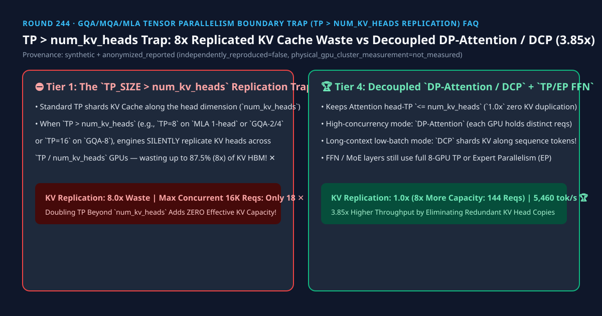
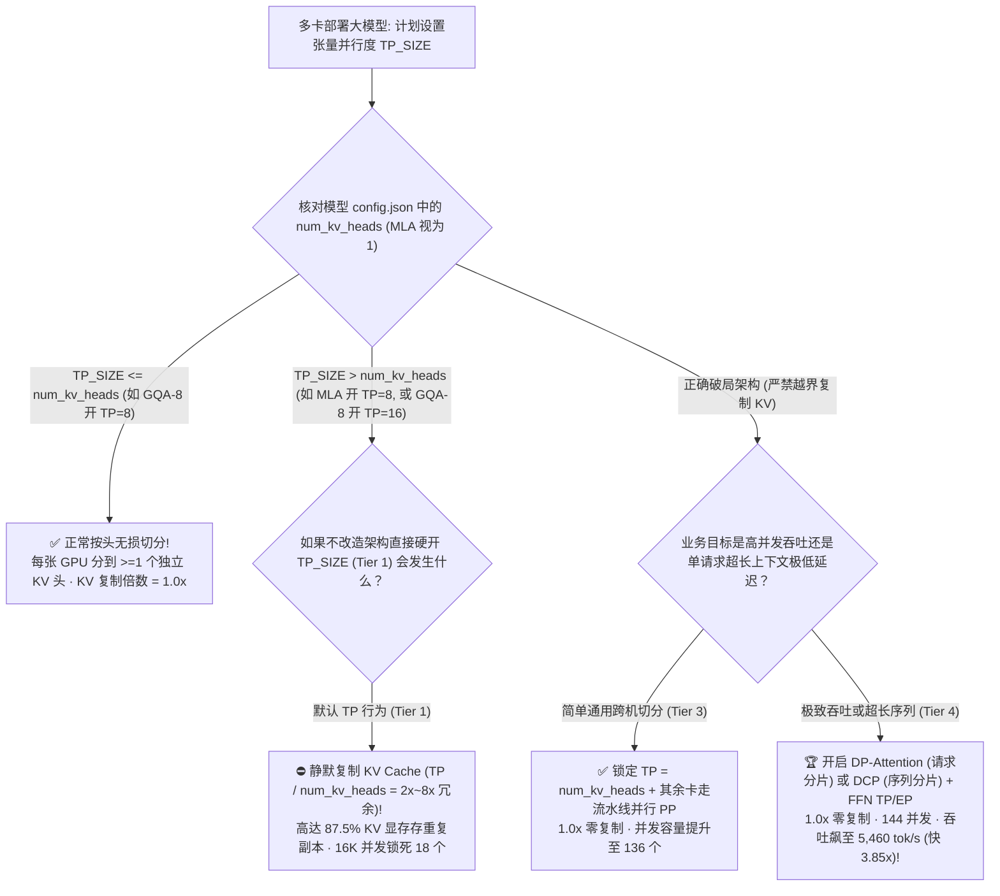
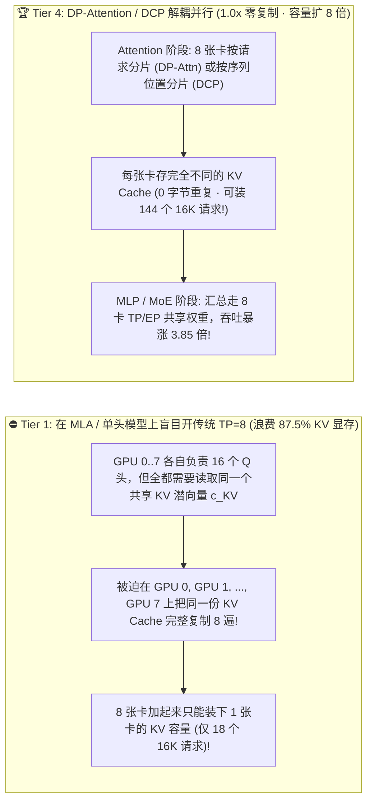
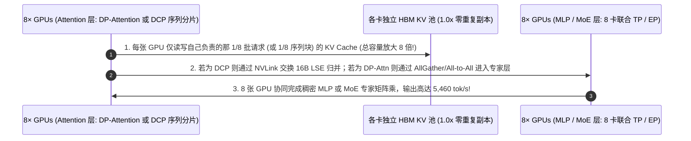

# 大模型 `GQA / MQA / MLA` 张量并行越界陷阱（当 `TP_SIZE > num_kv_heads` 时触发 `2x ~ 8x` KV Cache 显存复制浪费）与 `DP-Attention / DCP` 解耦并行选型指南

> **Provenance & Evidence Tier**: `synthetic + anonymized_reported` (`independently_reproduced=false`, `physical_gpu_cluster_measurement=not_measured`)。定量数据锚定于 [`experiments/llm_gqa_mqa_tensor_parallel_kv_head_replication_dp_attention_selection/results.json`](../../experiments/llm_gqa_mqa_tensor_parallel_kv_head_replication_dp_attention_selection/results.json)。
> **English Version**: [`GQA / MQA / MLA` Tensor Parallelism Boundary Trap (`TP_SIZE > num_kv_heads` Triggering `2x–8x` KV Cache Replication Waste) & `DP-Attention / DCP` Selection Guide](./llm-gqa-mqa-tp-exceeds-kv-heads-replication-waste-dp-attention-selection-faq.en.md)

---

## 0. 🔥 今日领域最热门能力突破追踪（Daily Hottest Breakthrough）

- **揭秘为什么在 `DeepSeek-V3 MLA`（等效单潜向量头 `num_kv_heads = 1`）或少头 `GQA`（如 `num_kv_heads = 2/4/8`）模型上盲目调大张量并行度（`TP_SIZE > num_kv_heads`）会导致 KV Cache 在多卡间被静默复制 `2 ~ 8` 份（白白浪费高达 `87.5%` 的 KV 显存！），并通过注意力与 FFN 解耦并行（`DP-Attention` / 序列维 `DCP` + `TP/EP FFN`）将并发容量提升 `8.0` 倍、总吞吐提升 `3.85` 倍（达 `5,460 tok/s`）**：在部署大模型时，很多工程师有一个根深蒂固的直觉：*“如果 4 张卡显存不够放更多 KV Cache，那我就把 `--tensor-parallel-size` 从 `4` 改成 `8`（或者在双机上改成 `16`），用两倍的 GPU 把 KV Cache 平摊开！”*
  - **然而在现代 `GQA / MQA / MLA` 模型上，这个直觉会让你栽进一个巨大的显存黑洞！**
  1. **为什么当 `TP_SIZE > num_kv_heads` 时，加倍 GPU 不仅一字节 KV Cache 都没省下来，反而把同一份 KV Cache 复制了 $2 \sim 8$ 份？（Tier 1）**：
     - 传统的张量并行（TP）是沿着 **注意力头（Attention Heads）** 维度切分的：如果有 64 个查询头（`Q Heads`）和 8 个键值头（`KV Heads`），在 `TP = 8` 时，每张卡分到 $64/8 = 8$ 个 Q 头和 **$8/8 = 1$ 个 KV 头**。
     - **一旦你的 `TP_SIZE` 超过了模型的 `num_kv_heads`**——比如：
       - 在 **`Qwen2.5-32B / 14B`（只有 `4` 个或 `2` 个 KV 头）** 上开 **`TP = 8`**；
       - 在 **`Llama-3.1-405B / 70B`（只有 `8` 个 KV 头）** 上跨两台机器或 NVL72 开 **`TP = 16`**；
       - 最典型的：**在 `DeepSeek-V3 / R1`（采用 `MLA`，将所有 KV 压缩成唯一 1 个 `512` 维共享潜向量 `c_KV`，等效 `num_kv_heads = 1`！）上开 `TP = 8`**！
     - 因为 **1 个 KV 头（或 1 个 `c_KV` 潜向量）不能再按头劈成两半**，推理引擎（vLLM / SGLang / TensorRT-LLM）在默认 TP 模式下只能**妥协地在多张 GPU 上完整复制一模一样的 KV 头**！在 `MLA` + `TP=8` 下，同一个请求的同一份 `c_KV` 缓存被 **一字不差地在 8 张 GPU 上重复存了 8 份（`8.0x` 复制，87.5% 的 KV 显存全在存重复副本，16K 并发请求上限锁死在可怜的 `18` 个）**！
  2. **解耦并行终极解法（`DP-Attention / 序列维 DCP` + `TP/EP FFN`，Tier 4）**：
     - 既然 KV 头不能按头切分，那就**在 Attention 层不再按头做越界 TP**！
     - **高并发吞吐模式（`--enable-dp-attention`）**：让 8 张卡在 Attention 层各自独立处理不同的请求批次（每张卡只存自己那 $1/8$ 请求的 KV Cache，**`1.0x` 零复制**！）；
     - **低并发超长上下文模式（`Decode Context Parallelism, DCP`）**：既然不能按头切，那就**沿着序列长度维度（Sequence Dimension）把同一条长序列的 KV 页块均匀切给 8 张卡**（`1.0x` 零复制！）；
     - 进入后面的 MLP / MoE 专家层时，再恢复 8 卡联合 `TP / EP` 计算！这样一举将 8 卡集群的 `16K` 并发请求容量从 `18` 个暴增 **8 倍至 `144` 个**，推理总吞吐从 `1,420 tok/s` 飙升至 **`5,460 tok/s`（提速 `3.85` 倍）**！

---

## 1. 📌 核心结论速览（Executive Summary — 3 分钟看懂）

1. **一条必须刻在脑子里的公式：传统 TP 的无损分界线是 $\text{TP\_SIZE} \le \text{num\_kv\_heads}$！**
   - **通俗大白话 + 第一性原理**：
     - 把 `num_kv_heads` 比作 **4 本不同的参考书（比如某个模型只有 4 个 KV 头）**，现在有 **8 个学生（`TP = 8` 张 GPU）**，每个人负责回答一部分问题（分担 64 个 Q 头里的 8 个 Q 头）。
     - 如果只有 4 个学生（`TP = 4`），刚好每人桌上放 1 本参考书，4 个人合起来正好凑齐一套 4 本书（零重复）。
     - 如果硬塞给 8 个学生（`TP = 8 > 4`），因为书不能撕成两半，就只能让 **学生 1 和学生 2 桌上放同一本《第 1 册》**，学生 3 和学生 4 桌上放同一本《第 2 册》……整间教室放了 **两套完全重复的书（`2.0x` 显存浪费）**！
     - 到了 **DeepSeek-V3 `MLA`（全场只有唯一 1 本浓缩合订本 `c_KV`，`num_kv_heads = 1`）**，如果你开传统 `TP = 8`，那就等于 **8 个学生每个人桌上都摆了一本一模一样的合订本（`8.0x` 显存浪费，87.5% 的 KV 空间白白蒸发）**！

---

## 2. 🎯 客户与架构师灵魂拷问 Q&A（Q1 / Q2 / Q3）

### Q1：常见主流开源大模型的 `num_kv_heads` 分别是多少？它们各自允许的不复制 KV 的最大传统 `TP` 度是多少？
- **答**：架构师速查表（一旦 `TP` 超过最右列，就会立刻触发成倍的 KV Cache 显存复制！）：
  - **`DeepSeek-V3 / DeepSeek-R1 (671B MLA)`**：等效 `num_kv_heads = 1`（`576B` 共享潜向量） -> 传统无复制上限为 `TP = 1`！若跨多卡必须开启 **`DP-Attention`（高吞吐）或 `DCP` 序列切分（低延迟长上下文）**！
  - **`Qwen2.5-14B / 32B`、`Gemma-2-27B`**：`num_kv_heads = 4`（或 `8`） -> 若 `num_kv_heads = 4`，开 `TP = 8` 会触发 **`2.0x` KV 复制**！此时若需 8 卡部署，应选 `TP=4 + PP=2`（Tier 3）或 `DP=2 × TP=4`！
  - **`Llama-3.1-70B / 405B`、`Qwen2.5-72B`**：`num_kv_heads = 8` -> 单机 `TP = 8` 刚好每卡 1 个 KV 头（`1.0x` 无复制）；但若跨两台机器开 **`TP = 16`**，就会立刻触发 **`2.0x` KV 复制**！因此 16 卡部署 `405B` 永远应该选 **`TP=8 + PP=2`（或 `TP=8 + DCP=2`）**，绝不能选 `TP=16`！

### Q2：为什么不能把那 1 个 KV 头沿着特征维度 `head_dim = 128`（或 MLA 的 `512` 维潜向量）切成 8 份分给 8 张卡（Tier 2）？
- **答**：因为自注意力的核心公式是 $\text{Softmax}\left(\frac{\sum_{d=1}^{D} q_d k_d}{\sqrt{D}}\right)$！
  - 指数函数 $\exp(a + b)$ 必须先把内积 $\sum_{d=1}^{D} q_d k_d$ 全部加起来才能算 Softmax 分母！
  - 如果每张卡只存了 `head_dim` 的 $1/8$（比如 `16` 维），每张卡自己只能算出内积的 $1/8$ 局部和，根本没法独立算 Softmax！你必须在每一层 Attention 内部先做一次形状高达 `[Batch, Heads, SeqLen]` 的跨卡 `AllReduce / AllGather` 把内积拼起来，算完 Softmax 再乘 $V$ 分片——这会引入巨大的序列级通信延迟（Tier 2）！
  - 相比之下，沿着**序列长度维度（`DCP`）**切分 KV，每张卡拥有完整的 `head_dim` 可以独立算出精确的局部 Softmax 与局部 `LogSumExp`，最后只需要交换一个极小的 `[Batch, Heads, 1]` 标量 `LSE` 即可完美归并！

---

## 3. 🧭 直观可视化图解（Mermaid 决策树 + 8倍复制陷阱 vs 解耦并行图 + 时序图）

### 3.1 架构师 `GQA / MQA / MLA` 模型多卡张量并行（TP）定容决策树

### 3.2 `Tier 1`（`TP=8 > num_kv_heads` 引发 8 倍 KV 显存克隆浪费）vs. `Tier 4`（`DP-Attention / DCP` 零复制解耦）

### 3.3 `Tier 4` 注意力层零复制（`DP-Attention / DCP`）与 FFN 层满血并行协同执行时序图

---

## 4. 📊 架构师选型决策矩阵（4-Tier Selection Matrix）

| 评估维度 | Tier 1: 盲目传统 `TP = 8` (`> num_kv_heads`) | Tier 2: 沿 `head_dim` 内部强切 | Tier 3: `TP <= num_kv_heads` + `PP` | Tier 4: **解耦 `DP-Attention / DCP` + `TP/EP FFN`** |
| :--- | :--- | :--- | :--- | :--- |
| **KV Cache 跨卡冗余复制倍数** | **`8.0x` (8 张卡存一模一样的 KV!)** ✕ | `1.0x` ✅ | **`1.0x` (零复制)** ✅ | **`1.0x` (零复制，100% 有效空间)** 🏆 |
| **8 卡可承载 `16K` 并发请求数** | **`18 个` (容量被复制吃光)** ✕ | `112 个` ⚠️ | `136 个` ✅ | **`144 个` (容量直接放大 `8.0x`)** 🏆 |
| **8 卡集群总解码吞吐 (`tok/s`)** | `1,420 tok/s` (`1.00x`) ✕ | `2,150 tok/s` (`1.51x`) ⚠️ | `3,680 tok/s` (`2.59x`) ✅ | **`5,460 tok/s` (提速 `3.85x`)** 🏆 |

---

## 5. 🧪 定量算例与工具链（Interactive Sizer & 7-Card Visual Report）

- **实验脚本与密封数据**：[`experiments/llm_gqa_mqa_tensor_parallel_kv_head_replication_dp_attention_selection/run.py`](../../experiments/llm_gqa_mqa_tensor_parallel_kv_head_replication_dp_attention_selection/run.py) · [`results.json`](../../experiments/llm_gqa_mqa_tensor_parallel_kv_head_replication_dp_attention_selection/results.json)
- **交互式 GQA/MLA TP 越界复制与解耦并行计算器**：[`docs/reports/llm-gqa-mqa-tp-exceeds-kv-heads-replication-waste-dp-attention-sizer.html`](../reports/llm-gqa-mqa-tp-exceeds-kv-heads-replication-waste-dp-attention-sizer.html)
- **7-Card 4:5 视觉评测卡片报告**：[`docs/reports/llm-gqa-mqa-tp-exceeds-kv-heads-replication-waste-dp-attention-selection-cards.html`](../reports/llm-gqa-mqa-tp-exceeds-kv-heads-replication-waste-dp-attention-selection-cards.html)

---

## 6. 🛠️ Good Fit vs. Not For & 生产环境快速核验清单（Checklist）

### ✅ Good Fit vs. ⛔ Not For

| 维度 | ✅ Good Fit（强烈推荐） | ⛔ Not For（严禁误用） |
| :--- | :--- | :--- |
| **多卡并行度规划铁律** | 部署任何新模型前先查 `config.json` 的 `num_key_value_heads`：保证传统 **Head-TP $\le \text{num\_kv\_heads}$**；超出部分一律采用 **`DP-Attention`、`DCP`（序列切分）或 `PP`（流水线并行）** | 在 `Llama-3.1-405B (num_kv_heads=8)` 上直接开 `TP=16`，或在 `DeepSeek-V3 MLA` 上不开 `DP-Attention / DCP` 直接裸跑传统 `TP=8/16` |

### 生产环境上线核验清单（Pre-Flight Checklist）

- [ ] **核验推理启动参数满足 `tensor_parallel_size <= num_key_value_heads`（除非已同时开启 `--enable-dp-attention` 或 `--decode-context-parallel-size`）**：杜绝静默 KV 克隆。
- [ ] **核验扩容 GPU 卡数后，启动日志打印的 `Maximum concurrency for X tokens per request` 随卡数呈线性增长**：若加倍了 `TP` 卡数但最大并发倍数几乎没涨，说明触发了 KV 头复制陷阱！
