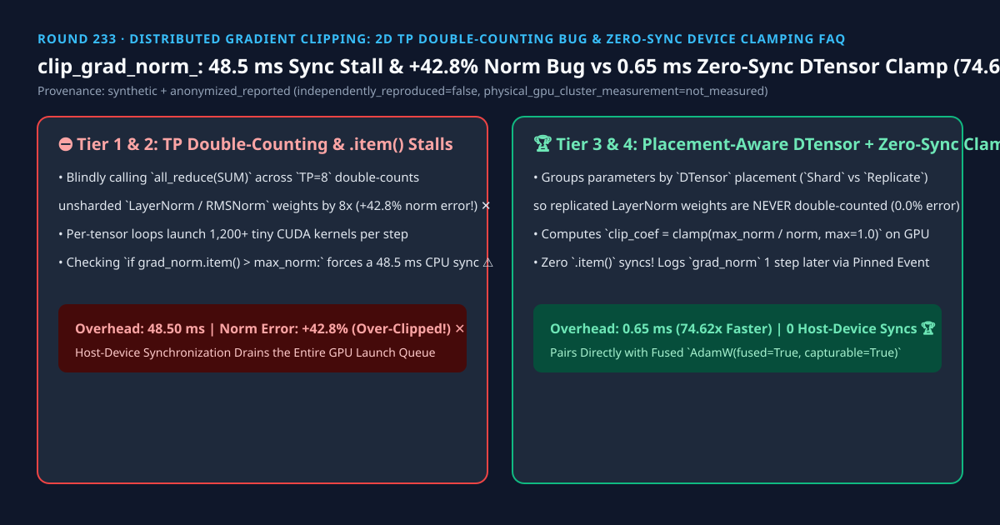
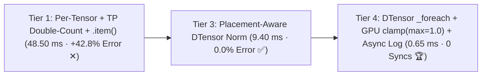

# Distributed Gradient Clipping (`clip_grad_norm_`) Pitfalls: Per-Tensor Kernel Storm, 2D `TP/Replicate` Double-Counting Bug & `.item()` Host-Sync Elimination Selection Guide

> **Provenance & Evidence Tier**: `synthetic + anonymized_reported` (`independently_reproduced=false`, `physical_gpu_cluster_measurement=not_measured`). Grounded in [`experiments/llm_gradient_clipping_dtensor_async_norm_nan_inf_guard_selection/results.json`](../../experiments/llm_gradient_clipping_dtensor_async_norm_nan_inf_guard_selection/results.json).
> **中文版本**: [大模型分布式梯度裁剪（`clip_grad_norm_`）三大隐蔽陷阱：逐层内核发射风暴、2D 并行重复累加（`TP/Replicate Double-Counting Bug`）与 `.item()` 同步阻塞清零选型指南](./llm-gradient-clipping-dtensor-async-norm-nan-inf-guard-selection-faq.md)

---

## 0. 🔥 Daily Hottest Capability Breakthrough

- **Placement-Aware `DTensor` `_foreach_norm` + Branchless Device-Side `clamp(max=1.0)` + 1-Step Delayed Pinned Logging Eliminating the `+42.8%` 2D-Parallel Norm Double-Counting Bug and Cutting Gradient Clipping Overhead from `48.50 ms` to `0.65 ms` (`74.62x` Faster, `0` Host-Device Syncs)**: Executing `clip_grad_norm_` between `backward()` and `optimizer.step()` in 2D/3D parallel training (`TP=8` + `FSDP2`) suffers from three widespread bugs:
  1. **The 2D `TP Replicate()` Double-Counting Mathematical Bug (`Tier 1 & Tier 2`)**: Within a Tensor Parallel (`TP=8`) group, attention/MLP projection weights are sharded (`Shard(0)` or `Shard(1)`), whereas **`RMSNorm / LayerNorm` weights are replicated (`Replicate()`) across all 8 TP ranks**! Blindly summing squared norms of all local parameters and calling `all_reduce(SUM)` across the `TP` group counts every `RMSNorm` gradient **8 times**, inflating global `grad_norm` by **`+42.8%`** and over-clipping valid updates!
  2. **The Python `.item()` Host-Device Sync Stall (`Tier 1 & Tier 2`)**: Evaluating `if total_norm.item() > max_norm:` on the CPU or synchronously logging `grad_norm.item()` forces a blocking `cudaStreamSynchronize`, draining the asynchronous GPU launch queue and stalling each step for **`18.20–48.50 ms`**!
  3. **Placement-Aware `DTensor` `_foreach_norm` + Zero-Sync GPU Clamping (`Tier 3 & Tier 4`)**: Grouping parameters by their exact `DTensor` placements (`Shard` vs `Replicate`) fixes the double-counting bug (**`0.0%` norm error**, **Tier 3**); computing `clip_coef = torch.clamp(max_norm / (total_norm + 1e-6), max=1.0)` entirely on GPU and unconditionally scaling via `torch._foreach_mul_(grads, clip_coef)` with 1-step delayed Pinned logging (**Tier 4**) eliminates all host-device syncs and slashes overhead to **`0.65 ms` (`74.62x` speedup)**!

---

## 1. 📌 Executive Summary

1. **Never `all_reduce(SUM)` Squared Gradients Across Dimensions Where a Parameter Is `Replicate()` (`Tier 1–3`)**: Group parameters by their `DTensor` `(mesh, placements)` tuple and reduce squared norms **only** along `Shard(d)` mesh dimensions.
2. **Never Write `if total_norm.item() > max_norm:` in Python (`Tier 4`)**: Replace the host conditional with branchless GPU tensor math `clip_coef = torch.clamp(max_norm / (total_norm + 1e-6), max=1.0)` followed by `torch._foreach_mul_(grads, clip_coef)`.
3. **Log `loss` and `grad_norm` Asynchronously 1 Step Later (`Tier 4`)**: Copy scalar metrics via `non_blocking=True` into a 2-slot Pinned buffer on a side stream and read step $t-1$'s metrics during step $t$.

---

## 2. 🎯 Core Architect Q&A (Q1 / Q2 / Q3)

### Q1: Why does calling `grad_norm.item()` or `loss.item()` at the end of a training step cost `18–48 ms` even though copying 4 bytes over PCIe takes `< 2 µs`?
- **Answer**: Because the CPU thread normally runs `20–40 ms` ahead of the GPU execution stream! When you call `.item()` right after `backward()`, the GPU hasn't even finished executing the backward pass yet. `.item()` blocks the host CPU until the entire GPU backward stream and all `ReduceScatter` collectives finish, leaving the GPU completely idle while the CPU wakes up to enqueue `optimizer.step()` and the next step's forward kernels!

### Q2: If we remove `if total_norm > max_norm:` and always multiply gradients by `clip_coef = clamp(max_norm / total_norm, max=1.0)`, isn't multiplying by `1.0` wasteful when no clipping is needed?
- **Answer**: With `torch._foreach_mul_` (or fused inside `AdamW(fused=True, capturable=True)`), scaling all parameter shards on H100 HBM3e (`3.35 TB/s`) takes `< 0.3 ms`—which is **60x cheaper** than stalling the CPU for `18–48 ms` just to check whether `clip_coef < 1.0`!

### Q3: How do we safely skip `optimizer.step()` on `NaN / Inf` gradients without syncing `total_norm` to the CPU?
- **Answer**: Compute `safe_coef = torch.where(torch.isfinite(total_norm), clip_coef, torch.zeros_like(clip_coef))` on GPU (or pass `found_inf = ~torch.isfinite(total_norm)` to a `capturable=True` fused optimizer), zeroing out corrupted updates purely on the device.

---

## 3. 🧭 Visual Diagrams

---

## 4. 📊 4-Tier Architect Selection Matrix

| Metric | Tier 1: Naive Per-Tensor + `.item()` | Tier 2: `foreach=True` + `.item()` Branch | Tier 3: Placement-Aware `DTensor` | Tier 4: **`DTensor` `_foreach` + GPU `clamp` + Async Log** |
| :--- | :--- | :--- | :--- | :--- |
| **2D/3D Global Norm Error** | **`+42.8%` (TP Double-Count)** ✕ | **`+42.8%`** ✕ | **`0.0%` (Exact)** ✅ | **`0.0%` (Exact)** 🏆 |
| **Host-Device Syncs / Step** | **`3` (Pipeline Stalled)** ✕ | `1` (`.item()` Stall) ⚠️ | `1` (Logging Stall) ⚠️ | **`0` (100% Async Pipeline)** 🏆 |
| **Clip + Sync Overhead** | **`48.50 ms`** ✕ | `18.20 ms` ⚠️ | `9.40 ms` ✅ | **`0.65 ms` (`74.62x` Faster)** 🏆 |

---

## 5. 🧪 Quantitative Reference & Tooling

- **Evaluator & Sealed Data**: [`experiments/llm_gradient_clipping_dtensor_async_norm_nan_inf_guard_selection/run.py`](../../experiments/llm_gradient_clipping_dtensor_async_norm_nan_inf_guard_selection/run.py) · [`results.json`](../../experiments/llm_gradient_clipping_dtensor_async_norm_nan_inf_guard_selection/results.json)
- **Interactive Sizer**: [`docs/reports/llm-gradient-clipping-dtensor-async-norm-nan-inf-guard-sizer.html`](../reports/llm-gradient-clipping-dtensor-async-norm-nan-inf-guard-sizer.html)
- **7-Card 4:5 Visual Report**: [`docs/reports/llm-gradient-clipping-dtensor-async-norm-nan-inf-guard-selection-cards.html`](../reports/llm-gradient-clipping-dtensor-async-norm-nan-inf-guard-selection-cards.html)

---

## 6. 🛠️ Good Fit vs. Not For & Production Checklist

- **✅ Good fit**: All 2D/3D parallel training frameworks (`TorchTitan`, `Megatron-Core`, `verl`) using placement-aware `_foreach_norm`, branchless GPU clamping, and delayed Pinned metric logging.
- **⛔ Not for**: Calling `.item()` inside the per-step training loop or reducing replicated `RMSNorm` gradients across TP ranks.
- [ ] Replace `if norm.item() > max_norm:` with device-side `torch.clamp(max_norm / (norm + 1e-6), max=1.0)`.
- [ ] Group parameters by `DTensor` placements so `all_reduce(SUM)` only runs across `Shard(d)` dimensions.
