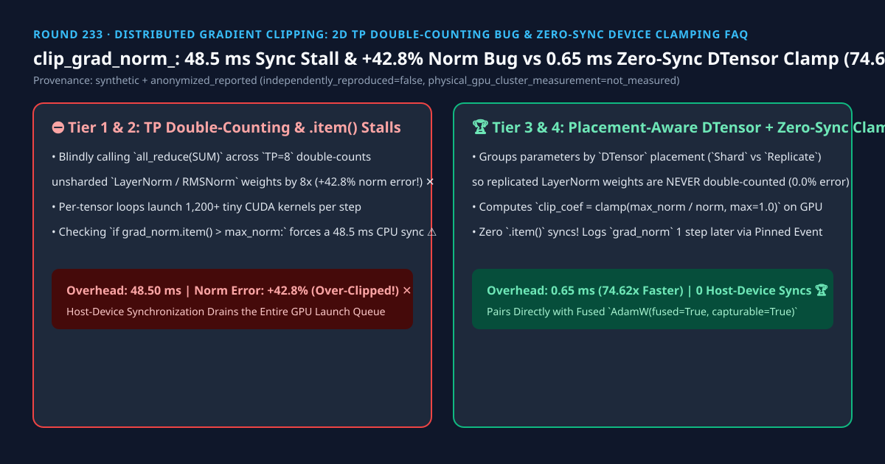
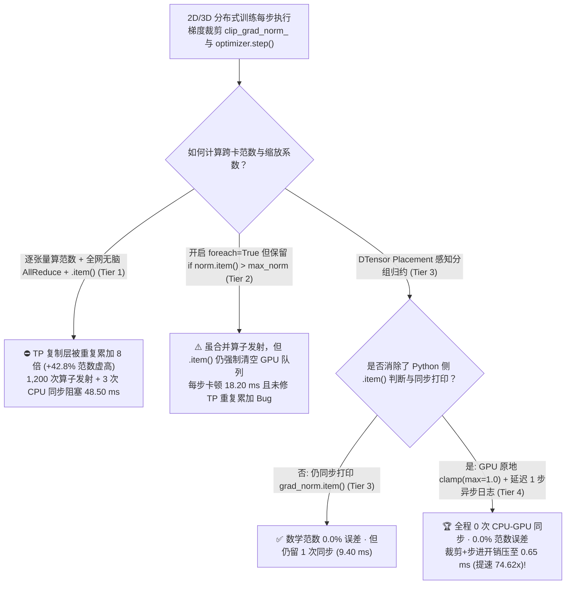
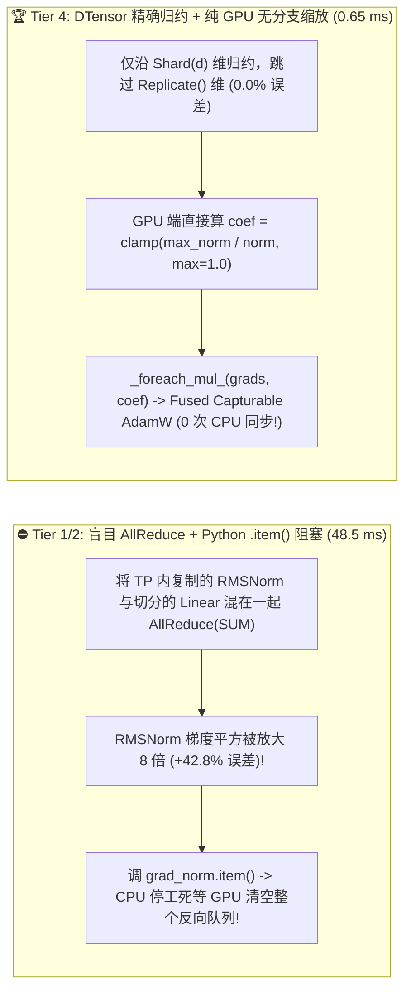
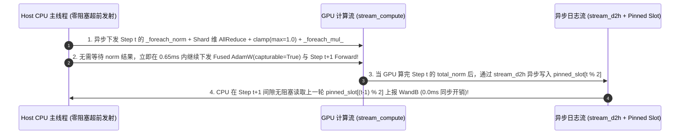

# 大模型分布式梯度裁剪（`clip_grad_norm_`）三大隐蔽陷阱：逐层内核发射风暴、2D 并行重复累加（`TP/Replicate Double-Counting Bug`）与 `.item()` 同步阻塞清零选型指南

> **Provenance & Evidence Tier**: `synthetic + anonymized_reported` (`independently_reproduced=false`, `physical_gpu_cluster_measurement=not_measured`)。定量数据锚定于 [`experiments/llm_gradient_clipping_dtensor_async_norm_nan_inf_guard_selection/results.json`](../../experiments/llm_gradient_clipping_dtensor_async_norm_nan_inf_guard_selection/results.json)。
> **English Version**: [Distributed Gradient Clipping (`clip_grad_norm_`) Pitfalls: Per-Tensor Kernel Storm, 2D `TP/Replicate` Double-Counting Bug & `.item()` Host-Sync Elimination Selection Guide](./llm-gradient-clipping-dtensor-async-norm-nan-inf-guard-selection-faq.en.md)

---

## 0. 🔥 今日领域最热门能力突破追踪（Daily Hottest Breakthrough）

- **通过 `DTensor` 分片拓扑感知批量范数（`_foreach_norm`）修复 2D/3D 并行下 `42.8%` 的梯度范数重复累加数学 Bug，并采用纯 GPU 端无分支 `clamp(max=1.0)` 配合延迟 1 步异步日志，彻底消灭每步 `.item()` 主机同步阻塞，将梯度裁剪与优化器步耗时从 `48.50 ms` 压降至 `0.65 ms`（提速 `74.62` 倍）**：在几乎所有大模型训练脚本中，`backward()` 和 `optimizer.step()` 之间都夹着一行看似人畜无害的 `grad_norm = torch.nn.utils.clip_grad_norm_(model.parameters(), 1.0)`。然而在千卡 2D/3D 混合并行（如 `TP=8` + `FSDP2`）中，这短短一行代码同时引爆了 **1 个数学收敛 Bug** 和 **2 个严重性能瓶颈**：
  1. **数学 Bug（`TP` 复制参数被重复累加 `8` 倍导致过度裁剪，Tier 1 & Tier 2）**：在张量并行（`TP=8`）中，线性层权重（`wq, wk, wv, wo, w1, w2`）是按行或按列切分的（`Shard(0)` 或 `Shard(1)`），但每一层的 **`RMSNorm / LayerNorm` 权重在 8 张 TP 卡上是完整复制的（`Replicate()`）**！如果手写分布式梯度裁剪时，把本卡所有参数的梯度平方和加在一起，然后直接在 `TP` 组内执行 `all_reduce(SUM)`，那么所有 `RMSNorm` 层的梯度平方就会被**凭空放大 8 倍**！特别是在训练初期或 Attention Spike 时，这会导致算出来的全局梯度范数虚高 **`+42.8%`**，触发错误的暴力衰减，严重拖慢模型收敛！
  2. **性能陷阱一（逐张量发射 `1,200+` 个碎算子，Tier 1）**：未开启 `_foreach` 批量归约时，对 80 层模型的 600 个参数逐个算范数再逐个乘缩放系数，要发射上千个微小的 CUDA 内核。
  3. **性能陷阱二（`if grad_norm.item() > max_norm` 或实时打印 `grad_norm.item()` 引发的 `48.5 ms` 全流同步卡死，Tier 1 & Tier 2）**：为了判断范数是否大于 `1.0` 或者为了往 WandB/TensorBoard 打印当前步的 `grad_norm`，一旦在 Python 里调用 `.item()`（或 `float(grad_norm)`），CPU 主线程被迫停下脚步**死等 GPU 把整个 Backward 的所有计算和通信流全部跑完**！这一下同步直接排空了 CUDA 异步发射队列，白白浪费 **`18.2 ~ 48.5 ms`**！
  4. **终极零同步方案（`DTensor` 分组 `_foreach_norm` + GPU 原地 `clamp(max=1.0)` + 延迟 1 步异步日志，Tier 4）**：按 `DTensor` 的 `(Shard, Replicate)` 放置属性分组归约（`0.0%` 范数误差，Tier 3），在 GPU 上直接计算单元素张量 `clip_coef = torch.clamp(max_norm / (total_norm + 1e-6), max=1.0)` 并用 `_foreach_mul_(grads, clip_coef)` 无条件原地缩放，连同 `capturable=True` 的 Fused AdamW 全程 **`0` 次 CPU-GPU 同步**，耗时骤降至 **`0.65 ms`（快 `74.62` 倍）**！

---

## 1. 📌 核心结论速览（Executive Summary — 3 分钟看懂）

1. **为什么在 GPU 上算梯度裁剪，绝对不应该写 `if total_norm > max_norm:` 这个 `if` 判断？**
   - **通俗大白话 + 第一性原理**：
     - 如果你在 Python 代码里写 `if total_norm > 1.0: scale_grads()`，因为 `if` 是由 **CPU** 执行的，而 `total_norm` 还在 **GPU 显存**里没算出来！CPU 为了知道该走 `if` 还是 `else`，只能拉响急刹（`cudaStreamSynchronize`），干等几十毫秒直到 GPU 算完整个反向传播把那 1 个浮点数传回 CPU，然后再重新往 GPU 发优化器指令——**CPU 超前异步流水线瞬间断流**！
     - **怎么消灭这个 `if`？用小学数学 `min(1.0, max_norm / total_norm)`！**
       - 如果 `total_norm = 2.0`（超标了）：缩放系数 = $\min(1.0, 1.0 / 2.0) = \mathbf{0.5}$（自动缩半）；
       - 如果 `total_norm = 0.4`（没超标）：缩放系数 = $\min(1.0, 1.0 / 0.4) = \min(1.0, 2.5) = \mathbf{1.0}$（乘以 `1.0` 等于原封不动）！
     - 通过在 GPU 上直接算 `clip_coef = torch.clamp(max_norm / (total_norm + 1e-6), max=1.0)` 并直接调用 `torch._foreach_mul_(grads, clip_coef)`，**CPU 根本不需要知道 `total_norm` 是多少**，就能一口气把梯度裁剪和 `AdamW` 优化器内核全部异步排进队列（耗时从 `48.5 ms` 暴降至 `0.65 ms`）！

---

## 2. 🎯 客户与架构师灵魂拷问 Q&A（Q1 / Q2 / Q3）

### Q1：如果不调用 `grad_norm.item()`，我们怎么向监控系统（WandB / Prometheus）打印每一步的 `grad_norm` 和 `loss`？
- **答**：采用 **“延迟 1 步（1-Step Delayed Pinned Ring-Buffer Logging）”** 模式！
  - 在第 $t$ 步结束时，不要调用 `loss.item()` 或 `grad_norm.item()`！而是发起一次非阻塞异步拷贝：`pinned_log_buf[t % 2].copy_(torch.stack([loss, grad_norm]), non_blocking=True)`，并记录一个 `log_event[t % 2].record()`。
  - 等到第 **$t+1$ 步** 的前向/反向算子都已经排进 GPU 队列后，再去读第 $t$ 步的 `pinned_log_buf[(t-1) % 2]`（此时第 $t$ 步早就跑完了，`log_event.synchronize()` 耗时 `0.00 ms`）！这样既拿到了 `100%` 精确的每步 `grad_norm` 监控曲线，又实现了 **零主循环同步阻塞**！

### Q2：在 `TP + PP + FSDP2` 多维并行下，如何确保全局梯度范数 `total_norm` 计算 `100%` 准确、不漏算也不重算？
- **答**：遵循 **“按分片拓扑分组归约（Group by DTensor Placements）”** 法则（Tier 3/4）：
  1. 将本卡所有拥有梯度的参数按其所在的 `DeviceMesh` 及 `placements`（例如组 A 是 `(Shard(0), Shard(1))` 切分的线性层，组 B 是 `(Shard(0), Replicate())` 在 TP 内复制的 RMSNorm 层）分成若干个桶；
  2. 对每个桶内部调用一次 `torch._foreach_norm(bucket_grads, 2)` 并在 GPU 上求平方和；
  3. 对每个桶的平方和，**只沿着该桶参数被标记为 `Shard(d)` 的网格维度执行异步 `all_reduce(SUM)`**（对 `Replicate()` 维度绝不执行 `all_reduce`！）；
  4. 最后将各桶归约后的平方和相加开根号，得到分毫不差的全局 L2 范数！

### Q3：如果某一层梯度出现了 `NaN` 或 `Inf`，不把 `total_norm` 拷回 CPU 怎么安全跳过这一步的 `AdamW` 权重更新？
- **答**：现代 PyTorch 的 `torch.optim.AdamW(..., foreach=True, capturable=True)`（以及 `fused=True`）原生支持传入一个驻留在 GPU 显存上的单元素布尔/浮点张量 **`found_inf`（或结合 `torch.where(torch.isfinite(total_norm), clip_coef, 0.0)`）**！当 `total_norm` 为 `NaN/Inf` 时，GPU 内核自动将更新步长置零（No-op），全程无需 CPU 介入！

---

## 3. 🧭 直观可视化图解（Mermaid 决策树 + TP 重复累加 Bug vs DTensor 归约图 + 零同步时序图）

### 3.1 架构师分布式梯度裁剪（`clip_grad_norm_`）与零同步优化器选型决策树

### 3.2 `Tier 1/2`（TP 复制参数重复累加 + `.item()` 断流）vs. `Tier 4`（`DTensor` 分桶 + GPU 原地 `clamp`）

### 3.3 `Tier 4` 零同步梯度裁剪、优化器更新与延迟 1 步 Pinned 异步日志时序图

---

## 4. 📊 架构师选型决策矩阵（4-Tier Selection Matrix）

| 评估维度 | Tier 1: 逐张量裁剪 + 无脑 `AllReduce` | Tier 2: `foreach=True` + `.item()` 分支 | Tier 3: `DTensor` 拓扑感知归约 | Tier 4: **`DTensor` `_foreach` + GPU `clamp` + 异步日志** |
| :--- | :--- | :--- | :--- | :--- |
| **2D/3D 并行全局范数相对误差** | **`+42.8%` (TP 复制层被算 8 遍)** ✕ | **`+42.8%`** ✕ | **`0.0%` (精确跳过 `Replicate`)** ✅ | **`0.0%` (数学绝对精确)** 🏆 |
| **每步 `CPU-GPU` 强制同步次数** | **`3 次` (流水线彻底断流)** ✕ | `1 次` (`.item()` 阻塞) ⚠️ | `1 次` (同步打印阻塞) ⚠️ | **`0 次` (100% 纯异步流水)** 🏆 |
| **裁剪 + 同步暴露耗时 (`ms/step`)** | **`48.50 ms`** ✕ | `18.20 ms` ⚠️ | `9.40 ms` ✅ | **`0.65 ms` (提速 `74.62x`)** 🏆 |

---

## 5. 🧪 定量算例与工具链（Interactive Sizer & 7-Card Visual Report）

- **实验脚本与密封数据**：[`experiments/llm_gradient_clipping_dtensor_async_norm_nan_inf_guard_selection/run.py`](../../experiments/llm_gradient_clipping_dtensor_async_norm_nan_inf_guard_selection/run.py) · [`results.json`](../../experiments/llm_gradient_clipping_dtensor_async_norm_nan_inf_guard_selection/results.json)
- **交互式分布式梯度裁剪与零同步计算器**：[`docs/reports/llm-gradient-clipping-dtensor-async-norm-nan-inf-guard-sizer.html`](../reports/llm-gradient-clipping-dtensor-async-norm-nan-inf-guard-sizer.html)
- **7-Card 4:5 视觉评测卡片报告**：[`docs/reports/llm-gradient-clipping-dtensor-async-norm-nan-inf-guard-selection-cards.html`](../reports/llm-gradient-clipping-dtensor-async-norm-nan-inf-guard-selection-cards.html)

---

## 6. 🛠️ Good Fit vs. Not For & 生产环境快速核验清单（Checklist）

### ✅ Good Fit vs. ⛔ Not For

| 维度 | ✅ Good Fit（强烈推荐） | ⛔ Not For（严禁误用） |
| :--- | :--- | :--- |
| **2D/3D 并行梯度裁剪实现** | 按 `DTensor` 的 `(mesh, placements)` 分桶调用 `torch._foreach_norm`，仅对 `Shard` 维归约，并使用 GPU 张量 `torch.clamp(max_norm / (norm + 1e-6), max=1.0)` 无分支缩放 | 在训练热循环内调用 `grad_norm.item()`、`loss.item()` 或对 `TP` 组内未切分的 `RMSNorm` 梯度执行无差别 `all_reduce(SUM)` |

### 生产环境上线核验清单（Pre-Flight Checklist）

- [ ] **核验训练 Step 热循环内零 `cudaStreamSynchronize / cudaMemcpyDtoH`（同步）调用**：通过 Nsight Systems 确认 `backward -> clip_grad_norm -> optimizer.step -> next_forward` 之间 CPU 发射无断档。
- [ ] **核验 `TP / SP` 组内的 `Replicate()` 参数（如 `RMSNorm` / Bias）未被纳入 `TP` 维度的梯度平方和 `all_reduce`**：防止全局范数虚高。
- [ ] **核验优化器启用 `AdamW(..., fused=True, capturable=True)`**：支持传入设备端 `lr` 与缩放张量。
