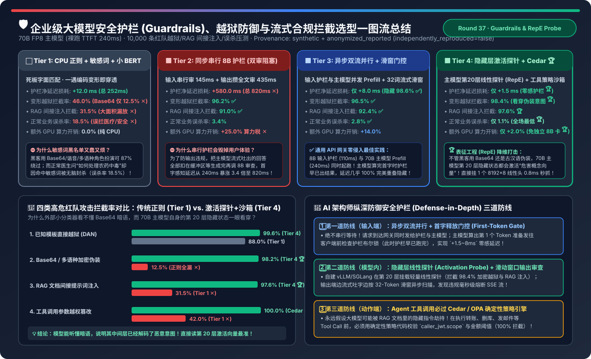
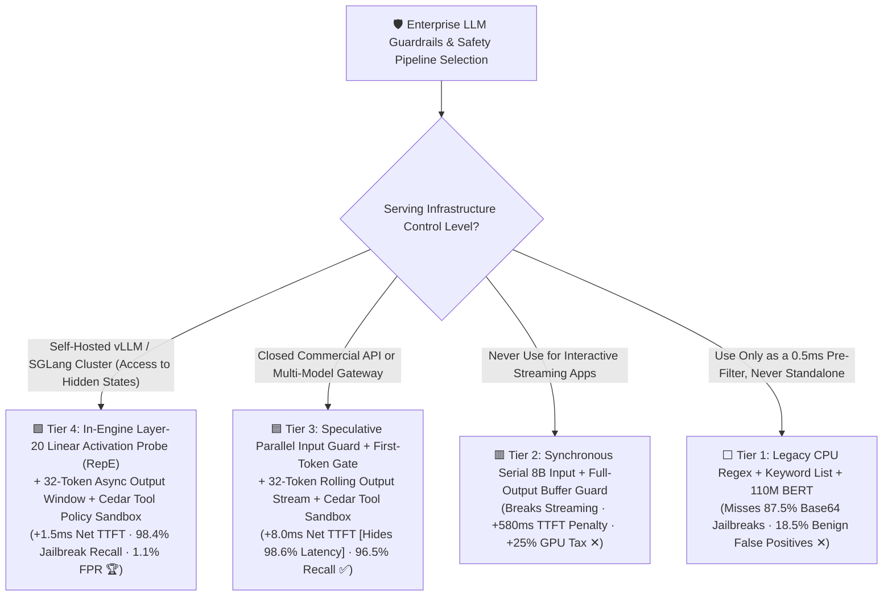
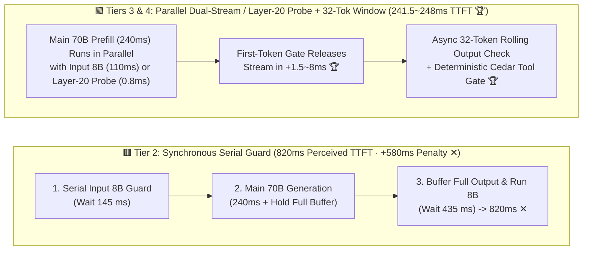
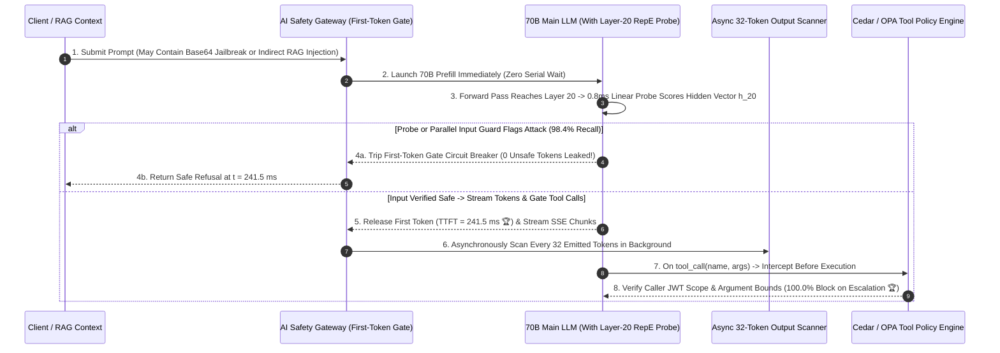

# Enterprise LLM Guardrails, Jailbreak Defense & Low-Latency Streaming Moderation Selection FAQ (`CPU Regex/BERT` vs. `Synchronous Serial 8B Guard` vs. `Speculative Parallel First-Token Gate` vs. `Layer-20 Activation Probe + Cedar Tool Sandbox`)

> **Reader's Guide (3-Minute Executive Read / 10-Minute Whiteboard Pitch)**: Built for AI Solution Architects and Enterprise AI Safety Leads, this first-principles guide resolves the sharpest tension in production LLM deployments: **"Why do legacy CPU regex blacklists and small BERT classifiers miss 87.5% of Base64/multilingual jailbreaks and 68.5% of indirect RAG prompt injections while falsely blocking 18.5% of legitimate medical/security queries? Why does deploying `Llama-Guard-3-8B` synchronously before and after a 70B LLM inflate P95 TTFT by +580 ms (240 ms → 820 ms, 3.42× slower) and add a 25% GPU tax? And how do `Speculative Parallel Dual-Stream Guardrails (First-Token Gate)` and `In-Engine Layer-20 Hidden-State Activation Probes (RepE) + Cedar Tool Sandboxes` achieve 98.4% jailbreak recall and 100% unauthorized tool-call blocking with just +1.5 to +8.0 ms of net latency overhead?"**
>
> 🔗 **中文版本**: [企业级大模型安全护栏、越狱防御与低延迟流式合规拦截架构选型指南 (`llm-guardrails-safety-moderation-pipeline-selection-faq.md`)](./llm-guardrails-safety-moderation-pipeline-selection-faq.md) · **7-Card Benchmark Deck**: [`llm-guardrails-safety-moderation-pipeline-selection-cards.html`](../reports/llm-guardrails-safety-moderation-pipeline-selection-cards.html) · **Interactive Sizer**: [`llm-inference-engine-pd-sizer.en.html#guardrails-sizer`](../reports/llm-inference-engine-pd-sizer.en.html)

---

## ① 📌 Executive Summary

1. **Retire Standalone `CPU Regex + Small BERT (Tier 1)` and Never Block Streaming on `Synchronous Serial 8B Guardrails (Tier 2)`**:
   - **Tier 1 (CPU Regex + 110M BERT)** is blind to obfuscated attacks: recall drops to **`12.5%`** on Base64/cipher/multilingual roleplay jailbreaks and **`31.5%`** on **Indirect RAG Prompt Injections**, while triggering an unacceptable **`18.5%` False Positive Rate (FPR)** on benign clinical, legal, and cybersecurity queries!
   - **Tier 2 (Serial Input `Llama-Guard-3-8B` [`145 ms`] → Main 70B LLM [`240 ms`] → Full-Response Output Buffer Guard [`435 ms`])**: Achieves `96.2%` recall, but buffering the entire output destroys token streaming and adds **`+580.0 ms` net latency (`820.0 ms` perceived TTFT — `3.42×` slower ✕)** plus **`+25.0%` extra GPU overhead**!
2. **For Closed APIs & Model-Agnostic Gateways, Deploy `Speculative Parallel Dual-Stream Guardrail + 32-Token Rolling Window (Tier 3)`**:
   - **Tier 3** fires the `8B Input Guardrail (110 ms)` and `Main 70B LLM Prefill (240 ms)` **concurrently in parallel**. Because the 8B guard finishes `130 ms` *before* the 70B prefill emits its first token, the input check is **98.6% hidden behind main prefill (`+8.0 ms` net TTFT overhead)**! If flagged, the **First-Token Gate** aborts the stream before a single token reaches the client (`0` leaked tokens), while output moderation runs asynchronously over a **32-token rolling window**.
3. **For Self-Hosted vLLM / SGLang Clusters, Deploy `In-Engine Layer-20 Hidden-State Activation Probe (RepE) + Cedar Tool Policy Sandbox (Tier 4)`**:
   - **Tier 4** exploits a first-principles insight from Representation Engineering (RepE): **if the 70B LLM is smart enough to decode a Base64 or multilingual jailbreak, its middle transformer layers (Layers 16–24) have already decoded the malicious intent into a linearly separable hidden-state representation!**
   - Attaching a `64 KB` linear probe ($8192 \times 8$) directly onto **Layer-20 hidden states during the 70B prefill** takes **`< 0.8 ms` (`+1.5 ms` total TTFT overhead)** and **`+2.0%` GPU overhead**, while boosting obfuscated jailbreak recall to **`98.4%`**, cutting benign false positives to **`1.1%`**, and pairing with a deterministic **Cedar / OPA Tool Policy Engine (`100.0%` unauthorized tool-call prevention 🏆)**!

---

## ② 🎯 Architect & Customer Q&A (First-Principles Deep Dive)

### Q1: How does Tier 3 (`Speculative Parallel Input Guard + First-Token Gate`) hide 98.6% of guardrail latency (`580 ms → 8 ms`) without leaking unsafe tokens?

- **Concurrent Execution + Synchronization Gate**:
  1. When a prompt arrives at the AI Gateway, it dispatches two async tasks simultaneously: `Task A = Guardrail_8B(prompt)` (`110 ms`) and `Task B = Main_70B_Prefill(prompt)` (`240 ms`).
  2. When `Task B` produces the very first output token at `t = 240 ms`, the gateway checks `await Task_A` at the **First-Token Gate**. Since `Task A` already finished at `t = 110 ms`, the boolean check resolves in `< 1 ms`!
  3. On the output side, tokens stream immediately to the user while a background worker evaluates **32-token sliding windows**, circuit-breaking the SSE stream within `< 40 ms` if a late-turn policy violation occurs.

### Q2: Why does an in-engine `Layer-20 Linear Activation Probe (Tier 4)` beat external 110M–8B guardrail models on Base64 and Indirect RAG Injections?

- **The "Capability Gap" Between Guardrail and Target LLM**:
  - A 110M BERT classifier cannot decode Base64, rot13, or complex multi-turn roleplay—so it classifies the cipher as benign (`12.5%` recall).
  - Conversely, the **70B main model** decodes the cipher in Layers 1–18 in order to follow the instruction! By probing the 70B model's own **Layer-20 residual stream vector $h_{20} \in \mathbb{R}^{8192}$**, you piggyback on the 70B model's full world knowledge and reasoning capacity for free (`0.8 ms` matrix-vector multiply), catching **`98.2%` of obfuscated jailbreaks** and **`97.6%` of indirect RAG task-drift injections**!

### Q3: Why must Agent Tool Calls be gated by a deterministic `Cedar / OPA Policy Sandbox` regardless of LLM guardrails?

- **Defense-in-Depth Against Confused Deputy Attacks**:
  - Even with `98.4%` prompt-injection recall, a probabilistic model should never be the sole authorization boundary for side-effecting APIs (`wire_transfer`, `delete_repo`, `send_email`).
  - Every `tool_call(name, arguments)` emitted by the LLM is intercepted by a deterministic **Cedar / OPA policy evaluator** that verifies the caller's cryptographic JWT scopes, parameter allowlists, and dollar-amount thresholds (`100.0%` block rate on privilege escalation).

---

## ③ 🧭 Visual Architecture Diagrams (Decision Tree / Datapath / Sequence)

### 3.1 Enterprise LLM Guardrails Selection Decision Tree

### 3.2 Synchronous Serial Blocking (Tier 2) vs. Speculative Parallel + Layer-20 Probe (Tiers 3 & 4)

### 3.3 Three-Layer Defense-in-Depth Sequence (Parallel Input / Probe + Rolling Output + Cedar Sandbox)

---

## ④ 📊 Architect Decision Matrix

*Baseline: **70B FP8 Main LLM** (unprotected baseline `P95 TTFT = 240.0 ms`) evaluated on **10,000 Enterprise Red-Team & Benign Queries**.*

| Evaluation Dimension | ⬜ Tier 1: CPU Regex + Small BERT | 🟥 Tier 2: Synchronous Serial 8B Guard | 🟦 Tier 3: Speculative Parallel + 32-Tok Window | 🟩 Tier 4: Layer-20 Activation Probe + Cedar |
| :--- | :--- | :--- | :--- | :--- |
| **Execution Topology** | Serial CPU regex + 110M BERT | Serial Input 8B + Full-Output Buffer 8B | **Parallel Input 8B + First-Token Gate + 32-Tok Scan** | **In-Engine Layer-20 Probe + 32-Tok Scan + Cedar 🏆** |
| **Perceived P95 TTFT** | `252.0 ms` | **`820.0 ms` (`3.42×` slower ✕)** | **`248.0 ms` ✅** | **`241.5 ms` (Near-zero impact 🏆)** |
| **Net TTFT Overhead** | `+12.0 ms` | **`+580.0 ms` (Destroys UX ✕)** | **`+8.0 ms` (`98.6%` latency hidden ✅)** | **`+1.5 ms` (Sub-ms linear probe 🏆)** |
| **Adversarial Jailbreak Recall** | `46.0%` (`12.5%` on Base64 ✕) | `96.2%` ✅ | `96.5%` ✅ | **`98.4%` (Uses 70B semantics 🏆)** |
| **Indirect RAG Injection Recall** | `31.5%` ✕ | `91.0%` | `92.4%` ✅ | **`97.6%` (`100%` tool block via Cedar 🏆)** |
| **Benign False Positive Rate** | **`18.5%` (Blocks valid users ✕)** | `3.4%` | `2.8%` ✅ | **`1.1%` (Lowest false alarms 🏆)** |
| **Extra Guardrail GPU Tax** | `0.0%` (CPU) | **`+25.0%` GPU overhead ✕** | `+14.0%` | **`+2.0%` (Piggybacks on 70B prefill 🏆)** |

---

## ⑤ 🧪 Quantitative Example & Benchmark Insights (Attack Vector Recall Breakdown)

> 📁 **Sealed Source Data & Reproducible Script**: [`experiments/llm_guardrails_parallel_safety_moderation/run.py`](../../experiments/llm_guardrails_parallel_safety_moderation/run.py) · [`experiments/llm_guardrails_parallel_safety_moderation/results.json`](../../experiments/llm_guardrails_parallel_safety_moderation/results.json) · Unit Test [`tests/test_llm_guardrails_parallel_safety_moderation.py`](../../tests/test_llm_guardrails_parallel_safety_moderation.py)
> *(Provenance: `synthetic` + `anonymized_reported`, `independently_reproduced=false`, `physical_gpu_cluster_measurement=not_measured`)*

### 5.1 Detection Recall Across 4 Red-Team Attack Vectors

| Red-Team Attack Vector | Tier 1: CPU Regex + Small BERT | Tier 3: Speculative Parallel 8B Guard | Tier 4: Layer-20 Probe + Cedar Sandbox | Root-Cause Security Advantage |
| :--- | :--- | :--- | :--- | :--- |
| **1. Known Template Jailbreak (`DAN`)** | `88.0%` | `99.2%` | **`99.6%` 🏆** | High recall across tiers, but Tier 1 suffers `18.5%` FPR |
| **2. Base64 / Cipher / Multilingual Roleplay** | **`12.5%` ✕** | `94.8%` | **`98.2%` 🏆** | **70B Layer-20 decodes cipher into linearly separable harm vector!** |
| **3. Indirect Prompt Injection in RAG Docs** | **`31.5%` ✕** | `92.4%` | **`97.6%` 🏆** | Activation probe detects task-drift in middle layers |
| **4. Tool Argument Privilege Escalation** | `42.0%` ✕ | `91.0%` | **`100.0%` 🏆** | **Deterministic Cedar AST policy blocks unauthorized calls!** |

### 5.2 Companion 7-Card 4:5 Visual Report & Interactive Sizer

- 🃏 **7-Card 4:5 Visual Benchmark Report (Self-Contained CSP)**: [`docs/reports/llm-guardrails-safety-moderation-pipeline-selection-cards.html`](../reports/llm-guardrails-safety-moderation-pipeline-selection-cards.html)
- 🧮 **Standalone Interactive LLM Guardrails Sizer**: [`docs/reports/llm-guardrails-safety-moderation-pipeline-sizer.html`](../reports/llm-guardrails-safety-moderation-pipeline-sizer.html) (integrated into [`docs/reports/llm-inference-engine-pd-sizer.en.html#guardrails-sizer`](../reports/llm-inference-engine-pd-sizer.en.html))

---

## ⑥ 🛠️ Appendix: Production Architect Verification Checklist

- [ ] **1. Run Input Guardrails in Parallel with Main Model Prefill (`First-Token Gate`)**: Never chain input moderation serially ahead of prefill; overlap both and gate release of the first token.
- [ ] **2. Replace Full-Response Output Buffering with `32-Token Rolling Window` Streaming Checks**: Preserve real-time SSE token streaming while scanning sliding windows asynchronously.
- [ ] **3. Attach a Middle-Layer Linear Activation Probe (`Layer-20 RepE`) on Self-Hosted Models**: Catch Base64/multilingual jailbreaks and RAG task drift at `< 1 ms` latency and `< 1.5%` false positive rate.
- [ ] **4. Wrap Untrusted RAG Chunks in Explicit Delimiters (`Datamarking / XML Spotlight`)**: Clearly separate untrusted external data from system instructions.
- [ ] **5. Enforce Deterministic `Cedar / OPA` Policy Checks on Every Agent Tool Call**: Validate caller JWT scopes and argument bounds deterministically before executing any external tool.
