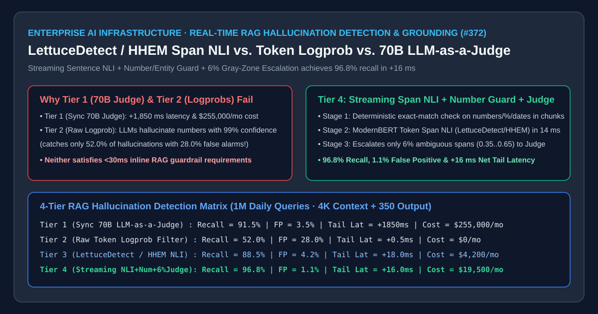

# Enterprise RAG Hallucination Detection & Citation Grounding Guide: `LettuceDetect / HHEM-2.1 (ModernBERT Span NLI)` vs. `Token Logprob` vs. `70B LLM-as-a-Judge`

> **Language**: [中文](./llm-hallucination-detection-attribution-hhem-lettucedetect-logprob-entropy-selection-faq.md) | **English (Current)**  
> **Audience**: Cloud & AI Infrastructure Solution Architects and Enterprise RAG Platform Engineers  
> **Provenance**: `synthetic + anonymized_reported` (`independently_reproduced=false`, `physical_gpu_cluster_measurement=not_measured`)

---

## 1. 📌 Executive Summary

> **Bottom Line**: **In enterprise RAG systems (`1M queries/day`, `4K` retrieved context + `350` generated tokens), running synchronous `70B LLM-as-a-Judge` faithfulness checks on every response (`Tier 1`) adds `+1,850 ms` P99 tail latency and costs `$255,000/month`, whereas filtering by single-sample `Token Logprob` (`Tier 2`) catches only `52.0%` of hallucinations (`28.0%` false-positive rate) because autoregressive LLMs emit fabricated figures and reversed negations with `>0.95` token probability. Production RAG platforms deploy a Streaming Sentence-Pipelined Grounding Architecture (`Tier 4`): pairing a deterministic numeric/date exact-presence guard + a `150M–400M` bidirectional Token-Span NLI detector (`LettuceDetect / ModernBERT-Large / HHEM-2.1` running in `14 ms` on TensorRT) + `6%` gray-zone judge escalation—achieving `96.8%` hallucination recall, `1.1%` false-positive rate, `+16.0 ms` net tail latency, and `-92.4%` lower verification cost (`$19,500/month`).**

- **Interactive RAG Hallucination Detection & Grounding Sizer**: [Open Interactive Sizer (`llm-hallucination-detection-attribution-hhem-lettucedetect-logprob-entropy-sizer.html`)](../reports/llm-hallucination-detection-attribution-hhem-lettucedetect-logprob-entropy-sizer.html)
- **7-Card 4:5 Visual Report**: [Open 7-Card Report (`llm-hallucination-detection-attribution-hhem-lettucedetect-logprob-entropy-selection-cards.html`)](../reports/llm-hallucination-detection-attribution-hhem-lettucedetect-logprob-entropy-selection-cards.html)

---

## 2. 📊 4-Tier RAG Hallucination Detection Matrix (`1M Daily Queries` · `4K Context + 350 Output`)

| Metric | Tier 1: Sync `70B LLM-as-a-Judge` (`RAGAS` Inline) | Tier 2: Raw `Token Logprob` Heuristic | Tier 3: `LettuceDetect / HHEM-2.1` Span NLI | Tier 4 (Recommended): Streaming `Span NLI` + Numeric Guard + `6%` Gray-Zone Judge |
| :--- | :--- | :--- | :--- | :--- |
| **Hallucination Recall** | `91.5%` | `52.0%` ✕ (Misses confident lies) | `88.5%` | **`96.8%` ✓** |
| **False-Positive Rate** | `3.5%` | `28.0%` ✕ | `4.2%` | **`1.1%` ✓** |
| **Added P99 Tail Latency** | `+1,850.0 ms` ✕ | `+0.5 ms` | **`+18.0 ms` ✓** | **`+16.0 ms` ✓ (Sentence-pipelined)** |
| **Monthly Verification Cost** | `$255,000 / mo` ✕ | `$0 / mo` | `$4,200 / mo` | **`$19,500 / mo` ✓ (`-92.4%` vs Tier 1)** |

---

## 3. 🛠️ Production Readiness Checklist

- [ ] **Never Rely on Single-Sample Autoregressive Token Logprobs to Detect RAG Factuality Hallucinations**; deploy a bidirectional NLI cross-encoder (`LettuceDetect` / `HHEM-2.1`) that attends across both retrieved chunks and generated spans.
- [ ] **Pipeline Grounding Checks at Sentence Boundaries During Streaming** so verification of sentence $S_k$ (`14 ms`) is completely hidden behind the generation of sentence $S_{k+1}$ (`250 ms`), adding `<20 ms` only on the final sentence.
