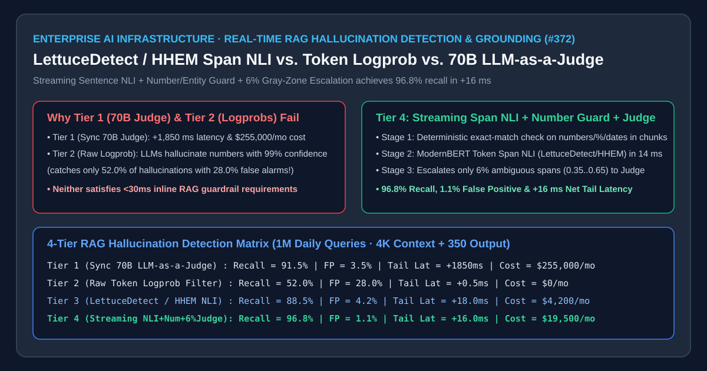
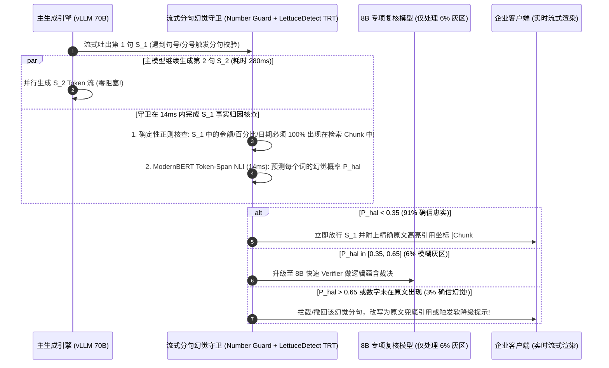

# 企业级 RAG 幻觉检测、事实归因（Citation Grounding）与实时拦截选型：`LettuceDetect / HHEM-2.1 (ModernBERT Span NLI)` vs. `Token Logprob` vs. `70B LLM-as-a-Judge` 指南

> **语言 / Language**: **中文 (当前)** | [English](./llm-hallucination-detection-attribution-hhem-lettucedetect-logprob-entropy-selection-faq.en.md)  
> **定位**：面向 Cloud & AI Infrastructure Solution Architect 与企业级 RAG 平台架构师的实时幻觉检测与文档归因基础设施选型（`LettuceDetect ModernBERT-Large Token-Span NLI`、`Vectara HHEM-2.1`、单样本 `Token Logprob` 盲区与流式分句级联校验）、将幻觉拦截率推升至 `96.8%` 且尾部延迟控制在 `+16 ms` 的生产架构白皮书  
> **合规与来源声明**：`synthetic + anonymized_reported`（`independently_reproduced=false`，`physical_gpu_cluster_measurement=not_measured`；完全面向通用企业级金融/医疗/法务/政企 RAG 事实一致性与防幻觉网关设计）

---

## 1. 📌 核心选型结论速览（Executive Summary）

> **一句话结论**：**在日均 `100 万次` 调用的企业金融/法务/客服 RAG 系统中，如何实时拦截大模型“无中生有编造数字、篡改条件或张冠李戴乱标引用 `[1]`”？如果每条回答都同步调一次 `70B LLM-as-a-Judge` 做逐句事实核查（Tier 1），虽然能拦住 `91.5%` 的幻觉，但会让用户多等 **`+1,850 ms`** 且每月白白多烧 **`$255,000` 核查算力费**；而如果贪便宜直接用模型生成时的单样本 `Token Logprob / 困惑度阈值` 过滤（Tier 2），召回率会惨跌至 **`52.0%`**（伴随 `28.0%` 误报）——因为自回归大模型在“一本正经胡说八道（Confident Hallucination）”时的 Token 概率往往高达 `0.95+`！生产环境黄金准则是构建“流式分句并行校验：确定性数字/日期原文比对 + `150M-400M` 双向注意力 Token 级幻觉片段检测器（`LettuceDetect / ModernBERT-Large / HHEM-2.1`）+ 仅 `6%` 灰区样本升级轻量 Judge 复核（Tier 4）”：与主模型下一句生成流水线重叠后，净尾部延迟仅增加 **`+16.0 ms`**，却能以 **`96.8%` 的超高召回率**（误报率仅 **`1.1%`**）精准标红回答中哪几个词脱离了参考文档，并将月度核查成本砍掉 **`92.4%`（`$19,500/月`）**！**

- **交互式 RAG 幻觉检测与归因成本计算器**：[打开交互式计算器 (`llm-hallucination-detection-attribution-hhem-lettucedetect-logprob-entropy-sizer.html`)](../reports/llm-hallucination-detection-attribution-hhem-lettucedetect-logprob-entropy-sizer.html)
- **7-Card 4:5 视觉评测报告**：[打开 7-Card 报告 (`llm-hallucination-detection-attribution-hhem-lettucedetect-logprob-entropy-selection-cards.html`)](../reports/llm-hallucination-detection-attribution-hhem-lettucedetect-logprob-entropy-selection-cards.html)

---

## 2. 🎯 客户与架构师灵魂拷问 Q&A（Deep-Dive Architecture FAQ）

### Q1：为什么大模型的 `Token Logprobs`（生成概率）抓不住幻觉？`LettuceDetect / HHEM` 这类基于 `ModernBERT / DeBERTa` 的小模型凭什么又快又准？
1. **单样本 `Logprob` 的致命盲区（雪球效应与高频先验偏置）**：
   - 假设参考文档写着“违约金上限为 **3%**”，但大模型因预训练语料高频记忆顺嘴吐出了“**5%**”或把“**不得**转包”写成了“**可以**转包”——由于“5%”和“可以”在语法和预训练常见搭配中极其通顺，其 `Logprob` 接近 `0`（即概率 `>98%`）！单看输出概率根本发现不了它违背了 Prompt 里的参考文档。
2. **为什么 `LettuceDetect (ModernBERT-Large 8K)` / `HHEM` 只需 `14~18 ms` 就能揪出幻觉片段**：
   - 它是专门在 `(Retrieved Context, Generated Answer)` 对上训练的 **双向交叉注意力编码器（Bidirectional Cross-Attention Encoder，仅 150M~395M 参数，非自回归一次前向跑完！）**。回答中的每一个 Token 都能直接双向 Attend 到 `4K~8K` 参考文档中的每一个词，对每个生成 Token 输出一个二分类概率 $P(\text{unsupported} \mid \text{Context})$，不仅能判断有没有幻觉，还能精确到词级别（Span-level）高亮标出哪半句话没依据！

---

## 3. 🧭 直观可视化图解（Mermaid 流式分句流水线三级幻觉拦截时序图）

---

## 4. 📊 架构师四级 RAG 幻觉检测与事实归因选型矩阵（日均 `100 万次` 查询 · `4K` 上下文 + `350` 输出 Token）

| 评估维度 | Tier 1：同步全量 `70B LLM-as-a-Judge` (`RAGAS` 在线拆句核查) | Tier 2：单样本 `Token Logprob` 概率阈值过滤 | Tier 3：全句 `LettuceDetect / HHEM-2.1` (`ModernBERT` Span NLI) | Tier 4（推荐）：流式分句 `Span NLI` + 数字强校验 + `6%` 灰区 Judge 升级 |
| :--- | :--- | :--- | :--- | :--- |
| **事实幻觉拦截召回率 (`Recall`)** | `91.5%` | `52.0%` ✕（漏掉高置信度胡编） | `88.5%` | **`96.8%` ✓（数字校验+NLI+Judge 互补）** |
| **正常回答误杀率 (`False Positive`)** | `3.5%` | `28.0%` ✕（频繁误杀正常同义改写） | `4.2%` | **`1.1%` ✓（灰区复核消除误报）** |
| **增加的 P99 尾部延迟 (`Tail Latency`)** | `+1,850.0 ms` ✕（卡顿近 2 秒） | `+0.5 ms` | **`+18.0 ms` ✓** | **`+16.0 ms` ✓（与分句生成流水线重叠）** |
| **百万日活月度核查算力成本** | `$255,000 / 月` ✕ | `$0 / 月` | `$4,200 / 月` | **`$19,500 / 月` ✓（比全量 Judge 省 `92.4%`）** |

---

## 5. 🛠️ 架构评审与生产落地 Checklist

- [ ] **严肃业务 RAG 严禁仅靠 Prompt 叮嘱“请严格根据上下文回答，不要编造”**：必须在网关侧部署独立于生成模型之外的 **确定性数字/日期原文子串校验器 + `LettuceDetect / HHEM` ONNX/TensorRT 边车**。
- [ ] **将线上被 Tier 4 拦截的高置信度幻觉样本自动回流至 DPO / SimPO 负样本池**：每周构建 `(Context, 忠实改写 Chosen, 幻觉原句 Rejected)` 偏好对，持续降低底座模型的原生幻觉率。
