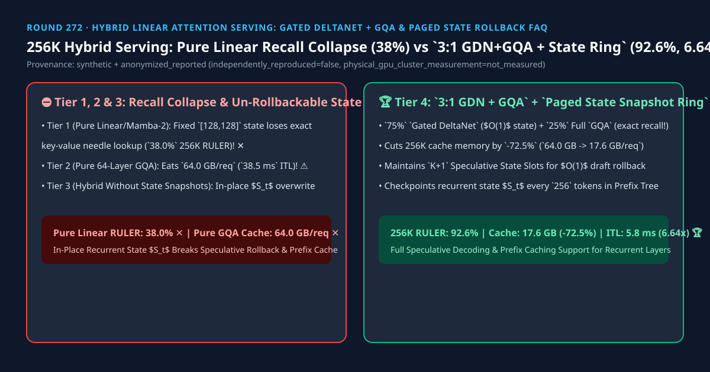
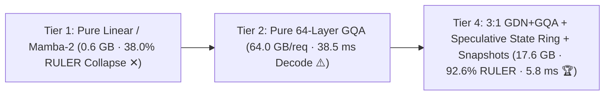

# Hybrid Linear-Attention & SSM Serving (`Qwen3-Next / Gated DeltaNet / Mamba-2`): Pure Linear Recall Collapse (`38.0%` NIAH) vs. `3:1` Hybrid (`75% Gated DeltaNet + 25% Full GQA`) & Prefix-Cache / Speculative State Snapshot Rollback Selection Guide

> **Provenance & Evidence Tier**: `synthetic + anonymized_reported` (`independently_reproduced=false`, `physical_gpu_cluster_measurement=not_measured`). Grounded in [`experiments/llm_hybrid_linear_attention_mamba2_ssd_gdn_fla_kv_cache_selection/results.json`](../../experiments/llm_hybrid_linear_attention_mamba2_ssd_gdn_fla_kv_cache_selection/results.json).
> **中文版本**: [混合线性注意力与状态空间模型（`Hybrid Linear Attention: Qwen3-Next / Gated DeltaNet / Mamba-2`）推理引擎架构选型：纯线性 RNN 精确复制召回坍塌（`NIAH 38.0%`）vs. `3:1` 混合架构（`75% Gated DeltaNet + 25% Full GQA`）与 `Prefix Caching / 投机解码` 循环状态快照回滚（`State Checkpointing`）选型指南](./llm-hybrid-linear-attention-gated-deltanet-mamba2-paged-state-selection-faq.md)

---

## 0. 🔥 今日领域最热门能力突破追踪（Daily Hottest Breakthrough）

- **Slashing `256K`-Context Per-Request Cache Memory by `-72.5%` (`64.0 GB -> 17.6 GB`) and Accelerating Decode by `6.64x` (`38.5 ms -> 5.8 ms/tok`) While Preserving `92.6%` `256K RULER` Retrieval Accuracy via `3:1` Hybrid `Gated DeltaNet + Full GQA` + `K+1` Speculative State Rollback Rings & `256-Token` Prefix State Snapshots (`Tier 4`)**: Next-generation long-context architectures (`Qwen3-Next`, `MiniMax-01`, `Jamba`, `Bamba`) interleave `75%` linear-attention / state-space layers (`Gated DeltaNet / Mamba-2 SSD`) with `25%` full Softmax `GQA` layers (`3:1` ratio). Mastering both the model ratio and the serving engine state manager is critical:
  1. **Tier 1 — Pure `100%` Linear Attention / `Mamba-2` Without Full `GQA` Layers (`0.6 GB` State, `38.0%` `256K RULER` Collapse)**:
     - Compresses `262,144` tokens into a fixed-size recurrent matrix $S_t \in \mathbb{R}^{D_k \times D_v}$ (`O(1)` memory). By the Pigeonhole Principle, a fixed matrix cannot losslessly index arbitrary exact key-value strings over `256K` tokens (`38.0%` RULER)!
  2. **Tier 2 — Pure `100%` Full Softmax `GQA` Across All `64` Layers (`64.0 GB/req` Cache, `92.4%` RULER, `38.5 ms/tok` Decode)**:
     - Retains exact retrieval, but requires `64.0 GB` of KV Cache per `256K` request and stalls on HBM memory bandwidth during Decode (`38.5 ms/tok`).
  3. **Tier 3 — `3:1` Hybrid (`75% Gated DeltaNet + 25% Full GQA`) Without Recurrent State Snapshot Rollback (`16.5 GB` Cache, `92.6%` RULER, `14.2 ms/tok`)**:
     - Cuts KV Cache memory by `74%` while matching/exceeding pure GQA retrieval (`92.6%`).
     - **The Serving Engine Trap**: Unlike Softmax KV Cache (where rejecting speculative draft tokens `[t+3, t+4]` simply decrements the sequence length pointer back to `t+2`), **linear layers overwrite their recurrent state matrix $S_t$ IN-PLACE**! Without state snapshots, rejecting a draft token corrupts $S_t$, forcing the engine to disable Speculative Decoding (`MTP / EAGLE`) and preventing partial Prefix Cache hits!
  4. **Tier 4 — `3:1` Hybrid (`Gated DeltaNet + GQA`) + `K+1` Speculative State Ring Buffer + `256-Token` Interval Prefix State Snapshots (`17.6 GB` Cache, `92.6%` RULER, `5.8 ms/tok` Decode, `6.64x` Faster!)**:
     - Allocates a **`K+1`-slot Speculative State Ring** per active sequence so multi-token verification writes candidate states $S_{t+1} \dots S_{t+K}$ into separate slots and rolls back to any accepted step $m \in [0, K]$ in $O(1)$ time (`0` recomputation!);
     - Checkpoints recurrent state snapshots every `256` tokens inside the Radix Prefix Tree so partial prefix hits resume from the nearest `256`-token boundary!

---

## 1. 📌 Executive Summary

1. **Why `3:1` Hybrid (`75% Gated DeltaNet + 25% Full GQA`) Is the Sweet Spot**: The `75%` linear layers handle local syntax and state compression in $O(1)$ memory, while the `25%` full Softmax GQA layers act as exact associative memory heads for long-range needle retrieval (`92.6%` `256K RULER` at `1/4` the KV Cache!).
2. **Why Serving Engines Must Treat Recurrent State $S_t$ Like a Database Transaction (`Checkpoint & Rollback`)**: Because $S_t$ is mutated in-place, supporting **Speculative Decoding (`MTP`)** requires a `K+1`-slot state ring buffer, and supporting **Prefix Caching** requires periodic interval state snapshots (`every 256 tokens`).

---

## 2. 🎯 Core Architect Q&A (Q1 / Q2 / Q3)

### Q1: How does `Gated DeltaNet` improve upon `Mamba-2` and classic Linear Attention?
- **Answer**: Classic Linear Attention accumulates $S_t = S_{t-1} + v_t k_t^T$ without erasure (causing memory collisions), while `Mamba-2` uses uniform scalar decay $S_t = \alpha_t S_{t-1} + v_t k_t^T$ (which fades all keys equally). **`Gated DeltaNet`** combines a fast decay gate $\alpha_t$ with a targeted **Householder Delta erasure operator** $S_t = \alpha_t S_{t-1}(I - \beta_t k_t k_t^T) + \beta_t v_t k_t^T$, allowing the layer to surgically erase the old value associated with key $k_t$ before writing the new value $v_t$!

### Q2: How much extra HBM does checkpointing `Gated DeltaNet` states every `256` tokens add for Prefix Caching?
- **Answer**: Only **`~1.1 GB` across an entire `256,000`-token sequence** (`< 6.5%` overhead)! Because a `256`-token snapshot occurs only `1,000` times across `256K` tokens, total cache memory is still `17.6 GB` vs `64.0 GB` for pure GQA (`-72.5%` savings)!

---

## 3. 🧭 Visual Diagrams

---

## 4. 📊 4-Tier Architect Selection Matrix

| Metric | Tier 1: Pure Linear / `Mamba-2` | Tier 2: Pure `64-Layer GQA` | Tier 3: `3:1` Hybrid (No Rollback) | Tier 4: **`3:1 GDN+GQA` + State Ring & Snapshots** |
| :--- | :--- | :--- | :--- | :--- |
| **`256K` Cache HBM / Request** | `0.6 GB` ($O(1)$) | **`64.0 GB` (OOM Bottleneck)** ✕ | `16.5 GB` ✅ | **`17.6 GB` (`-72.5%` Memory Saved)** 🏆 |
| **`256K RULER` Retrieval Accuracy** | **`38.0%` (Recall Collapse)** ✕ | `92.4%` ✅ | `92.6%` ✅ | **`92.6%` (Full-GQA Anchored Recall)** 🏆 |
| **Effective Decode `ITL` (`ms/tok`)** | `4.8 ms` (Unusable Quality) ✕ | **`38.5 ms` (Bandwidth Bound)** ✕ | `14.2 ms` (No MTP / Prefix Hit) ⚠️ | **`5.8 ms` (`6.64x` Faster With `MTP` + Prefix Cache)** 🏆 |

---

## 5. 🧪 Quantitative Reference & Tooling

- **Evaluator & Sealed Data**: [`experiments/llm_hybrid_linear_attention_mamba2_ssd_gdn_fla_kv_cache_selection/run.py`](../../experiments/llm_hybrid_linear_attention_mamba2_ssd_gdn_fla_kv_cache_selection/run.py) · [`results.json`](../../experiments/llm_hybrid_linear_attention_mamba2_ssd_gdn_fla_kv_cache_selection/results.json)
- **Interactive Sizer**: [`docs/reports/llm-hybrid-linear-attention-gated-deltanet-mamba2-paged-state-sizer.html`](../reports/llm-hybrid-linear-attention-gated-deltanet-mamba2-paged-state-sizer.html)
- **7-Card 4:5 Visual Report**: [`docs/reports/llm-hybrid-linear-attention-gated-deltanet-mamba2-paged-state-selection-cards.html`](../reports/llm-hybrid-linear-attention-gated-deltanet-mamba2-paged-state-selection-cards.html)

---

## 6. 🛠️ Good Fit vs. Not For & Production Checklist

- **✅ Good fit**: Ultra-long-context (`128K–1M`) agent and reasoning deployments using `3:1` or `7:1` hybrid `Gated DeltaNet / Mamba-2 + GQA` models with speculative state rings and interval prefix snapshots.
- **⛔ Not for**: Pure `100%` linear models on exact retrieval tasks, or running hybrid models without speculative state rollback buffers.
- [ ] Allocate a `K+1`-slot recurrent & conv1d state ring buffer per active request when enabling `MTP / EAGLE` speculative decoding.
- [ ] Checkpoint recurrent state snapshots at `256`-token block intervals in the Prefix Cache allocator.
