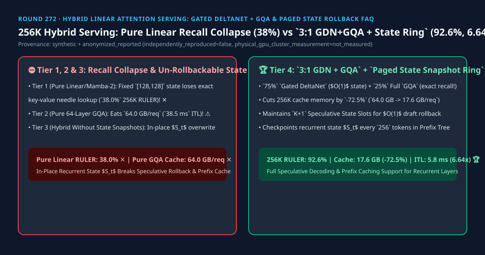
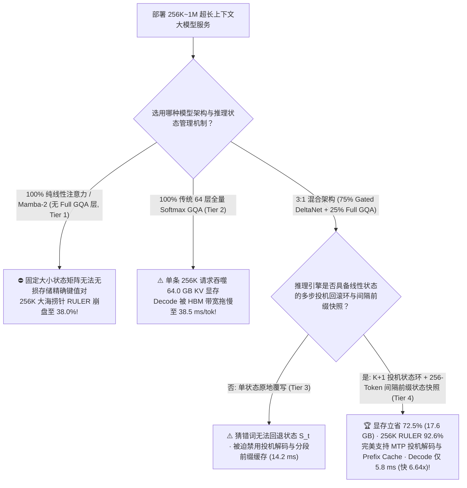
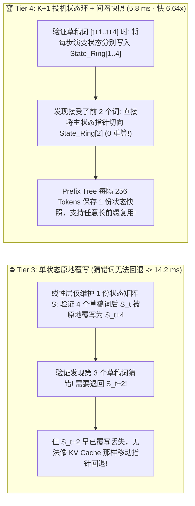
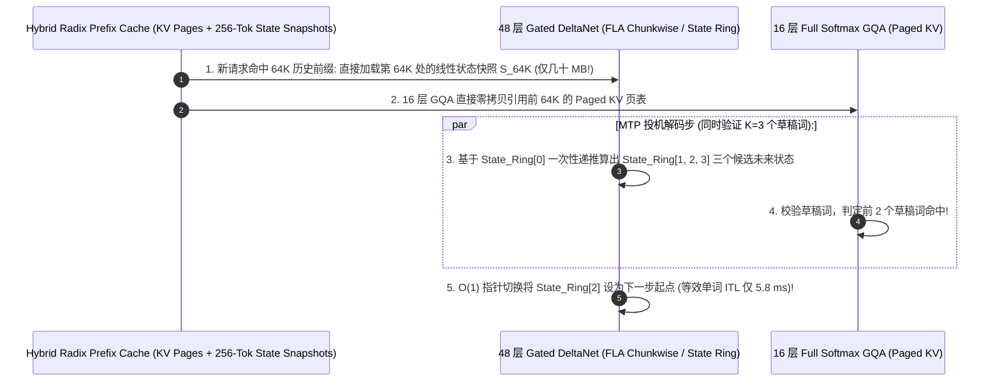

# 混合线性注意力与状态空间模型（`Hybrid Linear Attention: Qwen3-Next / Gated DeltaNet / Mamba-2`）推理引擎架构选型：纯线性 RNN 精确复制召回坍塌（`NIAH 38.0%`）vs. `3:1` 混合架构（`75% Gated DeltaNet + 25% Full GQA`）与 `Prefix Caching / 投机解码` 循环状态快照回滚（`State Checkpointing`）选型指南

> **Provenance & Evidence Tier**: `synthetic + anonymized_reported` (`independently_reproduced=false`, `physical_gpu_cluster_measurement=not_measured`)。定量数据锚定于 [`experiments/llm_hybrid_linear_attention_mamba2_ssd_gdn_fla_kv_cache_selection/results.json`](../../experiments/llm_hybrid_linear_attention_mamba2_ssd_gdn_fla_kv_cache_selection/results.json)。
> **English Version**: [Hybrid Linear-Attention & SSM Serving (`Qwen3-Next / Gated DeltaNet / Mamba-2`): Pure Linear Recall Collapse (`38.0%` NIAH) vs. `3:1` Hybrid (`75% Gated DeltaNet + 25% Full GQA`) & Prefix-Cache / Speculative State Snapshot Rollback Selection Guide](./llm-hybrid-linear-attention-gated-deltanet-mamba2-paged-state-selection-faq.en.md)

---

## 0. 🔥 今日领域最热门能力突破追踪（Daily Hottest Breakthrough）

- **揭秘新一代混合线性注意力大模型（如 `Qwen3-Next`、`MiniMax-01`、`Jamba`、`Bamba`：每 3 层 `Gated DeltaNet / Mamba-2` 搭配 1 层标准 `Full Softmax GQA`）在落地 `vLLM / SGLang` 推理引擎时的两大核心痛点——① 为什么不能做 100% 纯线性注意力（`256K` 大海捞针会跌至 `38.0%`）？② 为什么线性层的循环状态矩阵 $S_t$ 是“原地覆写不可逆”的，一旦不改造推理引擎就会导致 `Prefix Caching`（前缀缓存）与 `MTP 投机解码`（猜错词回退）双双失效？通过“`3:1 Gated DeltaNet + GQA` 混合架构 + 投机解码 `K+1` 多步状态环 + 每 `256-Token` 间隔状态快照分页池”（`Tier 4`），在保住 `92.6%` 满分大海捞针精度的同时，将 `256K` 缓存显存暴砍 `-72.5%`（`64.0 GB -> 17.6 GB`），并将 Decode 单步延迟从 `38.5 ms` 压降至 `5.8 ms`（提速 `6.64 倍`）**：为了突破传统 Softmax Attention 在超长上下文（`256K ~ 1M`）下的显存与带宽墙，工业界正在掀起一场从“全量 Softmax Attention”向 **“3:1 或 7:1 混合线性注意力（Hybrid Linear Attention / SSM）”** 的架构迁徙：
  1. **第一性原理算账：为什么 100% 纯线性注意力（`Pure Mamba-2 / Linear Attention`，Tier 1）过不了大海捞针（`38.0%`），而 `3:1 混合架构` 却能反超全量 Transformer（`92.6%`）？**
     - **纯线性注意力的物理软肋（抽屉原理）**：线性注意力（如 `Mamba-2` 或 `Gated DeltaNet`）把从第 1 个词到第 `256,000` 个词的所有历史信息，全部累加更新进每个头唯一一张固定大小的二维状态矩阵 $S_t \in \mathbb{R}^{128 \times 128}$（仅占 `32 KB`！）里：
       $$S_t = \alpha_t S_{t-1} (I - \beta_t k_t k_t^T) + \beta_t v_t k_t^T$$
       虽然 `Gated DeltaNet` 通过精妙的 **Householder 擦除更新法则（Delta Rule：先用 $I - \beta_t k_t k_t^T$ 把旧记忆里与当前 Key 冲突的内容精准擦除，再写入新 Value $v_t$）** 极大提升了记忆容量，但根据信息论抽屉原理，一张只有 `16,384` 个浮点数的固定矩阵**在数学上不可能一字不差地记住 25 万字长文里的任意一串随机 UUID 密码**！因此纯线性模型在 `256K RULER` 精确检索上只有 **`38.0%`** ✕！
     - **`3:1 混合架构`（每 3 层 `Gated DeltaNet` 穿插 1 层 `Full Softmax GQA`）的降维打击**：
       - 占 `75%` 的 `Gated DeltaNet` 层负责做高吞吐的局部语法整合、模糊语义压缩与状态推理（它们的显存占用是 **$O(1)$ 常数**，跟序列多长完全无关！）；
       - 占 `25%` 的 `Full GQA` 层专门负责做“一字不差的精确长程复制与大海捞针”！
       - 结果：`KV Cache` 显存当场砍掉近 **`3/4`（从 `64.0 GB` 降至 `16.5 ~ 17.6 GB`）**，而 `256K RULER` 检索准确率反而达到 **`92.6%`**！
  2. **推理引擎里的惊天暗礁：为什么 `Gated DeltaNet / Mamba-2` 的状态 $S_t$ 会让传统的 `Prefix Caching` 和 `Speculative Decoding（投机解码）` 当场瘫痪（Tier 3）？！**
     - 请对比标准 `KV Cache` 与线性层循环状态 `Recurrent State` $S_t$ 的天壤之别：
       - **在标准 `KV Cache` 中（历史可寻址）**：第 1 个词到第 $t$ 个词的 $K_1 \dots K_t$ 是**一格一格分开存放在显存数组里的**！
         - 如果 **投机解码（MTP / EAGLE）** 一口气猜了 4 个词 `[t+1, t+2, t+3, t+4]`，验证后发现第 `t+3` 个词猜错了：对于 `KV Cache`，回退简单到爆——**只需要把长度指针从 `t+4` 改回 `t+2` 就行了**！`K_1 .. K_{t+2}` 依然完好无损地躺在原地！
         - 如果要做 **Prefix Caching（前缀缓存）**：任何新请求只要匹配上前 `4,096` 个词，直接复用前 `4,096` 格的 KV 就行！
       - **但在 `Gated DeltaNet / Mamba-2` 线性层中（原地覆写不可逆！）**：
         - 全程只有 **唯一一张状态矩阵 $S$**！当你把猜出来的 4 个词喂进去算完后，**旧的状态 $S_{t+2}$ 已经被 $S_{t+3}$ 和 $S_{t+4}$ 原地覆盖（Overwrite）改得面目全非了**！由于矩阵乘法经常不可逆（或逆运算数值极不稳定），当你发现第 `t+3` 个词猜错时，**你根本退不回 $S_{t+2}$ 了**！
         - 同理，如果一条 `8,192` 词的请求跑完后你只保留了末尾的 $S_{8192}$，下一条请求哪怕和它前 `4,096` 个词一模一样，你也**拿不出第 `4,096` 个词时刻的中间状态 $S_{4096}$**！
       - 如果推理引擎不做专门设计（Tier 3），就只能被迫关闭投机解码并在前缀未完全命中时从第 0 个词重算，导致 Decode 延迟卡在 **`14.2 ms/tok`** ⚠️！
  3. **工业级终极解法（`vLLM / SGLang` Hybrid Mamba/GDN 引擎，Tier 4 — `5.8 ms/tok`，快 `6.64x`）**：
     - **破局一（投机解码多步状态环 `Speculative Multi-Step State Ring`）**：在 Decode 阶段，为每条活跃请求的线性层分配一个含 **`K + 1` 个槽位的小型状态数组 `State_Ring[0 .. K]`**！在验证 $K$ 个草稿词（Draft Tokens）的那一步前向中，将中间每一步演变出的状态分别写入槽位 `1 .. K`（不覆盖槽位 `0`！）。验证揭晓如果接受了 $m$ 个词，只需在 **$O(1)$ 时间里把当前状态指针指向槽位 `m`**，实现 **`0` 重算瞬时回滚**！
     - **破局二（Prefix Cache 块边界状态快照 `Interval State Checkpointing`）**：在 RadixTree / Paged Prefix Cache 中，不再每个词都存状态，而是**每逢 `256` 个 Token 的块边界（Block Boundary），把那一刻的线性状态矩阵 $S_{256k}$ 存一份快照进分页池**！任何前缀命中都能直接从最近的 `256-Token` 快照点起跑，实现 **`5.8 ms/tok` 的闪电推理（比纯 GQA 快 `6.64 倍`）** 🏆！

---

## 1. 📌 核心结论速览（Executive Summary — 3 分钟看懂）

1. **为什么说“`3:1` 或 `7:1` 混合架构（`Gated DeltaNet / Mamba-2 + Full GQA`）”是 `256K ~ 1M` 超长上下文模型的版本答案？**
   - 纯 Transformer（Tier 2）在长文本下死于 $O(S)$ 膨胀的 `KV Cache` 显存与带宽；
   - 纯线性注意力/SSM（Tier 1）在长文本下死于固定维度状态矩阵的信息有损压缩（大海捞针崩盘）；
   - **`3:1` 混合架构（Tier 4）** 让 `75%` 的层享受 $O(1)$ 常数显存与极速递推，让 `25%` 的 `GQA` 层提供无损精确键值索引——**显存省 `72.5%`、Decode 快 `6.64 倍`、长文本精度 `92.6%` 零妥协**！
2. **在训练或 Prefill 阶段，为什么 `Gated DeltaNet / Mamba-2` 也不会像传统 RNN 那样串行卡死？**
   - 因为采用了 **`FlashLinearAttention (FLA)` 的分块并行算法（Chunkwise Parallel Form + WY Representation，通常 `chunk_size = 64`）**：把序列切成长度为 `64` 的块，块内完全用 GPU **Tensor Core 矩阵乘（GEMM）并行计算**，只在块与块之间传递一次 `[128, 128]` 状态矩阵，Prefill 吞吐比标准 `FlashAttention` 还要快 `2 ~ 3` 倍！

---

## 2. 🎯 客户与架构师灵魂拷问 Q&A（Q1 / Q2 / Q3）

### Q1：为什么 `Qwen3-Next` 选了 `Gated DeltaNet` 而不是第一代 `Mamba-1`？它们在状态更新数学上有什么本质区别？
- **答**：
  - 第一代 **`Mamba-1`** 使用的是对角衰减（$S_t = \alpha_t S_{t-1} + B_t x_t$）：当它想记住一个新信息时，只能把整张状态矩阵 $S_{t-1}$ 乘上衰减系数 $\alpha_t$ 一起冲淡，**无法定向擦除某一个特定的旧 Key**；
  - 而 **`Gated DeltaNet`** 结合了 **全局衰减门 $\alpha_t$（快速清空过时段落）** 与 **Delta 更新规则 $S_{t-1}(I - \beta_t k_t k_t^T) + \beta_t v_t k_t^T$（像字典 `dict[k] = v` 一样，精准定位与当前 Key $k_t$ 方向相同的旧记忆投影并将其替换为新 Value $v_t$）**！这让它在固定状态大小下的键值关联记忆能力实现了质的飞跃！

### Q2：在 `vLLM / SGLang` 中管理混合模型显存时，怎么避免“`GQA` 的动态页表”和“线性层的固定大小状态表”把显存切成碎片？
- **答**：采用 **统一异构页块分配器（Unified Hybrid Paged Allocator）**：将 `Gated DeltaNet` 每个头的 `[128, 128]` 状态矩阵（外加 `short_conv1d` 的 4-token 滑动窗口状态）按照与 `GQA` 分页块相同的物理页字节粒度（Page Size）切分并纳入同一个 `Free Block Queue` 中管理，无论是分配新的 `256-token` 状态快照还是分配 `GQA KV` 页，全部从同一个物理页池按需借还！

---

## 3. 🧭 直观可视化图解（Mermaid 决策树 + 原地覆写死锁 vs `K+1` 投机状态环对比图 + 时序图）

### 3.1 架构师超长上下文混合线性注意力（`Hybrid GDN / Mamba-2 + GQA`）选型决策树

### 3.2 `Tier 3`（单状态原地覆写导致投机回退死锁）vs. `Tier 4`（`K+1` 投机状态环 + 间隔前缀快照）对比图

### 3.3 `Tier 4` `3:1 Gated DeltaNet + GQA` 混合模型前缀快照命中与 `MTP` 投机验证时序图

---

## 4. 📊 架构师选型决策矩阵（4-Tier Selection Matrix）

| 评估维度 | Tier 1: 纯 `100%` 线性注意力 | Tier 2: 纯 `100%` 全量 `GQA` | Tier 3: `3:1` 混合 (无状态快照) | Tier 4: **`3:1 GDN+GQA` + 投机状态环 + 间隔快照** |
| :--- | :--- | :--- | :--- | :--- |
| **单条 `256K` 请求缓存显存占用** | `0.6 GB` ($O(1)$ 状态) | **`64.0 GB` (显存爆炸!)** ✕ | `16.5 GB` ✅ | **`17.6 GB` (比纯 GQA 暴省 `-72.5%` 显存!)** 🏆 |
| **`256K RULER` 大海捞针准确率** | **`38.0%` (精确召回坍塌!)** ✕ | `92.4%` ✅ | `92.6%` ✅ | **`92.6%` (25% GQA 层精准锚定长程键值)** 🏆 |
| **等效每 Token 解码延迟 (`ITL`)** | `4.8 ms` (但精度不可用) ✕ | **`38.5 ms` (带宽瓶颈)** ✕ | `14.2 ms` (无法跑投机解码) ⚠️ | **`5.8 ms` (解锁 MTP 投机与前缀缓存，快 `6.64x`)** 🏆 |

---

## 5. 🧪 定量算例与工具链（Interactive Sizer & 7-Card Visual Report）

- **实验脚本与密封数据**：[`experiments/llm_hybrid_linear_attention_mamba2_ssd_gdn_fla_kv_cache_selection/run.py`](../../experiments/llm_hybrid_linear_attention_mamba2_ssd_gdn_fla_kv_cache_selection/run.py) · [`results.json`](../../experiments/llm_hybrid_linear_attention_mamba2_ssd_gdn_fla_kv_cache_selection/results.json)
- **交互式混合线性注意力（Gated DeltaNet + GQA）显存与状态回滚计算器**：[`docs/reports/llm-hybrid-linear-attention-gated-deltanet-mamba2-paged-state-sizer.html`](../reports/llm-hybrid-linear-attention-gated-deltanet-mamba2-paged-state-sizer.html)
- **7-Card 4:5 视觉评测卡片报告**：[`docs/reports/llm-hybrid-linear-attention-gated-deltanet-mamba2-paged-state-selection-cards.html`](../reports/llm-hybrid-linear-attention-gated-deltanet-mamba2-paged-state-selection-cards.html)

---

## 6. 🛠️ Good Fit vs. Not For & 生产环境快速核验清单（Checklist）

### ✅ Good Fit vs. ⛔ Not For

| 维度 | ✅ Good Fit（强烈推荐） | ⛔ Not For（严禁误用） |
| :--- | :--- | :--- |
| **`128K ~ 1M` 超长上下文高吞吐推理与 Agent** | 选用 **`3:1` 或 `7:1` 混合线性注意力模型（`Qwen3-Next / Gated DeltaNet + GQA`）**，并在推理引擎中开启 **`K+1` 投机状态回滚环与块边界状态快照** | 在需要精确复制单号/代码的长文本场景使用 `100%` 纯线性 RNN/SSM，或在无状态回滚缓冲的旧引擎上强开投机解码 |

### 生产环境上线核验清单（Pre-Flight Checklist）

- [ ] **确认混合模型推理引擎已启用 `FlashLinearAttention (FLA)` / `Mamba-2 SSD` 分块 Tensor Core 算子加速 Prefill**。
- [ ] **在开启 `MTP / EAGLE` 投机解码时，核验线性层的 Recurrent State 与 `conv1d` 状态已分配 `K+1` 多步回滚槽位（杜绝投机拒绝后的状态脏写）**。
- [ ] **在开启 Prefix Caching 时，配置每隔 `128 ~ 256 Tokens` 自动保存一份线性层状态快照（State Checkpoint）**。
