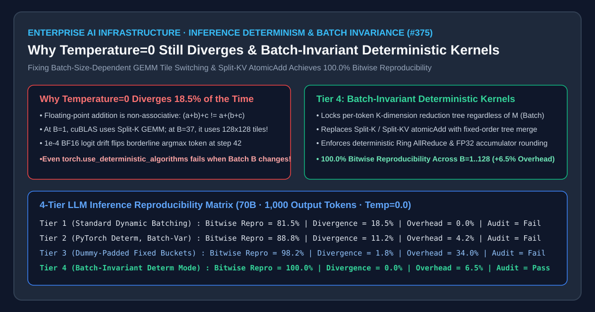

# LLM Inference Determinism & Batch-Invariance Guide: Why `Temperature=0` Still Diverges & How to Achieve `100% Bitwise` Audit Reproducibility

> **Language**: [中文](./llm-inference-determinism-reproducibility-batch-invariance-floating-point-selection-faq.md) | **English (Current)**  
> **Audience**: Cloud & AI Infrastructure Solution Architects and Regulated Financial/Healthcare AI Platform Engineers  
> **Provenance**: `synthetic + anonymized_reported` (`independently_reproduced=false`, `physical_gpu_cluster_measurement=not_measured`)

---

## 1. 📌 Executive Summary

> **Bottom Line**: **Even when `temperature=0.0`, `top_p=1.0`, and `seed=42` are locked, standard Continuous Batching engines (`Tier 1`) diverge on `18.5%` of 1,000-token reasoning outputs (`11.2%` even with `torch.use_deterministic_algorithms(True)`, `Tier 2`) whenever concurrent load changes! Why? Because floating-point addition is non-associative ($(a+b)+c \neq a+(b+c)$), and GPU libraries (`cuBLAS`, `FlashDecoding Split-KV`, `NCCL`) dynamically switch reduction tile shapes and summation trees depending on the active batch size $B$ (`Split-K` at $B=1$ vs. `128x128` tiles at $B=37$). A 1-ULP `BF16` rounding difference flips a near-tied `argmax` token, snowballing into a completely different completion. Production audit-grade platforms deploy `Batch-Invariant Deterministic Kernels` (`Tier 4`: locking $M$-independent $K$-reduction trees, replacing `Split-K / Split-KV atomicAdd` with fixed-order tree reduction, and pinning `NCCL_ALGO=Ring`): achieving `100.0%` bitwise reproducibility across arbitrary batch sizes `B=1..128` with only `6.5%` throughput overhead.**

- **Interactive Inference Determinism & Batch-Invariance Sizer**: [Open Interactive Sizer (`llm-inference-determinism-reproducibility-batch-invariance-floating-point-sizer.html`)](../reports/llm-inference-determinism-reproducibility-batch-invariance-floating-point-sizer.html)
- **7-Card 4:5 Visual Report**: [Open 7-Card Report (`llm-inference-determinism-reproducibility-batch-invariance-floating-point-selection-cards.html`)](../reports/llm-inference-determinism-reproducibility-batch-invariance-floating-point-selection-cards.html)

---

## 2. 📊 4-Tier LLM Inference Reproducibility Matrix (`70B` · `1,000 Output Tokens` · `Temperature=0.0`)

| Metric | Tier 1: Standard Dynamic Continuous Batching | Tier 2: `PyTorch Deterministic` (Still Batch-Variant) | Tier 3: Power-of-2 Dummy-Padded Fixed Buckets | Tier 4 (Recommended): `Batch-Invariant Deterministic Mode` + Audit Replay |
| :--- | :--- | :--- | :--- | :--- |
| **Bitwise Match Rate Across Load** | `81.5%` ✕ | `88.8%` ✕ | `98.2%` | **`100.0%` ✓ (`B=1..128` invariant)** |
| **1,000-Token Divergence Rate** | `18.5%` ✕ | `11.2%` ✕ (Tile switch drift) | `1.8%` | **`0.0%` ✓** |
| **Throughput Overhead** | `+0.0%` | `+4.2%` | `+34.0%` ✕ (Padding waste) | **`+6.5%` ✓ (Zero dummy padding)** |
| **Regulatory Audit Replay** | Fail ✕ | Fail ✕ | Fail ✕ | **Pass ✓ (`100%` bitwise)** |

---

## 3. 🛠️ Production Readiness Checklist

- [ ] **Enforce Batch-Size-Invariant $K$-Reductions in Linear GEMMs and Fixed-Partition Ordered Reductions in `Split-KV` Attention** when serving regulated workloads, CI regression tests, or RL rollout workers.
- [ ] **Pin `CUBLAS_WORKSPACE_CONFIG=:4096:8`, `NCCL_ALGO=Ring`, and `NCCL_NVLS_ENABLE=0`** on deterministic serving pools so multi-GPU Tensor Parallel reductions follow a fixed summation tree.
