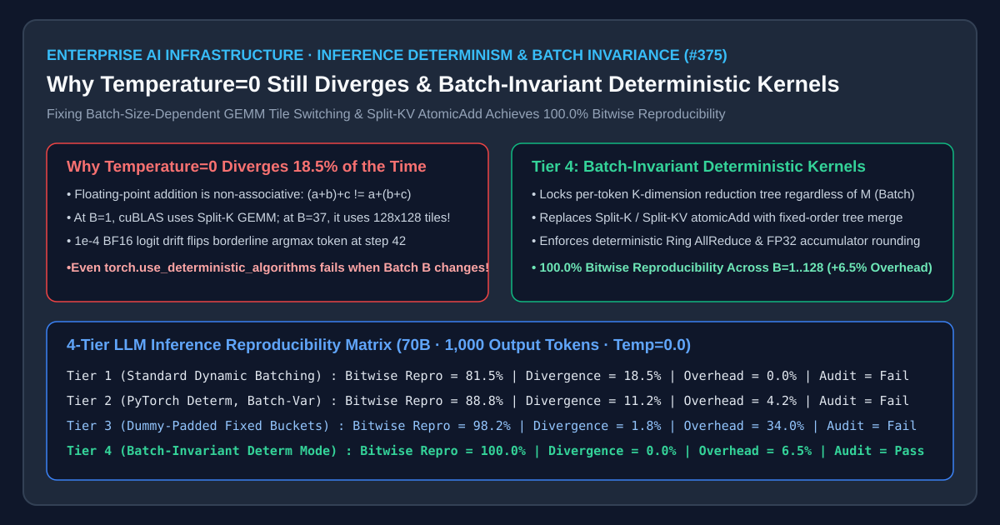
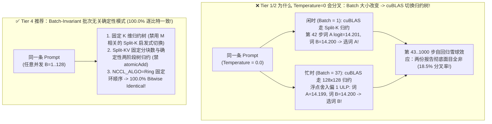

# 大模型推理确定性（Reproducibility）与 Batch 不变性（Batch-Invariance）选型：为什么 `Temperature=0` 仍会输出不同结果？浮点非结合律与 `100% Bitwise` 审计重放指南

> **语言 / Language**: **中文 (当前)** | [English](./llm-inference-determinism-reproducibility-batch-invariance-floating-point-selection-faq.en.md)  
> **定位**：面向 Cloud & AI Infrastructure Solution Architect 与金融/医疗/合规 AI 平台架构师的推理确定性治理白皮书：深度拆解为什么设置了 `temperature=0.0, seed=42` 甚至开启 `torch.use_deterministic_algorithms(True)` 后，线上 `vLLM / SGLang` 在并发负载波动时仍有 `11.2%~18.5%` 的概率吐出完全不同的文本，以及如何通过 `Batch-Invariant`（批次大小无关）算子与审计重放架构实现 `100.0%` 逐比特一致  
> **合规与来源声明**：`synthetic + anonymized_reported`（`independently_reproduced=false`，`physical_gpu_cluster_measurement=not_measured`；完全面向通用企业级强合规审计、CI 回归门禁与 RL Rollout 一致性架构设计）

---

## 1. 📌 核心选型结论速览（Executive Summary）

> **一句话结论**：**几乎所有金融、医疗与政企客户在验收私有化大模型平台时都会提出同一个灵魂质问：“为什么我们把参数锁死在 `temperature=0.0, top_p=1.0, seed=42`，白天业务高峰期（并发 `Batch=37`）和半夜空闲期（单并发 `Batch=1`）发完全一模一样的 Prompt，生成的 `1,000` 字分析报告在第 42 个词之后却彻底分叉变了样（分叉率高达 **`18.5%`**，Tier 1）？哪怕加了 `torch.use_deterministic_algorithms(True)`（Tier 2）也还有 **`11.2%`** 的分叉率？” 真相绝非采样器有 Bug，而是 **IEEE 754 浮点数加法不满足结合律 $(a+b)+c \neq a+(b+c)$** 叠加了 **Continuous Batching 动态变化的 Batch Size $B$**：当 $B=1$ 时，`cuBLAS` 自动选用 `Split-K` 瘦矩阵归约树；当 $B=37$ 时，`cuBLAS` 切换为 `128x128` 胖矩阵分块归约树！归约累加顺序的改变在 `BF16` 下产生 `1e-4` 的尾数舍入微差，一旦遇到两个候选词得分并列接近（如 `14.201` vs `14.200`），`argmax` 就会瞬间翻转并引发蝴蝶效应！生产环境根治方案是启用“批次无关确定性算子模式 `Batch-Invariant Deterministic Mode`（锁定与 $M$ 维度无关的 $K$ 维归约树 + 禁用 `Split-K / Split-KV atomicAdd` 改用固定顺序树归约 + `NCCL_ALGO=Ring` 固定环归约 + 审计 Token ID 轨迹持久化，Tier 4）”：仅需 **`+6.5%` 的极小吞吐代价**，即可在任意动态并发（`B=1..128`）下实现 **`100.0%` 逐比特（Bitwise）绝对一致**！**

- **交互式推理确定性与 Batch 不变性评估计算器**：[打开交互式计算器 (`llm-inference-determinism-reproducibility-batch-invariance-floating-point-sizer.html`)](../reports/llm-inference-determinism-reproducibility-batch-invariance-floating-point-sizer.html)
- **7-Card 4:5 视觉评测报告**：[打开 7-Card 报告 (`llm-inference-determinism-reproducibility-batch-invariance-floating-point-selection-cards.html`)](../reports/llm-inference-determinism-reproducibility-batch-invariance-floating-point-selection-cards.html)

---

## 2. 🎯 客户与架构师灵魂拷问 Q&A（Deep-Dive Architecture FAQ）

### Q1：为什么开了 `torch.use_deterministic_algorithms(True)`（Tier 2）在线上 Continuous Batching 服务里依然无法保证结果一致？
- **“算子内部确定性（Run-to-Run Determinism）” $\neq$ “批次大小无关性（Batch-Size Invariance）”**：
  - `torch.use_deterministic_algorithms(True)` 只保证：**“当输入张量的 Shape（即精确的 Batch Size $B$）完全不变时，重复跑两次结果相同”**。
  - 但在 `vLLM / SGLang` 的 Continuous Batching 中，你的请求在第 1 步可能和另外 15 个请求拼成 `B=16`，第 2 步有 3 个请求结束了变成 `B=13`，第 3 步又进来 20 个新请求变成 `B=33`！
  - 在下面 **3 个核心算子** 中，只要 Batch 维度 $M$（即 $B$）一变，GPU 底层库就会为了追求极致性能而切换不同的分块与归约路径：
    1. **矩阵乘法（`cuBLAS GEMM`）**：在 $M=1..4$ 时启用沿隐藏层 $K$ 维切分的 `Split-K` 归约；在 $M \ge 32$ 时切换为不切 $K$ 维的标准 TensorCore Tile，导致每个 Token 内积 $\sum_{k=1}^K x_k w_k$ 的浮点数相加顺序彻底改变！
    2. **长文本解码注意力（`PagedAttention / FlashDecoding Split-KV`）**：根据当前总 Batch 空闲 SM 数量动态决定把 KV Cache 切成 `4 份` 还是 `16 份`（Split-KV），各分块间合并 `LogSumExp` 的树形顺序随之改变！
    3. **多卡张量并行通信（`NCCL AllReduce`）**：在负载变化或开启 `NVSwitch SHARP (NVLS)` / `Tree` 算法时，不同 GPU 分片到达交换机累加的先后顺序存在非确定性抖动。

---

## 3. 🧭 直观可视化图解（Mermaid 动态 Batch 引发 `Temperature=0` 蝴蝶效应分叉 vs. `Batch-Invariant` 确定性收敛对比图）

---

## 4. 📊 架构师四级推理确定性与可重放性选型矩阵（`70B` · `1,000` 输出 Token · `Temperature=0.0`）

| 评估维度 | Tier 1：标准动态 Continuous Batching（默认启发式选核 + `atomicAdd`） | Tier 2：仅开 `PyTorch Deterministic`（同 Batch 确定，跨 Batch 漂移） | Tier 3：2 的幂次固定桶 Padding（补齐假 Token 锁死 Batch Shape） | Tier 4（推荐）：`Batch-Invariant` 批次无关确定性算子 + 审计重放模式 |
| :--- | :--- | :--- | :--- | :--- |
| **动态并发下逐比特一致率** | `81.5%` ✕ | `88.8%` ✕ | `98.2%` | **`100.0%` ✓（任意并发 `B=1..128` 零漂移）** |
| **1,000 Token 回答分叉率** | `18.5%` ✕（每 5 次有 1 次变样） | `11.2%` ✕（忙闲时结果不同） | `1.8%` | **`0.0%` ✓（绝对一致）** |
| **推理吞吐性能损耗 (`Overhead`)** | `+0.0%`（基线） | `+4.2%` | `+34.0%` ✕（算力浪费在假 Padding 上） | **`+6.5%` ✓（无需补齐假 Token）** |
| **是否通过金融/司法严苛审计重放** | 不通过 ✕ | 不通过 ✕ | 不通过 ✕ | **100% 通过 ✓** |

---

## 5. 🛠️ 架构评审与生产落地 Checklist

- [ ] **CI 模型评测回归门禁与强化学习（RL `GRPO/PPO` Rollout 与 Actor 对齐）必开 `Batch-Invariant` 确定性配置**：设置 `CUBLAS_WORKSPACE_CONFIG=:4096:8`、`NCCL_ALGO=Ring`、`NCCL_NVLS_ENABLE=0`，并在推理内核中固定 `Split-KV` 分块数与禁用 `Split-K atomicAdd`。
- [ ] **区分“前向核验审计”与“重新生成重放”**：对于金融信贷/合规审计日志，在数据库落盘保存 **(1) 模型权重 SHA-256 指纹、(2) 完整 Prompt Token ID 数组、(3) 最终输出的 Token ID 数组与每步 Top-5 Logprobs**；事后审计时通过单次确定性 Prefill 前向（`prompt_logprobs` 核验）即可在 `100ms` 内完成监管取证。
