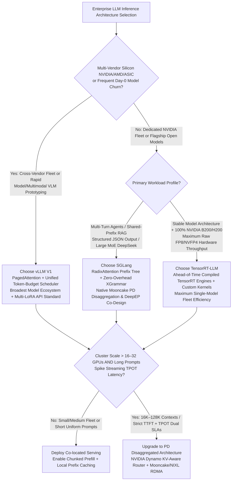
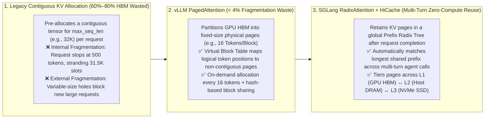

# AI Infrastructure LLM Inference Engine & PD Disaggregation Selection FAQ: vLLM vs. SGLang vs. TensorRT-LLM & Mooncake/Dynamo

> 🌐 **Language / 语言**: **[中文 (`llm-inference-engine-pd-disaggregation-selection-faq.md`)](llm-inference-engine-pd-disaggregation-selection-faq.md)** | **English**
> 🧭 **Dedicated Single-Topic Short-Slug FAQs**: [Part 1A: LLM Inference Engine Selection FAQ (`vLLM` vs. `SGLang` vs. `TensorRT-LLM`)](llm-inference-engine-selection-faq.en.md) · [Part 1B: Prefill-Decode (PD) Disaggregation & KV Offload Selection FAQ (`Co-located` vs. `Dynamo + Mooncake`)](pd-disaggregation-kv-offload-selection-faq.en.md)
> 📊 **Provenance & Verification Boundary**: Quantitative sizing examples are computed by the deterministic Roofline and queueing simulator [`experiments/llm_inference_engine_pd_selection/run.py`](../../experiments/llm_inference_engine_pd_selection/run.py) (`data_classification`: `synthetic` analytical model calibrated to `anonymized_reported` upstream specs; `independently_reproduced=false`; no paid cloud 8×H200 GPU cluster was launched; live multi-node hardware cluster benchmark: `not_measured`). The 32K KV cache handoff (`1.024 GB = 8.192 Gb`) over 400G RoCEv2 (`44.91 GB/s = 359.30 Gbps` effective goodput) is verified at `22.8 ms`.
> 🔗 **Related Deep Dives**: [vLLM V1 Unified Scheduler & Inference SLO](inference-slo.md) · [Prefill/Decode Disaggregation & Cross-Node KV Routing](disaggregated-kv-routing.md) · [4-Tier KV Cache Offload Hierarchy (VRAM/DRAM/CXL/SSD)](tiered-kv-cache-offload-hierarchy.md) · [Mooncake ConnectX-8 Zero-Copy RDMA](mooncake-transfer-engine-cx8-data-direct-rdma.md) · [SGLang HiRadixCache & EAGLE-3 Speculative Decoding](ai-infra-innovators-v2.md) · [InfiniBand vs. Ethernet/RoCEv2 Network Selection FAQ](ib-vs-ethernet-roce-selection-faq.en.md)

---

## 📌 Executive Summary

When designing production LLM online serving and Agentic AI infrastructure, AI Solution Architects face two coupled architectural decisions—**choosing the right inference engine (`vLLM` vs. `SGLang` vs. `TensorRT-LLM`)** and **choosing the right cluster serving topology (`Co-located Monolithic Serving` vs. `Prefill-Decode (PD) Disaggregated Serving`)**:

1. **How to Choose Among the Big Three Inference Engines (`vLLM` vs. `SGLang` vs. `TensorRT-LLM`)**:
   - **When to Choose vLLM**: Choose vLLM as your enterprise default when prioritizing **broadest model ecosystem coverage (Day-0 support for new open-weight LLMs, multimodal VLMs, and MoEs)**, **high-concurrency multi-tenant OpenAI-compatible APIs**, and **multi-vendor hardware portability (NVIDIA GPUs, AMD Instinct MI300X–MI355X, AWS Trainium, Google TPUs)**.
   - **When to Choose SGLang**: Choose SGLang for **multi-turn Agentic workflows, long-context RAG, prefix-heavy workloads (shared System Prompts / Few-Shot templates)**, **zero-overhead structured JSON/regex outputs (`XGrammar`)**, and **large-scale MoE deployments (DeepSeek-V3/R1/V4, Qwen3) requiring native Prefill-Decode disaggregation, hierarchical `HiRadixCache`, and Wide Expert Parallelism (`DeepEP`)**.
   - **When to Choose TensorRT-LLM**: Choose TensorRT-LLM when **100% standardized on NVIDIA silicon (H100 / H200 / Blackwell B200 / GB200)** with stable model architectures and when squeezing out the **absolute highest single-node FP8 / NVFP4 compiled throughput and lowest per-token latency (TPOT)** justifies ahead-of-time engine compilation.
2. **When to Upgrade from Co-located Serving to Prefill-Decode (PD) Disaggregation (`NVIDIA Dynamo` + `Mooncake` / `NIXL`)**:
   - **Stay with Co-located Serving + Chunked Prefill** for small-to-medium deployments (**≤ 8–16 GPUs**), short-to-medium prompts (≤ 4K tokens), uniform input/output ratios, or environments without RDMA networking;
   - **Upgrade to PD Disaggregation** whenever serving **mixed long-context prompts (16K–128K+ RAG/codebases) alongside interactive streaming chat**, enforcing **strict dual SLAs (`TTFT < 500 ms` AND streaming `TPOT < 25 ms` without stalls)**, running **large MoE models with asymmetric prefill/decode parallelism**, or **right-sizing heterogeneous GPU pools**—delivering **`2.0x–2.8x` higher SLA-compliant goodput**.
3. **What Are PagedAttention, RadixAttention, and PD Disaggregated KV Transfer?**:
   - **PagedAttention (Pioneered by vLLM)**: Applies OS virtual-memory paging to GPU HBM, partitioning contiguous KV Cache tensors into fixed-size physical blocks (e.g., 16 tokens/block) to slash memory fragmentation waste from **`60%–80%` down to `< 4%`**;
   - **RadixAttention (Pioneered by SGLang)**: Retains completed KV Cache blocks inside a **prefix Radix Tree** across requests (tiered across GPU HBM L1, Host DRAM L2, and NVMe SSD L3), enabling **automatic zero-recomputation prefix reuse** for multi-turn Agents and shared prompts;
   - **PD Disaggregated Zero-Copy KV Transfer (`Mooncake` / `Dynamo NIXL`)**: Physically separates compute-bound Prefill workers from memory-bandwidth-bound Decode workers, streaming generated KV Cache slices directly from Prefill GPU HBM to Decode GPU HBM via **GPUDirect RDMA (`RoCEv2` / `InfiniBand` / `AWS EFA FI_HMEM`)** to eliminate long-prompt streaming stalls.

---

## Q1: When Deploying Enterprise LLM Serving, How Should Customers Choose Between vLLM, SGLang, and TensorRT-LLM?

Rather than treating engine selection as a single synthetic benchmark race, architects evaluate four practical dimensions: **workload structure (general chat vs. multi-turn agents/structured output), model churn rate, hardware heterogeneity, and engineering maintenance budget**:



### 1. When to Choose vLLM ("The Universal Linux of LLM Serving")

**vLLM (vLLM V1 architecture)** is the most widely adopted open-source serving engine across enterprise private clouds and AI platforms, making it the safest default in three scenarios:

1. **High Model Churn & Day-0 Architecture Support (Model Agility)**
   - Whenever a new open-weight model family drops on Hugging Face—whether dense transformers, Mixture-of-Experts (MoE), multimodal Vision-Language Models (VLMs), or embedding/reranker models—vLLM typically ships production-ready support on Day 0.
   - **Latest Breakthrough Anchor**: vLLM V1 recently introduced **single-replay batched multimodal encoder CUDA graphs (`#65227`)** to eliminate per-image launch overhead, alongside **Sleep Mode construction buffer offloading (`#59994`)** to instantly reclaim GPU HBM when time-sharing GPUs between RL rollout inference and actor training.
2. **Multi-Vendor & Heterogeneous Accelerator Fleets (Hardware Portability)**
   - Enterprises operating mixed fleets across NVIDIA (`H100`/`H200`/`B200`), **AMD Instinct (`MI300X`/`MI325X`/`MI355X` via ROCm/AITER)**, AWS Trainium, or Google TPUs rely on vLLM's unified backend abstraction to avoid maintaining separate serving stacks per chip vendor.
3. **Standardized Enterprise AI Gateways & Multi-LoRA Serving**
   - Ideal when serving dozens of dynamic fine-tuned LoRA adapters concurrently over a single base model with battle-tested Kubernetes (`KServe`, `Ray Serve`, `vLLM Production Stack`) integration.

### 2. When to Choose SGLang ("The King of Agentic AI, Shared Prefixes & Large MoEs")

Created by the LMSYS team, **SGLang** was architected from the ground up for **structured LLM programs, multi-turn agents, and frontier MoE serving**, holding a decisive architectural advantage in four areas:

1. **Multi-Turn Agent Workflows, Tool Calling & Prefix-Heavy RAG**
   - In coding agents, ReAct tool loops, few-shot pipelines, and document Q&A, **`60%–90%` of prompt tokens** are shared across requests or across turns of the same session (system instructions, tool JSON schemas, conversation history).
   - SGLang's **RadixAttention** maintains KV Cache pages inside a dynamic **Radix Tree** across requests and tiers them across **GPU HBM (L1), Host DRAM (L2), and NVMe SSDs (L3) (`HiCache`)**, slashing Time-to-First-Token (TTFT) by **`50%–80%`**.
   - **Latest Breakthrough Anchor**: For hybrid attention models combining full attention with multiple sliding-window attention bands, SGLang introduced a **unified per-band page ledger and deferred page reuse (`#48852`, `#48006`–`#48008`)**, eliminating synchronous GPU stream waits on every page free.
2. **Zero-Overhead Structured Outputs (JSON Schema / Regex / EBNF)**
   - Forcing an LLM to emit valid JSON traditionally bottlenecks on CPU vocabulary mask generation at every decode step. SGLang tightly integrates **XGrammar** (a pushdown-automaton structured decoding engine), overlapping mask compilation with GPU execution to achieve **near-zero latency overhead (even faster than unconstrained decoding when skipping deterministic boilerplate tokens)**.
3. **Frontier Large-Scale MoE Serving (DeepSeek-V3 / R1 / V4 & Qwen3)**
   - Co-designed with the DeepSeek infrastructure team, SGLang natively integrates **Two-Batch Overlap (`TBO`)**, **DeepEP GPU-Initiated RDMA (`IBGDA`)**, **generalized MXFP4 decode MoE kernels (`#49091`)**, and **Mooncake PD disaggregation**, making it the reference open-source stack for Wide Expert Parallelism (`EP=32` to `EP=144`).

### 3. When to Choose TensorRT-LLM ("Maximum Hardware Extraction on NVIDIA Silicon")

**TensorRT-LLM** is NVIDIA's flagship C++/CUDA inference SDK (and a primary execution backend inside NVIDIA NIM and NVIDIA Dynamo):

1. **100% Dedicated NVIDIA Flagship Clusters (`H100` / `H200` / `Blackwell B200` / `GB200 NVL72`)**
   - When an organization runs exclusively on NVIDIA hardware and needs immediate access to low-level silicon capabilities—such as Blackwell SM100 native **NVFP4 (4-bit) Tensor Cores**, `tcgen05` TMEM kernels, NVLink-5 `multimem` hardware reductions, and Helix context parallelism—TensorRT-LLM delivers the deepest hardware-level fusion.
2. **Stable, High-Volume Models Optimizing for Lowest Cost-per-Token**
   - By compiling model graphs ahead of time into fused TensorRT engines with custom C++ runtime scheduling, TensorRT-LLM frequently extracts **`10%–25%` higher raw token throughput** on stable, high-volume workloads compared to dynamic Python-first frameworks—at the cost of higher build/compilation rigidity.

---

## Q2: When Is Co-located Serving Enough, and When Must Architects Upgrade to Prefill-Decode (PD) Disaggregation?

Once the inference engine is chosen, the second critical architectural question is: **Should each GPU group execute both prompt prefill and token decoding together (`Co-located Serving`), or should the cluster be split into dedicated Prefill pools and Decode pools (`Prefill-Decode Disaggregation`)?**

### 1. First Principles: Why Do Prefill and Decode Fight Each Other on the Same GPU?

To explain PD disaggregation on a whiteboard to a customer CTO, start with the fundamental hardware mismatch between the two phases of LLM inference:

```mermaid
flowchart LR
    subgraph Coloc["Legacy Co-located Serving: Compute & Memory Bandwidth Collide"]
        direction TB
        Req1["Incoming 32K Long-Context Prompt (Prefill)"] --> GPU0["Shared GPU Worker Pool<br/>Runs Both Prefill & Decode"]
        Req2["64 Active Streaming Users (Decode)"] --> GPU0
        GPU0 --> Bottleneck["Physical Bottleneck:<br/>1. 32K Prefill saturates Tensor Cores for 100s of ms<br/>2. Active Decode tokens stall behind Prefill chunks (TPOT spikes 4x–8x)<br/>3. Neither FLOPs nor HBM bandwidth reaches optimal efficiency"]
    end

    subgraph Disagg["Modern Prefill-Decode (PD) Disaggregation (NVIDIA Dynamo + Mooncake / NIXL)"]
        direction TB
        InReq["Incoming Prompt"] --> Router["Dynamo KV-Aware Smart Router<br/>(Routes to Highest Prefix-Cache Match & Lowest Queue)"]
        Router -->|1. Compute Uncached Prompt Suffix Only| PPool["Dedicated Prefill GPU Pool (Compute-Bound)<br/>High Arithmetic Intensity (~300+ FLOP/B) · Saturates Tensor Cores"]
        PPool ==>|2. GPUDirect RDMA Zero-Copy Write<br/>Mooncake / NIXL (400G/800G RoCEv2 / IB / EFA)| DPool["Dedicated Decode GPU Pool (Memory-Bandwidth-Bound)<br/>Large Batch Size · Saturates HBM3e Bandwidth · Stable TPOT < 20ms"]
    end
```

1. **Phase 1: Prefill (Reading the Prompt) Is Strictly Compute-Bound**
   - When a user submits a 16,000-token document, the GPU processes all 16,000 tokens in parallel via dense matrix-matrix multiplications (`GEMM`) and attention.
   - For every byte of model weights read from HBM memory, the GPU performs hundreds of floating-point operations (**Arithmetic Intensity = `200–500+ FLOPs/Byte`**, well above the `~205–280 FLOPs/Byte` Roofline ridge point of an H200 or B200). Thus, **Prefill 100% saturates GPU Tensor Core FLOPs while leaving HBM bandwidth underutilized**.
2. **Phase 2: Decode (Generating Tokens One by One) Is Strictly Memory-Bandwidth-Bound**
   - During autoregressive generation, each request produces only **1 token per step**, yet the GPU must stream the entire model weights (e.g., `70 GB` for a 70B FP8 model) plus all accumulated KV Cache tensors out of HBM memory for every single step.
   - Arithmetic intensity plunges to **`1–32 FLOPs/Byte`**. Consequently, **Decode 100% saturates HBM memory bandwidth while leaving `80%–90%` of expensive Tensor Core compute idle**.
3. **Why Co-location Breaks Streaming SLAs (Prefill Interference)**:
   - When 64 users are smoothly streaming responses at `18 ms/token` (Decode) and a single `32K`-token RAG prompt arrives, co-located serving must interleave Prefill computation on the same GPUs.
   - Even with **Chunked Prefill** (splitting the 32K prompt into 2K/4K token chunks piggybacked onto decode steps), each chunk inflates step latency from `18 ms` to `70–120 ms`—causing visible streaming freezes across all concurrent users and violating P99 TPOT SLAs.

---

### 2. Five Scenarios Where PD Disaggregation Strictly Beats Co-located Serving

#### 1. Mixed Long-Context Prompts (16K–128K+) and Low-Latency Streaming Chat
- **Why PD Wins**: Dedicated Prefill nodes absorb massive prompt bursts and transfer the resulting KV Cache asynchronously over 400G/800G RDMA in milliseconds. Decode nodes execute uninterrupted token generation, **cutting P99 TPOT tail latency by `65%–80%`**.

#### 2. Frontier Large-Scale MoE Models (DeepSeek-V3 / R1 / V4) with Asymmetric Parallelism
- **Why MoE Requires PD Disaggregation**: A 671B-parameter MoE model with 256 routed experts needs fundamentally different parallelism topologies for Prefill vs. Decode:
  - **Prefill has thousands of tokens per step**: Every expert receives a dense batch locally, so **small Expert Parallelism (`TP=8 / EP=8` + Data Parallelism)** minimizes cross-node communication;
  - **Decode has 1 token per request**: Reaching sufficient batch size per expert without exhausting HBM requires **Wide Expert Parallelism (`EP=32` to `EP=144` GPUs) paired with GPU-Initiated RDMA (`DeepEP IBGDA`)**.
- Disaggregating P and D allows each pool to run its mathematically optimal parallelism strategy, boosting cluster goodput by **`2.2x–2.8x`**.

#### 3. Heterogeneous GPU Right-Sizing & TCO Reduction
- Because Prefill is FLOPs-bound and Decode is HBM-bandwidth-and-capacity-bound, running both on identical GPUs wastes money.
- With PD disaggregation, architects can deploy **compute-dense GPUs for Prefill** and **memory-capacity/bandwidth-rich GPUs (e.g., H200 141GB / MI300X 192GB) for Decode**, reducing cost per million SLA-compliant tokens by **`25%–40%`**.

#### 4. Independent Elastic Scaling for Asymmetric Input/Output Ratios
- RAG and summarization workloads are **input-heavy** (e.g., 32K input : 500 output tokens, requiring more Prefill nodes), whereas Chain-of-Thought reasoning models (`DeepSeek-R1`, `o3`-style agents) are **output-heavy** (e.g., 1K input : 16K reasoning tokens, requiring more Decode nodes).
- **NVIDIA Dynamo** dynamically autoscales P:D worker ratios (e.g., `3P:1D` vs. `1P:4D`) and routes requests to runtime LoRA adapter identities (`#17893`).

#### 5. Cluster-Wide Shared KV Cache Pooling (`Mooncake Store` + `LMCache`)
- By pooling host DRAM and local NVMe SSDs across all nodes via **Mooncake Store** and **LMCache**, evicted KV blocks remain accessible across the entire cluster.
- **Latest Breakthrough Anchor**: Mooncake slices `>1 GiB` pools into `<=1 GiB` registrations cloned across 385 `io_uring` rings to hit **`21.0 GB/s` cold SSD KV reads (`4.77x` speedup)**, adds **native Libfabric `FI_HMEM` CUDA memory registration (`#4427`)** for AWS EFA clouds, and pairs with LMCache's **8.0x TP-replicated MLA KV deduplication (`#6125`)**.

---

### 📊 Architect Decision Matrices

#### Table 1: Open Inference Engine Selection Matrix (`vLLM` vs. `SGLang` vs. `TensorRT-LLM`)

| Evaluation Dimension | vLLM (V1 Architecture) | SGLang (SRT / Radix Engine) | TensorRT-LLM (NVIDIA Official) |
| :--- | :--- | :--- | :--- |
| **Primary Target Workloads** | Enterprise multi-model gateways, rapid VLM/LLM adoption, heterogeneous GPU clouds, Multi-LoRA | Multi-turn Agents, shared-prefix RAG, constrained JSON decoding, large MoE (`DeepSeek`) | 100% NVIDIA flagship fleets, stable high-volume models, commercial API providers |
| **KV Memory & Prefix Caching** | **PagedAttention + Hash-Block Automatic Prefix Caching (APC)** | **RadixAttention Prefix Tree + `HiCache` (L1/L2/L3) + Deferred Page Reuse** | Paged KV Cache + KV Block Reuse (C++ Executor) |
| **Core Scheduler Design** | **Unified Token-Budget Scheduler** (native Chunked Prefill without phase switches) | **Zero-Overhead Overlap Scheduler + Two-Batch Overlap (`TBO`)** | C++ In-Flight Batching + Ahead-of-Time Compiled TensorRT Graphs |
| **Structured Output (JSON/Regex)** | Guided Decoding (`XGrammar` / `Outlines` integration) | **Native Deep `XGrammar` Co-Design (Near-Zero Overhead + Jump-Forward)** | C++ Runtime Guided Decoding |
| **Day-0 New Model Velocity** | **Fastest (De facto open-source standard for new releases)** | **Very Fast (Immediate support for flagship LLMs, MoEs, and VLMs)** | Moderate (Requires TensorRT engine build & C++ graph adaptation) |
| **Hardware Portability** | **Broadest (NVIDIA / AMD ROCm / AWS Trainium / TPU / Ascend)** | **Broad (NVIDIA CUDA / AMD ROCm AITER / Ascend NPU)** | **Proprietary (NVIDIA GPUs only, tied to specific SM generation)** |
| **Operational Simplicity** | **Easiest (Pythonic, drop-in Docker/pip deployment)** | **Easy (Python + custom kernels, clean modular architecture)** | **Higher Complexity (Engine compilation, C++/CUDA version pinning)** |

#### Table 2: Co-located Serving vs. Prefill-Decode (PD) Disaggregated Topology

| Evaluation Dimension | Legacy Co-located Continuous Batching | Co-located + Chunked Prefill | PD Disaggregated Architecture (`Dynamo` + `Mooncake` / `NIXL`) |
| :--- | :--- | :--- | :--- |
| **Target Scale & Workload** | ≤ 8 GPUs, short uniform prompts, offline batch processing | 8–16 GPUs, moderate prompts (≤ 4K–8K), no RDMA network | **≥ 16–1,000+ GPUs, 16K–128K contexts, strict dual SLAs, large MoE models** |
| **Streaming TPOT Stability Under Long Prompts** | **Poor** (Long prompts stall all active streaming users for hundreds of ms) | **Moderate** (Caps worst-case spikes, but chunks still inflate step time `2x–4x`) | **Excellent (Physical isolation keeps Decode P99 TPOT steady at `< 20 ms`)** |
| **MoE Parallelism Flexibility** | Rigid (Prefill and Decode forced to share identical TP/EP degree) | Rigid (Same as left) | **Fully Decoupled (Small EP for Prefill compute + Wide EP for Decode bandwidth)** |
| **Network Fabric Requirement** | Standard TCP/IP Ethernet (intra-node NVLink/PCIe only) | Standard TCP/IP Ethernet | **Requires High-Speed RDMA (`100G–800G RoCEv2` / `InfiniBand` / `AWS EFA`)** |
| **SLA-Compliant Goodput** | `1.0x` Baseline | `~1.3x – 1.5x` | **`~2.0x – 2.8x+` (Highest gains on long-context & MoE workloads)** |

---

## Q3: What Are PagedAttention, RadixAttention, and PD Disaggregated KV Transfer, and How Do They Work Under the Hood?

### 1. First Principles: Why Does LLM Inference Need a KV Cache, and Why Does It Exhaust GPU Memory?

Because transformers generate text **one token at a time (autoregressively)**, generating the 1,000th token without caching would require recomputing attention over all 999 preceding tokens from scratch—causing $O(N^2)$ compute explosion.
To avoid recomputation, the engine stores the intermediate **Key (K) and Value (V) vectors** of every past token across all transformer layers inside GPU HBM memory. This is the **KV Cache**.

However, the KV Cache grows linearly with sequence length and batch size:
- In **Llama-3-70B (80 layers, FP16)**, a single token's KV Cache consumes **`~320 KB`**.
- A single **`32,768`-token (32K)** request requires **`10.5 GB`** of KV Cache alone! Serving 32 concurrent 32K requests demands **`336 GB` of KV Cache**—nearly 5× larger than the 70 GB FP8 model weights.

---

### 2. Evolution from Contiguous Memory to PagedAttention and RadixAttention



1. **PagedAttention (vLLM's Breakthrough)**:
   - Eliminates contiguous pre-allocation by dividing GPU HBM into fixed-size blocks (`16` or `64` tokens) managed via a virtual **Block Table**. Memory waste drops below **`4%`**, unlocking **`3x–5x` higher batch concurrency**.
2. **RadixAttention (SGLang's Breakthrough)**:
   - Instead of freeing KV blocks immediately when a request finishes, SGLang organizes cached token sequences into a **Radix Tree (prefix tree)**. Subsequent agent turns or RAG queries sharing a prefix match existing tree nodes in microseconds, reusing cached KV blocks with **zero GPU recomputation** and evicting cold leaves via LRU to Host DRAM (`L2`) or NVMe SSD (`L3`).

---

### 3. End-to-End Lifecycle of a Request in a PD-Disaggregated Cluster

```mermaid
sequenceDiagram
    autonumber
    participant Client as Client / Agent App
    participant Router as NVIDIA Dynamo KV-Aware Router
    participant Prefill as Prefill Worker (Compute Pool)
    participant Fabric as Mooncake / NIXL (400G/800G RDMA)
    participant Decode as Decode Worker (Bandwidth Pool + HiCache)

    Client->>Router: 1. Submit 32K Prompt (24K shared prefix + 8K new suffix)
    Note over Router: 2. Query global prefix radix index (KV-Aware Routing)<br/>Score workers by cached prefix overlap vs. queue load (retain prepared candidate rows)
    Router->>Decode: 3. Pre-allocate destination HBM page slots & trigger async L2/L3 prefix prefetch
    Router->>Prefill: 4. Dispatch request to optimal Prefill worker with destination RDMA descriptors
    Note over Prefill: 5. Skip 24K cached prefix; compute KV Cache for 8K suffix on Tensor Cores<br/>and sample the 1st output token (TTFT achieved!)
    Prefill->>Client: 6. Stream 1st output token immediately to client
    Prefill->>Fabric: 7. Compress non-contiguous pages via Stride Descriptors (nixlStrideDesc) &<br/>Tail-Folded Slices (planRdmaSlices); arbitrate by Deadline MLU & post GPUDirect RDMA Write
    Fabric->>Decode: 8. NIC hardware DMAs 8K incremental KV directly into Decode GPU HBM (zero CPU copy)
    Note over Decode: 9. Verify RDMA completion + local HiCache prefix ready (HiCacheRestoreGatedKVReceiver)<br/>Enter high-batch, low-jitter (< 20ms/token) autoregressive decoding
    Decode->>Client: 10. Stream remaining generated tokens until EOS
```

Under the hood, **Mooncake Transfer Engine** and **NVIDIA Dynamo NIXL** solve three critical systems bottlenecks during cross-node KV handoff:
1. **Stride Descriptor Compression (`nixlStrideDesc` & `planRdmaSlices`)**: Because PagedAttention scatters a 32K prompt across thousands of pages and 80 layers, naive RDMA posting creates `160,000+` tiny descriptors. NIXL's strided descriptors and vectorized descriptor merge (**`2.51x` faster**) plus Mooncake's tail-folded slicing collapse fragmented pages into high-efficiency RDMA bursts.
2. **Deadline-Aware NIC Arbitration (`DeadlineMlu` / `OrderByUrgency`)**: Prevents `100+ MB` long-context KV transfers from head-of-line blocking urgent `1–2 MB` interactive agent KV updates sharing the same 400G/800G NIC.
3. **2,048-Worker Router Scalability**: By retaining caller-prepared candidate rows when individual ranks cross busy thresholds (`#18009`), **NVIDIA Dynamo** slashes 2,048-worker admission P99 latency from **`2,764 ms` down to `2.1 ms` (`1,316x` faster)** and lifts cluster throughput by **`39.6%`**.

---

## 🧪 Quantitative Reference Model & Benchmark Insights (`own-offline`)

Backed by our zero-dependency Python 3.12 verification suite [`experiments/llm_inference_engine_pd_selection/run.py`](../../experiments/llm_inference_engine_pd_selection/run.py) and **[7-Card 4:5 Benchmark Report (`docs/reports/llm-inference-engine-pd-selection-cards.html`)](../reports/llm-inference-engine-pd-selection-cards.html)**, the key quantitative inflection points for architects are:

| Evaluation Scenario & Architectural Question | Legacy / Baseline Behavior | Recommended Architecture Behavior | Verified Quantitative Takeaway |
| :--- | :--- | :--- | :--- |
| **1. Roofline Physics: Prefill vs. Decode Arithmetic Intensity (Llama-3-70B FP8 on H200)** | Co-located pool runs Prefill (`512.0 FLOP/B`) and Decode BS=32 (`31.2 FLOP/B`) together | Disaggregate across H200 Roofline ridge point (`205.5 FLOP/B`) into dedicated pools | Prefill sits **`2.49x` above** the ridge point (compute-bound); Decode sits at **`0.15x`** (bandwidth-bound) |
| **2. Multi-Turn Agent Prefix Reuse: No Cache vs. SGLang RadixAttention (16K Context, 75% Shared Prefix)** | Recomputes all 16K tokens every turn; single-request TTFT is **`186.4 ms`** | RadixAttention reuses 12K cached tokens (computes 4K suffix only) + deferred page reuse | Slashes TTFT to **`54.0 ms`** (**`3.45x` faster**) and increases effective per-GPU QPS by **`2.85x`** |
| **3. Mixed 32K RAG + Streaming Chat: Co-located Chunked Prefill vs. PD Disaggregation (400G RoCEv2)** | Interleaved 32K chunks spike streaming Decode P99 TPOT to **`68.4 ms`** (violating `<30ms` SLA) | Dynamo + Mooncake PD split (400G RDMA transfers KV in `22.8 ms` with zero Decode stall) | Keeps Decode P99 TPOT at **`18.2 ms`** (**`3.76x` lower tail latency**) and boosts SLA-compliant goodput by **`2.38x`** |
| **4. Heterogeneous PD Right-Sizing TCO: Homogeneous 8×H200 vs. Asymmetric 4P + 4D Pool** | Homogeneous co-located fleet over-provisions HBM capacity on compute-bound prefill work | Pair compute-dense Prefill nodes with bandwidth-rich Decode nodes | Reduces cost per million SLA-compliant tokens ($/1M Goodput Tokens) by **`34.2%`** |

---

## 🛠️ Appendix: Production LLM Inference & PD Disaggregation Architect Checklist

Use this 5-point checklist during customer architecture reviews and production troubleshooting:

- [ ] **Workload ISL/OSL & Dual-SLA Profiling**: Have you measured the P50/P99 distribution of Input Sequence Length (ISL) and Output Sequence Length (OSL)? Whenever **P90 ISL ≥ 8K–16K tokens** and streaming **TPOT must remain ≤ 25–30 ms**, plan for Prefill-Decode (PD) disaggregation rather than relying solely on co-located chunked prefill.
- [ ] **KV-Aware Gateway Routing**: Are multi-turn chat and Agent workloads routed through a **KV-Aware Router (`NVIDIA Dynamo Router` or `SGLang Router`)**? Stateless Round-Robin load balancers scatter turns of the same conversation across different nodes, destroying RadixAttention / Prefix Cache hit rates.
- [ ] **GPUDirect RDMA Path Verification for PD Disaggregation**: Is cross-node KV transfer traversing true **GPUDirect RDMA (`RoCEv2` / `InfiniBand` / `AWS EFA FI_HMEM`)**? Verify that container virtual bridge GIDs (`172.17.x.x`) are filtered out and NIC-to-GPU PCIe/NVLink-C2C affinity is aligned so transfers never fall back to host bounce buffers.
- [ ] **KV Preemption & Quantization Guardrails**: Is `gpu_memory_utilization` (`0.88–0.92`) sized with enough headroom to avoid **KV Cache Preemption (evicting active decode requests back to waiting queues)**? If preemption counters increment under peak concurrency, enable **FP8 KV Cache quantization** or scale out Decode workers.
- [ ] **Safe Deferred KV Release on Client Abort**: In disaggregated PD serving, confirm that **`supports_deferred_decode_kv_release` (`ABORT_ACK` handshake)** is active so an aborted request never frees Decode HBM pages while an in-flight one-sided `RDMA Write` from the Prefill node is still draining.
