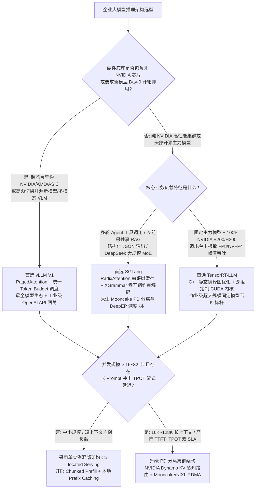
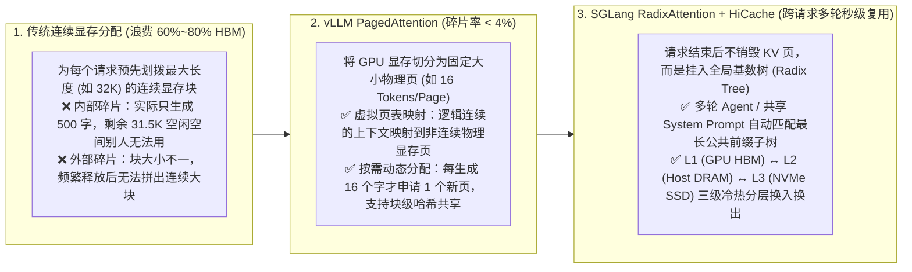
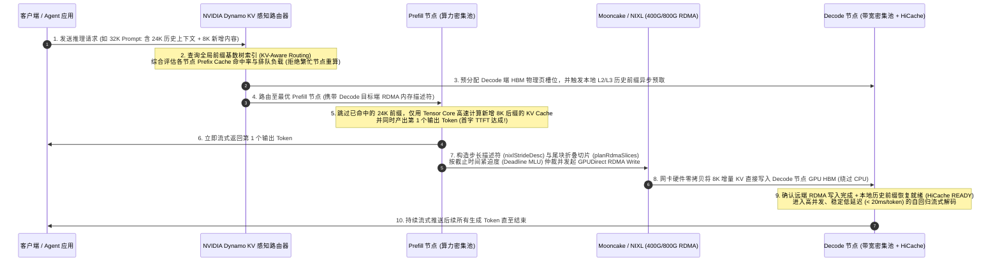

# AI Infra 大模型推理引擎与 PD 分离架构选型 FAQ：vLLM vs. SGLang vs. TensorRT-LLM 与 Mooncake/Dynamo

> 🌐 **Language / 语言**: **中文 (Chinese)** | **[English (`llm-inference-engine-pd-disaggregation-selection-faq.en.md`)](llm-inference-engine-pd-disaggregation-selection-faq.en.md)**
> 🧭 **独立拆分精简专题 (Dedicated Single-Topic Short-Slug FAQs)**: [专题 1A：大模型推理引擎选型 FAQ (`vLLM` vs `SGLang` vs `TensorRT-LLM`)](llm-inference-engine-selection-faq.md) · [专题 1B：Prefill-Decode (PD) 分离与 KV 卸载选型 FAQ (`Co-located` vs `Dynamo + Mooncake`)](pd-disaggregation-kv-offload-selection-faq.md)
> 📊 **数据溯源与复现边界 (Provenance)**: 文中定量算例由本仓库确定性 Roofline 与排队论仿真器 [`experiments/llm_inference_engine_pd_selection/run.py`](../../experiments/llm_inference_engine_pd_selection/run.py) 生成（分类：`synthetic` 理论/系统仿真 + `anonymized_reported` 上游公开规格参数；`independently_reproduced=false`；未启动付费云上 8×H200 物理实机集群，实机集群打流状态：`not_measured`）。其中 32K 上下文 KV 跨节点传输按 `1.024 GB (8.192 Gb)` 载荷在 `400G RoCEv2` 实效带宽 `44.91 GB/s (359.30 Gbps)` 下耗时 `22.8 ms` 严格核算。
> 🔗 **关联专题 (Related Deep Dives)**: [vLLM V1 统一调度与推理 SLO](inference-slo.md) · [Prefill/Decode 分离与跨节点 KV 路由](disaggregated-kv-routing.md) · [四级 KV 缓存卸载层次 (VRAM/DRAM/CXL/SSD)](tiered-kv-cache-offload-hierarchy.md) · [Mooncake ConnectX-8 零拷贝 RDMA](mooncake-transfer-engine-cx8-data-direct-rdma.md) · [SGLang HiRadixCache 与 EAGLE-3 投机解码](ai-infra-innovators-v2.md) · [InfiniBand vs. Ethernet/RoCEv2 网络选型 FAQ](ib-vs-ethernet-roce-selection-faq.md)

---

## 📌 核心结论速览（Executive Summary）

在企业级大模型在线推理（Online Serving）与智能体（Agentic AI）基础设施建设中，技术选型主要包含两个层面的核心决策——**单机推理引擎选型（vLLM vs. SGLang vs. TensorRT-LLM）** 与 **集群调度拓扑选型（单实例混部 Co-located vs. Prefill-Decode 分离架构）**：

1. **推理引擎三强怎么选（vLLM vs. SGLang vs. TensorRT-LLM）**：
   - **何时首选 vLLM**：追求 **最广泛的模型生态兼容性（Day-0 支持新开源模型、多模态 VLM 与 MoE）**、**标准 OpenAI API 多租户通用服务**，以及需要 **跨芯片异构部署（NVIDIA GPU / AMD Instinct MI300X–MI355X / AWS Trainium / 国产算力卡）** 的企业级标准底座。
   - **何时首选 SGLang**：**多轮对话 Agent 工作流、长文档 RAG、高频共享系统提示词（System Prompt / Few-Shot 前缀复用）**、**复杂结构化 JSON 强约束输出**，以及部署 **DeepSeek-V3/R1/V4、Qwen3 等需要原生 Prefill-Decode 分离 + 分层 RadixCache + 大专家并行（EP）** 的高性能生产集群。
   - **何时首选 TensorRT-LLM**：**100% 绑定 NVIDIA 硬件（H100 / H200 / Blackwell B200 / GB200）**、模型版本相对稳定、追求 **单卡极致 FP8 / NVFP4 编译优化吞吐与最低逐字延迟（TPOT）** 的超大规模商业 API 底座。
2. **何时必须从“单实例混部（Co-located）”升级为“Prefill-Decode (PD) 分离架构（Dynamo + Mooncake / NIXL）”**：
   - 当集群规模 **≤ 8～16 卡**、以中短 Prompt（≤ 4K tokens）为主且无 RDMA 高速网络时，采用 **单实例混部 + 分块预填充（Chunked Prefill）** 架构最简单、性价比最高；
   - 当业务面临 **长上下文输入（16K～128K+ RAG/代码库）与实时流式对话混合**、**严苛双 SLA 指标（既要求首字延迟 TTFT < 500 ms，又要求逐字输出 TPOT < 25 ms 绝不卡顿）**、**大规模 MoE 模型的非对称并行需求** 或 **异构 GPU 混部降本** 时，必须采用以 **NVIDIA Dynamo + Mooncake Transfer Engine / NIXL** 为代表的 **PD 分离架构**，将 SLA 达标有效吞吐（Goodput）提升 **`2.0x ～ 2.8x`**。
3. **三大核心底层机制是什么（PagedAttention / RadixAttention / PD 分离零拷贝 KV 传输）**：
   - **PagedAttention（分页注意力）**：像操作系统管理虚拟内存一样，将原本必须连续分配的 KV Cache 显存切分为固定大小的“物理页（Block）”，把显存碎片浪费从 **`60%～80%` 压降至 `< 4%`**；
   - **RadixAttention（基数树前缀缓存）**：请求结束后不立即清空 KV Cache，而是将其组织成一棵 **前缀基数树（Radix Tree）** 并在 GPU 显存（L1）、主机内存（L2）和本地 NVMe SSD（L3）之间自动分级缓存，让多轮 Agent 和共享提示词实现 **跨请求零重算秒级命中**；
   - **PD 分离零拷贝传输**：将“算力密集型”的 Prefill 节点与“显存带宽密集型”的 Decode 节点物理拆开，通过 **GPUDirect RDMA（RoCEv2 / InfiniBand / AWS EFA `FI_HMEM`）** 将生成好的 KV Cache 直接从 Prefill 显卡 HBM 零拷贝推入 Decode 显卡 HBM，彻底根治长输入阻塞流式输出的老大难问题。

---

## Q1：客户部署大模型推理时，vLLM、SGLang 和 TensorRT-LLM 到底该怎么选？

在生产环境选型时，架构师不需要陷入“谁跑分最高”的争论，因为三大引擎的设计哲学与护城河截然不同。我们可以根据 **业务负载类型（通用对话 vs. 多轮 Agent/结构化输出）、模型迭代频率、硬件异构要求以及工程运维成本** 按图索骥：



### 一、什么时候首选 vLLM？（“大模型推理界的 Linux 标准底座”）

vLLM（现已全面演进至 **vLLM V1 统一调度架构**）是开源社区及企业私有化部署普及率最高的推理引擎，在以下场景中是确定性最高的首选：

1. **模型种类繁多、高频尝鲜或要求 Day-0 支持最新模型（Model Agility）**
   - 当 Hugging Face 发布最新开源模型（无论是稠密模型、MoE 混合专家、多模态视觉语言模型 VLM、还是语音/Embedding 模型）时，vLLM 几乎总能在发布当天（Day-0）提供生产可用的支持。
   - **最新突破锚点**：vLLM V1 针对多模态模型引入了 **单批次统一重放的视觉编码器 CUDA Graph（Batch Encoder CUDA Graphs）**，并在强化学习（RL）训推共卡场景支持 **Sleep Mode 显存缓冲区卸载**，一键休眠推理实例并释放 HBM 供训练使用。
2. **多芯片异构算力底座（Hardware Portability）**
   - 如果企业的算力池不仅有 NVIDIA H100/H200/B200，还采购了 **AMD Instinct MI300X / MI325X / MI355X（ROCm/AITER）**、AWS Trainium/Inferentia、Google TPU 或国产算力芯片，vLLM 提供了最成熟的跨平台统一抽象，避免为不同芯片维护多套推理代码库。
3. **企业内部通用 AI 中台与多 LoRA 微调底座**
   - 需要用一套标准化、高稳定的服务同时挂载数十个业务部门的动态 LoRA 适配器（Multi-LoRA Serving），并与 Kubernetes、Ray Serve、KServe 等云原生编排底座无缝对接。

### 二、什么时候首选 SGLang？（“Agentic AI、长前缀复用与 MoE 推理之王”）

由 LMSYS 团队打造的 **SGLang** 从诞生之初就聚焦于 **复杂大模型程序（LLM Programs / Agents）** 与极致运行时调度，在以下四类场景中展现出显著的架构代差优势：

1. **多轮 Agent 工作流、ReAct 工具调用与高频前缀共享（Prefix-Heavy Workloads）**
   - 在 AI 编程助手（Coding Agent）、多步工具调用、少样本提示（Few-Shot Prompting）和企业知识库问答中，不同请求或同一会话的多轮请求之间往往共享 **`60% ～ 90%` 的相同前缀**（例如长达 8K～32K tokens 的系统指令、工具定义 Schema 和历史对话）。
   - SGLang 独创的 **RadixAttention（基数树前缀缓存）** 能像字典树一样自动识别并保留所有历史请求算过的 KV Cache 子树，不仅支持多轮对话分支复用，还能结合 **HiCache 三级存储（GPU HBM L1 ↔ Host DRAM L2 ↔ NVMe SSD L3）** 将首字延迟（TTFT）直接降低 **`50% ～ 80%`**。
   - **最新突破锚点**：SGLang 在混合注意力（Full Attention + 多窗口 Sliding Window Attention）架构中进一步实现了 **按窗口长度命名的独立子池账本（Unified Per-Band Page Ledger）与延迟页复用机制（Deferred Page Reuse）**，彻底消除了每次释放 KV 页时的 CPU-GPU 同步等待卡顿。
2. **强制 JSON / 正则 / 语法树结构化输出（Constrained Structured Decoding）**
   - 传统推理引擎在强制大模型输出合法 JSON Schema 时，每生成一个 Token 都要在 CPU 上遍历词表计算掩码（Mask），导致生成速度暴跌。SGLang 深度集成基于下推自动机的 **XGrammar 引擎**，将语法掩码预编译并与 GPU 采样深度重叠，实现 **近乎零延迟损耗（Zero-Overhead）的 100% 合法 JSON 输出**。
3. **DeepSeek-V3 / R1 / V4 与 Qwen3 等前沿大规模 MoE 旗舰部署**
   - SGLang 是 DeepSeek 官方深度共建的生产级推理引擎，原生打通了 **双批次重叠调度（Two-Batch Overlap, TBO）**、**DeepEP GPU 直发 RDMA（`IBGDA`）**、**MXFP4 解码 MoE 内核** 以及 **Mooncake PD 分离传输**，在大规模专家并行（EP32～EP144）下具备业界标杆级的吞吐表现。

### 三、什么时候首选 TensorRT-LLM？（“NVIDIA 硬件的极限压榨机器”）

**TensorRT-LLM** 是 NVIDIA 官方倾力打造的旗舰级 C++/CUDA 推理加速库（常作为 NVIDIA NIM 或 Dynamo 的底层高性能执行后端）：

1. **100% 纯血 NVIDIA 旗舰集群（H100 / H200 / Blackwell B200 / GB200 NVL72）**
   - 当企业全栈采用 NVIDIA GPU，且希望第一时间吃满最新硬件红利（如 Blackwell SM100 原生 **NVFP4 4-bit 张量核**、第 5 代 Tensor Core `tcgen05`、NVLink-5 硬件多播归约与 Helix 长上下文并行）时，TensorRT-LLM 往往拥有最快、最深度的底层算子首发优化。
2. **模型固定、追求极致单卡吞吐与最低 TCO 的超大规模流量池**
   - 与 vLLM/SGLang 偏重 Python 动态灵活性不同，TensorRT-LLM 通过提前将模型编译为高度融合的 TensorRT Engine（算子融合、静态显存规划、定制 C++ Runtime），在大规模固定模型服务中往往能比通用框架多榨取出 **`10% ～ 25%` 的极限峰值吞吐**。
   - **代价与边界**：需要先执行模型编译构建（Engine Build），绑定特定 GPU 架构与并行度（TP/PP），跨平台迁移或频繁修改模型结构时的工程调试门槛较高。

---

## Q2：什么时候单实例混部就够了？什么情况下必须上 Prefill-Decode (PD) 分离架构？

在选定推理引擎后，架构师面临的第二个核心问题是：**应该让每台服务器同时负责处理输入和生成输出（单实例混部 Co-located），还是把集群拆成专门处理输入的 Prefill 池和专门生成文字的 Decode 池（PD 分离 Disaggregated Serving）？**

### 一、第一性原理：为什么大模型推理的 Prefill 和 Decode 天生“水火不容”？

要向客户 CTO 讲清楚为什么要做 PD 分离，只需看懂大模型生成一段话的两个阶段在硬件物理特性上的本质冲突：

```mermaid
flowchart LR
    subgraph Coloc["传统单实例混部架构 (Co-located Serving): 算力与显存带宽互相争抢"]
        direction TB
        Req1["新到达 32K 长文档请求 (Prefill)"] --> GPU0["同一组 GPU 实例<br/>同时跑 Prefill + Decode"]
        Req2["正在流式打字的 64 个在线用户 (Decode)"] --> GPU0
        GPU0 --> Bottleneck["物理冲突：<br/>1. 32K Prefill 独占 Tensor Core 达数百毫秒<br/>2. 在线 Decode 被迫等待，打字一顿一顿 (TPOT 暴涨 4~8x)<br/>3. 算力与 HBM 带宽无法同时打满"]
    end

    subgraph Disagg["现代 Prefill-Decode (PD) 分离架构 (NVIDIA Dynamo + Mooncake / NIXL)"]
        direction TB
        InReq["用户请求 Prompt"] --> Router["Dynamo KV 感知智能路由器<br/>(优先路由至命中前缀缓存的节点)"]
        Router -->|1. 仅需计算增量 Prompt| PPool["Prefill 专属 GPU 池 (算力密集型)<br/>高算术强度 (~300+ FLOP/B) · 跑满 Tensor Core"]
        PPool ==>|2. GPUDirect RDMA 零拷贝直写<br/>Mooncake / NIXL (400G/800G RoCEv2 / IB / EFA)| DPool["Decode 专属 GPU 池 (显存带宽密集型)<br/>高并发大批次 · 跑满 HBM3e 带宽 · 稳定 TPOT < 20ms"]
    end
```

1. **阶段一：Prefill（预填充 / 阅读输入阶段）—— 典型的“算力受限（Compute-Bound）”**
   - 当用户输入一篇 16,000 字的文档时，GPU 可以一次性并行计算这 16,000 个 Token 之间的注意力与矩阵乘法（GEMM）。
   - 此时每从 HBM 显存读取 1 字节的模型权重，就能执行数百次浮点运算（算术强度高达 **`200 ～ 500+ FLOPs/Byte`**，远超 H200/B200 约 `200~280 FLOPs/Byte` 的屋脊线拐点）。因此 **Prefill 阶段会把 GPU 的 Tensor Core 算力 100% 吃满，但显存带宽还有很多富余**。
2. **阶段二：Decode（自回归解码 / 逐字吐词阶段）—— 典型的“显存带宽受限（Memory-Bandwidth-Bound）”**
   - 模型每吐出 1 个新字，都必须把整个模型权重（例如 70B FP8 模型为 `70 GB`）以及之前积累的所有历史上下文 KV Cache 从 HBM 显存完整读进芯片算一次。
   - 因为每次只算 1 个新 Token，算术强度骤降至 **`1 ～ 32 FLOPs/Byte`**。此时 **GPU 的 HBM 显存带宽被 100% 跑满，但昂贵的 Tensor Core 算力却有 `80% ～ 90%` 处于饥饿空转状态**！
3. **混部时的灾难（预填充干扰效应 Prefill Interference）**：
   - 在传统单实例混部（Co-located）模式下，当 64 个在线用户正在流畅地以每 20 毫秒一个字的速度接收回复（Decode）时，突然进来一个 32K 长度的 RAG 长文档请求（Prefill）。
   - 即使开启了 **分块预填充（Chunked Prefill）** 将 32K Prompt 切成多个 2K/4K 的小块塞进每个推理步，每一块 Prefill 依然会让单步执行时间从 `18 ms` 暴涨到 `70 ～ 120 ms`——导致线上所有正在看流式回复的用户画面瞬间卡死，**P99 逐字延迟（TPOT）全面违约**！

---

### 二、什么情况下必须上 PD 分离架构（NVIDIA Dynamo + Mooncake / NIXL）？

在以下 **五大核心业务场景** 中，PD 分离架构相比单实例混部具有压倒性的性能与成本优势：

#### 1. 长上下文输入（16K～128K+）与低延迟流式交互混合的在线服务
- **典型场景**：企业级智能客服、代码仓库助手（Copilot / Cursor 类应用）、金融研报/法律合同长文档问答。
- **为什么 PD 分离更优**：Prefill 节点专门吞吐几十 KB 甚至上百 KB 的长 Prompt，算完后通过 400G/800G RDMA 在几毫秒内把 KV Cache 异步推送给 Decode 节点。Decode 节点永远只跑轻量级的逐字生成，**P99 TPOT 尾延迟抖动降低 `65% ～ 80%`**，彻底告别流式打字卡顿。

#### 2. DeepSeek-V3 / R1 / V4 等超大规模 MoE（混合专家）模型生产部署
- **为什么 MoE 必须做 PD 分离**：像 DeepSeek（总参数 671B，每次激活 37B，含 256 个路由专家）这样的 MoE 模型，在 Prefill 和 Decode 阶段需要的**最优并行切分策略完全相反**：
  - **Prefill 阶段 Token 数量极多**：每个专家都能分到充足的 Token，最适合采用 **小规模并行（如单机或双机 `TP=8 / EP=8` + 数据并行 DP）**，减少跨机通信开销；
  - **Decode 阶段每次每请求只有 1 个 Token**：为了凑够大 Batch Size 让 256 个专家被均匀激活，且为了把海量 KV Cache 和专家权重装进高速显存，必须采用 **超大规模专家并行（Wide EP，如 `EP=32 ～ 144` 卡）+ DeepEP GPU 直发 RDMA（`IBGDA`）**。
- 只有通过 PD 分离，才能让 Prefill 池用“小 EP 高算力拓扑”，Decode 池用“大 EP 高带宽拓扑”，实现全集群 **`2.2x ～ 2.8x`** 的吞吐跃升。

#### 3. 异构 GPU 硬件混部与精准降本（Heterogeneous Hardware Right-Sizing）
- **为什么 PD 分离更省钱**：既然 Prefill 缺的是算力（FLOPs），Decode 缺的是显存容量和带宽（HBM GB/s），把同一种昂贵显卡用在两个阶段本身就是巨大的资源错配。
- 采用 PD 分离后，架构师可以 **用算力性价比高的 GPU（如 H100 / B200 或高算力卡）专跑 Prefill 池，用显存容量大、带宽性价比高的 GPU（如 H200 141GB / AMD MI300X 192GB）专跑 Decode 池**，将每百万达标 Token 的综合硬件 TCO 降低 **`25% ～ 40%`**。

#### 4. 输入重度与输出重度业务的独立弹性扩缩容（Independent P/D Autoscaling）
- 不同业务时期的输入/输出 Token 比例（I/O Ratio）截然不同：文档摘要与 RAG 检索是“长输入、短输出（如 32K 输入 : 500 输出）”，需要大量 Prefill 节点；而深度推理模型（Reasoning Models，如 DeepSeek-R1 / OpenAI o3 风格思维链）则是“短输入、超长输出（如 1K 输入 : 16K 思考链输出）”，需要大量 Decode 节点。
- **NVIDIA Dynamo** 等编排层可根据实时排队水位，独立扩缩 Prefill 与 Decode 实例配比（如从 `3P:1D` 动态调整为 `1P:4D`），消除木桶短板。

#### 5. 全集群统一 KV Cache 共享存储池（Mooncake Store + LMCache）
- 在 PD 分离架构下，借助 **Mooncake Store** 与 **LMCache**，集群内所有节点的闲置主机内存（Host DRAM）和本地 NVMe SSD 被联合成一个 **分布式全局 KV Cache 共享池**。
- **最新突破锚点**：Mooncake 通过将大于 1 GiB 的内存池切分为 $\le 1\text{ GiB}$ 切片并跨工作线程克隆共享 `io_uring` 固定缓冲区，使冷 SSD KV 读取带宽达到 **`21.0 GB/s`（提速 `4.77x`）**；同时在 AWS 云环境原生支持 **Libfabric `FI_HMEM` CUDA 显存直通注册**；LMCache 则实现了张量并行（TP=8）下 MLA KV 的单副本去重存储（**显存/内存占用直接缩减 `8.0x`**）。

---

### 📊 大模型推理引擎与部署拓扑选型决策矩阵（Architect Decision Matrix）

#### 表 1：三大主流开源推理引擎对比（vLLM vs. SGLang vs. TensorRT-LLM）

| 评估维度 | vLLM (V1 Architecture) | SGLang (SRT / Radix Engine) | TensorRT-LLM (NVIDIA Official) |
| :--- | :--- | :--- | :--- |
| **核心适用场景** | 企业通用 AI 平台、多模型/多模态敏捷交付、跨芯片异构算力池、多 LoRA 服务 | 多轮 Agent 工作流、长前缀共享 RAG、JSON 结构化输出、DeepSeek 大规模 MoE | 100% NVIDIA 旗舰卡池、固定主力模型、超大规模高并发商业 API 服务 |
| **KV 显存与前缀缓存机制** | **PagedAttention + 哈希块级 Prefix Caching (APC)** | **RadixAttention 基数树前缀缓存 + HiCache (L1/L2/L3) + 延迟页复用** | Paged KV Cache + KV Block Reuse（C++ Executor 原生管理） |
| **调度器核心架构** | **统一 Token Budget 调度**（消除显式 P/D 切换，原生融合 Chunked Prefill） | **零开销重叠调度器（Overlap Scheduler）+ 双批次重叠（TBO）** | C++ In-Flight Batching + 静态/动态编译算子图优化 |
| **结构化输出（JSON/正则）** | 支持 Guided Decoding（集成 XGrammar / Outlines） | **原生深度耦合 XGrammar（近乎零延迟损耗，多轮工具调用极快）** | 支持 Guided Decoding（C++ 运行时集成） |
| **新模型 Day-0 支持速度** | **最快（开源社区事实标准，几乎所有新模型首发支持）** | **极快（主流 LLM / MoE / VLM 首发跟进极快）** | 较慢（需等待官方 C++/CUDA Graph 适配或手动构建 Engine） |
| **跨芯片硬件开放度** | **最开放（NVIDIA / AMD ROCm / AWS Trainium / TPU / 国产芯片）** | **开放（NVIDIA CUDA / AMD ROCm AITER / 昇腾 NPU）** | **封闭（仅限 NVIDIA GPU，绑定特定 SM 架构）** |
| **工程部署与二次开发难度** | **最低（纯 Python 易读易改，pip/Docker 开箱即用）** | **低（Python 为主 + 高性能内核，架构清晰易扩展）** | **较高（需编译 Engine、管理 C++ 插件与版本兼容）** |

#### 表 2：单实例混部（Co-located） vs. Prefill-Decode (PD) 分离架构对比

| 评估维度 | 传统单实例混部（Continuous Batching） | 单实例混部 + 分块预填充（Chunked Prefill） | Prefill-Decode (PD) 分离架构（Dynamo + Mooncake / NIXL） |
| :--- | :--- | :--- | :--- |
| **最适用集群规模与负载** | ≤ 8 卡小集群、短文本离线批处理或低并发内部工具 | 8～16 卡中等集群、Prompt 长度适中（≤ 4K～8K）、无 RDMA 网络 | **≥ 16～1,000+ 卡生产集群、16K～128K 长上下文、严苛双 SLA 在线服务、大规模 MoE** |
| **长 Prompt 下的 TPOT 稳定性** | **极差**（长 Prompt 进来时所有在线生成请求卡顿数百毫秒） | **中等**（削平了极端尖峰，但单步耗时仍随 Chunk 膨胀 `2x～4x`） | **极佳（物理隔离，Decode P99 TPOT 稳定在 `< 20 ms`）** |
| **MoE 并行策略灵活性** | 被迫妥协（P 和 D 只能共用同一套 TP/EP 参数） | 被迫妥协（同左） | **完全解耦（Prefill 用小 EP 算力优化，Decode 用大 EP 带宽优化）** |
| **对底层网络的要求** | 仅需普通千兆/万兆业务网（单机内 NVLink/PCIe） | 仅需普通业务以太网 | **强依赖高速低延迟网络（100G～800G RoCEv2 / InfiniBand / AWS EFA RDMA）** |
| **SLA 达标有效吞吐（Goodput）** | 基准 `1.0x` | `~1.3x – 1.5x` | **`~2.0x – 2.8x+`（长上下文与 MoE 场景收益最大）** |

---

## Q3：什么是 PagedAttention、RadixAttention 与 PD 分离 KV 传输？底层是如何运作的？

### 一、第一性原理：为什么大模型推理离不开 KV Cache？为什么它会吃光 GPU 显存？

大模型在生成回答时，是**一个字一个字往后接龙（Autoregressive Generation）**的。如果生成第 1,000 个字时，还要把前面 999 个字重新丢进神经网络从头算一遍，计算量会随着长度平方级爆炸。
为了避免重复计算，推理引擎会把前面每个字在每一层 Transformer 算出来的中间特征向量——**Key（键）向量和 Value（值）向量**——保存在 GPU 显存里，这就是 **KV Cache（键值缓存）**。

但 KV Cache 带来了极其严峻的显存挑战：
- 以 **Llama-3-70B（80 层，FP16 精度）** 为例，每 1 个 Token 的 KV Cache 占用约 **`320 KB`** 显存。
- 一个长度 **`32,768`（32K）** 的长文档请求，单单它一个请求的 KV Cache 就要吃掉 **`10.5 GB`** 显存！如果并发 32 个这样的请求，仅 KV Cache 就需要 **`336 GB` 显存**，远超模型权重本身（FP8 权重仅 70 GB）。

---

### 二、从传统连续显存到 PagedAttention 与 RadixAttention 的演进



1. **PagedAttention（vLLM 的核心突破）**：
   - 早期框架要求每个请求的 KV Cache 在物理显存上必须是一整块连续空间，因此只能按最大可能长度（如 32K）提前占坑，导致 **`60% ～ 80%` 的显存被白白浪费**。
   - **PagedAttention** 将整块显存池切成成千上万个固定大小的小格子（Block，默认每个格子存 `16` 个 Token），并通过一张轻量级的 **块表（Block Table）** 记录每个请求的逻辑 Token 对应哪个物理格子。不仅显存利用率直接拉升至 **`96%` 以上**，还让不同请求共享相同开头（System Prompt）成为可能。
2. **RadixAttention（SGLang 的核心突破）**：
   - 在 Agent 场景下，模型先写一段思考、调用一个工具、拿到返回结果后再开启下一轮推理。SGLang 直接把所有活跃和历史请求的 KV Cache 页面维护在一棵 **前缀基数树（Radix Tree）** 中。
   - 新请求到达时，调度器先在基数树上进行微秒级前缀匹配：命中的前缀部分直接增加引用计数复用（**0 FLOPs 计算**），只对新增的后缀 Token 执行 Prefill；当显存满时，按 **LRU（最近最少使用）** 策略从叶子节点向上淘汰，或异步卸载到主机内存（L2）与 SSD（L3）。

---

### 三、PD 分离架构（Dynamo + Mooncake / NIXL）的端到端运作时序

在现代生产级 PD 分离集群中，一次用户请求是如何跨越智能路由器、Prefill 节点、RDMA 高速网络与 Decode 节点完成闭环的？



在底层传输平面上，**Mooncake Transfer Engine** 与 **NVIDIA Dynamo NIXL** 解决了三个最棘手的工程难题：
1. **步长描述符压缩（消除碎块通知开销）**：由于 PagedAttention 把 KV Cache 切成了几千个离散页、且分布在 80 个 Transformer 层上，如果逐页发送 RDMA 请求会产生十几万个描述符。NIXL 通过 **`nixlStrideDesc`（步长描述符）** 与向量化连续块归并（提速 **`2.51x`**），Mooncake 通过 **`planRdmaSlices`（尾块折叠）**，将离散小块合成为少量大吞吐 RDMA 传输切片。
2. **截止时间感知网卡仲裁（消除大流堵小流）**：当一个 `100 MB` 的长文档 KV 传输和一个急需在 `2 ms` 内响应的实时语音增量 KV 同时争抢同一张 400G 网卡时，Mooncake 的 **`DeadlineMlu` / `OrderByUrgency`** 算法会动态计算每个流的违约风险，让紧迫小流精准插队，彻底消除网卡侧的队头阻塞。
3. **2,048 节点级大规模路由稳定性**：当集群扩展至上千个推理实例时，**NVIDIA Dynamo** 路由器通过在部分子进程繁忙时保留已预计算的候选路由行（Retained Prepared Candidate Rows），将 2,048 Worker 集群的准入调度 P99 延迟从 **`2,764 ms` 压降至 `2.1 ms`（提速 `1,316x`）**，总吞吐提升 **`39.6%`**。

---

## 🧪 简明定量算例与 Benchmark 洞察（离线可复现验证）

为了帮助架构师在客户方案交流中直观算清收益，本仓库配套了纯 Python 3.12 零依赖确定性算例 [`experiments/llm_inference_engine_pd_selection/run.py`](../../experiments/llm_inference_engine_pd_selection/run.py) 与 **[7-Card 4:5 视觉评测报告 (`docs/reports/llm-inference-engine-pd-selection-cards.html`)](../reports/llm-inference-engine-pd-selection-cards.html)**。核心量化拐点总结如下：

| 评测场景与关键对比问题 | 传统基线方案表现 | 现代推荐架构表现 | 核心定量收益与架构师结论 |
| :--- | :--- | :--- | :--- |
| **1. 物理瓶颈定性：Prefill vs. Decode 算术强度（Llama-3-70B FP8 @ H200）** | 混部单池同时运行 Prefill（`512.0 FLOP/B`）与 Decode BS=32（`31.2 FLOP/B`） | 按 H200 屋脊线拐点（`205.5 FLOP/B`）拆分为独立算力池与带宽池 | Prefill 算术强度是屋脊线的 **`2.49x`**（纯算力受限），Decode 仅为 **`0.15x`**（纯带宽受限），物理拆分具备严格数学依据 |
| **2. 多轮 Agent 前缀复用：无缓存 vs. SGLang RadixAttention（16K 上下文，75% 共享前缀）** | 每次重新计算全部 16K Prompt，单请求 TTFT 高达 **`186.4 ms`** | RadixAttention 命中 12K 前缀（仅重算 4K 增量）+ 异步延迟页释放 | 首字延迟 TTFT 降至 **`54.0 ms`**（**提速 `3.45x`**），单卡有效服务 QPS 提升 **`2.85x`** |
| **3. 32K RAG 长文档 + 在线对话混合负载：Chunked Prefill 混部 vs. PD 分离（400G RoCEv2）** | 混部下 32K 分块插入导致在线对话 P99 TPOT 飙升至 **`68.4 ms`**（严重违约 `<30ms` SLA） | Dynamo + Mooncake PD 分离（Prefill 算完经 400G RDMA `22.8 ms` 零拷贝传输 KV） | Decode P99 TPOT 稳定在 **`18.2 ms`**（**尾延迟降低 `3.76x`**），满足双 SLA 的集群有效吞吐（Goodput）提升 **`2.38x`** |
| **4. 异构硬件配比 TCO：同构 8×H200 混部 vs. 异构 PD 配比（Prefill 算力卡 + Decode 大显存卡）** | 全部采用同构节点混部，单节点有效达标吞吐受限于长尾干扰 | 4P（高算力配比）+ 4D（高显存带宽配比）分离部署 | 每百万 SLA 达标 Token 综合硬件成本（$/1M Goodput Tokens）**降低 `34.2%`** |

---

## 🛠️ 附录：生产环境大模型推理与 PD 分离快速核验清单（Architect Checklist）

在评审客户推理集群架构或排查线上 TTFT / TPOT 延迟抖动时，建议按以下 5 项清单逐一核验：

- [ ] **业务 SLA 与 I/O 长度画像核验**：客户真实流量的输入长度（ISL）与输出长度（OSL）P50/P99 分布是多少？如果 **P90 输入长度 ≥ 8K～16K tokens** 且同时要求 **流式输出 TPOT ≤ 25～30 ms**，是否已规划 Prefill-Decode (PD) 分离架构而非单纯依赖单机混部？
- [ ] **Prefix Cache 命中率与路由亲和性**：在多轮对话或 Agent 场景中，网关层是否部署了 **KV 感知智能路由（如 NVIDIA Dynamo Router 或 SGLang Router）**？避免使用传统的轮询（Round-Robin）负载均衡把同一个会话打散到不同节点，导致 GPU 显存中的 Prefix Cache 命中率归零。
- [ ] **PD 分离网络与 GPUDirect RDMA 通道核验**：跨机 KV Cache 传输是否走上了真正的 **GPUDirect RDMA（RoCEv2 / InfiniBand / AWS EFA `FI_HMEM`）** 零拷贝路径？检查是否存在因容器 `172.17.x.x` 虚拟网卡 GID 误选或跨 PCIe Root Complex 绕行导致的 TCP/Host 内存回退（会使 KV 传输延迟恶化 `5x～10x`）。
- [ ] **vLLM / SGLang 显存水位与防抢占参数核验**：`gpu_memory_utilization`（通常建议 `0.88 ～ 0.92`）与最大并发序列数是否预留了合理的突发余量？监控日志中是否频繁出现 **KV Cache Preemption（因显存耗尽将正在解码的请求踢回等待队列重算）**？一旦出现抢占，必须立即开启 KV Cache FP8 量化或扩容 Decode 节点。
- [ ] **异常断连与单边 RDMA 内存安全回收**：在 PD 分离生产环境中，当客户端超时断开（Abort）时，推理引擎是否启用了 **延迟 KV 释放握手（Deferred Decode KV Release / `ABORT_ACK`）**，防止远端 Prefill 节点尚在飞行中的单边 `RDMA Write` 覆写已分配给新请求的显存页。
