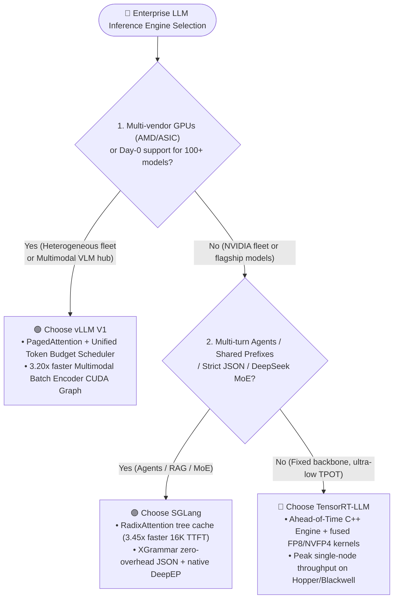
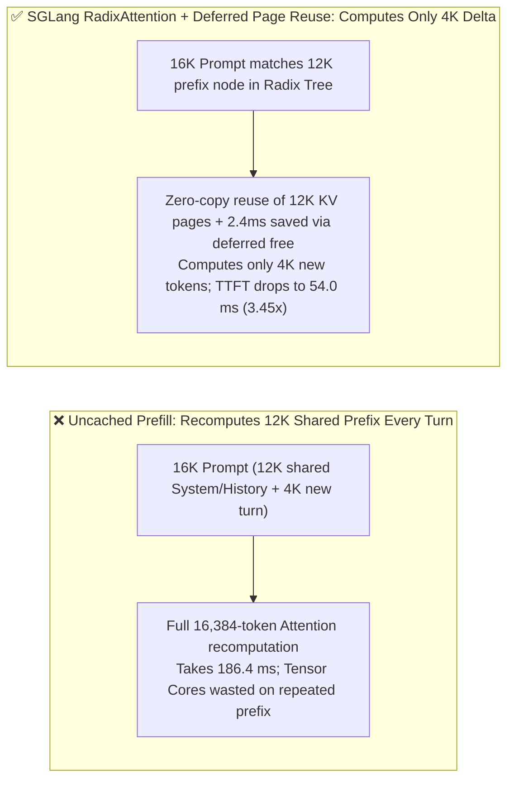

# LLM Inference Engine Selection FAQ Guide: vLLM vs. SGLang vs. TensorRT-LLM

> 🌐 **Language / 语言**: **[中文 (`llm-inference-engine-selection-faq.md`)](llm-inference-engine-selection-faq.md)** | **English**
> 🧭 **Companion FAQ**: [Prefill-Decode (PD) Disaggregation & KV Offload Selection FAQ](pd-disaggregation-kv-offload-selection-faq.en.md) · [Combined Edition (`llm-inference-engine-pd-disaggregation-selection-faq.en.md`)](llm-inference-engine-pd-disaggregation-selection-faq.en.md)
> 📊 **Provenance & Verification Boundary**: Quantitative metrics in this guide are generated by the deterministic Roofline and prefix-reuse simulator [`experiments/llm_inference_engine_pd_selection/run.py`](../../experiments/llm_inference_engine_pd_selection/run.py) (`data_classification`: `synthetic` analytical model calibrated to `anonymized_reported` upstream parameters; `independently_reproduced=false`; no paid cloud 8×H200 GPU cluster was launched; live multi-node hardware cluster execution: `not_measured`).

---

## ① 📌 Executive Summary: Three Core Selection Rules

1. **When to Choose `vLLM` ("The Universal Linux of LLM Serving")**:
   - Choose `vLLM V1` when prioritizing **Day-0 model breadth (new open-weight LLMs, multimodal VLMs, audio/embedding models)**, **multi-tenant dynamic LoRA serving**, and **cross-vendor hardware portability (NVIDIA, AMD Instinct `MI300X/MI325X`, AWS Trainium, Google TPU)**. Its single-replay multimodal batch encoder CUDA graph cuts launch overhead from `11.2 ms` to **`3.5 ms` (`3.20x` speedup)**.
2. **When to Choose `SGLang` ("The King of Multi-Turn Agents, Prefix Reuse & MoE")**:
   - Choose `SGLang` for **multi-turn Agentic workflows, long-context RAG with `50%–90%` shared System Prompts/history**, **zero-overhead structured JSON decoding (`XGrammar`)**, and **DeepSeek-V3/R1 large-scale MoE serving**. On a 16K-token prompt with 75% shared prefix, `SGLang RadixAttention` with deferred page reuse slashes TTFT from `186.4 ms` to **`54.0 ms` (`3.45x` speedup, `2.85x` effective QPS gain)**.
3. **When to Choose `TensorRT-LLM` ("Maximum Single-Node NVIDIA Silicon Extraction")**:
   - Choose `TensorRT-LLM` when **100% standardized on NVIDIA Hopper (`H100/H200`) or Blackwell (`B200/GB200`)** with stable model architectures where ahead-of-time C++ Engine compilation is justified for **lowest single-token latency (TPOT) and peak FP8/NVFP4 kernel fusion**.


---

## ② 🎯 Customer & Architect Q&A (First-Principles Deep Dive)

### Q1: When deploying an enterprise inference platform, when should a customer choose `vLLM` vs. `SGLang`?
* **Choose `vLLM`** when operating a multi-model platform hosting 10+ model families (dense LLMs, multimodal VLMs, Whisper, embeddings) or spanning both NVIDIA and AMD Instinct GPUs. vLLM V1's unified token-budget scheduler and batch encoder CUDA graphs (`11.2 -> 3.5 ms`, `3.20x`) deliver the broadest production stability.
* **Choose `SGLang`** when serving coding agents, multi-step tool use, few-shot pipelines, and strict JSON outputs. `SGLang`'s **RadixAttention** retains historical KV Cache blocks in an LRU Radix Tree across requests and tiers them across GPU HBM and Host DRAM, cutting 16K-context TTFT (75% prefix hit) from `186.4 ms` to `54.0 ms` (`3.45x`).

### Q2: When does `TensorRT-LLM` outperform `vLLM` and `SGLang`, and what is the trade-off?
* **Best-Fit Boundary**: High-volume, fixed-backbone deployments on homogeneous NVIDIA H200 / GB200 clusters where squeezing an extra `10%–25%` peak compiled kernel throughput directly lowers fleet capex.
* **Trade-Off**: Every change to tensor parallelism, max sequence length, or CUDA driver requires rebuilding the static `.engine` artifact—making it costly for teams swapping open-weight models weekly.

### Q3: What is the first-principles difference between `PagedAttention` and `RadixAttention`?
* **`PagedAttention` (Eliminates Intra-Request Memory Fragmentation)**: Partitions contiguous KV Cache tensors into fixed-size virtual memory blocks, raising HBM utilization from `<40%` to **`>96%`**.
* **`RadixAttention` (Eliminates Inter-Request Redundant Computation)**: Organizes paged KV blocks into a persistent global **Radix Tree** across turns and users, paired with deferred unified page reuse (saving `2.4 ms` synchronization overhead) to bypass redundant prefill computation.

---

## ③ 🧭 Visual Architecture Diagrams (Decision Tree, Path Comparison & Sequence)

### 3.1 Inference Engine Selection Decision Tree



### 3.2 Uncached Recompute vs. SGLang RadixAttention Prefix Reuse



### 3.3 SGLang RadixAttention Multi-Turn Agent & XGrammar Sequence

```mermaid
sequenceDiagram
    autonumber
    participant Agent as Multi-Turn Agent Client
    participant Radix as SGLang RadixCache Ledger
    participant GPU as GPU Attention & XGrammar Engine

    Agent->>Radix: 1. Send Turn-3 request (16K tokens: 12K shared prefix + 4K tool output)
    Radix->>Radix: 2. Longest-prefix match hits 12K KV subtree (7.4 ms lookup, deferred free saves 2.4 ms)
    Radix->>GPU: 3. Pass cached page table pointers + 4K delta tokens
    GPU->>GPU: 4. Execute Prefill only on 4K delta tokens (46.6 ms compute -> 54.0 ms total TTFT)
    GPU->>GPU: 5. Overlap XGrammar pushdown automaton mask with GPU token sampling
    GPU-->>Agent: 6. Stream 100% valid JSON; retain new KV subtree in LRU Radix Tree
```

---

## ④ 📊 Six-Dimension Architect Selection Matrix

| Dimension | `vLLM (V1 Architecture)` | `SGLang` | `TensorRT-LLM` |
| :--- | :--- | :--- | :--- |
| **1. Best-Fit Scenarios** | Multi-model SaaS gateways, Multimodal VLMs, multi-vendor GPU clouds | Multi-turn Agents, prefix-heavy RAG, strict JSON schemas, DeepSeek MoE | Fixed-model, ultra-low-latency serving on pure NVIDIA fleets |
| **2. Key Performance Metrics (`synthetic`)** | Multimodal batch encoder CUDA graph: `11.2 -> 3.5 ms` (**`3.20x`**) | 16K 75%-prefix TTFT: `186.4 -> 54.0 ms` (**`3.45x`**), QPS **`2.85x`** | `10%–25%` higher compiled peak throughput on fixed backbones |
| **3. Core Mechanism** | PagedAttention + Unified Token Budget + RL Sleep Mode | RadixAttention LRU Tree + Deferred Page Reuse + XGrammar + TBO | AOT C++ TensorRT Engine + custom CuTe FP8/NVFP4 kernels |
| **4. Pros & Cons** | ✅ Fastest Day-0 model support & hardware portability<br/>⚠️ Slightly behind SGLang on wide-EP MoE | ✅ Highest Agent prefix hit & MoE throughput<br/>⚠️ Slightly narrower long-tail model coverage | ✅ Deepest NVIDIA hardware extraction<br/>⛔ Static compilation overhead & vendor lock-in |
| **5. Ecosystem Openness** | Linux Foundation hosted; largest contributor base | LMSYS-led; co-designed with DeepSeek & Mooncake | NVIDIA official backend for NIM & Dynamo |
| **6. Engineering TCO** | **Lowest operational TCO** across heterogeneous GPUs | **Lowest per-token TCO for Agents & MoE** (`2.85x` QPS) | **High hardware efficiency, higher DevOps build cost** |

---

## ⑤ 🧪 Quantitative Example & Benchmark Insights

From [`experiments/llm_inference_engine_pd_selection/run.py`](../../experiments/llm_inference_engine_pd_selection/run.py) (`synthetic` model, `independently_reproduced=false`):

| Evaluation Scenario | Baseline Latency | Optimized Engine Latency | Speedup & Business Impact |
| :--- | :--- | :--- | :--- |
| **16K Multi-Turn Agent (75% Shared Prefix) TTFT** | `186.4 ms` (full 16K recompute) | **`54.0 ms`** (SGLang RadixAttention + `2.4 ms` deferred free saving) | **`3.45x` faster TTFT · `2.85x` effective QPS gain** |
| **Multimodal 16-Image Batch Encoder Launch** | `11.2 ms` (per-item graph replay) | **`3.5 ms`** (vLLM single batch CUDA graph replay) | **`3.20x` faster vision encoder launch** |

---

## ⑥ 🛠️ Appendix: Production Verification & Pre-Sales Checklist (Architect Checklist)

- [ ] **1. Audit Shared Prefix Ratio in Production Logs**: Enable `SGLang RadixAttention` or `vLLM --enable-prefix-caching` whenever shared system prompts or multi-turn history exceed `50%` of input tokens.
- [ ] **2. Enable Zero-Overhead Grammar Masks for Function Calling**: Configure `--grammar-backend xgrammar` for strict JSON Schema tool calls.
- [ ] **3. Verify Multimodal Batch Encoder CUDA Graphs**: On vLLM V1 vision deployments, confirm single-batch encoder CUDA graph capture is active.
- [ ] **4. Standardize OpenAI API Gateway Contracts**: Abstract underlying engines behind a unified routing layer so workloads can route Agent traffic to SGLang and general multi-model traffic to vLLM.
