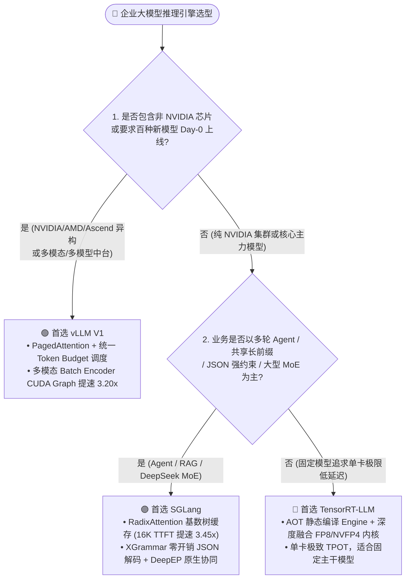
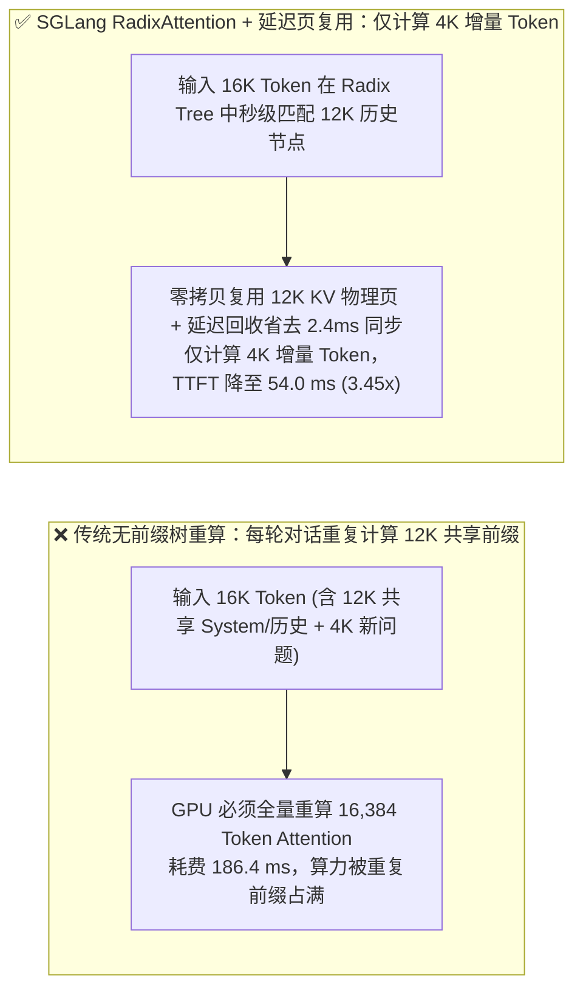
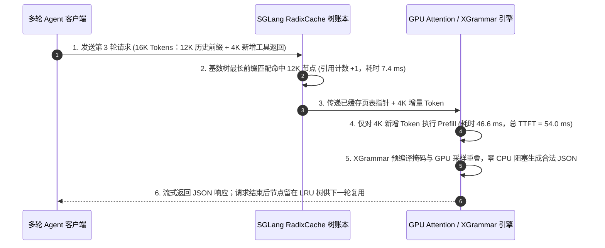

# 大模型推理引擎选型 FAQ 指南：vLLM vs. SGLang vs. TensorRT-LLM

> 🌐 **Language / 语言**: **中文 (Chinese)** | **[English (`llm-inference-engine-selection-faq.en.md`)](llm-inference-engine-selection-faq.en.md)**
> 🧭 **姊妹专题 (Companion FAQ)**: [大模型 Prefill-Decode (PD) 分离与 KV 卸载选型 FAQ](pd-disaggregation-kv-offload-selection-faq.md) · [综合合订版 (`llm-inference-engine-pd-disaggregation-selection-faq.md`)](llm-inference-engine-pd-disaggregation-selection-faq.md)
> 📊 **数据溯源与复现边界 (Provenance)**: 文中定量结果来自本仓库确定性 Roofline 与前缀缓存仿真器 [`experiments/llm_inference_engine_pd_selection/run.py`](../../experiments/llm_inference_engine_pd_selection/run.py)（分类：`synthetic` 理论/系统算例 + `anonymized_reported` 上游公开规格；`independently_reproduced=false`；未启动付费云上 8×H200 实机集群，物理集群实测状态：`not_measured`）。

---

## ① 📌 核心结论速览（Executive Summary）

1. **何时首选 `vLLM`（“大模型推理界的 Linux 通用底座”）**：
   - 当企业追求 **最广泛的模型生态兼容性（新开源 LLM、多模态 VLM、语音模型 Day-0 开箱即用）**、**多租户动态 LoRA 服务**，或需要跨越 **NVIDIA GPU、AMD Instinct (`MI300X/MI325X`)、AWS Trainium 与国产算力芯片** 维护统一推理底座时，100% 首选 `vLLM V1`。其最新单批次重放视觉编码器 CUDA Graph 将多模态启动开销从 `11.2 ms` 降至 **`3.5 ms`（提速 `3.20x`）**。
2. **何时首选 `SGLang`（“多轮 Agent、长前缀共享与大规模 MoE 之王”）**：
   - 当业务核心是 **多轮 ReAct Agent 工具调用、长文档 RAG（共享 50%～90% System Prompt/历史前缀）**、**强约束 JSON 结构化输出（XGrammar）**，或部署 **DeepSeek-V3/R1 等大规模 MoE 模型** 时，首选 `SGLang`。在 16K 上下文、75% 共享前缀下，`SGLang RadixAttention` 配合延迟页复用将首字延迟（TTFT）从 `186.4 ms` 压降至 **`54.0 ms`（提速 `3.45x`，有效 QPS 提升 `2.85x`）**。
3. **何时首选 `TensorRT-LLM`（“纯 NVIDIA 旗舰集群的极限压榨引擎”）**：
   - 当集群 **100% 绑定 NVIDIA Hopper (`H100/H200`) 或 Blackwell (`B200/GB200`)**、模型结构相对固定，且愿意承担 C++ Engine 静态编译构建成本以换取 **单卡极致 FP8/NVFP4 峰值吞吐与最低逐字延迟（TPOT）** 时，选用 `TensorRT-LLM`。

---

## ② 🎯 客户与架构师灵魂拷问 Q&A（FAQ-Driven）

### Q1：客户部署在线推理平台时，什么时候选 `vLLM`，什么时候选 `SGLang`？
* **选 `vLLM` 的场景**：企业 AI 中台需要同时托管 10+ 种不同架构模型（Llama、Qwen、多模态 Qwen-VL、Whisper、Embedding），或者底层既有 NVIDIA H200 又有 AMD MI300X。vLLM V1 的统一 Token Budget 调度器与多模态单次批重放 CUDA Graph（`11.2 -> 3.5 ms`，`3.20x`）提供了最稳健的通用底座。
* **选 `SGLang` 的场景**：Coding Agent、智能客服多轮对话、Few-Shot 批处理与 JSON Schema 强约束抽取。传统前缀缓存在请求结束后容易被冲刷，而 `SGLang` 的 **RadixAttention（基数树缓存）** 将历史 KV Cache 组织为 LRU 前缀树并支持 GPU HBM ↔ Host DRAM 分级留存，在 16K 上下文 75% 前缀命中下将 TTFT 从 `186.4 ms` 降至 `54.0 ms`（`3.45x`）。

### Q2：什么情况下 `TensorRT-LLM` 会优于 `vLLM` 和 `SGLang`？代价是什么？
* **适用边界**：超大规模单一主力模型（如全公司统一调用的 70B/405B 主干模型）运行在纯 NVIDIA H200 / GB200 上，且对单卡极致 FP8/NVFP4 算子融合有硬性要求。
* **工程代价**：每次调整 Tensor Parallelism 度数、最大序列长度或升级驱动时，都需要重新编译 `.engine` 文件；对于每周频繁微调或频繁更换开源新模型的团队，编译与排障成本远高于 `vLLM` / `SGLang`。

### Q3：什么是 `PagedAttention` 与 `RadixAttention`？两者底层有什么本质区别？
* **`PagedAttention`（解决“单次请求内部的显存碎片”）**：借鉴操作系统虚拟内存分页，把连续的 KV Cache 拆成固定大小的物理块（如每块 16 个 Token），使显存利用率从不足 40% 提升至 **96% 以上**。
* **`RadixAttention`（解决“跨请求、跨轮次的重复计算”）**：在分页存储之上构建一棵全局 **基数树（Radix Tree）**，把不同请求共用的 System Prompt、工具定义与多轮历史作为树节点长期驻留，并配合延迟统一页回收（Deferred Page Reuse，节省 `2.4 ms` 同步开销）实现秒级首字响应。

---

## ③ 🧭 直观可视化图解（Mermaid 选型决策树 + 架构对比 + 时序图）

### 3.1 推理引擎选型决策树

### 3.2 无缓存重算 vs. SGLang RadixAttention 前缀树命中对比图

### 3.3 SGLang RadixAttention 多轮 Agent 前缀命中与 XGrammar 解码时序图

---

## ④ 📊 架构师选型决策矩阵（Architect Decision Matrix）

| 对比维度 | `vLLM (V1 架构)` | `SGLang` | `TensorRT-LLM` |
| :--- | :--- | :--- | :--- |
| **1. 核心适用场景** | 企业通用多模型中台、多模态 VLM、跨芯片异构云 | 多轮 Agent、共享长前缀 RAG、JSON 强约束、DeepSeek MoE | 纯 NVIDIA 旗舰卡固定主力模型超低延迟服务 |
| **2. 关键性能指标 (`synthetic`)** | 多模态编码器 CUDA Graph 启动：`11.2 -> 3.5 ms` (**`3.20x`**) | 16K 75% 前缀命中 TTFT：`186.4 -> 54.0 ms` (**`3.45x`**)，QPS **`2.85x`** | 固定模型静态编译峰值吞吐较通用 Python 框架高 `10%–25%` |
| **3. 底层核心机制** | PagedAttention + 统一 Token Budget 调度 + Sleep Mode | RadixAttention 基数树 + 延迟页复用 + XGrammar + TBO | Ahead-of-Time C++ Engine 编译 + 定制 CuTe FP8/FP4 内核 |
| **4. 优劣势与边界** | ✅ Day-0 模型支持最全、多芯片最稳 ⚠️ 超大 MoE 极限优化略慢于 SGLang | ✅ Agent 前缀命中与 MoE EP 性能最强 ⚠️ 小众长尾模型覆盖略少于 vLLM | ✅ NVIDIA 硬件压榨最深 ⛔ 编译耗时长、跨硬件不可移植 |
| **5. 生态开放度** | Linux Foundation 托管，社区规模最大 | LMSYS 主导，DeepSeek / Mooncake 深度原生协同 | NVIDIA 官方主导，深度集成 NIM 与 Dynamo |
| **6. 综合工程 TCO** | **运维成本最低**（一套代码跨多代 GPU/ASIC） | **Agent 与 MoE 单 Token 成本最低**（QPS 提升 `2.85x`） | **硬件利用率高但研发维护成本高** |

---

## ⑤ 🧪 简明定量算例与 Benchmark 洞察

基于 [`experiments/llm_inference_engine_pd_selection/run.py`](../../experiments/llm_inference_engine_pd_selection/run.py) 封存算例（`synthetic` 仿真，`independently_reproduced=false`）：

| 评测场景 | 传统基线耗时 | 优化引擎方案耗时 | 架构加速比与业务收益 |
| :--- | :--- | :--- | :--- |
| **16K 多轮 Agent（75% 共享前缀）首字延迟 TTFT** | `186.4 ms`（全量重算 16K） | **`54.0 ms`**（SGLang RadixAttention + 延迟页回收省 `2.4 ms`） | **TTFT 提速 `3.45x` · 有效并发 QPS 提升 `2.85x`** |
| **多模态 16 图批次视觉编码器启动开销** | `11.2 ms`（逐图触发 CUDA Graph） | **`3.5 ms`**（vLLM 单批次统一 CUDA Graph 重放） | **视觉编码器启动提速 `3.20x`** |

---

## ⑥ 🛠️ 附录：生产环境快速核验与售前打单清单（Architect Checklist）

- [ ] **1. 统计线上流量共享前缀比例**：若 System Prompt + 多轮历史占比 `≥ 50%`，优先开启 `SGLang RadixAttention`（默认开启）或 `vLLM --enable-prefix-caching`。
- [ ] **2. 核验结构化 JSON 输出吞吐**：若业务重度依赖 Function Calling / JSON Schema，开启 `--grammar-backend xgrammar` 消除 CPU 词表掩码阻塞。
- [ ] **3. 多模态 VLM 服务核验批编码器图重放**：在 vLLM V1 中确认多模态 Batch Encoder CUDA Graph 已生效，避免逐图 Kernel 启动瓶颈。
- [ ] **4. 跨芯片异构算力池统一网关标准**：若同时持有 NVIDIA 与 AMD MI300X，统一以 vLLM / SGLang OpenAI 兼容协议对外暴露，避免业务层耦合底层引擎。
