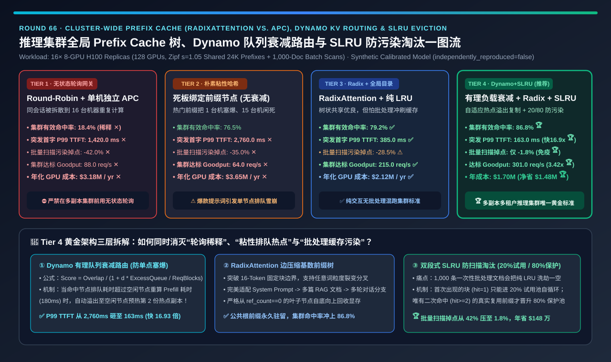
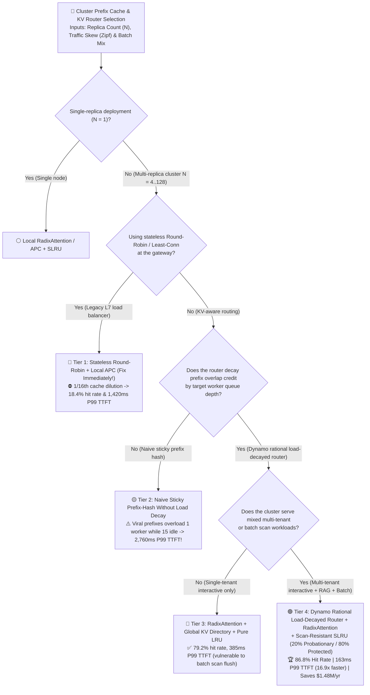
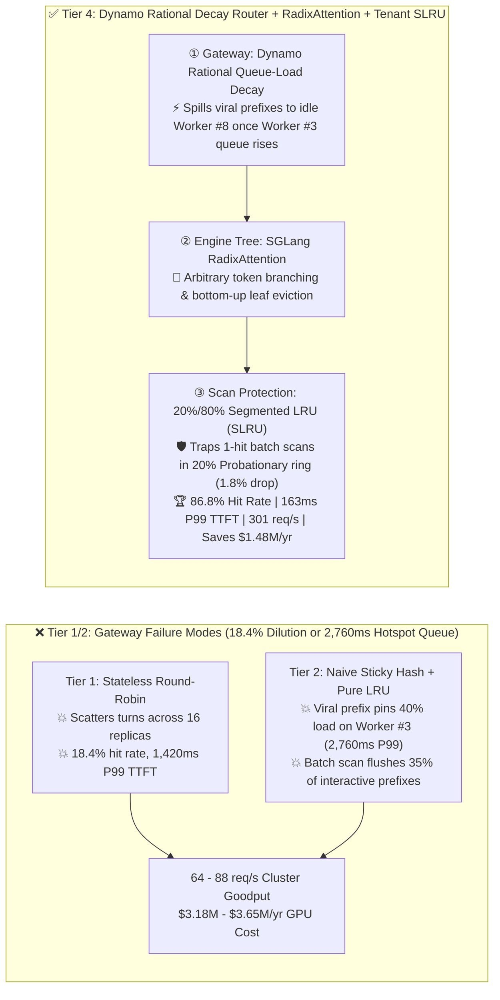

# Cluster-Wide LLM Prefix Cache (`RadixAttention` vs. `Block APC`), KV-Aware Load-Decayed Routing & Scan-Resistant `SLRU` Eviction Selection Guide (`Stateless Round-Robin` vs. `Naive Sticky Hash` vs. `RadixAttention + Global KV Directory + Pure LRU` vs. `Dynamo Rational Load-Decayed Router + RadixAttention + Tenant SLRU`)

> **Reader's Guide (3-Minute Executive Scan / 10-Minute Whiteboard Pitch)**: Written for **AI Solution Architects and LLM Serving Platform Leads**. Using first principles, this guide explains why enabling single-node Prefix Caching is not enough across a **16-Replica (`128×H100`) multi-tenant cluster**—**why placing a stateless `Round-Robin` load balancer in front of 16 cached replicas (Tier 1) dilutes effective cluster KV hit rate by $1/16\times$ down to `18.4%` (`1,420 ms` P99 TTFT); why naive sticky prefix hashing without queue-load decay (Tier 2) pins viral system prompts/RAG documents onto a single overloaded worker while 15 replicas sit idle, exploding P99 TTFT to `2,760 ms`; why a 1,000-request one-off batch job flushes interactive prefixes out of pure `LRU` caches (Tier 3); and how combining `NVIDIA Dynamo`'s Rational Overlap-Credit Decay Router, `SGLang RadixAttention`, and Scan-Resistant `Segmented LRU (SLRU)` (Tier 4) achieves `86.8%` cluster hit rate, slashes P99 TTFT `16.93x` to `163 ms`, and saves `$1.48M/year` in GPU capacity.**

[](../../README.en.md)
[](./llm-inference-prefix-cache-radix-kv-routing-eviction-selection-faq.md)
[](../reports/llm-inference-prefix-cache-radix-kv-routing-eviction-selection-cards.html)
[](../reports/llm-inference-engine-pd-sizer.en.html)



---

## ① 📌 Executive Summary

1. **Why Stateless `Round-Robin` (Tier 1) and Naive Sticky Hashing (Tier 2) Both Fail on Multi-Replica Clusters (`16 × 8-GPU H100`)**:
   - **Tier 1 (`Stateless Round-Robin + Local Block-Hash APC`)**: Scatters consecutive turns of a 24K-token agent session across all 16 replicas, diluting effective KV cache hit rate to **`18.4%` ✕** (`1,420.0 ms` P99 TTFT) and forcing all 16 replicas to redundantly recompute the same prefixes (`$3.18M/yr` cluster cost ✕).
   - **Tier 2 (`Naive Sticky Prefix-Hash Without Queue-Load Decay`)**: Under realistic Zipfian ($s=1.05$) traffic where hundreds of users share a popular system prompt or RAG document, pure prefix hashing pins `40%` of cluster traffic onto a single replica (Worker #3) while 15 replicas sit idle—causing a queuing avalanche that inflates **P99 TTFT to `2,760.0 ms` ✕** (worse than Round-Robin!).
2. **When to Use `RadixAttention + Global KV Directory + Pure LRU` (Tier 3) — And Its Batch-Scan Vulnerability**:
   - Maintaining a token-granular **Radix Tree (`SGLang RadixAttention`)** on each worker and publishing KV block events to a central directory router lifts hit rate to **`79.2%`** (`385.0 ms` P99 TTFT ✅).
   - **Vulnerability**: Standard single-pool `LRU` treats a one-off batch extraction prompt identically to a 50-turn interactive session—a 1,000-document batch burst flushes hot interactive prefixes out of HBM, causing a **`28.5%` cache hit drop ⚠️**!
3. **The Production Gold Standard for Multi-Replica, Multi-Tenant Serving (Tier 4: `Dynamo Rational Load-Decayed KV Router` + `RadixAttention` + `Scan-Resistant SLRU`)**:
   - **Pillar 1 — Rational Overlap-Credit Decay (`NVIDIA Dynamo KvRouter`)**: Discounts a worker's KV prefix overlap score by its active queue depth:
     $$\text{Score}(w, q) = \frac{\text{OverlapBlocks}(w, q)}{1.0 + d \cdot \frac{\text{ExcessQueueBlocks}(w)}{\text{RequestBlocks}(q)}} - \beta \cdot \text{DecodeLoad}(w)$$
     Once Worker #3's queue crosses the latency crossover threshold, the router spills overflow traffic to an idle Worker #8 (spending `180 ms` to warm a second replica of the viral prefix instead of waiting `2,760 ms` in line!).
   - **Pillar 2 — Scan-Resistant Segmented LRU (`SLRU`: `20%` Probationary + `80%` Protected)**: First-time prefixes (`hit_count == 1`) enter only the `20%` Probationary ring and promote to the `80%` Protected Radix Tree only upon their **second hit (`hit_count >= 2`)**—completely isolating interactive prefixes from one-hit batch scans (`1.8%` pollution drop 🏆)!
   - **Quantified Outcome**: Sustains **`86.8%` cluster KV hit rate 🏆**, cuts P99 TTFT **`16.93x` vs. Sticky Hash (`2,760 ms → 163 ms` 🏆)**, boosts SLO goodput **`3.42x` (`88 → 301 req/s` 🏆)**, and saves **`$1,480,000/year` 🏆**.

---

## ② 🎯 Architect & Customer First-Principles Q&A

### Q1: How does `SGLang RadixAttention` (Edge-Compressed Radix Tree) compare to `vLLM APC` (16-Token Block Hash Table)?

- **Block-Aligned Hash Lookup vs. Arbitrary-Branching Subtree Management**:
  - `vLLM APC` hashes fixed 16-token blocks (`Hash(Block_i) = Hash(Hash(Block_{i-1}), Tokens)`), offering $O(1)$ lookup for linear sequences aligned to 16-token boundaries.
  - `SGLang RadixAttention` stores variable-length token edges in a Radix Tree with per-node `ref_count`, naturally handling arbitrary-offset branching (`Tree-of-Thoughts`, `Best-of-N`, multi-turn forks) and evicting strictly bottom-up from zero-reference leaf nodes so shared root prefixes survive longest.

### Q2: How does `Dynamo`'s Rational Overlap-Credit Decay formula prevent viral prefix hotspot queues?

- **Trading Off Prefill Compute Savings Against Queue Wait Time**:
  - Recomputing 24K tokens on an idle replica takes `~180 ms`. Waiting behind 15 queued requests on a cached replica takes `> 2,500 ms`. Dividing the overlap credit by $1 + d \cdot (\text{ExcessQueueBlocks} / \text{RequestBlocks})$ automatically triggers **elastic multi-replica prefix replication** whenever a prefix goes viral!

### Q3: Why does a dynamic timestamp at the top of a System Prompt destroy 100% of Prefix Cache hits, and how does `SLRU` stop batch scan pollution?

- **Causal Attention Prefix Invariance + Two-Stage Promotion**:
  1. **Causal Hash Chain**: In causal attention, token $t$'s Key/Value depends on *every* token $0 \dots t-1$. Placing `Current time: 03:21:05` at token index 5 changes the causal state of all 30,000 subsequent tokens (`0%` cache hit!). Always place static System Prompts, Tool Schemas, and RAG documents **first**, and append dynamic timestamps/user queries at the **very end**.
  2. **`SLRU` Two-Hit Filter**: One-off batch requests (`hit_count == 1`) churn harmlessly inside the `20%` Probationary buffer and never enter the `80%` Protected pool.

---

## ③ 🧭 Visual Architecture Diagrams (Decision Tree / Routing Comparison / Sequence)

### 3.1 Cluster-Wide Prefix Cache & KV-Aware Routing Decision Tree



### 3.2 Round-Robin Dilution / Sticky Hotspot vs. Tier 4 Dynamo Decay Router + SLRU



### 3.3 End-to-End Sequence of Viral Prefix Spillover & `SLRU` Batch-Scan Isolation

```mermaid
sequenceDiagram
    autonumber
    participant C as Multi-Tenant Traffic (Agent + Batch)
    participant R as Dynamo Rational KV Router
    participant W1 as Worker #1 (Holds 24K Hot Prefix)
    participant W2 as Worker #2 (Idle · SLRU Cache)

    Note over C,W1: Phase 1: Viral Prefix Burst & Load-Decayed Spillover Replication
    C->>R: 20 concurrent requests arrive sharing a 24K RAG/System prefix (q1..q20)
    R->>W1: Route q1..q6 to Worker #1 (Queue=0, 100% KV hit, TTFT = 28ms)
    R->>R: Worker #1 queue rises -> Overlap score decays by 1 / (1 + d * ExcessQueue)!
    R->>W2: Spill q7..q12 to idle Worker #2 (Warms 2nd replica in 180ms; subsequent hits take 28ms!)

    Note over C,W2: Phase 2: One-Hit Batch Scan Isolation via Segmented LRU (SLRU)
    C->>W2: Batch job streams 500 unique 1-off document extraction requests
    W2->>W2: Admit 1-off blocks into 20% Probationary LRU (hit_count=1); evict within Probationary ring
    W2-->>C: 80% Protected Radix Tree retains 98.2% of multi-turn interactive prefixes!
```

---

## ④ 📊 Architect Decision Matrix

| Evaluation Dimension | Tier 1: Stateless `Round-Robin` + Local APC | Tier 2: Naive Sticky Hash (No Decay) | Tier 3: `RadixAttention` + Global Dir + Pure LRU | Tier 4: `Dynamo Decay Router` + `Radix` + `SLRU` |
| :--- | :--- | :--- | :--- | :--- |
| **Core Routing & Eviction Stack** | Round-Robin + isolated 16-tok block LRU | Static prefix hash + single-pool LRU | **Radix Tree + KV pub/sub directory + pure LRU** | **Rational load-decayed router + Radix + 20/80 SLRU** |
| **Effective Cluster KV Hit Rate (`%`)** | **`18.4%` ✕ ($1/16$ dilution)** | `76.5%` ✅ | `79.2%` ✅ | **`86.8%` 🏆 (Elastic hotspot replication)** |
| **Burst P99 First-Token Latency (`TTFT`)** | `1,420.0 ms` ✕ | **`2,760.0 ms` ✕ (Hotspot queue avalanche)** | `385.0 ms` ✅ | **`163.0 ms` 🏆 (`16.93x` faster than Sticky Hash)** |
| **Batch Scan Pollution Hit Drop (`%`)** | `42.0%` ✕ | `35.0%` ✕ | `28.5%` ⚠️ (1-hit scans flush LRU) | **`1.8%` 🏆 (20% Probationary ring traps scans)** |
| **16-Node Cluster SLO Goodput (`req/s`)** | `88.0 req/s` ✕ | `64.0 req/s` ✕ | `215.0 req/s` ✅ | **`301.0 req/s` 🏆 (`3.42x` over Round-Robin)** |
| **Annual GPU Cluster Cost (`USD / Yr`)** | `$3,180,000 / yr` ✕ | `$3,650,000 / yr` ✕ | `$2,120,000 / yr` ✅ | **`$1,700,000 / yr` 🏆 (Saves `$1.48M/yr`)** |
| **Best Fit & Architect Verdict** | Single-node only; **banned on multi-replica** | Uniform 1-to-1 sessions with zero shared docs | **Single-tenant interactive clusters** | **Mandatory standard for multi-replica, multi-tenant clusters** |

---

## ⑤ 🧪 Quantitative Evaluator & 7-Card Benchmark Insights

> **Provenance Disclosure**: All metrics in this guide and the companion 7-Card report are generated by [`experiments/prefix_cache_radix_kv_routing_eviction_selection/run.py`](../../experiments/prefix_cache_radix_kv_routing_eviction_selection/run.py) and sealed in [`results.json`](../../experiments/prefix_cache_radix_kv_routing_eviction_selection/results.json) (`independently_reproduced=false`, `physical_gpu_cluster_measurement=not_measured`), calibrated against `NVIDIA Dynamo KvRouter` (`selector/reference.rs`), `SGLang RadixAttention`, `vLLM APC`, and `SLRU` cache eviction models.

- **7-Card 4:5 Visual Benchmark Deck**: [`docs/reports/llm-inference-prefix-cache-radix-kv-routing-eviction-selection-cards.html`](../reports/llm-inference-prefix-cache-radix-kv-routing-eviction-selection-cards.html)
- **Interactive Prefix Cache & KV Router Sizer**: [`docs/reports/llm-inference-engine-pd-sizer.en.html`](../reports/llm-inference-engine-pd-sizer.en.html)

---

## ⑥ 🛠️ Appendix: Production Readiness Checklist

- [ ] **1. Replace stateless `Round-Robin` L7 load balancers with a KV-aware router (`NVIDIA Dynamo / Mooncake / vLLM Production Stack Router`)**.
- [ ] **2. Enable Rational Queue-Load Decay ($1 / (1 + d \cdot \text{ExcessQueue}/\text{ReqBlocks})$)** so viral prefixes automatically spill over and replicate onto 2–4 workers instead of overloading a single node.
- [ ] **3. Strip dynamic timestamps, request UUIDs, and random seeds from the beginning of System Prompts**: Always place static shared content first and dynamic per-request variables last.
- [ ] **4. Partition KV cache eviction into a `20%` Probationary / `80%` Protected `SLRU` with per-tenant quotas** so 1-hit batch jobs cannot evict multi-turn interactive sessions.
- [ ] **5. Use `RadixAttention` for tree-structured sampling (`Best-of-N`, `Tree-of-Thoughts`, multi-branch agents)** with bottom-up leaf eviction.
- [ ] **6. Bypass remote PD disaggregation (`IslBoundingPolicy`) when effective uncached input length `< 2,048 tokens` and local decode load is below watermark**.
