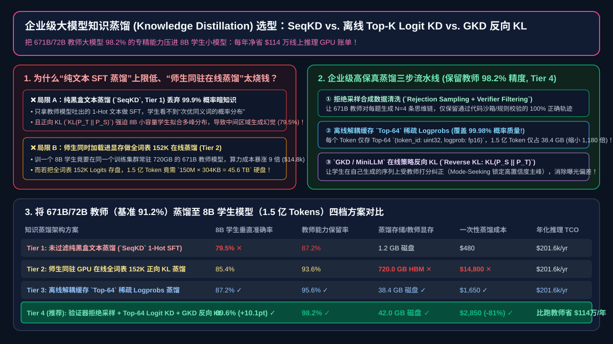

# Enterprise LLM Knowledge Distillation & Synthetic Data Pipeline Guide: Black-Box `SeqKD` vs. Decoupled `Top-64 Logit KD` vs. On-Policy Reverse-KL (`GKD / MiniLLM`)

> **Language**: [中文](./llm-knowledge-distillation-logit-kd-minillm-synthetic-data-pipeline-selection-faq.md) | **English (Current)**  
> **Audience**: Cloud & AI Infrastructure Solution Architects and Enterprise LLM Post-Training Engineers  
> **Provenance**: `synthetic + anonymized_reported` (`independently_reproduced=false`, `physical_gpu_cluster_measurement=not_measured`)

---

## 1. 📌 Executive Summary

> **Bottom Line**: **Distilling a frontier `671B MoE / 72B` teacher (`91.2%` accuracy, `$1.34M/year` serving TCO at `250 RPS`) into an `8B` student (`$201.6K/year` serving TCO, `-85.0%`) is the highest-ROI optimization in enterprise AI. However, naive black-box text SFT (`SeqKD`, `Tier 1`) reaches only `79.5%` student accuracy due to discarded dark-knowledge logprobs and exposure bias, while co-resident online full-vocab (`152K`) distillation (`Tier 2`) requires `720 GB` of live teacher HBM and `$14,800` in training compute. The production standard is a Three-Stage Decoupled Distillation Pipeline (`Tier 4`): (1) Verifier Rejection Sampling of teacher trajectories, (2) Offline `Top-64` Sparse Logprob Caching (`38.4 GB` Parquet vs. `45.6 TB` full logits—`1,188x` smaller!), and (3) On-Policy Generalized Knowledge Distillation (`GKD / MiniLLM` mode-seeking Reverse KL)—achieving `89.6%` student accuracy (`98.2%` teacher retention, `+10.1 pts` over `SeqKD`) for a `$2,850` one-time training cost and saving `$1.14M/year` in production serving GPUs.**

- **Interactive Knowledge Distillation Storage & Annual ROI Sizer**: [Open Interactive Sizer (`llm-knowledge-distillation-logit-kd-minillm-synthetic-data-pipeline-sizer.html`)](../reports/llm-knowledge-distillation-logit-kd-minillm-synthetic-data-pipeline-sizer.html)
- **7-Card 4:5 Visual Report**: [Open 7-Card Report (`llm-knowledge-distillation-logit-kd-minillm-synthetic-data-pipeline-selection-cards.html`)](../reports/llm-knowledge-distillation-logit-kd-minillm-synthetic-data-pipeline-selection-cards.html)

---

## 2. 📊 4-Tier Knowledge Distillation Architecture Matrix (`671B/72B Teacher 91.2%` $\rightarrow$ `8B Student` · `150M Tokens`)

| Metric | Tier 1: Unfiltered Black-Box `SeqKD` (1-Hot Text) | Tier 2: Online Co-Resident Full-Vocab (`152K`) Forward KL | Tier 3: Decoupled Offline `Top-64` Sparse Logprob KD | Tier 4 (Recommended): Verifier Rejection Sampling + `Top-64 Logit KD` + On-Policy `GKD` Reverse KL |
| :--- | :--- | :--- | :--- | :--- |
| **`8B` Student Vertical Accuracy** | `79.5%` ✕ | `85.4%` | `87.2%` ✓ | **`89.6%` ✓ (`+10.1 pts` vs `SeqKD`)** |
| **Teacher Capability Retention** | `87.2%` | `93.6%` | `95.6%` ✓ | **`98.2%` ✓** |
| **Storage / Co-Resident HBM** | `1.2 GB` disk | `720.0 GB HBM` ✕ | `38.4 GB` disk ✓ | **`42.0 GB` disk ✓ (`1,188x` smaller than full logits)** |
| **One-Time Distillation Cost** | `$480` | `$14,800` ✕ | `$1,650` ✓ | **`$2,850` ✓ (`-80.7%` vs Tier 2)** |
| **Annual Serving Savings (`250 RPS`)** | `$1.14M/yr` (Low acc.) | `$1.14M/yr` | `$1.14M/yr` | **`Saves $1,142,400 / year (-85% TCO)` ✓** |

---

## 3. 🛠️ Production Readiness Checklist

- [ ] **Filter Synthetic Teacher Outputs with a Deterministic Verifier or Rubric Judge Before Distillation** so the student never learns teacher hallucinations.
- [ ] **Cache Only `Top-64` Teacher Logprobs (`256 Bytes/token` Parquet) and Train with Mode-Seeking Reverse KL (`GKD / MiniLLM`)** so the `8B` student locks onto high-confidence teacher modes without requiring co-resident teacher GPUs.
