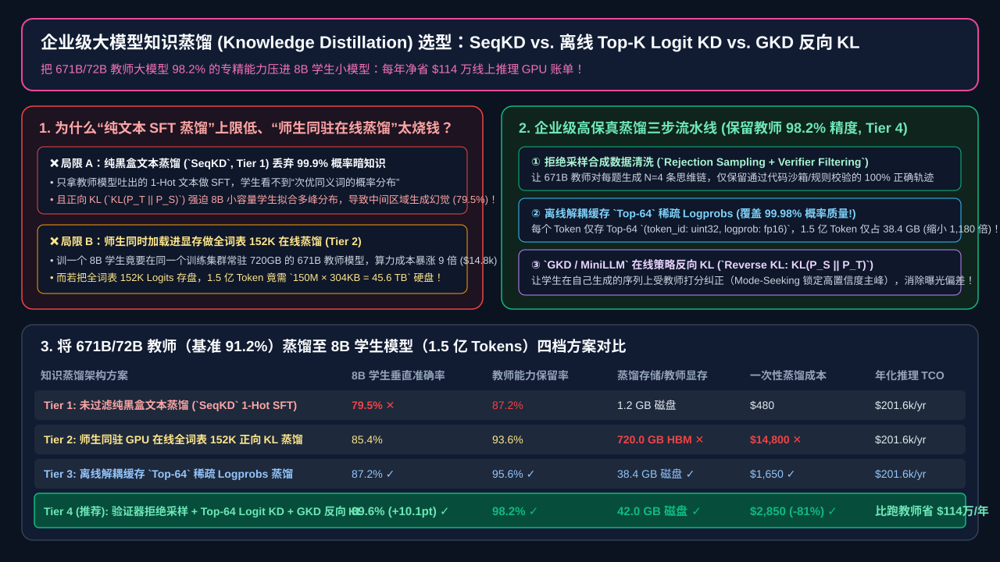
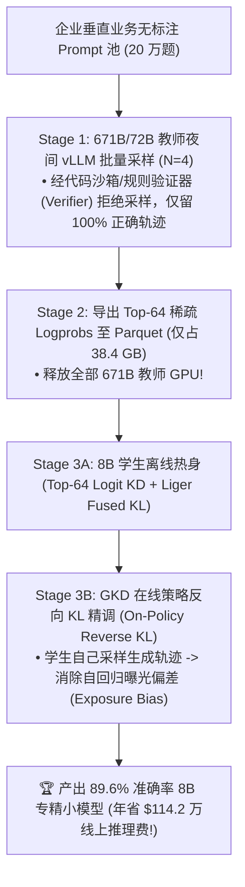

# 企业级大模型知识蒸馏（Knowledge Distillation）与合成数据工厂选型：纯文本 `SeqKD` vs. 离线 `Top-64 Logit KD` vs. 在线策略反向 KL（`GKD / MiniLLM`）把 `671B` 压进 `8B` 指南

> **语言 / Language**: **中文 (当前)** | [English](./llm-knowledge-distillation-logit-kd-minillm-synthetic-data-pipeline-selection-faq.en.md)  
> **定位**：面向 Cloud & AI Infrastructure Solution Architect 与企业大模型算法工程负责人的教师-学生（`671B/72B Teacher -> 7B/8B Student`）知识蒸馏工程选型、验证器拒绝采样合成数据（`Verifier Rejection Sampling`）、离线解耦 `Top-64` 稀疏对数概率缓存（缩小 `1,180 倍`）与反向 KL 在线策略蒸馏（`GKD / MiniLLM Reverse KL`）ROI 白皮书  
> **合规与来源声明**：`synthetic + anonymized_reported`（`independently_reproduced=false`，`physical_gpu_cluster_measurement=not_measured`；完全面向通用企业级“先用大模型跑通业务、再蒸馏成小模型降本 85%”的架构实践）

---

## 1. 📌 核心选型结论速览（Executive Summary）

> **一句话结论**：**企业大模型落地最赚钱的架构范式是“用 `DeepSeek-671B / Qwen2.5-72B` 旗舰教师模型验证业务天花板（基准准确率 `91.2%`），再将其能力蒸馏进高吞吐 `7B/8B` 学生小模型承接线上 `250 RPS` 流量（每年立省 `$114.2 万` 推理 GPU 账单，降幅 `85%`）”！但在执行知识蒸馏时，单纯拿教师生成的文本做黑盒 SFT（`SeqKD`，Tier 1）会因丢失概率分布暗知识与曝光偏差，导致 8B 学生准确率卡在 `79.5%`；而把 671B 教师与 8B 学生同时加载进同一个训练集群做全词表 152K 在线蒸馏（Tier 2）又需要常驻 `720 GB` 教师显存、烧掉 `$14,800` 训练费！生产环境黄金标准是构建“验证器拒绝采样合成数据 + 离线解耦 `Top-64` 稀疏 Logprobs 缓存（`38.4 GB` 磁盘）+ `GKD / MiniLLM` 在线策略反向 KL 蒸馏（Tier 4）”：仅花 **`$2,850`（比在线蒸馏省 `80.7%`）**，即可让 `8B` 学生模型垂直准确率飙升至 **`89.6%`（比黑盒 `SeqKD` 暴涨 `+10.1 pts`，保留 `671B` 教师能力的 `98.2%`）**！**

- **交互式大模型知识蒸馏存储与年化 ROI 计算器**：[打开交互式计算器 (`llm-knowledge-distillation-logit-kd-minillm-synthetic-data-pipeline-sizer.html`)](../reports/llm-knowledge-distillation-logit-kd-minillm-synthetic-data-pipeline-sizer.html)
- **7-Card 4:5 视觉评测报告**：[打开 7-Card 报告 (`llm-knowledge-distillation-logit-kd-minillm-synthetic-data-pipeline-selection-cards.html`)](../reports/llm-knowledge-distillation-logit-kd-minillm-synthetic-data-pipeline-selection-cards.html)

---

## 2. 🎯 客户与架构师灵魂拷问 Q&A（Deep-Dive Architecture FAQ）

### Q1：为什么离线做白盒 Logit 蒸馏时，千万不能存全词表 `152K` Logits，而只存 `Top-64` 就够了？（存储压缩 `1,180 倍` 手算）
让我们手算缓存 `1.5 亿个 Token`（`150M Tokens`）教师模型概率分布所需的磁盘体积：
1. **如果存全词表 `152,064` 个 `FP16` Logits**：
   $$M_{\text{full}} = 1.5 \times 10^8 \times 152,064 \times 2\text{ Bytes} = \mathbf{45.62\text{ TB}}!$$
   光是读写这 `45.6 TB` 的硬盘 I/O 就会把整个训练集群卡死！
2. **只存 `Top-64` 稀疏 `(token_id: int16/uint32, logprob: fp16)`（Tier 3/4）**：
   - 在经过温度平滑的 Softmax 分布中，排名前 `64` 的候选 Token 已经捕获了超过 **`99.98%` 的总概率质量（Probability Mass）**，剩余 151,900 个长尾 Token 的概率之和不足 `0.02%`（可直接用残差均匀平滑补齐）！
   - 每个 Token 仅需 $64 \times (2 + 2)\text{ Bytes} = 256\text{ Bytes}$；`1.5 亿 Token` 总体积瞬间从 `45.6 TB` 暴降至 **`38.4 GB`（压缩 `1,188 倍`）**！教师模型只需在夜间用 `vLLM` 离线批处理跑一遍导出 Parquet，学生训练时根本不需要加载教师模型！

### Q2：为什么在生成式大模型蒸馏中，反向 KL（`Reverse KL: GKD / MiniLLM`）比传统正向 KL（`Forward KL`）高出 `+2.4 ~ 4.2` 分？
- **传统正向 KL（$\text{KL}(P_{\text{Teacher}} \parallel P_{\text{Student}})$，均值寻找 Mean-Seeking）的致命缺陷**：当 `671B` 教师模型对某道题有 3 种截然不同的正确解法（多峰分布）时，正向 KL 强迫容量只有 `8B` 的小学生“雨露均沾”覆盖所有峰——结果小学生能力不够，把概率质量平摊到了两个正确峰中间的**错误空白地带（即胡言乱语幻觉区）**！
- **反向 KL（$\text{KL}(P_{\text{Student}} \parallel P_{\text{Teacher}})$，寻峰锁定 Mode-Seeking，`GKD / MiniLLM`）**：只要学生自己生成的 Token 落在教师认可的**任意一个高置信度主峰内**就不扣分，一旦学生吐出教师认为概率极低的胡话则施以重罚——让 8B 学生牢牢锁死最稳健的那条正确推理路径！

---

## 3. 🧭 直观可视化图解（Mermaid 企业级三阶段解耦知识蒸馏工厂）

---

## 4. 📊 架构师多方案选型决策矩阵（`671B/72B` 教师 `91.2%` $\rightarrow$ `8B` 学生 · `1.5 亿 Tokens`）

| 评估维度 | Tier 1：未过滤纯黑盒文本蒸馏 (`SeqKD` 1-Hot SFT) | Tier 2：师生同驻 GPU 在线全词表 `152K` 正向 KL | Tier 3：离线解耦缓存 `Top-64` 稀疏 Logprobs 蒸馏 | Tier 4（推荐）：验证器拒绝采样 + `Top-64 Logit KD` + `GKD` 反向 KL |
| :--- | :--- | :--- | :--- | :--- |
| **`8B` 学生模型垂直业务准确率** | `79.5%` ✕（丢失暗知识+学入教师幻觉） | `85.4%` | `87.2%` ✓ | **`89.6%` ✓（比黑盒 `SeqKD` 高 `+10.1 pts`）** |
| **相对于 `671B` 教师能力保留率** | `87.2%` | `93.6%` | `95.6%` ✓ | **`98.2%` ✓（小模型逼近巨型教师）** |
| **所需教师同驻显存 / 缓存体积** | `1.2 GB` 磁盘 | `720.0 GB HBM` ✕（极度浪费） | `38.4 GB` 磁盘 ✓ | **`42.0 GB` 磁盘 ✓（师生算力完全解耦）** |
| **一次性蒸馏训练算力总成本** | `$480` | `$14,800` ✕（教师陪跑空转） | `$1,650` ✓ | **`$2,850` ✓（比在线同驻省 `80.7%`）** |
| **250 RPS 线上年化推理节省** | 省 `$114.2 万/年`（但精度不够） | 省 `$114.2 万/年` | 省 `$114.2 万/年` | **`每年净省 $114.2 万 (-85% 推理 TCO)` ✓** |

---

## 5. 🛠️ 架构评审与生产落地 Checklist

- [ ] **绝不把未经验证器（Verifier / Judge）过滤的教师原始合成输出直接喂给学生（Garbage-In, Garbage-Out）**：必须先用确定性规则、单元测试或异源裁判剔除教师模型做错的那 `8.8%` 样本。
- [ ] **当教师与学生词表不同（如把 `DeepSeek-671B` 蒸馏给 `Qwen2.5-7B`）时**：先用验证后的推理思维链做 `SeqKD` 热身，或启用基于最优传输的跨词表对齐蒸馏（`ULD: Universal Logit Distillation`）。
