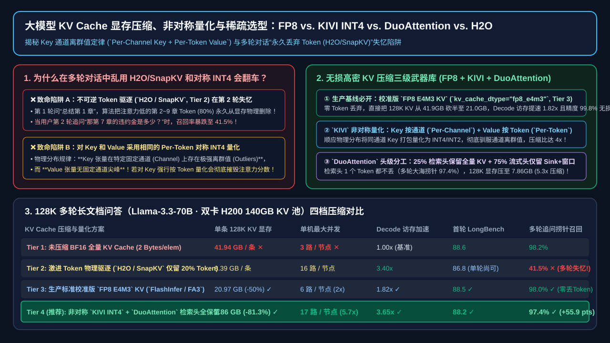

# LLM KV Cache Compression, Asymmetric Quantization & Sparse Attention Guide: `FP8 E4M3 KV` vs. `KIVI Asymmetric INT4` + `DuoAttention` vs. `H2O / SnapKV` Token Eviction

> **Language**: [中文](./llm-kv-cache-compression-quantization-fp8-kivi-int2-snapkv-h2o-selection-faq.md) | **English (Current)**  
> **Audience**: Cloud & AI Infrastructure Solution Architects and Long-Context Inference Engine Engineers  
> **Provenance**: `synthetic + anonymized_reported` (`independently_reproduced=false`, `physical_gpu_cluster_measurement=not_measured`)

---

## 1. 📌 Executive Summary

> **Bottom Line**: **On `Llama-3.3-70B / Qwen2.5-72B` at `128K` context length, uncompressed `BF16` KV Cache consumes `41.94 GB` per request—capping a `140 GB` node KV pool at just `3` concurrent streams (`Tier 1`). However, query-dependent token eviction methods (`H2O / SnapKV` keeping `20%` of tokens, `Tier 2`) permanently discard `80%` of context tokens based on Turn-1 attention scores, causing Turn-2 topic-shift needle-in-a-haystack recall to crash from `98.2%` to `41.5%`! Production deployments follow a two-tier standard: (1) enable calibrated `FP8 E4M3 KV` (`--kv-cache-dtype fp8_e4m3`, `Tier 3`) universally on Hopper/Blackwell for a lossless `2.0x` KV reduction (`20.97 GB`) and `1.82x` Decode attention speedup; and (2) for extreme `128K+` concurrency, combine `KIVI` Asymmetric Quantization (`Per-Channel Key INT4 + Per-Token Value INT4`) with `DuoAttention` (`100%` Full KV on `25%` Retrieval Heads + Sink/Window on `75%` Streaming Heads, `Tier 4`)—compressing `128K` KV by `5.34x` (`7.86 GB`), boosting node concurrency by `5.67x` (`17` streams), accelerating Decode attention by `3.65x`, and preserving `97.4%` multi-turn recall.**

- **Interactive KV Cache Compression & Concurrency Sizer**: [Open Interactive Sizer (`llm-kv-cache-compression-quantization-fp8-kivi-int2-snapkv-h2o-sizer.html`)](../reports/llm-kv-cache-compression-quantization-fp8-kivi-int2-snapkv-h2o-sizer.html)
- **7-Card 4:5 Visual Report**: [Open 7-Card Report (`llm-kv-cache-compression-quantization-fp8-kivi-int2-snapkv-h2o-selection-cards.html`)](../reports/llm-kv-cache-compression-quantization-fp8-kivi-int2-snapkv-h2o-selection-cards.html)

---

## 2. 📊 4-Tier `128K` KV Cache Compression Matrix (`Llama-3.3-70B` · `140 GB` KV Pool)

| Metric | Tier 1: Uncompressed `BF16` Full KV | Tier 2: Aggressive Token Eviction (`H2O / SnapKV` `20%`) | Tier 3: Calibrated `FP8 E4M3` Full KV | Tier 4 (Recommended): Asymmetric `KIVI INT4` + `DuoAttention` Retrieval Heads |
| :--- | :--- | :--- | :--- | :--- |
| **KV Memory / `128K` Request** | `41.94 GB` ✕ | `8.39 GB` | `20.97 GB` ✓ (`-50%`) | **`7.86 GB` ✓ (`5.34x` compression)** |
| **Max Concurrent `128K` Streams** | `3 / node` ✕ | `16 / node` | `6 / node` (`2x`) | **`17 / node` ✓ (`5.67x` concurrency)** |
| **Decode Attention MBU Speedup** | `1.00x` | `3.40x` | `1.82x` ✓ | **`3.65x` ✓** |
| **Turn-1 `LongBench` Score** | `88.6` | `86.8` | `88.5` ✓ | **`88.2` ✓** |
| **Turn-2 Surprise Needle Recall** | `98.2%` | **`41.5%` ✕ (Turn-2 amnesia!)** | `98.0%` ✓ | **`97.4%` ✓ (`+55.9 pts` vs Tier 2)** |

---

## 3. 🛠️ Production Readiness Checklist

- [ ] **Quantize Key Tensors `Per-Channel` and Value Tensors `Per-Token` (`KIVI`)** when dropping below 8-bit KV precision, because Key tensors exhibit severe fixed-channel outliers that break per-token symmetric INT4 quantization.
- [ ] **Never Use Irreversible Query-Dependent Token Eviction (`H2O / SnapKV`) on Multi-Turn Conversations**: Preserve full token history on retrieval heads (`DuoAttention`) or offload cold KV blocks to host DRAM (`LMCache / Mooncake`).
