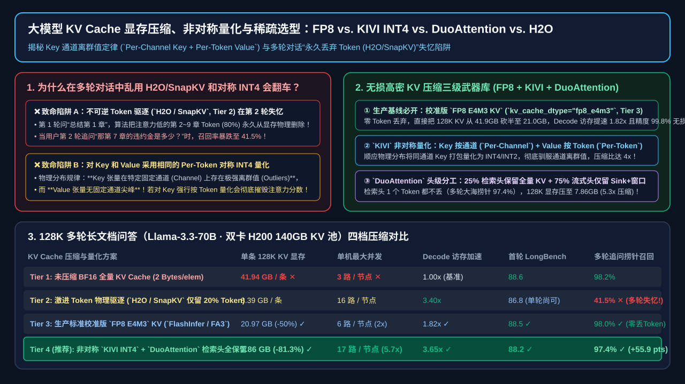
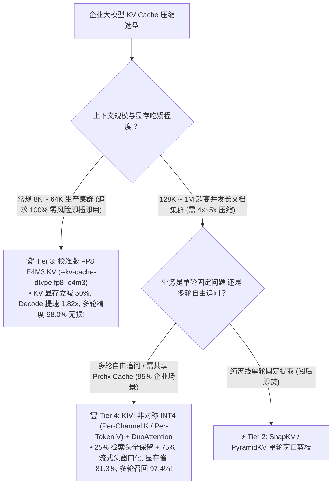

# 大模型 KV Cache 显存压缩、非对称量化与稀疏驱逐选型：`FP8 E4M3 KV` vs. `KIVI 非对称 Per-Channel Key + Per-Token Value 4-bit` vs. `DuoAttention / H2O / SnapKV` 容量与多轮精度指南

> **语言 / Language**: **中文 (当前)** | [English](./llm-kv-cache-compression-quantization-fp8-kivi-int2-snapkv-h2o-selection-faq.en.md)  
> **定位**：面向 Cloud & AI Infrastructure Solution Architect 与大模型推理引擎负责人的 `128K` 长上下文 KV Cache 显存压缩全景选型（校准版 `FP8 E4M3 KV`、`KIVI` 非对称通道/Token 4-bit 量化、`DuoAttention` 检索头/流式头异构分配 vs. `H2O / SnapKV` 物理驱逐在多轮对话中的“失忆陷阱”）白皮书  
> **合规与来源声明**：`synthetic + anonymized_reported`（`independently_reproduced=false`，`physical_gpu_cluster_measurement=not_measured`；完全面向通用企业级长上下文推理显存优化与精度治理）

---

## 1. 📌 核心选型结论速览（Executive Summary）

> **一句话结论**：**在 `Llama-3.3-70B / Qwen2.5-72B` 上跑 `128K` 长上下文时，未压缩 `BF16` KV Cache 单条请求就要吞掉 **`41.94 GB`** 显存（双卡 H200 留出的 140GB KV 池最多只能并发 `3 路`）！但在选择 KV 压缩方案时，架构师必须避开两大天坑：① 严禁在多轮交互式对话中使用 `H2O / SnapKV` 等“基于第 1 轮提问永久物理删除 80% 低注意力 Token”的驱逐算法（Tier 2）——一旦用户第 2 轮换个角度追问第 1 轮没问到的文档章节，大海捞针召回率会从 `98.2%` 断崖暴跌至 **`41.5%`（彻底失忆）**！② 严禁对 Key 张量使用简单的 `Per-Token` 对称 INT4 量化。生产环境黄金准则分两档：**
> - **普适零风险默认配置（Tier 3）**：在所有 Hopper/Blackwell 集群上一律开启校准版 **`FP8 E4M3 KV`（`--kv-cache-dtype fp8_e4m3`）**——1 个 Token 都不丢，直接将 KV 显存砍半（`20.97 GB`）、Decode 注意力访存提速 `1.82x`，多轮精度 `98.0%` 无损；
> - **超高密 128K+ 进阶配置（Tier 4）**：采用 **`KIVI` 非对称量化（`Per-Channel Key INT4 + Per-Token Value INT4`）+ `DuoAttention`（25% 检索头保留全量 KV + 75% 流式头仅留 Sink 与滑动窗口）**——将单条 `128K` KV 显存压至 **`7.86 GB`（压缩 `5.34 倍`）**、单机并发从 `3 路` 暴增至 **`17 路`（`5.67 倍`）**，且第 2 轮突袭追问召回率依然高达 **`97.4%`**！

- **交互式 KV Cache 压缩与并发容量计算器**：[打开交互式计算器 (`llm-kv-cache-compression-quantization-fp8-kivi-int2-snapkv-h2o-sizer.html`)](../reports/llm-kv-cache-compression-quantization-fp8-kivi-int2-snapkv-h2o-sizer.html)
- **7-Card 4:5 视觉评测报告**：[打开 7-Card 报告 (`llm-kv-cache-compression-quantization-fp8-kivi-int2-snapkv-h2o-selection-cards.html`)](../reports/llm-kv-cache-compression-quantization-fp8-kivi-int2-snapkv-h2o-selection-cards.html)

---

## 2. 🎯 客户与架构师灵魂拷问 Q&A（Deep-Dive Architecture FAQ）

### Q1：为什么大模型的 `Key` 张量和 `Value` 张量绝对不能用同一种方向做 `INT4 / INT2` 量化？（`KIVI` 非对称量化第一性原理）
通过对 Transformer 各层 KV 张量数值分布的剖析，业界发现了极其显著的**物理非对称性**：
1. **`Key` 张量（`[S, D]`）具有极强的“固定通道离群值（Channel-Wise Outliers）”**：无论输入什么文本，总有少数几个固定的特征维度（Channel $c_j$）数值比其他维度大 `10~50 倍`。如果按行（Per-Token）量化，这几个离群通道会把整行的量化步长（Scale）拉得极大，导致其余 95% 正常通道的有效位全部被抹零！因此 **`Key` 必须沿着序列方向按通道量化（Per-Channel Quantization，每攒够 $G=32$ 个 Token 块在通道内独立算 Scale）**。
2. **`Value` 张量（`[S, D]`）通道平滑，且在 Attention 中是按 Token 加权求和（$\sum A_{t,i} V_i$）**：因此 **`Value` 必须按 Token 量化（Per-Token Quantization）**。
- 遵循 **“Key 按通道、Value 按 Token + 最近 32 个残差 Token 保持 FP16/FP8”** 的 `KIVI` 准则，即可在 `INT4` 甚至 `INT2` 下实现近乎无损的注意力得分！

### Q2：为什么 `DuoAttention`（头级异构保留）比 `H2O / SnapKV`（Token 级物理删除）适合多轮对话与共享前缀缓存？
- **`H2O / SnapKV` 是“依赖当前 Query 的有损删除（Query-Dependent Eviction）”**：它在第 1 轮 Prefill 结束时，看哪些 Token 对第 1 轮问题贡献大就留哪 20%，把剩下 80% 直接删了。这不仅导致第 2 轮换问题时“死无对证”，更彻底破坏了跨请求的 Prefix Caching（因为不同问题删剩下的 20% Token 根本不一样）！
- **`DuoAttention` 是“模型结构固有的头级分工（Query-Independent Head Specialization）”**：离线识别出模型中真正负责跨长距离大海捞针的 **25% 检索头（Retrieval Heads，保留 100% 全量历史 Token）**，而将其余只关注局部语法和句首锚点的 **75% 流式头（Streaming Heads）压缩为 `Attention Sink (4 Tokens) + 近期滑动窗口`**——既省掉 `60%+` 显存，又保证任何时候追问文档任意角落都能由那 25% 检索头 100% 捞出来！

---

## 3. 🧭 直观可视化图解（Mermaid 多场景 KV Cache 压缩选型决策树）

---

## 4. 📊 架构师多方案选型决策矩阵（`Llama-3.3-70B` · `128K` 多轮对话 · `140 GB` KV 池）

| 评估维度 | Tier 1：未压缩 `BF16` 全量 KV | Tier 2：激进 Token 物理驱逐 (`H2O / SnapKV` 留 20%) | Tier 3：生产基线校准版 `FP8 E4M3` 全量 KV | Tier 4（推荐）：非对称 `KIVI INT4` + `DuoAttention` 检索头保留 |
| :--- | :--- | :--- | :--- | :--- |
| **单条 `128K` 请求 KV 显存** | `41.94 GB` ✕ | `8.39 GB` | `20.97 GB` ✓（减半） | **`7.86 GB` ✓（压缩 `5.34 倍`，省 `81.3%`）** |
| **单节点（140GB 池）最大并发** | `3 路 / 节点` ✕ | `16 路 / 节点` | `6 路 / 节点` (`2x`) | **`17 路 / 节点` ✓（提升 `5.67 倍`）** |
| **Decode 注意力访存加速比** | `1.00x`（基准） | `3.40x` | `1.82x` ✓ | **`3.65x` ✓（大幅降低长文 `TPOT`）** |
| **首轮 `LongBench` 综合得分** | `88.6` | `86.8` | `88.5` ✓ | **`88.2` ✓** |
| **第 2 轮突袭追问大海捞针召回** | `98.2%` | **`41.5%` ✕（被删 Token 失忆！）** | `98.0%` ✓ | **`97.4%` ✓（比物理驱逐高 `+55.9 pts`！）** |

---

## 5. 🛠️ 架构评审与生产落地 Checklist

- [ ] **Hopper (`H100/H200`)、Blackwell (`B200`) 与 `MI300X/MI325X` 生产集群默认开启 `FP8 KV Cache`**：并使用带校准缩放因子（`kv_scale`）的模型检查点，实现零精度损失的 2 倍 KV 扩容。
- [ ] **严禁在多轮交互式 Agent 或开启了全局 Prefix Caching 的实例上使用 Query-Dependent Token 物理删除算法（`H2O / SnapKV`）**：对于暂时不活跃的完整 KV 块，应通过 `LMCache / Mooncake` 卸载到主机 DDR5 内存而非物理丢弃！
