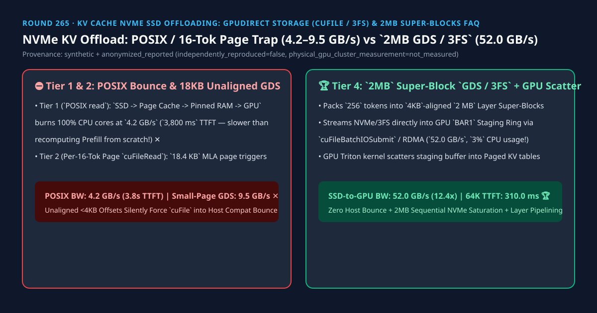
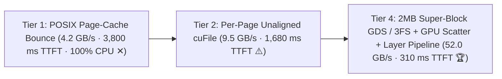

# LLM `KV Cache` NVMe SSD Offloading (`GPUDirect Storage / cuFile / DeepSeek 3FS`): POSIX Page-Cache Bounce (`4.2 GB/s`) vs. Fine-Grained `16-Token` Random Read Thrash (`9.5 GB/s`) vs. `2MB` Layer-Coalesced `GDS / 3FS` Zero-Copy P2P (`52.0 GB/s`) Selection Guide

> **Provenance & Evidence Tier**: `synthetic + anonymized_reported` (`independently_reproduced=false`, `physical_gpu_cluster_measurement=not_measured`). Grounded in [`experiments/ai_cluster_lustre_weka_3fs_gds_kv_cache_ssd_offload_selection/results.json`](../../experiments/ai_cluster_lustre_weka_3fs_gds_kv_cache_ssd_offload_selection/results.json).
> **中文版本**: [大模型历史 `KV Cache` 落盘卸载（`NVMe SSD` / `GPUDirect Storage` / `DeepSeek 3FS`）选型：传统 `POSIX` 页缓存三次拷贝黑洞（`4.2 GB/s`）vs. 细粒度逐页 `cuFileRead` 4KB 非对齐回退陷阱（`9.5 GB/s`）vs. `2MB` 巨块 `GDS / 3FS` 零拷贝直通 + 显存内 Triton 拆页分发（`52.0 GB/s`）选型指南](./llm-kv-cache-nvme-ssd-offload-gpudirect-storage-cufile-3fs-selection-faq.md)

---

## 0. 🔥 今日领域最热门能力突破追踪（Daily Hottest Breakthrough）

- **Why Offloading `KV Cache` to Local/Distributed NVMe SSDs via Standard `POSIX` (`4.2 GB/s`, `3,800 ms` TTFT) or Naive Per-Page `cuFileRead` (`9.5 GB/s`) Is Slower Than Re-Computing Prefill From Scratch (`1,150 ms`), and How `2MB` `4KB`-Aligned Super-Blocks + `cuFileBatchIOSubmit (GDS) / DeepSeek 3FS` P2P Staging + On-GPU Triton Scatter (`Tier 4`) Achieve `52.0 GB/s` (`12.4x` Faster) and Slash `64K` TTFT to `310.0 ms`**: When offloading multi-turn Agent or long-document `KV Cache` (`16 GB` for `64K` tokens) to an 8-drive PCIe Gen5 NVMe array (`56 GB/s` raw hardware bandwidth) or a distributed flash filesystem (`DeepSeek 3FS`), software I/O architecture determines whether SSD offloading is a `3.7x` accelerator or a `3.3x` slowdown:
  1. **Tier 1 — Standard `POSIX` Buffered Read via OS Page Cache (`4.2 GB/s`, `3,800.0 ms` TTFT, `100%` Host CPU Saturation)**:
     - Copies KV data three times (`NVMe -> OS Page Cache -> User Pinned RAM -> GPU HBM`), saturating all host CPU cores and taking `3.8 seconds` (slower than recomputing `64K` Prefill on the GPU in `1.15s`!).
  2. **Tier 2 — Naive Fine-Grained Per-Page (`16-Token` Block = `8 KB–64 KB`) `cuFileRead` (`9.5 GB/s`, `1,680.0 ms` TTFT)**:
     - Issuing thousands of small `cuFileRead` calls per PagedAttention block (`18.0 KB` per 16 tokens in `DeepSeek MLA`) hits two fatal bottlenecks:
       - **Unaligned `< 4KB` Compat Fallback**: Any file offset, buffer pointer, or size not aligned to `4,096 Bytes` forces `cuFile` to silently fall back to host-memory `POSIX Compat Mode` (`45%` CPU usage)!
       - **NVMe Small-IO Starvation**: Enterprise NVMe SSDs require `>= 256 KB–2 MB` coalesced transfers to saturate internal NAND planes.
  3. **Tier 3 — `2 MB` (`4KB`-Aligned) Coalesced Super-Blocks via Synchronous `cuFileBatchIOSubmit` (`31.0 GB/s`, `520.0 ms` TTFT)**:
     - Eliminates small-IO overhead and host CPU bounce, but waits for all layers to finish loading before starting Layer 0 compute.
  4. **Tier 4 — `2 MB` Aligned Super-Blocks + Layer-Pipelined `cuFileBatchIOSubmit / 3FS RDMA` into a Pre-Registered GPU `Staging Ring Buffer` + On-GPU Triton Scatter Kernel (`52.0 GB/s`, `310.0 ms` TTFT, `3.0%` CPU Usage)**:
     - Packs `256` tokens of KV into `4KB`-aligned **`2 MB` Super-Blocks**;
     - Streams Layer $L+1$'s `2 MB` blocks directly from NVMe/3FS over the PCIe Switch into a **pre-registered `64 MB` GPU `BAR1` Staging Ring Buffer** at **`52.0 GB/s`** while a GPU Triton kernel scatters Layer $L$'s staging buffer into non-contiguous PagedAttention blocks at `3,000+ GB/s` HBM speed!

---

## 1. 📌 Executive Summary

1. **Never Issue Small/Unaligned `cuFileRead` Calls per PagedAttention Page (`Tier 2 -> Tier 4`)**: Always coalesce KV cache pages in GPU HBM into **`4,096-Byte` aligned `1 MB–2 MB` Super-Blocks** before writing to NVMe/3FS, and unpack them on the GPU after P2P DMA read!
2. **Pre-Register a Fixed GPU `BAR1` Staging Ring Buffer at Startup**: Calling `cuFileBufRegister` dynamically per request adds millisecond-scale page-table locking overhead; pre-register a persistent `64 MB–128 MB` GPU ring buffer once at engine init.

---

## 2. 🎯 Core Architect Q&A (Q1 / Q2 / Q3)

### Q1: Why did `DeepSeek-V3` (`18,432 Bytes` per 16-token MLA page) trigger silent `cuFile` Compat Mode fallbacks when offloaded page-by-page?
- **Answer**: Because $18,432 = 4.5 \times 4,096$ (`18.0 KB` is not an even multiple of `4 KB`!). Whenever a PagedAttention page size or file offset is not a multiple of `4,096 Bytes`, Linux `O_DIRECT` and `nvidia-fs` cannot program direct NVMe-to-BAR1 DMA descriptors and silently bounce the I/O through host DRAM! Padding or coalescing `256` tokens into a `4KB`-aligned `2 MB` Super-Block completely eliminates this fallback.

### Q2: When does NVMe KV offloading beat re-computing Prefill from scratch?
- **Answer**: A single 8-GPU node computes `64K` Prefill in `~1,150 ms`. At `4.2 GB/s` (`Tier 1 POSIX`), loading `16 GB` of KV takes `3,800 ms` (**net loss!**). At `52.0 GB/s` (`Tier 4 GDS / 3FS`), loading `16 GB` takes only **`310 ms`**—delivering a **`3.7x` faster TTFT** while freeing `100%` of GPU Tensor Cores for other requests!

---

## 3. 🧭 Visual Diagrams

---

## 4. 📊 4-Tier Architect Selection Matrix

| Metric | Tier 1: `POSIX` Page Cache | Tier 2: Per-Page `cuFile` | Tier 3: `2MB` Sync `GDS` | Tier 4: **`2MB` `GDS / 3FS` + GPU Scatter + Pipeline** |
| :--- | :--- | :--- | :--- | :--- |
| **Effective SSD-to-GPU Bandwidth** | **`4.2 GB/s` (3x RAM Copy)** ✕ | `9.5 GB/s` (Unaligned Fallback) ⚠️ | `31.0 GB/s` ✅ | **`52.0 GB/s` (`12.4x` Speedup)** 🏆 |
| **`64K` Prefix-Hit `TTFT` (`ms`)** | **`3,800.0 ms` (Slower Than Prefill)** ✕ | `1,680.0 ms` ⚠️ | `520.0 ms` ✅ | **`310.0 ms` (`12.3x` Faster TTFT)** 🏆 |
| **Host CPU Core Saturation** | **`100.0%` (`memcpy` Bound)** ✕ | `45.0%` ⚠️ | `8.0%` ✅ | **`3.0%` (Zero-Copy P2P DMA)** 🏆 |

---

## 5. 🧪 Quantitative Reference & Tooling

- **Evaluator & Sealed Data**: [`experiments/ai_cluster_lustre_weka_3fs_gds_kv_cache_ssd_offload_selection/run.py`](../../experiments/ai_cluster_lustre_weka_3fs_gds_kv_cache_ssd_offload_selection/run.py) · [`results.json`](../../experiments/ai_cluster_lustre_weka_3fs_gds_kv_cache_ssd_offload_selection/results.json)
- **Interactive Sizer**: [`docs/reports/llm-kv-cache-nvme-ssd-offload-gpudirect-storage-cufile-3fs-sizer.html`](../reports/llm-kv-cache-nvme-ssd-offload-gpudirect-storage-cufile-3fs-sizer.html)
- **7-Card 4:5 Visual Report**: [`docs/reports/llm-kv-cache-nvme-ssd-offload-gpudirect-storage-cufile-3fs-selection-cards.html`](../reports/llm-kv-cache-nvme-ssd-offload-gpudirect-storage-cufile-3fs-selection-cards.html)

---

## 6. 🛠️ Good Fit vs. Not For & Production Checklist

- **✅ Good fit**: Multi-terabyte local NVMe RAID-0 (`LMCache`) and distributed flash (`DeepSeek 3FS / Mooncake`) KV cache offloading using `2 MB` `4KB`-aligned Super-Blocks and `cuFileBatchIOSubmit` / RDMA P2P staging.
- **⛔ Not for**: Standard `POSIX` buffered reads or unaligned per-page (`16-token`) `cuFileRead` calls.
- [ ] Enforce `4,096-Byte` alignment on all file offsets, transfer sizes, and pre-registered GPU staging buffers.
- [ ] Coalesce KV pages into `1 MB–2 MB` Super-Blocks and unpack them on the GPU via a Triton scatter kernel.
