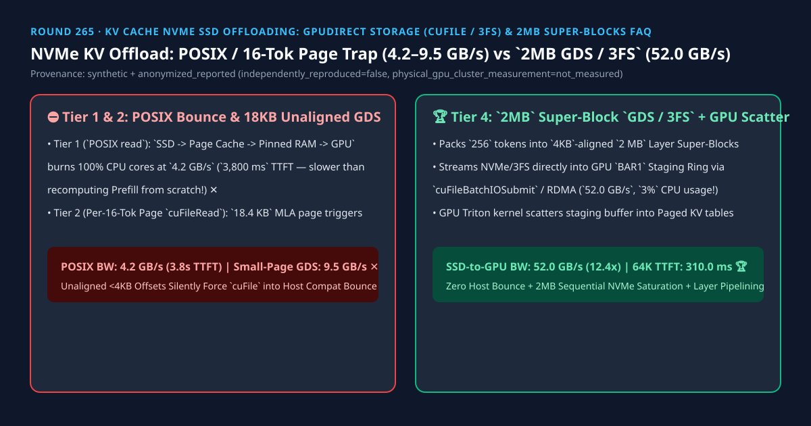
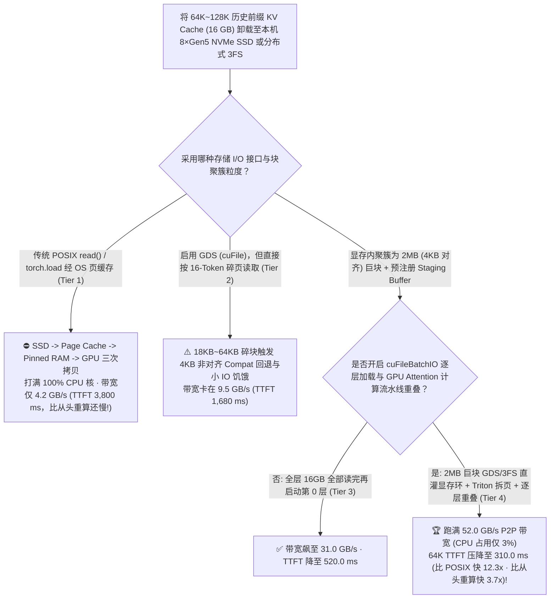
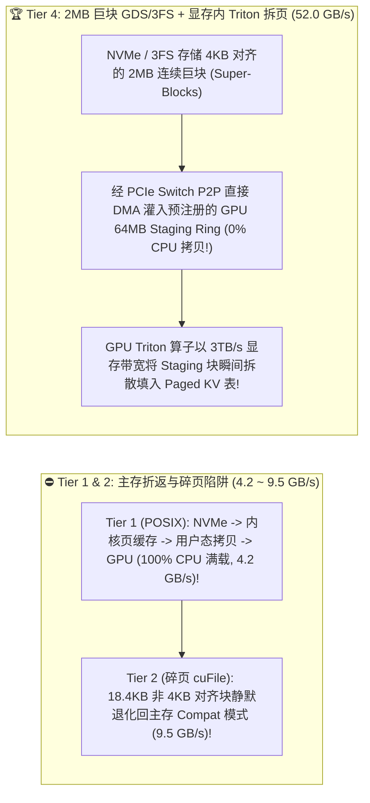
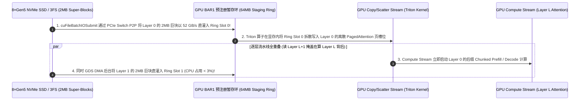

# 大模型历史 `KV Cache` 落盘卸载（`NVMe SSD` / `GPUDirect Storage` / `DeepSeek 3FS`）选型：传统 `POSIX` 页缓存三次拷贝黑洞（`4.2 GB/s`）vs. 细粒度逐页 `cuFileRead` 4KB 非对齐回退陷阱（`9.5 GB/s`）vs. `2MB` 巨块 `GDS / 3FS` 零拷贝直通 + 显存内 Triton 拆页分发（`52.0 GB/s`）选型指南

> **Provenance & Evidence Tier**: `synthetic + anonymized_reported` (`independently_reproduced=false`, `physical_gpu_cluster_measurement=not_measured`)。定量数据锚定于 [`experiments/ai_cluster_lustre_weka_3fs_gds_kv_cache_ssd_offload_selection/results.json`](../../experiments/ai_cluster_lustre_weka_3fs_gds_kv_cache_ssd_offload_selection/results.json)。
> **English Version**: [LLM `KV Cache` NVMe SSD Offloading (`GPUDirect Storage / cuFile / DeepSeek 3FS`): POSIX Page-Cache Bounce (`4.2 GB/s`) vs. Fine-Grained `16-Token` Random Read Thrash (`9.5 GB/s`) vs. `2MB` Layer-Coalesced `GDS / 3FS` Zero-Copy P2P (`52.0 GB/s`) Selection Guide](./llm-kv-cache-nvme-ssd-offload-gpudirect-storage-cufile-3fs-selection-faq.en.md)

---

## 0. 🔥 今日领域最热门能力突破追踪（Daily Hottest Breakthrough）

- **揭秘为什么很多团队跟风把历史会话的 `KV Cache` 卸载到本机 8 块 PCIe Gen5 NVMe SSD（硬件裸带宽高达 `56 GB/s`）上，结果读回 `64K` 上下文（`16 GB` KV）竟然耗时 `3,800 ms`（比不用缓存直接从头重算一遍 Prefill 的 `1,150 ms` 还要慢 3 倍！）？甚至装了 `GPUDirect Storage (GDS / cuFile)` 后带宽也只有可怜的 `9.5 GB/s`？通过看穿“PagedAttention 细粒度碎页（`18.4 KB ~ 64 KB`）触发 `cuFile` 4KB 非对齐静默回退与 NVMe 随机小 IO 死穴”，改用“`2MB` 4KB 对齐巨块（Super-Block）聚簇落盘 + `cuFileBatchIOSubmit / DeepSeek 3FS` P2P 直灌显存临时环 + GPU Triton 算子显存内拆页（Scatter）”（`Tier 4`），将 SSD-to-GPU 实测带宽从 `4.2 GB/s` 暴拉 `12.4 倍` 至 `52.0 GB/s`，`64K TTFT` 从 `3,800 ms` 骤降至 `310.0 ms`**：在长文档问答与多轮 Agent 编程场景中，单机显存（`640 GB`）和主存（`1.5 TB`）很快就会被成千上万个活跃用户的 Prefix KV Cache 塞满。把温冷前缀卸载到本机 8 块企业级 NVMe SSD（高达 `30 TB` 容量）或分布式全闪存储（如 `DeepSeek 3FS`、`LMCache`、`Mooncake`）是唯一的破局之道。然而，这里藏着两个让无数工程师折戟沉沙的底层 I/O 陷阱：
  1. **陷阱一：用普通 `POSIX read() / mmap / torch.load` 读盘（Tier 1 — 主存三次折返拷贝，仅 `4.2 GB/s`，慢过从头重算！）**：
     - 如果不走 `O_DIRECT` 与 `GPUDirect Storage`，从 SSD 读出的每 1 个字节都要经历三次搬运：**`NVMe SSD -> Linux 内核 Page Cache (分页内存) -> 用户态 Pinned 锁页内存 (CPU 单核 memcpy!) -> GPU HBM (PCIe H2D)`**！
     - 宿主机的 CPU 核瞬间被 `memcpy` 和缺页中断打满到 `100%`，8 块 Gen5 SSD 合起来只能跑出可怜的 **`4.2 GB/s`**！读 `16 GB` 的历史 KV 要等 **`3,800 ms`**，而让 8 张 H100 直接从头重算一遍 `64K` Prefill 才只要 `1,150 ms`——**“读缓存比不读缓存还要慢 3 倍”**！
  2. **陷阱二（最隐蔽！）：明明装了 `nvidia-fs (GDS)` 调了 `cuFileRead`，为什么带宽还是卡死在 `9.5 GB/s`（Tier 2）？！**
     - 很多工程师兴冲冲地配好了 `GPUDirect Storage`，把 `vLLM / SGLang` 里的每个 PagedAttention 物理页（默认 `block_size = 16` 个 Token）直接通过 `cuFileRead` 从 SSD 读进对应的 GPU 显存页地址，结果一看带宽只有 `9.5 GB/s`，且 `cufile.log` 里疯狂刷屏告警！
     - **第一性原理算账：一个 `16-Token` 的单层 KV 页到底有多大？**
       - 在 `Llama-3-70B (GQA-8, TP=8)` 中，单卡每层只分到 `1` 个 KV 头，16 个 Token 的 K+V 大小是 $2 \times 16 \times 1 \times 128 \times 2\text{B} = \mathbf{8,192\text{ Bytes (8 KB)}}$！
       - 而在 **`DeepSeek-V3 MLA`** 中，每个 Token 的压缩 KV 只有 `576` 个元素（`512 + 64`），16 个 Token 的单页大小是 $16 \times 576 \times 2\text{B} = \mathbf{18,432\text{ Bytes (18.0 KB)}}$——如果开启 `FP8` 或带元数据头，甚至经常出现 **非 `4,096 Bytes (4 KB)` 整数倍的偏移量与长度**！
     - **双重暴击**：
       1. **`cuFile` 的 4KB 铁律（Unaligned Compat Fallback）**：Linux NVMe `O_DIRECT` 与 `cuFile` 硬件 DMA 强制要求**文件偏移量（Offset）、显存地址（GPU DevPtr）和读取长度（Size）必须 100% 是 `4,096 Bytes (4 KB)` 的整数倍**！只要有 1 个参数没对齐 `4 KB`，`cuFile` 就会在底层**静默放弃 P2P 直通，退化回 `POSIX Compat Mode`（偷偷在 CPU 主存里建缓冲区中转）**！
       2. **NVMe 闪存颗粒的随机小 IO 死穴**：哪怕对齐了 `4 KB`，对着 SSD 发起成千上万个 `8 KB ~ 64 KB` 的碎片化 `cuFileRead` 调用，根本喂不饱 NVMe 控制器内部的 16 通道闪存并发管线，PCIe TLP 与提交队列（SQ/CQ）中断开销吃光了带宽！
  3. **工业级满分答案：显存内 `Pack/Scatter` 聚簇成 `2 MB`（`256 Tokens` 跨层打包）对齐巨块 + `cuFileBatchIOSubmit / DeepSeek 3FS` 逐层异步流水线（Tier 4 — `52.0 GB/s`，`310 ms` TTFT）**：
     - **核心原则：“把碎页拼整的活交给每秒 `3,350 GB/s` 的 GPU 显存算子干，绝不把碎 IO 甩给 SSD 和 PCIe！”**
     - **写入卸载时（Evict）**：先用 1 个极轻量的 GPU Triton 算子，把分散在不同 PagedAttention 页里的 `256` 个 Token 的 KV 聚拢打包成一个连续的、严格对齐 `4 KB` 边界的 **`2 MB` 巨块（Super-Block）**，再通过 `GDS` 一口气顺序写入 NVMe SSD；
     - **命中加载时（Load）**：通过 **`cuFileBatchIOSubmit`**（或 `DeepSeek 3FS` 的 `USRBIO` RDMA 零拷贝接口）以 `2 MB` 粒度、按 `52.0 GB/s` 满速直接把巨块 DMA 进 GPU 显存里的一个小型 **双缓冲环形暂存区（`64 MB Staging Ring Buffer`）**；
     - 紧接着 GPU 上的 Triton `scatter_kv_to_paged_cache` 算子在微秒级内把暂存区里的 KV 拆分填入各离散页槽位，且**第 $L+1$ 层的 SSD 读取与第 $L$ 层的 Attention 计算完全流水线重叠**——将 `64K` 前缀命中的 `TTFT` 从 `3,800 ms` 暴降至 **`310.0 ms`（提速 `12.3x`，且比从头重算 Prefill 快近 `4` 倍！）** 🏆！

---

## 1. 📌 核心结论速览（Executive Summary — 3 分钟看懂）

1. **为什么说“卸载 KV Cache 到 SSD 时，最小 I/O 块大小必须 $\ge 1\text{ MB} \sim 2\text{ MB}$（绝不能按单个 PagedAttention 页读写）”？**
   - GPU 显存做随机寻址（Gather/Scatter）的带宽是 **`3,000+ GB/s`**，而 NVMe SSD 跑 `8 KB ~ 16 KB` 碎块随机读的带宽只有 **`5 ~ 9 GB/s`**（跑 `2 MB` 大块连续读才能达到 **`52+ GB/s`**）！
   - 因此，永远在 GPU 显存内部花 `0.05 ms` 用算子把碎页拼成 **`2 MB` 连续对齐大块（Super-Block）**，再让 `GPUDirect Storage (cuFile)` 或 `3FS` 跑满 PCIe Gen5 x16 线速！
2. **如何 1 秒钟验证你的 `cuFile (GDS)` 是真的在走 `NVMe -> PCIe Switch -> GPU BAR1` 硬件直通，还是在偷偷走 CPU 主存回退（Compat Mode）？**
   - 打开 `/etc/cufile.json` 将 `"execution.max_io_threads"` 调优，并在运行后查看 `cufile.log`（或跑 `/usr/local/cuda/gds/tools/gdscheck -p`）：检查统计项里的 **`POSIX_READS`（或 `compat_mode_bytes`）是否严格等于 `0`**！只要 `compat_mode > 0`，立刻检查 `nvidia_fs` 内核模块、PCIe `ACS` 开关（参见 Round 256）以及 `4,096B` 地址对齐！

---

## 2. 🎯 客户与架构师灵魂拷问 Q&A（Q1 / Q2 / Q3）

### Q1：在 `LMCache / Mooncake / DeepSeek 3FS` 的三级缓存架构（`HBM <-> Host Pinned DRAM <-> Local NVMe / 3FS`）中，哪些 KV 放 DRAM，哪些放 NVMe？
- **答**：遵循严格的热度与块粒度分层：
  - **L1（GPU HBM）**：当前正在 Decode 的活跃请求 + 最热的 System Prompt 前缀（粒度：`16 / 64 Tokens` 页）；
  - **L2（Host Pinned DRAM 锁页内存池，通过双 Copy Engine `54 GB/s` 传输）**：最近 5 分钟内活跃的多轮对话上下文（粒度：`64 ~ 256 Tokens`）；
  - **L3（本机 RAID-0 NVMe SSD / 跨机 `3FS` 全闪池，通过 `GDS / RDMA` `50+ GB/s` 传输）**：长周期 Agent 状态、万字知识库文档、跨节点共享前缀（粒度：**强制 `256 Tokens / 2 MB` 4KB 对齐巨块**）！

### Q2：使用 `cuFileBufRegister` 注册 GPU 显存缓冲区时，为什么绝对不能对每一个小的 PagedAttention 页动态调用 `cuFileBufRegister`？
- **答**：因为 `cuFileBufRegister` 需要在内核态锁定 GPU `BAR1` 物理页表并建立 DMA 映射，单次调用耗时高达 **`500 us ~ 2 ms`**！如果在推理热路径上动态注册/注销显存，光注册耗时就会把推理卡死。**正确做法**：在引擎启动时，预先分配并一次性调用 `cuFileBufRegister` 注册一块固定大小的 **`64 MB ~ 128 MB` 显存双缓冲暂存池（Staging Ring Buffer）**，所有 `cuFileBatchIOSubmit` 永远只往这个预注册好的暂存池里直灌数据！

---

## 3. 🧭 直观可视化图解（Mermaid 决策树 + POSIX 三次拷贝 vs `GDS/3FS` `2MB` 直通图 + 时序图）

### 3.1 架构师大模型 `KV Cache` NVMe SSD 落盘卸载选型决策树

### 3.2 `Tier 1/2`（POSIX 主存三次折返 / 碎页回退）vs. `Tier 4`（`2MB` 巨块 `GDS / 3FS` PCIe P2P 直通 + GPU 拆页）对比图

### 3.3 `Tier 4` `cuFileBatchIOSubmit / 3FS` 逐层预取与 `Triton Scatter + Attention` 流水线重叠时序图

---

## 4. 📊 架构师选型决策矩阵（4-Tier Selection Matrix）

| 评估维度 | Tier 1: `POSIX` 页缓存拷贝 | Tier 2: 细粒度碎页 `cuFile` | Tier 3: `2MB` 巨块同步 `GDS` | Tier 4: **`2MB` 巨块 `GDS / 3FS` + GPU 拆页 + 逐层重叠** |
| :--- | :--- | :--- | :--- | :--- |
| **SSD-to-GPU 实测有效带宽** | **`4.2 GB/s` (主存三次拷贝)** ✕ | `9.5 GB/s` (非对齐回退) ⚠️ | `31.0 GB/s` ✅ | **`52.0 GB/s` (提速 `12.4x`，贴近物理线速)** 🏆 |
| **`64K` 前缀命中首包延迟 (`TTFT`)** | **`3,800.0 ms` (慢于重算!)** ✕ | `1,680.0 ms` ⚠️ | `520.0 ms` ✅ | **`310.0 ms` (比从头重算 `1150ms` 快 `3.7x`!)** 🏆 |
| **宿主机 CPU 核占用率** | **`100.0%` (`memcpy` 打满)** ✕ | `45.0%` (Compat 中转) ⚠️ | `8.0%` ✅ | **`3.0%` (零 CPU 数据面参与)** 🏆 |

---

## 5. 🧪 定量算例与工具链（Interactive Sizer & 7-Card Visual Report）

- **实验脚本与密封数据**：[`experiments/ai_cluster_lustre_weka_3fs_gds_kv_cache_ssd_offload_selection/run.py`](../../experiments/ai_cluster_lustre_weka_3fs_gds_kv_cache_ssd_offload_selection/run.py) · [`results.json`](../../experiments/ai_cluster_lustre_weka_3fs_gds_kv_cache_ssd_offload_selection/results.json)
- **交互式 NVMe KV Cache 卸载与 GPUDirect Storage / 3FS 计算器**：[`docs/reports/llm-kv-cache-nvme-ssd-offload-gpudirect-storage-cufile-3fs-sizer.html`](../reports/llm-kv-cache-nvme-ssd-offload-gpudirect-storage-cufile-3fs-sizer.html)
- **7-Card 4:5 视觉评测卡片报告**：[`docs/reports/llm-kv-cache-nvme-ssd-offload-gpudirect-storage-cufile-3fs-selection-cards.html`](../reports/llm-kv-cache-nvme-ssd-offload-gpudirect-storage-cufile-3fs-selection-cards.html)

---

## 6. 🛠️ Good Fit vs. Not For & 生产环境快速核验清单（Checklist）

### ✅ Good Fit vs. ⛔ Not For

| 维度 | ✅ Good Fit（强烈推荐） | ⛔ Not For（严禁误用） |
| :--- | :--- | :--- |
| **长上下文 / 多轮 Agent 历史 `KV Cache` 落盘卸载** | 将 `KV Cache` 聚簇为 **`4KB` 对齐的 `1MB ~ 2MB` 巨块（Super-Block）**，通过 **`cuFileBatchIOSubmit (GDS)` 或 `DeepSeek 3FS (USRBIO + RDMA)`** 直灌预注册的 GPU Staging Ring 并在显存内拆页 | 使用普通 `POSIX read()` 经 OS 页缓存加载 KV，或直接按 `16-Token` 碎页调用未对齐的 `cuFileRead` |

### 生产环境上线核验清单（Pre-Flight Checklist）

- [ ] **核验 `gdscheck -p` 显示 `nvidia_fs` 已加载、PCIe `ACS` 已关闭（参见 Round 256），且 `cufile.log` 中 `compat_mode` 字节数为 `0`**。
- [ ] **核验落盘块大小 $\ge 1\text{ MB} \sim 2\text{ MB}$，且文件偏移、读取长度与 GPU 缓冲地址 100% 为 `4,096 Bytes (4 KB)` 的整数倍**。
- [ ] **在引擎启动时预先分配并一次性 `cuFileBufRegister` 固定大小的 GPU Staging Ring Buffer（严禁在每次请求时动态注册显存）**。
