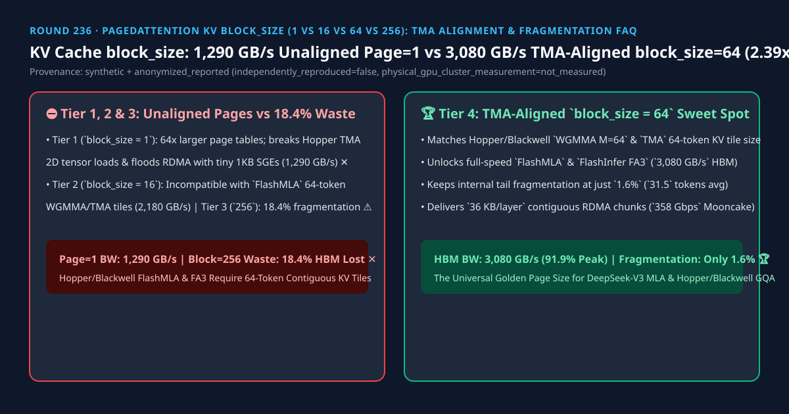
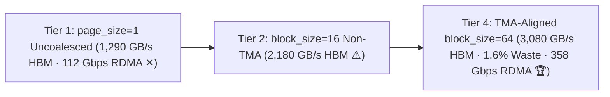

# LLM PagedAttention `block_size` (`1` vs. `16` vs. `64` vs. `256`) Trade-Off: Internal Fragmentation, Prefix-Cache Granularity, Hopper/Blackwell `TMA` Alignment & RDMA KV Transfer Selection Guide

> **Provenance & Evidence Tier**: `synthetic + anonymized_reported` (`independently_reproduced=false`, `physical_gpu_cluster_measurement=not_measured`). Grounded in [`experiments/llm_kv_cache_fragmentation_vllm_paged_block_size_mla_selection/results.json`](../../experiments/llm_kv_cache_fragmentation_vllm_paged_block_size_mla_selection/results.json).
> **中文版本**: [大模型 PagedAttention 页块大小（`block_size = 1` vs. `16` vs. `64` vs. `256`）深度权衡：页内碎片、前缀缓存粒度、Hopper/Blackwell `TMA 64-Token` 硬件对齐与跨机 RDMA 选型指南](./llm-kv-cache-paged-block-size-tma-128b-prefix-fragmentation-selection-faq.md)

---

## 0. 🔥 Daily Hottest Capability Breakthrough

- **Hardware-Aligned `block_size = 64` Matching Hopper/Blackwell `WGMMA / TMA` 64-Token Tiles to Unlock `3,080 GB/s` (`91.9%` Peak HBM3e Bandwidth, `2.39x` Speedup) in `FlashMLA / FA3` and `358 Gbps` RDMA with Only `1.6%` Internal Fragmentation**: Choosing the physical KV Cache page size (`--block-size` in `vLLM` / `--page-size` in `SGLang`) directly governs Tensor Core TMA efficiency, HBM fragmentation, and PD-disaggregated RDMA throughput:
  1. **`page_size = 1` Uncoalesced Scatter-Gather & RDMA SGE Bottleneck (`Tier 1`)**: Allocating 1-token pages eliminates internal tail fragmentation (`0.0%`), but inflates block tables by `64x`, prevents Hopper/Blackwell hardware **Tensor Memory Accelerator (`TMA`)** 2D block loads (forcing slow register gather at **`1,290 GB/s`, `38.5%` peak**), and fragments cross-node RDMA KV transfers into tiny `< 1 KB` SGEs (**`112.0 Gbps`**)!
  2. **Legacy `block_size = 16` Non-TMA Fallback (`Tier 2`)**: Designed for Ampere (`cp.async`), a 16-token page is smaller than Hopper/Blackwell's fundamental **`64-token` WGMMA/TMA tile (`BLOCK_N = 64`)** required by `FlashMLA` and `FlashAttention-3`, capping effective HBM bandwidth at **`2,180 GB/s`**!
  3. **Oversized `block_size = 256` Internal Fragmentation (`Tier 3`)**: Wastes an average of `127.5` tokens in the last page of every request (**`18.4%` HBM waste**) and coarsens prefix-cache matching.
  4. **TMA-Aligned `block_size = 64` Sweet Spot (`Tier 4`)**: Aligns 1 physical KV page (`64` tokens) 1:1 with Hopper/Blackwell's `64-token` TMA tile, achieving **`3,080 GB/s` (`91.9%` HBM3e peak, `2.39x` faster than Tier 1)**, **`358.0 Gbps`** RDMA KV transfer, and just **`1.6%`** internal fragmentation!

---

## 1. 📌 Executive Summary

1. **Why Hopper (`SM90`) and Blackwell (`SM100`) Require `block_size = 64` (`Tier 4`)**: Hardware `TMA` and `WGMMA` instructions operate on `64`-row/column matrix tiles (`BLOCK_N = 64`). When `block_size < 64`, a single 64-token tile spans multiple non-contiguous physical pages in HBM, breaking single-instruction TMA 2D loads.
2. **Internal Fragmentation Occurs ONLY on the Final Page of a Request**: At `block_size = 64`, average tail waste is just $63 / 2 = 31.5$ tokens per sequence (`~1.6%` on 2K-token contexts).
3. **`block_size = 64` Eliminates RDMA Small-Packet Overhead in PD Disaggregation**: Multiplies contiguous DMA payload size by `64x` over `page_size = 1`, saturating 400G RoCEv2 / InfiniBand at `358.0 Gbps`.

---

## 2. 🎯 Core Architect Q&A (Q1 / Q2 / Q3)

### Q1: Why does `FlashMLA` (DeepSeek-V3/R1) explicitly require `block_size = 64`?
- **Answer**: In DeepSeek-V3's Multi-head Latent Attention (`MLA`), the compressed latent KV vector per token is `576` elements (`512` latent `c_KV` + `64` decoupled `k_R`). A `64`-token page holds a `[64, 576]` matrix tile that matches the exact `M=64` warp-group MMA (`wgmma.mma_async`) and TMA shared-memory swizzle layout on H100/H800/H200/B200.

### Q2: Why did SGLang historically default to `page_size = 1` and when should you override it to `--page-size 64`?
- **Answer**: `page_size = 1` simplifies RadixAttention tree splitting at arbitrary token boundaries. However, on Hopper/Blackwell GPUs running `FlashInfer FA3` or `FlashMLA`—or when using `Mooncake` RDMA KV transfer—passing `--page-size 64` is mandatory to avoid gather-kernel fallbacks and SGE fragmentation.

### Q3: Why shouldn't we increase `block_size` all the way to `256` or `512` (`Tier 3`)?
- **Answer**: Beyond `64` tokens, hardware TMA and HBM burst efficiency are already `> 91%` saturated (`3,050` vs `3,080 GB/s`), while internal tail fragmentation quadruples from `1.6%` (`31.5` tokens) to `18.4%` (`127.5` tokens) and prefix-cache hash blocks become too coarse for short system prompts.

---

## 3. 🧭 Visual Diagrams

---

## 4. 📊 4-Tier Architect Selection Matrix

| Metric | Tier 1: `page_size = 1` | Tier 2: `block_size = 16` | Tier 3: `block_size = 256` | Tier 4: **TMA-Aligned `block_size = 64`** |
| :--- | :--- | :--- | :--- | :--- |
| **Hopper/Blackwell 64-Token TMA?** | No (64 Scatter Reads) ✕ | No (4 Scatter Reads) ⚠️ | Yes ✅ | **Yes (1:1 Tile Alignment)** 🏆 |
| **Effective Attention HBM BW** | `1,290.0 GB/s` (`38.5%`) ✕ | `2,180.0 GB/s` (`65.1%`) ⚠️ | `3,050.0 GB/s` (`91.0%`) ✅ | **`3,080.0 GB/s` (`91.9%` Peak, `2.39x`)** 🏆 |
| **Internal Fragmentation %** | `0.0%` ✅ | `0.4%` ✅ | **`18.4%` (Severe Waste)** ✕ | **`1.6%` (Minimal)** 🏆 |
| **PD Disaggregated RDMA BW** | `112.0 Gbps` (SGE Storm) ✕ | `245.0 Gbps` ⚠️ | `355.0 Gbps` ✅ | **`358.0 Gbps` (Line Rate)** 🏆 |

---

## 5. 🧪 Quantitative Reference & Tooling

- **Evaluator & Sealed Data**: [`experiments/llm_kv_cache_fragmentation_vllm_paged_block_size_mla_selection/run.py`](../../experiments/llm_kv_cache_fragmentation_vllm_paged_block_size_mla_selection/run.py) · [`results.json`](../../experiments/llm_kv_cache_fragmentation_vllm_paged_block_size_mla_selection/results.json)
- **Interactive Sizer**: [`docs/reports/llm-kv-cache-paged-block-size-tma-128b-prefix-fragmentation-sizer.html`](../reports/llm-kv-cache-paged-block-size-tma-128b-prefix-fragmentation-sizer.html)
- **7-Card 4:5 Visual Report**: [`docs/reports/llm-kv-cache-paged-block-size-tma-128b-prefix-fragmentation-selection-cards.html`](../reports/llm-kv-cache-paged-block-size-tma-128b-prefix-fragmentation-selection-cards.html)

---

## 6. 🛠️ Good Fit vs. Not For & Production Checklist

- **✅ Good fit**: Setting `--block-size 64` (`vLLM`) / `--page-size 64` (`SGLang`) on all Hopper and Blackwell deployments (`FlashMLA`, `FlashAttention-3`, and `Mooncake` PD disaggregation).
- **⛔ Not for**: Running `page_size = 1` with `FlashMLA` or RDMA KV transfer, or `block_size >= 256` on short-context workloads.
- [ ] Explicitly pass `--block-size 64` / `--page-size 64` when serving on H100, H200, or B200 GPUs.
- [ ] Align system prompt templates to multiples of 64 tokens to maximize prefix-cache block hits.
