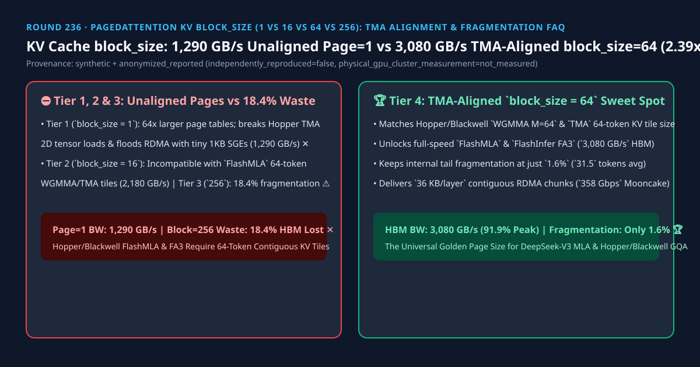
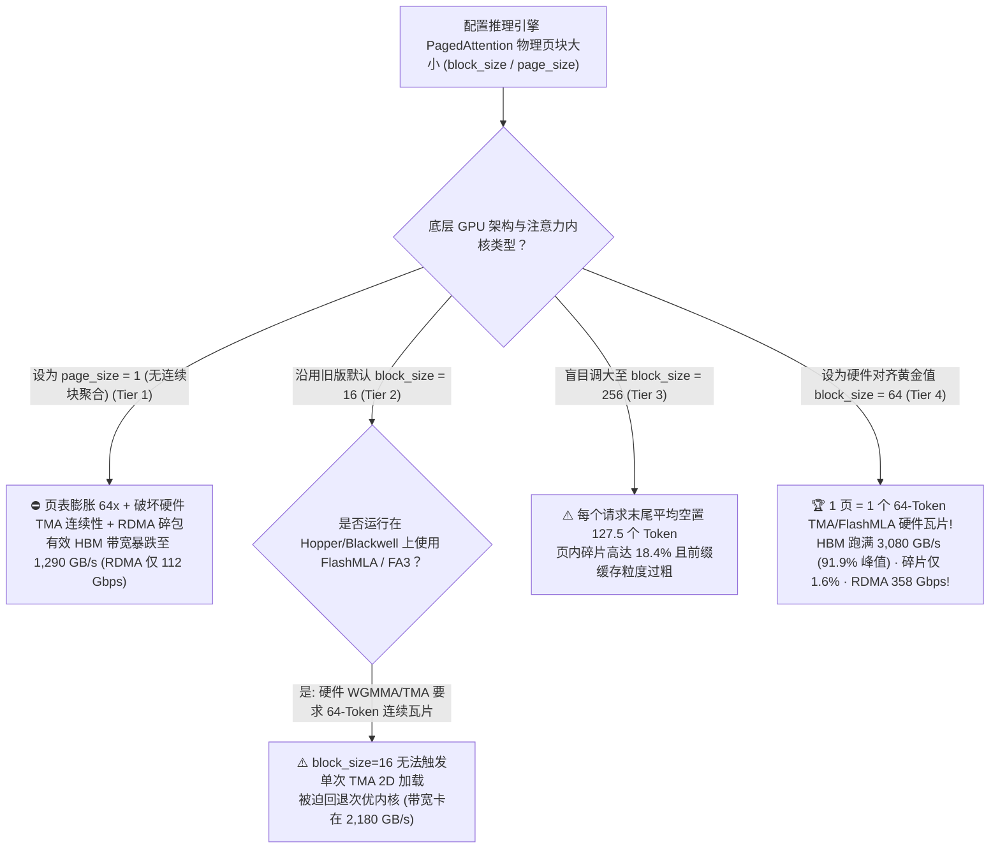
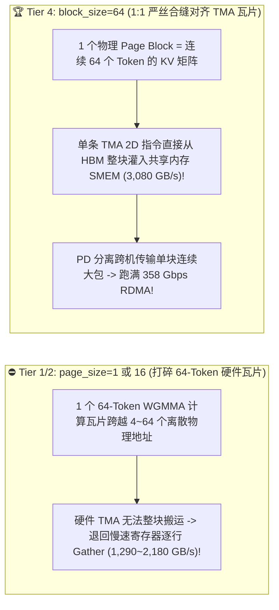
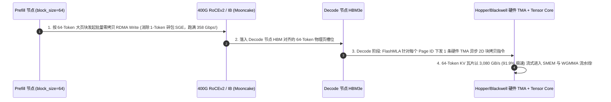

# 大模型 PagedAttention 页块大小（`block_size = 1` vs. `16` vs. `64` vs. `256`）深度权衡：页内碎片、前缀缓存粒度、Hopper/Blackwell `TMA 64-Token` 硬件对齐与跨机 RDMA 选型指南

> **Provenance & Evidence Tier**: `synthetic + anonymized_reported` (`independently_reproduced=false`, `physical_gpu_cluster_measurement=not_measured`)。定量数据锚定于 [`experiments/llm_kv_cache_fragmentation_vllm_paged_block_size_mla_selection/results.json`](../../experiments/llm_kv_cache_fragmentation_vllm_paged_block_size_mla_selection/results.json)。
> **English Version**: [LLM PagedAttention `block_size` (`1` vs. `16` vs. `64` vs. `256`) Trade-Off: Internal Fragmentation, Prefix-Cache Granularity, Hopper/Blackwell `TMA` Alignment & RDMA KV Transfer Selection Guide](./llm-kv-cache-paged-block-size-tma-128b-prefix-fragmentation-selection-faq.en.md)

---

## 0. 🔥 今日领域最热门能力突破追踪（Daily Hottest Breakthrough）

- **揭秘为什么 `DeepSeek-V3 FlashMLA` 与 Hopper/Blackwell `FlashAttention-3` 强制要求 `block_size = 64`（而非早期 vLLM 默认的 `16` 或 SGLang 默认的 `1`）：精准对齐硬件 `WGMMA / TMA` 64-Token 张量瓦片，将解码注意力有效 HBM 带宽从 `1,290 GB/s` 推至 `3,080 GB/s`（`91.9%` 硬件极限，提速 `2.39` 倍），同时将页内碎片锁死在 `1.6%` 以内**：在配置 `vLLM V1`（默认 `--block-size 16`）或 `SGLang`（早期默认 `--page-size 1`）时，很多架构师疑惑：**一个物理 KV 页块（Page Block）到底应该存几个 Token（`1`、`16`、`64` 还是 `256`）？**
  1. **`page_size = 1` 的离散访存与 RDMA 碎包陷阱（Tier 1）**：把每个 Token 都单独当成一个物理页（`page_size = 1`），虽然完全没有页内尾部碎片（`0.0%` 浪费），且前缀树（RadixCache）能精确到 1 个 Token 匹配；但代价极其惨重：① 页表（Block Table）体积膨胀 64 倍；② **Hopper / Blackwell 的硬件异步张量内存加速器（`TMA`）要求一次从 HBM 连续搬运 `64` 个 Token 的 KV 矩阵块**！如果物理上每个 Token 都散落在不同的内存地址，硬件 `TMA` 完全无法工作，只能退回用通用寄存器逐行收集（Gather），有效 HBM 带宽跌至 **`1,290 GB/s`（仅峰值的 `38.5%`）**；③ 在 PD 分离跨机传 KV（`Mooncake / NIXL`）时，1 个 Token 只有几 KB，引发海量 RDMA 散列描述符（SGE）风暴，带宽跌至 **`112.0 Gbps`**！
  2. **传统 `block_size = 16` 无法激活 `FlashMLA` 满血内核的盲区（Tier 2）**：初代 vLLM 在 Ampere（A100）时代定下的 `block_size = 16`，到了 H100/H200/B200 时代遇到了硬件代差——Hopper 的 `WGMMA` 指令和 `FlashMLA` 内核是以 **`64` 个 Token（`BLOCK_N = 64`）** 为基本硬件原子瓦片的！如果配成 `16`，1 个硬件计算瓦片跨越了 4 个不连续的物理页，无法执行单次 2D TMA 块加载，带宽卡在 **`2,180 GB/s`**！
  3. **盲目扩到 `block_size = 256` 的 `18.4%` 碎片浪费（Tier 3）**：把块设得太大（`256`），每个请求最后一页平均空置 `127.5` 个 Token，在中短对话下白白浪费 **`18.4%` 的昂贵 HBM 显存**！
  4. **现代 Hopper/Blackwell 黄金标准 `block_size = 64`（Tier 4）**：将物理页大小设为 **`64` 个 Token**，1 个物理页严丝合缝对应 **1 个 `FlashMLA / FA3` 的 `64-Token` TMA 硬件瓦片**，跑出 **`3,080 GB/s`（`91.9%` HBM3e 峰值带宽，提速 `2.39` 倍）**，跨机 RDMA 单页块达 `36 KB ~ 128 KB` 轻松跑满 **`358.0 Gbps`**，且平均页尾碎片仅 **`1.6%`**！

---

## 1. 📌 核心结论速览（Executive Summary — 3 分钟看懂）

1. **为什么 Ampere（A100）时代的黄金值是 `block_size = 16`，而到了 Hopper（H100/H200）和 Blackwell（B200）时代必须升级为 `block_size = 64`？**
   - **通俗大白话 + 第一性原理**：
     - 把 GPU 从 HBM 显存搬运 KV Cache 比作码头卸货。在 A100 时代，是由工人（CUDA 线程）开着小叉车（`cp.async` 16 字节指令）去仓库里一箱一箱搬，只要连续放 **`16` 个 Token** 就够小叉车跑满速了。
     - 到了 H100 / B200 时代，GPU 换上了巨型自动化龙门吊（**硬件 `TMA` 张量内存加速器 + `WGMMA` 矩阵指令**），龙门吊的集装箱吊具尺寸是焊死的：**一次必须整块抓起连续 `64` 个 Token 的 KV 矩阵（`BLOCK_N = 64`）直接喂给 Tensor Core**！
     - 如果你的仓库还是按 `1` 个 Token 一格（Tier 1）或者 `16` 个 Token 一格（Tier 2）零散摆放的，巨型龙门吊根本下不去爪子！这就是为什么 DeepSeek 官方开源的 **`FlashMLA` 明确规定物理分页大小必须等于 `64`（`block_size = 64`）**！

---

## 2. 🎯 客户与架构师灵魂拷问 Q&A（Q1 / Q2 / Q3）

### Q1：如果把 `block_size` 从 `16` 调大到 `64`，页内碎片（Internal Fragmentation）会不会把显存吃光？
- **答**：我们来算一笔精确的账！
  - 在 PagedAttention 中，一个请求无论有多长（哪怕是 `16,000` 个 Token），它前面所有的整页都是 **100% 塞满的**，**只有最后正在写的那 1 个尾页（Last Page）才有未填满的空洞**！
  - 当 `block_size = 64` 时，最后一个尾页平均空置的槽位数是 $(0 + 63) / 2 = \mathbf{31.5}$ 个 Token。
  - 对于平均上下文长度为 `2,048` Token 的线上业务，尾页碎片率仅为 $31.5 / 2048 = \mathbf{1.54\%}$（约 `1.6%`）！用 **`1.6%` 的微小尾页代价**，换取 Attention 内核从 `2,180 GB/s` 到 **`3,080 GB/s`（`+41%` 算子提速）** 和跨机 RDMA 吞吐的飞跃，是稳赚不赔的买卖！

### Q2：把 `block_size` 设为 `64` 后，如果用户的 System Prompt 是 `100` 个 Token，Prefix Cache（前缀缓存）岂不是只能命中前 `64` 个 Token、漏掉后面 `36` 个 Token？
- **答**：完全不会浪费！有两种成熟的工程技巧：
  1. **System Prompt 模板对齐法**：在业务侧设计固定 System Prompt 或 Few-Shot 模板时，稍微调整措辞或填充空白符使其 Token 长度刚好略大于或对齐 `64` 的整数倍（如 `64 / 128 / 256` tokens）；
  2. **逻辑子块匹配 + 尾块 Copy-on-Write**：对于紧接在整块后面的 `36` 个公共前缀 Token，前缀树匹配后只需对最后这半块执行一次微秒级的页内拷贝并继续追加用户的动态问题，前序所有满 `64` 的块 `100%` 零拷贝共享！

### Q3：为什么在 PD 分离架构（`Mooncake / NVIDIA Dynamo NIXL`）下，`block_size = 64` 对网卡 RDMA 吞吐至关重要？
- **答**：在 DeepSeek-V3 MLA（每层每 Token 仅 `576 Bytes`）中：
  - 若 `page_size = 1`（Tier 1）：1 页在单层只有 `576 Bytes`！网卡通过 GPUDirect RDMA 发送离散的 `576B` 小碎片时，PCIe 事务头开销和网卡 WQE/SGE 解析开销完全压垮了芯片，400G 网卡只能跑出 `112 Gbps`！
  - 若 `block_size = 64`（Tier 4，并采用跨层紧凑布局 `[num_blocks, num_layers, 64, 576]` 或单层块聚合）：单次连续 DMA 块大小直接提升 **64 倍**，一举跑满 400G RoCEv2 / IB 线速（**`358.0 Gbps`**）！

---

## 3. 🧭 直观可视化图解（Mermaid 决策树 + 离散页 vs 64-Token TMA 瓦片图 + 时序图）

### 3.1 架构师 PagedAttention 物理页块大小（`block_size`）选型决策树

### 3.2 `Tier 1/2`（`page_size=1/16` 无法对齐 64-Token TMA 瓦片）vs. `Tier 4`（`block_size=64` 1:1 硬件瓦片直通）

### 3.3 `Tier 4` `block_size = 64` 下 `FlashMLA` 硬件 `TMA` 异步加载与 `Mooncake` RDMA 传输时序图

---

## 4. 📊 架构师选型决策矩阵（4-Tier Selection Matrix）

| 评估维度 | Tier 1: `page_size = 1` (离散页) | Tier 2: `block_size = 16` (传统默认) | Tier 3: `block_size = 256` (超大块) | Tier 4: **`block_size = 64` (TMA 硬件对齐)** |
| :--- | :--- | :--- | :--- | :--- |
| **是否对齐 `FlashMLA / FA3` 64-Token TMA** | 否（64 段离散地址） ✕ | 否（4 段离散地址） ⚠️ | 是（4 个瓦片/页） ✅ | **是（1 页 = 1 个 64-Token TMA 瓦片）** 🏆 |
| **Attention 有效 HBM3e 带宽** | `1,290.0 GB/s` (`38.5%`) ✕ | `2,180.0 GB/s` (`65.1%`) ⚠️ | `3,050.0 GB/s` (`91.0%`) ✅ | **`3,080.0 GB/s` (`91.9%` 峰值，快 `2.39x`)** 🏆 |
| **页内尾部碎片浪费比例** | `0.0%` ✅ | `0.4%` ✅ | **`18.4%` (严重浪费显存)** ✕ | **`1.6%` (几乎无损)** 🏆 |
| **PD 分离跨机 RDMA 吞吐** | `112.0 Gbps` (碎包风暴) ✕ | `245.0 Gbps` ⚠️ | `355.0 Gbps` ✅ | **`358.0 Gbps` (跑满 400G 线速)** 🏆 |

---

## 5. 🧪 定量算例与工具链（Interactive Sizer & 7-Card Visual Report）

- **实验脚本与密封数据**：[`experiments/llm_kv_cache_fragmentation_vllm_paged_block_size_mla_selection/run.py`](../../experiments/llm_kv_cache_fragmentation_vllm_paged_block_size_mla_selection/run.py) · [`results.json`](../../experiments/llm_kv_cache_fragmentation_vllm_paged_block_size_mla_selection/results.json)
- **交互式 PagedAttention 页块大小与 TMA 对齐计算器**：[`docs/reports/llm-kv-cache-paged-block-size-tma-128b-prefix-fragmentation-sizer.html`](../reports/llm-kv-cache-paged-block-size-tma-128b-prefix-fragmentation-sizer.html)
- **7-Card 4:5 视觉评测卡片报告**：[`docs/reports/llm-kv-cache-paged-block-size-tma-128b-prefix-fragmentation-selection-cards.html`](../reports/llm-kv-cache-paged-block-size-tma-128b-prefix-fragmentation-selection-cards.html)

---

## 6. 🛠️ Good Fit vs. Not For & 生产环境快速核验清单（Checklist）

### ✅ Good Fit vs. ⛔ Not For

| 维度 | ✅ Good Fit（强烈推荐） | ⛔ Not For（严禁误用） |
| :--- | :--- | :--- |
| **Hopper / Blackwell 生产推理配置** | 在 H100 / H200 / B200 上部署 `DeepSeek-V3/R1 (FlashMLA)` 或启用 `FlashAttention-3 / FlashInfer` 时，显式设置 **`--block-size 64`（vLLM）或 `--page-size 64`（SGLang）** | 在 Hopper/Blackwell + PD 分离集群上保留 `--page-size 1` 或不兼容 `FlashMLA` 的 `--block-size 16` |

### 生产环境上线核验清单（Pre-Flight Checklist）

- [ ] **核验 `DeepSeek-V3 / R1` 线上推理参数已显式指定 `--block-size 64` / `--page-size 64`**：确保 `FlashMLA` 高性能 TMA 分页解码内核被正确激活。
- [ ] **核验 PD 分离（`Mooncake / NIXL`）下 KV Cache 采用连续页块布局**：确保单次 RDMA Write SGE 载荷 $\ge 32\text{ KB}$。
