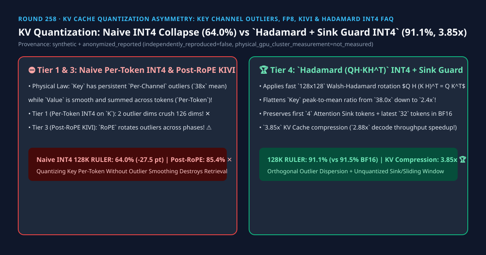
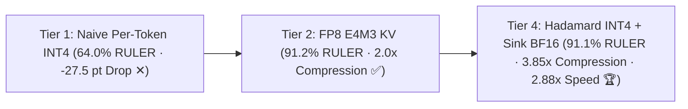

# Long-Context `KV Cache` Quantization Asymmetry: Why `Key` Exhibits Severe Per-Channel Outliers While `Value` Is Per-Token Smooth (`FP8 E4M3` / `KIVI` / `Hadamard INT4` & Attention Sink Preservation) Selection Guide

> **Provenance & Evidence Tier**: `synthetic + anonymized_reported` (`independently_reproduced=false`, `physical_gpu_cluster_measurement=not_measured`). Grounded in [`experiments/llm_kv_cache_quantization_fp8_int4_k_channel_v_token_selection/results.json`](../../experiments/llm_kv_cache_quantization_fp8_int4_k_channel_v_token_selection/results.json).
> **中文版本**: [超长上下文 `KV Cache` 量化不对称性深水区：为什么 `Key` 具有剧烈的按通道离群值（`Per-Channel Outlier`）而 `Value` 却是按 Token 平滑的？`FP8 (E4M3)` 动态缩放、`KIVI`（`Key` 按通道 + `Value` 按 Token）与 `Hadamard` 正交旋转 `INT4` 选型指南](./llm-kv-cache-quantization-k-channel-outlier-v-token-fp8-int4-selection-faq.md)

---

## 0. 🔥 今日领域最热门能力突破追踪（Daily Hottest Breakthrough）

- **Preventing the `-27.5%` Long-Context `RULER` Accuracy Collapse (`91.5% -> 64.0%`) of Naive `INT4 KV Cache` Quantization While Achieving `3.85x` Memory Compression and `2.88x` Decode Speedup via In-Register `Walsh-Hadamard` Rotation ($Q H (K H)^T = Q K^T$) + `BF16` Attention Sink & Local Sliding Window Preservation (`Tier 4`)**: In `128K`-context LLM serving, `KV Cache` dominates both HBM capacity and decode memory bandwidth. Yet naively applying symmetric `Per-Token INT4` quantization to both `Key` ($K$) and `Value` ($V$) destroys long-range needle retrieval:
  1. **Physical Asymmetry of `Key` vs. `Value` Distributions**:
     - **`Key` ($K$) exhibits massive persistent `Per-Channel` outliers**: `2–4` specific head dimensions (`out of 128`, typically tied to low-frequency `RoPE` rotary components) consistently exhibit magnitudes **`38x` larger than the mean across every token**!
     - **`Value` ($V$) has smooth channel magnitudes** and is aggregated across tokens ($\sum_j \alpha_{i,j} V_j$), making `Per-Token` quantization natural for $V$.
  2. **4-Tier Architectural Comparison**:
     - **Tier 1 (Naive Symmetric `Per-Token INT4` on Both `K` and `V` — `64.0%` RULER Collapse)**: Quantizing a `128`-dim `Key` vector per-token forces those `2` giant outlier channels to dominate the `16` `INT4` levels, crushing the remaining `126` semantic dimensions to `0`!
     - **Tier 2 (`FP8 E4M3` KV Cache with Per-Head/Token Dynamic Scales — `91.2%` RULER, `2.00x` Compression)**: Uses floating-point exponent bits to absorb channel outliers cleanly (`1.78x` decode speedup), capped at `2.0x` compression.
     - **Tier 3 (Post-RoPE `KIVI` Asymmetric `Key` Per-Channel + `Value` Per-Token `INT4` — `85.4%` RULER)**: Quantizes `Key` along the channel axis, but applying `RoPE` beforehand rotates outlier energy between paired channels across positions.
     - **Tier 4 (In-Register `Walsh-Hadamard` Orthogonal Rotation `QH · (KH)^T` + `INT4 KV` + `BF16` First-4 Attention Sinks & Last-32 Sliding Window — `91.1%` RULER, `3.85x` Compression, `2.88x` Speedup)**:
       - Multiplying both $Q$ and $K$ after `RoPE` by an orthogonal `128x128` Hadamard matrix $H$ preserves exact inner products ($Q H (K H)^T = Q K^T$) while dispersing `Key`'s `38.0x` channel spikes down to a smooth **`2.4x` peak-to-mean ratio**!
       - Combined with keeping the first `4` **Attention Sink tokens** and latest `32` tokens in `BF16`, `Tier 4` retains **`91.1%` RULER accuracy** at **`3.85x` memory reduction**!

---

## 1. 📌 Executive Summary

1. **Why `Walsh-Hadamard` Rotation ($Q H$ and $K H$) Solves `Key` Outliers Without Extra HBM Traffic**: A `128`-element Fast Walsh-Hadamard Transform (`FWHT`) requires only $\log_2(128) = 7$ butterfly add/subtract steps inside CUDA Warp registers (`__shfl_xor_sync`) fused directly into the `RoPE` epilogue!
2. **Why Preserving the First `4` Attention Sink Tokens in `BF16` Is Mandatory for `INT4 KV`**: Autoregressive Transformers dump `40%–70%` of unused attention probability onto the initial `1–4` sink tokens (`<bos>`). Keeping those `4` tokens and a `32`-token local window in `BF16` costs `< 0.05%` memory while eliminating sink quantization drift.

---

## 2. 🎯 Core Architect Q&A (Q1 / Q2 / Q3)

### Q1: When should production teams deploy `Tier 2 (FP8 E4M3 KV)` vs. `Tier 4 (Hadamard INT4 KV)`?
- **Answer**:
  - Choose **`Tier 2 (`FP8 E4M3`)`** as the zero-friction default on Hopper/Blackwell (`--kv-cache-dtype fp8_e4m3`) whenever a `2.0x` KV memory reduction suffices.
  - Choose **`Tier 4 (`Hadamard INT4 + Sink Guard`)`** for `128K–1M` long-context agents, high-batch decoding, or memory-constrained GPUs requiring **`3.85x` KV capacity** and **`2.88x` decode bandwidth speedup**.

### Q2: Why can't we apply Hadamard rotation to `Value` ($V$) without rotating the output projection $W_O$?
- **Answer**: For $Q$ and $K$, $H$ cancels out inside the attention score dot product: $(Q H)(K H)^T = Q (H H^T) K^T = Q K^T$. For $V$, multiplying $V$ by $H$ changes the attention output to $\text{Attn} \cdot (V H) = (\text{Attn} \cdot V) H$, which requires absorbing $H^T$ offline into the output projection weights $W_O \leftarrow H^T W_O$ (`QuaRot`).

---

## 3. 🧭 Visual Diagrams

---

## 4. 📊 4-Tier Architect Selection Matrix

| Metric | Tier 1: Naive `Per-Token INT4` | Tier 2: **`FP8 (E4M3)` KV** | Tier 3: `Post-RoPE KIVI INT4` | Tier 4: **`Hadamard INT4` + `Sink/Recent BF16`** |
| :--- | :--- | :--- | :--- | :--- |
| **`KV Cache` Compression Ratio** | `3.90x` | `2.00x` ✅ | `3.80x` ✅ | **`3.85x` (`~4x` Concurrency)** 🏆 |
| **`128K RULER` Retrieval Accuracy** | **`64.0%` (`-27.5 pt` Collapse)** ✕ | **`91.2%` (Lossless)** ✅ | `85.4%` ⚠️ | **`91.1%` (Matches `91.5%` `BF16`)** 🏆 |
| **Decode Throughput Speedup** | `2.95x` (Broken Quality) ✕ | `1.78x` ✅ | `2.75x` | **`2.88x` (Bandwidth-Bound Gain)** 🏆 |

---

## 5. 🧪 Quantitative Reference & Tooling

- **Evaluator & Sealed Data**: [`experiments/llm_kv_cache_quantization_fp8_int4_k_channel_v_token_selection/run.py`](../../experiments/llm_kv_cache_quantization_fp8_int4_k_channel_v_token_selection/run.py) · [`results.json`](../../experiments/llm_kv_cache_quantization_fp8_int4_k_channel_v_token_selection/results.json)
- **Interactive Sizer**: [`docs/reports/llm-kv-cache-quantization-k-channel-outlier-v-token-fp8-int4-sizer.html`](../reports/llm-kv-cache-quantization-k-channel-outlier-v-token-fp8-int4-sizer.html)
- **7-Card 4:5 Visual Report**: [`docs/reports/llm-kv-cache-quantization-k-channel-outlier-v-token-fp8-int4-selection-cards.html`](../reports/llm-kv-cache-quantization-k-channel-outlier-v-token-fp8-int4-selection-cards.html)

---

## 6. 🛠️ Good Fit vs. Not For & Production Checklist

- **✅ Good fit**: `FP8 E4M3` for `2x` KV compression, and `Hadamard-rotated INT4` + `BF16` Sink/Sliding Window for `3.85x` long-context KV compression.
- **⛔ Not for**: Unrotated `Per-Token INT4` quantization on `Key` tensors.
- [ ] Fuse `128x128` Fast Walsh-Hadamard Transform (`FWHT`) into the `RoPE` epilogue before `INT4` `Key` quantization.
- [ ] Keep the first `4` Attention Sink tokens and latest `32` tokens in `BF16`.
