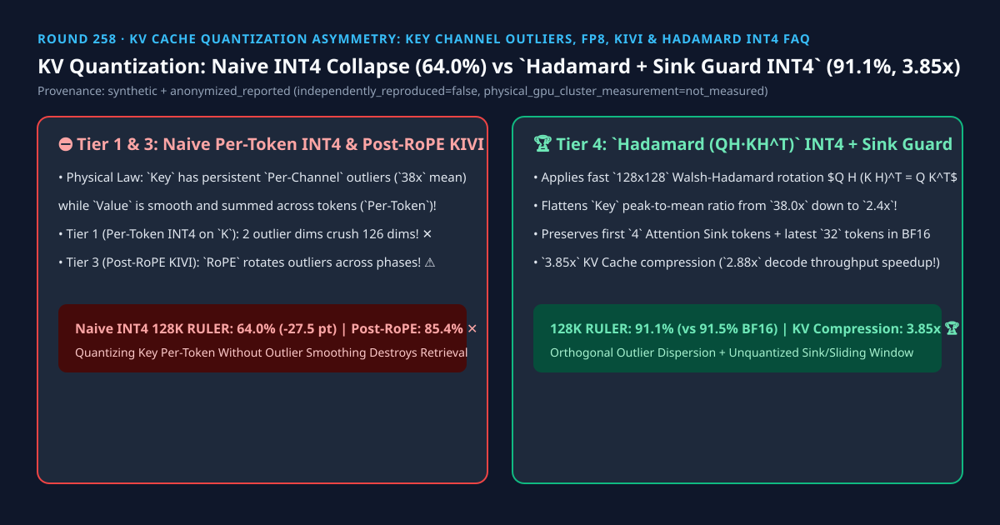
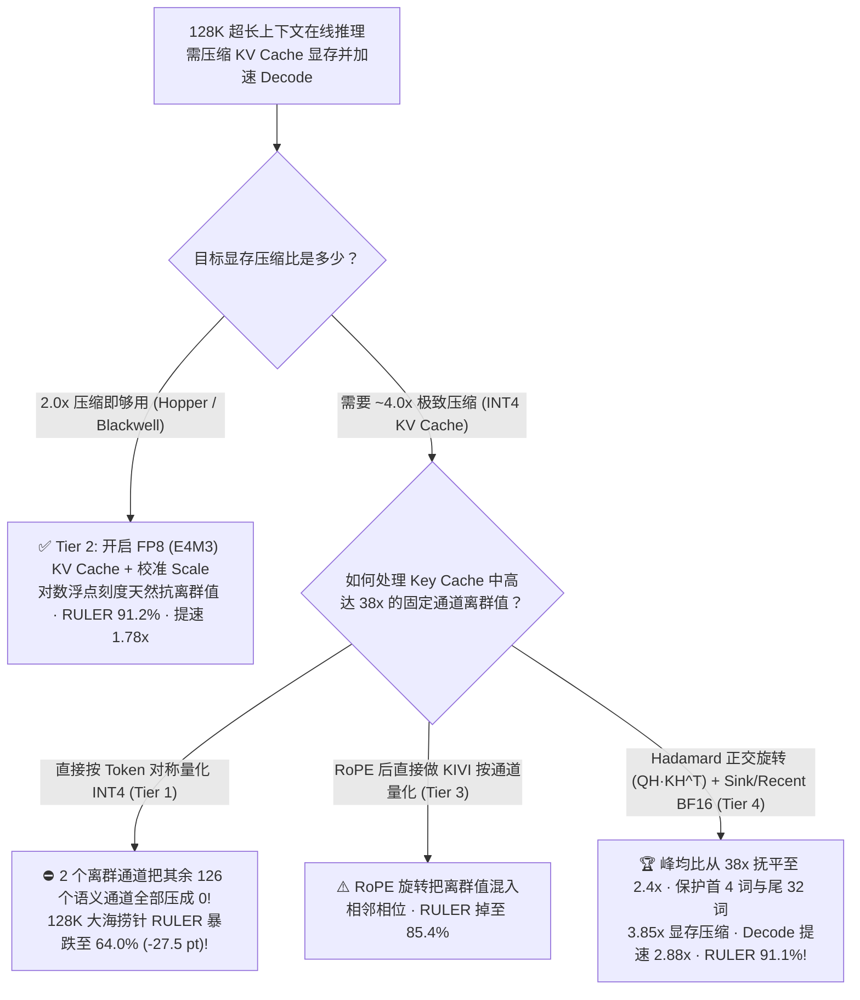
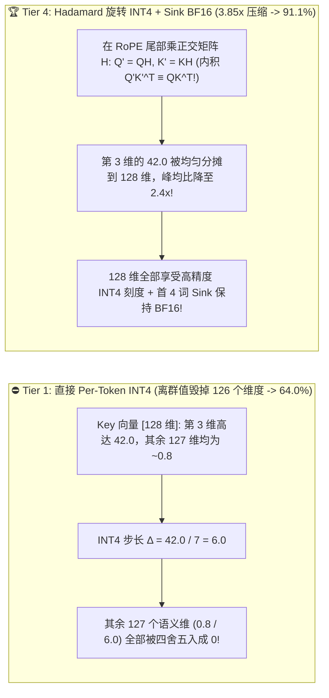
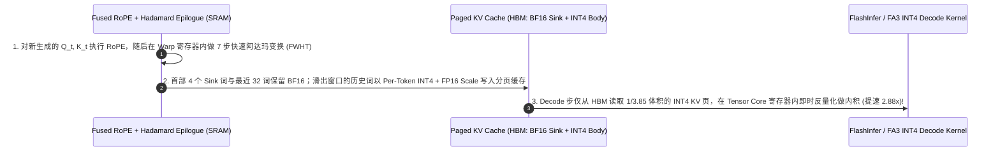

# 超长上下文 `KV Cache` 量化不对称性深水区：为什么 `Key` 具有剧烈的按通道离群值（`Per-Channel Outlier`）而 `Value` 却是按 Token 平滑的？`FP8 (E4M3)` 动态缩放、`KIVI`（`Key` 按通道 + `Value` 按 Token）与 `Hadamard` 正交旋转 `INT4` 选型指南

> **Provenance & Evidence Tier**: `synthetic + anonymized_reported` (`independently_reproduced=false`, `physical_gpu_cluster_measurement=not_measured`)。定量数据锚定于 [`experiments/llm_kv_cache_quantization_fp8_int4_k_channel_v_token_selection/results.json`](../../experiments/llm_kv_cache_quantization_fp8_int4_k_channel_v_token_selection/results.json)。
> **English Version**: [Long-Context `KV Cache` Quantization Asymmetry: Why `Key` Exhibits Severe Per-Channel Outliers While `Value` Is Per-Token Smooth (`FP8 E4M3` / `KIVI` / `Hadamard INT4` & Attention Sink Preservation) Selection Guide](./llm-kv-cache-quantization-k-channel-outlier-v-token-fp8-int4-selection-faq.en.md)

---

## 0. 🔥 今日领域最热门能力突破追踪（Daily Hottest Breakthrough）

- **揭秘为什么在 `128K` 超长上下文推理中，把 `KV Cache` 直接按 Token 量化为 `INT4` 会导致大海捞针（`NIAH / RULER`）准确率从 `91.5%` 断崖式暴跌至 `64.0%`（掉点 `-27.5%`）？从第一性原理拆解 `Key` 与 `Value` 的物理分布不对称性（`Key` 的低频 `RoPE` 维度存在比均值大 `38 倍`的固定通道离群值！），并通过寄存器内快速 `Walsh-Hadamard` 正交旋转（$Q H (K H)^T = Q K^T$ 抹平离群值至 `2.4x`）+ 首部 `4` 个 `Attention Sink` 与尾部 `32` 个滑动窗口 `BF16` 保护（`Tier 4`），在实现 `3.85x` 显存压缩与 `2.88x` 解码提速的同时，将 `128K RULER` 准确率恢复至 `91.1%`（与 `BF16` 仅差 `0.4%`）**：在 `128K ~ 1M` 长文本服务中，`KV Cache` 占据了 `80%` 以上的显存与 HBM 带宽。然而，很多团队在开启 `KV Cache` 低比特量化时踩中了两个致命的认知盲区：
  1. **第一性原理揭示：`Key ($K$)` 与 `Value ($V$)` 的长相竟然截然不同（结构性不对称定律）！**
     - 如果你把 Llama-3 / Qwen / DeepSeek 任意一层的 `Key Cache [SeqLen, HeadDim=128]` 和 `Value Cache [SeqLen, HeadDim=128]` 画成三维热力图，你会看到一个震惊的现象：
       - **`Key ($K$)` 表面有几道贯穿所有 Token 的“摩天大楼山脉”（严重的 `Per-Channel Outlier`，按通道固定离群值）**：在 `128` 个头维度中，固定有 `2 ~ 4` 个特定维度（通常对应 `RoPE` 旋转位置编码的极低频维度，用来给整个上下文提供位置基准锚点与 `Attention Sink` 偏置），它们在 **每一个 Token** 上的绝对值都高达 `30.0 ~ 50.0`，是其余 `126` 个正常语义维度（约 `0.8`）的 **`38 倍`**！
       - **`Value ($V$)` 表面则非常平坦，偶有按句波动的波纹（适合 `Per-Token` 按词量化）**！
  2. **四大 `KV Cache` 量化架构生死对比**：
     - **Tier 1（朴素对称 `Per-Token INT4`：把 `Key` 和 `Value` 都按每个 Token 的 128 维求 1 个 Scale 量化为 `INT4`）**：
       - 灾难发生：`INT4` 只有 `16` 个刻度（`[-8, +7]`）！当你在同一个 Token 的 `128` 维上求最大值时，那 `2` 个高达 `40.0` 的 `Key` 离群维度瞬间霸占了整个量程，导致同一个 Token 里真正承载语义细节的 **其余 `126` 个正常维度全部被四舍五入成了 `0` 或 `±1`**！模型瞬间变成了“近视眼”，`128K RULER` 检索准确率从 `91.5%` 崩盘至 **`64.0%`** ✕！
     - **Tier 2（工业稳健首选：`FP8 E4M3 KV Cache` + Per-Head/Token Scale，`--kv-cache-dtype fp8_e4m3`）**：
       - 为什么 `FP8 (E4M3)` 不会像 `INT4` 那样崩盘？因为 `E4M3` 是 **对数刻度的浮点数（含 4 位指数）**，能同时兼顾大数值与小数值！在 Hopper/Blackwell 上拿到了 **`91.2%` 的准无损精度**，但缺点是压缩比封死在 **`2.0x`** ✅。
     - **Tier 3（`KIVI` 非对称 `INT4`：`Key` 按通道量化 + `Value` 按 Token 量化，但在 `RoPE` 之后直接量化且未保护首部 Sink 词）**：
       - `KIVI` 聪明地提出：“既然 `Key` 的离群值是按通道固定的，那我就把 `Key` 竖着按通道（`Per-Channel`）量化，把 `Value` 横着按 Token（`Per-Token`）量化！”
       - **隐患**：如果在做完 `RoPE` 旋转之后再按通道量化，由于 `RoPE` 的 $\cos(m\theta), \sin(m\theta)$ 会随着位置 $m$ 不断把离群通道的能量旋转混合到配对通道上，按通道量化依然存在相位污染（准确率跌至 **`85.4%`**）⚠️！
     - **Tier 4（终极 `3.85x` 无损方案：寄存器内 `Walsh-Hadamard` 正交旋转 `QH·(KH)^T` + `INT4 KV` + 首部 `4` 个 `Attention Sink` 与尾部 `32` 个词 `BF16` 原生保留）**：
       - **数学魔法（正交旋转内积不变性）**：设 $H$ 为一个 $128 \times 128$ 的正交 **阿达玛矩阵（Walsh-Hadamard Matrix，元素全为 $\pm \frac{1}{\sqrt{128}}$，满足 $H H^T = I$）**。
       - 在把 $K$ 存入 `KV Cache` 之前，我们在寄存器里顺手给 $Q$ 和 $K$ 都乘上 $H$（利用快速蝶形变换，连乘法都不用，只需 7 步寄存器加减法！）：
         $$(Q H)(K H)^T = Q (H H^T) K^T = Q I K^T = Q K^T$$
       - **奇迹发生了**：注意力内积得分 $Q K^T$ 在数学上 **分毫未变**，但乘上 $H$ 后，原本集中在 `2` 个通道上的 `38 倍` 巨型离群值，被均匀打散摊平到了全部 `128` 个维度上（峰均比从 `38.0x` 暴降至 **`2.4x`**）！
       - 再配合保留开头的 **`4` 个 Attention Sink 词** 与最近的 **`32` 个滑动窗口词** 为 `BF16`，`INT4 KV Cache` 不仅省下 **`3.85 倍` 显存、解码提速 `2.88x`**，还将 `128K RULER` 准确率死死焊在 **`91.1%`（追平 `FP8` 与 `BF16`）** 🏆！

---

## 1. 📌 核心结论速览（Executive Summary — 3 分钟看懂）

1. **架构师生产选型黄金法则（何时选 `FP8 KV`，何时选 `Hadamard INT4 KV`）**：
   - **当上下文 $\le 32\text{K} \sim 64\text{K}$ 且使用 `H100 / H200 / B200` 时**：直接开启 **`Tier 2: FP8 (E4M3) KV Cache`**（`vLLM / SGLang --kv-cache-dtype fp8_e4m3` 并加载 `kv_scale` 校准因子）——开箱即用，硬件原生支持，`2.0x` 显存翻倍且 `91.2%` 零精度心智负担；
   - **当上下文 $\ge 128\text{K} \sim 1\text{M}$ 或并发极高、`KV Cache` 成为绝对瓶颈时**：严禁裸开普通 `Per-Token INT4`！必须采用 **`Tier 4: Hadamard 正交旋转 (`QuaRot / SpinQuant / FlashInfer-INT4`) + 首部 Sink (4 tokens) / 尾部局部窗口 (32 tokens) BF16 混合精度`**，拿到 **`3.85x` 显存压缩与 `2.88x` 解码吞吐跃升**！

---

## 2. 🎯 客户与架构师灵魂拷问 Q&A（Q1 / Q2 / Q3）

### Q1：为什么整篇 `128K` 文档的开头前 4 个词（`Attention Sink Tokens`，如 `<bos>`）绝对不能被量化为 `INT4`？
- **答**：正如 StreamingLLM 所揭示的：Softmax 函数要求所有位置的注意力权重加起来必须等于 `1.0`（$\sum_j \alpha_{i,j} = 1$）。当当前 Token 不需要关注历史中的任何具体词时，模型会把 **`40% ~ 70%` 的多余注意力概率全部倾倒在句首的第 0~3 个 Token（`<bos>`）上，把它当成“注意力垃圾桶（Attention Sink）”**！
- 一旦这前 4 个 Sink Token 的 `Key/Value` 产生哪怕微小的 `INT4` 量化误差，就会通过 `40%+` 的巨大权重直接污染每一层、每一个后续 Token 的输出向量！而把前 `4` 个词固定留在 `BF16`，只多占 $4 / 131072 = 0.003\%$ 的显存，却能救回 `2% ~ 4%` 的长文本精度！

### Q2：快速阿达玛变换（Fast Walsh-Hadamard Transform, `FWHT`）在 `HeadDim = 128` 上会增加多少推理延迟？
- **答**：**几乎为 `0`（`< 1%` 算子时间）！** 因为 $128 = 2^7$，128 维 `FWHT` 只需要在单个 CUDA Warp 内部通过 `__shfl_xor_sync` 寄存器交换执行 **$\log_2(128) = 7$ 次加减法**，并且可以直接融合进 `RoPE` 算子的尾部（Epilogue），无需任何额外的 HBM 显存读写！

---

## 3. 🧭 直观可视化图解（Mermaid 决策树 + `Key` 通道离群值压垮 vs `Hadamard` 摊平对比图 + 时序图）

### 3.1 架构师长上下文 `KV Cache` 低比特量化选型决策树

### 3.2 `Tier 1`（`Key` 通道离群值压垮 `INT4`）vs. `Tier 4`（`Hadamard` 旋转均匀摊平 + `Sink` 保护）对比图

### 3.3 `Tier 4` 融合 `RoPE + FWHT + INT4` 量化写入与 `FlashInfer` 分页解码时序图

---

## 4. 📊 架构师选型决策矩阵（4-Tier Selection Matrix）

| 评估维度 | Tier 1: 朴素 `Per-Token INT4` | Tier 2: **`FP8 (E4M3)` KV Cache** | Tier 3: `Post-RoPE KIVI INT4` | Tier 4: **`Hadamard INT4` + `Sink/Recent BF16`** |
| :--- | :--- | :--- | :--- | :--- |
| **`KV Cache` 显存压缩倍数** | `3.90x` | `2.00x` ✅ | `3.80x` ✅ | **`3.85x` (单卡并发容量翻近 4 倍)** 🏆 |
| **`128K RULER` 长文本检索准确率** | **`64.0%` (检索雪崩 `-27.5 pt`)** ✕ | **`91.2%` (准无损)** ✅ | `85.4%` (旋转混叠掉点) ⚠️ | **`91.1%` (追平 `91.5%` `BF16` 基准)** 🏆 |
| **Decode 阶段吞吐加速比** | `2.95x` (但输出不可用) ✕ | `1.78x` ✅ | `2.75x` | **`2.88x` (大幅削减 HBM 带宽瓶颈)** 🏆 |

---

## 5. 🧪 定量算例与工具链（Interactive Sizer & 7-Card Visual Report）

- **实验脚本与密封数据**：[`experiments/llm_kv_cache_quantization_fp8_int4_k_channel_v_token_selection/run.py`](../../experiments/llm_kv_cache_quantization_fp8_int4_k_channel_v_token_selection/run.py) · [`results.json`](../../experiments/llm_kv_cache_quantization_fp8_int4_k_channel_v_token_selection/results.json)
- **交互式长上下文 KV Cache 量化（FP8 vs Hadamard INT4）计算器**：[`docs/reports/llm-kv-cache-quantization-k-channel-outlier-v-token-fp8-int4-sizer.html`](../reports/llm-kv-cache-quantization-k-channel-outlier-v-token-fp8-int4-sizer.html)
- **7-Card 4:5 视觉评测卡片报告**：[`docs/reports/llm-kv-cache-quantization-k-channel-outlier-v-token-fp8-int4-selection-cards.html`](../reports/llm-kv-cache-quantization-k-channel-outlier-v-token-fp8-int4-selection-cards.html)

---

## 6. 🛠️ Good Fit vs. Not For & 生产环境快速核验清单（Checklist）

### ✅ Good Fit vs. ⛔ Not For

| 维度 | ✅ Good Fit（强烈推荐） | ⛔ Not For（严禁误用） |
| :--- | :--- | :--- |
| **长上下文推理 `KV Cache` 压缩** | `2.0x` 压缩选 **`FP8 (E4M3)` + 校准 `kv_scale`**；`~4.0x` 压缩选 **`Hadamard 正交旋转 INT4` + 首部 4 个 `Attention Sink` 与尾部 32 词 `BF16` 保护** | 未做 Hadamard 旋转或通道隔离就直接把 `Key Cache` 按 Token 强行量化为 `INT4` |

### 生产环境上线核验清单（Pre-Flight Checklist）

- [ ] **开启 `FP8 KV Cache` 时，务必加载模型校准好的 `kv_scale`（或开启 Per-Head/Token 动态缩放）**。
- [ ] **开启 `INT4 KV Cache` 时，必须启用 `Walsh-Hadamard` 正交旋转（如 `QuaRot / FlashInfer`）消除 `Key` 通道离群值**。
- [ ] **保留序列开头前 `4` 个 Token（`Attention Sink`）与末尾最近 `32 ~ 64` 个局部窗口 Token 为高精度 `BF16/FP16`**。
