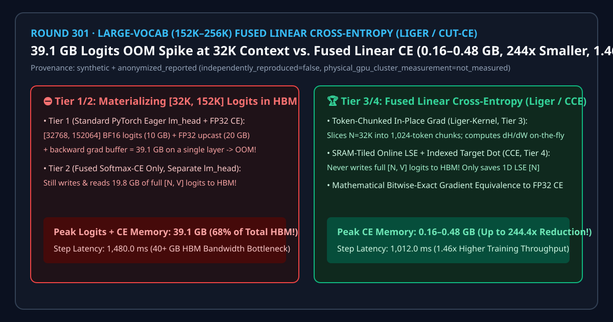
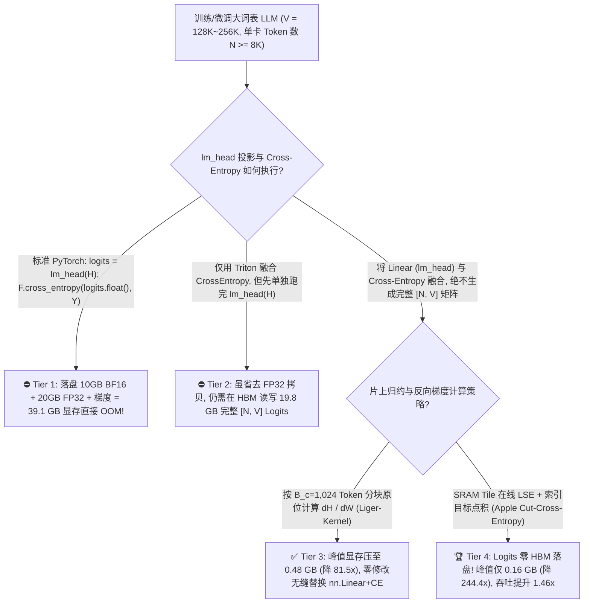
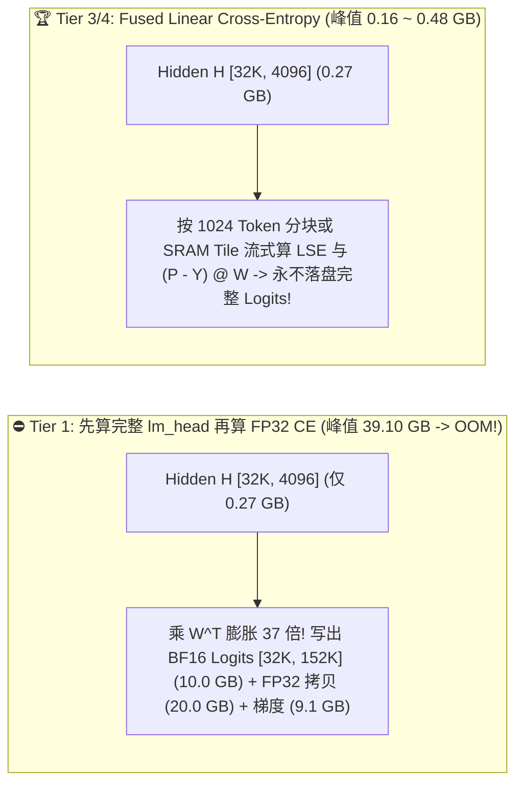
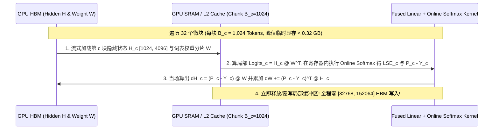

# 大模型大词表（`152K–256K Vocab`）长上下文训练显存爆炸与融合线性交叉熵（`Liger-Kernel / Apple Cut-Cross-Entropy`）选型：为什么 `8B` 模型在 `32K` 序列下仅最后一层 `lm_head + CrossEntropyLoss` 就会瞬间吃掉 `39.1 GB` 显存直接触发 OOM，而只融合 Softmax 仍需读写 `19.8 GB` Logits？基于 `Token` 分块原位求导与 `SRAM` 在线 `LSE` 零 Logits 落盘（显存骤降 `244x` 至 `0.16 GB`，提速 `1.46x`）选型指南

> **Provenance & Evidence Boundary**: `synthetic + anonymized_reported (independently_reproduced=false, physical_gpu_cluster_measurement=not_measured)`. 本文所有定量数据均来自封存确定性评估器 `experiments/llm_large_vocab_fused_linear_cross_entropy_liger_cce_memory_selection/run.py` 与 `results.json`。



---

## 0. 追踪每日最热门能力突破（Daily Capability Breakthrough）

- **今日焦点突破**：**面向多语言与推理大模型（`Qwen3 152K / Gemma 256K / Llama-3 128K`）长上下文训练的“零完整 Logits 显存落盘（`Zero Full-Logit Materialization`）融合线性交叉熵（`LigerFusedLinearCrossEntropyLoss` & `Apple Cut-Cross-Entropy (CCE)`）”算子架构**。
- **架构师价值**：很多团队在用 80GB H100 微调或强化学习训练 `8B` 模型（模型权重仅 `16 GB`）并开启 `FlashAttention + Activation Checkpointing` 后，惊讶地发现一到 `32K` 上下文仍然在最后一行 `loss = criterion(lm_head(h), labels)` 爆出 `CUDA out of memory`！真凶正是**大词表输出层（`lm_head`）与交叉熵损失（`CrossEntropyLoss`）的巨型 `[N, V]` Logits 张量**：
  1. **如果使用标准 PyTorch Eager 模式（`logits = lm_head(h); loss = F.cross_entropy(logits.float(), y)`，Tier 1）**：当单卡 Token 数 $N = 32,768$、词表大小 $V = 152,064$（如 `Qwen2.5/3`）时：
     - 先算出 `[32768, 152064]` 的 `BF16` Logits 张量（占 **`9.97 GB`**）；
     - 为了数值稳定转成 `FP32` 算 Softmax，再复制一份 `FP32` Logits（占 **`19.93 GB`**）；
     - 反向传播还要分配一份约 **`9.2 GB`** 的梯度缓冲区——**仅仅最后一层 Loss 计算就瞬间吞噬了 `39.10 GB` 显存（占整张 80GB 显卡近一半，占激活显存的 `68%`）**，且来回读写 `40+ GB` HBM 让单步耗时高达 `1,480.0 ms`！
  2. **如果只用 Triton 融合 `CrossEntropyLoss`，但不融合前面的 `lm_head` 线性层（Tier 2）**：虽然消除了 `FP32` 拷贝，但 `lm_head(h)` 仍然必须在 HBM 中完整写出一个 **`9.97 GB` 的 `BF16` Logits 矩阵** 并保存给反向传播（合计仍占 **`19.80 GB`** 显存）！
  采用 **将 `lm_head` 矩阵乘与 `CrossEntropy` 前反向深度融合的 `Liger-Kernel`（按 `1,024` Token 分块在 Forward 中原位算出梯度 `dH/dW`，峰值仅 `0.48 GB`，Tier 3）或 `Cut-Cross-Entropy (CCE)`（直接在 GPU SRAM Tile 内流式计算 `LogSumExp` 与目标词点积，完全不向 HBM 写出任何 Logits 块，峰值仅 `0.16 GB`，Tier 4）**，可将输出层峰值显存压缩 **`81.5x ~ 244.4x`（从 `39.10 GB` 降至 `0.16 GB`）**，同时因消除了 40GB HBM 带宽读写，将训练单步吞吐提升 **`1.46x`**！

---

## ① 📌 核心结论速览（Executive Summary）

1. **为什么现代大模型会出现“最后一层比前面 32 层 Transformer 加起来还吃显存”的反常现象？**
   - 早期 `Llama-1/2` 词表仅 $V = 32,000$，序列长 $N = 2,048$，Logits 大小仅为 $2048 \times 32000 \times 2\text{ B} = \mathbf{131\text{ MB}}$（微不足道）。
   - 而现代多语言大模型（`Qwen 152K`、`Gemma 256K`）词表扩大了 **`5 ~ 8 倍`**，训练序列长度拉长到 $N = 32,768 \sim 131,072$（扩大 **`16 ~ 64 倍`**）！隐藏层维度 $D = 4,096$ 与词表维度 $V = 152,064$ 之间存在 **`37.1 倍` 的维度膨胀比（Expansion Ratio $V/D = 37.1\times$）**：把仅 **`268 MB`** 的隐藏状态 $H \in \mathbb{R}^{32768 \times 4096}$ 乘以分类头权重 $W^T$ 投影成 Logits 后，体积瞬间暴涨 37 倍变成 **`10.0 GB`**！
2. **第一性原理：为什么算交叉熵 Loss 和梯度根本不需要在 HBM 里保存 `[N, V]` 的 Logits 矩阵？**
   - 交叉熵损失的数学定义为：
     $$\mathcal{L}_i = -\text{logit}_{i, y_i} + \log \sum_{v=1}^{V} \exp(\text{logit}_{i, v}) = -(h_i \cdot w_{y_i}) + \text{LSE}_i$$
   - 对 Logits 的梯度极其优美简洁：
     $$\frac{\partial \mathcal{L}_i}{\partial \text{logit}_{i, v}} = P_{i, v} - \mathbb{I}(v = y_i) = \exp(\text{logit}_{i, v} - \text{LSE}_i) - \mathbb{I}(v = y_i)$$
   - **核心洞察**：
     - **方案 A（`Liger-Kernel` 分块前反向合一，Tier 3）**：既然最后一层的输出只是一个标量 `loss`，它的上游梯度恒为 `1.0`（或 `1/N`）！我们完全可以在 **Forward 阶段**把 $N=32,768$ 个 Token 切成 $B_c = 1,024$ 的小块：每次只算 `[1024, 152064]` 的微型 Logits（仅 `311 MB`），立刻在片上算出概率 $P_c$，当场算出对当前分块隐藏状态的梯度 $\nabla H_c = (P_c - Y_c) W$ 并累加权重梯度 $\nabla W \mathrel{+}= (P_c - Y_c)^T H_c$，然后**直接扔掉这 `311 MB` 临时缓冲区**！等到真正的 `loss.backward()` 执行时，只需把算好的 $\nabla H$ 乘以标量 `grad_output` 即可！
     - **方案 B（`Cut-Cross-Entropy` SRAM 在线归约，Tier 4）**：前向时用索引点积核直接算正确标签的 $h_i \cdot w_{y_i}$，并用分块 GEMM + Triton Online Softmax 在 **SRAM 寄存器内**流式归约出 1D 向量 $\text{LSE} \in \mathbb{R}^{N}$（仅占 **`128 KB`**！），**连分块 Logits 都不写回 HBM**；反向时利用这 `128 KB` 的 $\text{LSE}$ 在 SRAM 内重算局部概率块并直接乘出 $\nabla H$ 与 $\nabla W$，峰值显存仅 **`0.16 GB`**！

---

## ② 🎯 客户与架构师灵魂拷问 Q&A（Q1 / Q2 / Q3）

### Q1：在 Forward 阶段就提前算好 $\nabla H$ 和 $\nabla W$（`Liger-Kernel` 模式），和标准 PyTorch 算出的梯度有精度损失吗？
- **100% 数学等价（Bitwise / FP32 级精度对齐，零近似）！**
  因为交叉熵损失通常已经是计算图的最末端（叶子 Loss），根据链式法则，$\frac{\partial \mathcal{L}_{\text{total}}}{\partial H} = \frac{\partial \mathcal{L}_{\text{total}}}{\partial \mathcal{L}} \cdot \frac{\partial \mathcal{L}}{\partial H}$。只要在自定义 `torch.autograd.Function` 的 `forward` 中算出未缩放的单位梯度 $\frac{\partial \mathcal{L}}{\partial H}$ 与 $\frac{\partial \mathcal{L}}{\partial W}$，在 `backward(ctx, grad_output)` 中只需执行一次极轻量的逐元素缩放 `grad_H *= grad_output`，结果与标准实现完全一致！

### Q2：在 `GRPO / PPO / DPO` 强化学习后训练中，我们不仅要算交叉熵，还要拿每个采样 Token 的 `logprobs` 并算熵正则项（`Entropy Bonus`），还能不落盘 `[N, V]` Logits 吗？
- **完全可以（必须用 `Fused Linear Logprob + Entropy` 内核）！**
  在强化学习训练中，许多开源框架早期会写 `logits = model(input_ids).logits; logprobs = gather(log_softmax(logits), labels)`——这同样会触发 `39 GB` 的 Logits 显存爆炸！
  正确做法是将 `labels`（采样的 Action Token ID）直接传进模型的 `forward(input_ids, labels=action_ids, return_entropy=True)`：在分块或 SRAM Tile 内同时归约出每个位置的 `selected_logprob`（`[N]` 一维向量，`128 KB`）与分块香农熵 $H_i = \text{LSE}_i - \sum_v P_{i,v} \text{logit}_{i,v}$（同样是 `[N]` 一维向量，`128 KB`），**永远不要让 `model.forward()` 向外返回 `[B, S, V]` 的三维 Logits 张量**！

### Q3：如果启用了张量并行 `TP=8`（`VocabParallelCrossEntropy`），还需要开启分块融合线性交叉熵吗？
- **当单卡序列很长（如 Context Parallel 或长序列 Packing $N \ge 32\text{K}$）或 `TP=1/2`（FSDP/ZeRO 模式）时，必须开启！**
  在纯 FSDP/ZeRO-3（`TP=1`）训练 7B~32B 模型时，每张卡持有完整的 $V=152,064$ 词表输出层，不开启融合线性交叉熵必爆显存；即使开启了 `TP=4/8`，将分块融合与词表切分结合也能彻底消除长序列（`64K–128K`）下的最后一层显存尖峰与 HBM 带宽瓶颈。

---

## ③ 🧭 直观可视化图解（Mermaid 选型决策树 + 路径对比图 + 交互时序图）

### 3.1 大词表输出层与交叉熵算子选型决策树



### 3.2 传统实例化 `[32K, 152K]` 巨型 Logits（`39.1 GB` OOM）vs. 分块/SRAM 融合线性交叉熵（`0.16 GB`）对比图



### 3.3 `Liger / Cut-Cross-Entropy` 零完整 Logits 落盘前反向时序图



---

## ④ 📊 架构师选型决策矩阵（4-Tier Decision Matrix）

| 选型 Tier | `lm_head + Cross-Entropy` 架构方案 | 最后一层峰值显存 (`32K`) | 单步训练耗时 | 训练吞吐 (`tok/s`) | 适用场景 |
| :--- | :--- | :--- | :--- | :--- | :--- |
| **Tier 1: 标准 PyTorch Eager (`BF16 + FP32 CE`)** | 落盘完整 `BF16` + `FP32` Logits | `39.10 GB` (OOM! ✕) | `1,480.0 ms` ✕ | `22,140` ✕ | ⛔ **长序列大词表必爆 OOM** |
| **Tier 2: 仅融合 `Softmax-CE`（分离 `lm_head`）** | 仍需落盘完整 `[N, V]` `BF16` Logits | `19.80 GB` ✕ | `1,190.0 ms` ✕ | `27,536` ✕ | ⛔ **白白浪费 20GB 显存与带宽** |
| **Tier 3: 分块融合线性 CE (`Liger-Kernel`)** | `1,024` Token 分块原位算梯度 | `0.48 GB` (`81.5x` 省 ✅) | `1,045.0 ms` ✅ | `31,356` ✅ | ✅ **通用 SFT / RL 框架即插即用** |
| **Tier 4: `SRAM` 瓦片在线 `LSE` (`Cut-Cross-Entropy`) (推荐)** | **索引目标点积 + 零 Logits HBM 写入** | **`0.16 GB` (`244.4x` 省 🏆)** | **`1,012.0 ms` 🏆** | **`32,379` (`1.46x` 🏆)** | 🏆 **超长上下文与超大词表极致方案** |

---

## ⑤ 🧪 定量算例与 7-Card 4:5 视觉卡片报告

- **定量算例仓库路径**：[`experiments/llm_large_vocab_fused_linear_cross_entropy_liger_cce_memory_selection/run.py`](../../experiments/llm_large_vocab_fused_linear_cross_entropy_liger_cce_memory_selection/run.py) · 封存数据：[`results.json`](../../experiments/llm_large_vocab_fused_linear_cross_entropy_liger_cce_memory_selection/results.json)
- **交互式架构选型计算器**：[`docs/reports/llm-large-vocab-fused-linear-cross-entropy-liger-cce-memory-sizer.html`](../reports/llm-large-vocab-fused-linear-cross-entropy-liger-cce-memory-sizer.html)
- **7-Card 4:5 视觉评测卡片报告**：[`docs/reports/llm-large-vocab-fused-linear-cross-entropy-liger-cce-memory-selection-cards.html`](../reports/llm-large-vocab-fused-linear-cross-entropy-liger-cce-memory-selection-cards.html)

```chart
{
  "data": {
    "values": [
      { "tier": "Tier 1: Standard Eager BF16+FP32 CE", "mem_gb": 39.10, "step_ms": 1480.0 },
      { "tier": "Tier 2: Fused Softmax-CE Only", "mem_gb": 19.80, "step_ms": 1190.0 },
      { "tier": "Tier 3: Liger Chunked Fused Linear CE", "mem_gb": 0.48, "step_ms": 1045.0 },
      { "tier": "Tier 4: Cut-Cross-Entropy SRAM-Tiled LSE", "mem_gb": 0.16, "step_ms": 1012.0 }
    ]
  },
  "semantic_types": {
    "tier": "Category",
    "mem_gb": "Quantity",
    "step_ms": "Quantity"
  },
  "chart_spec": {
    "chartType": "Bar Chart",
    "title": "Fused Linear Cross-Entropy (Liger / Cut-CE) Cuts 152K-Vocab Final-Layer Memory from 39.1 GB to 0.16 GB",
    "subtitle": "Peak lm_head + Cross-Entropy HBM footprint (GB) at 32K tokens/GPU (synthetic + anonymized_reported)",
    "encodings": {
      "x": "tier",
      "y": "mem_gb",
      "color": "tier"
    }
  }
}
```

---

## ⑥ 🛠️ 生产环境快速核验清单（Checklist + Good fit vs. Not for）

### ✅ Good fit vs. ⛔ Not for
- **✅ Good fit**：所有词表 $V \ge 64\text{K}$（特别是 `Qwen 152K`、`Gemma 256K`、`Llama-3 128K`）的预训练、SFT 微调、DPO 及 GRPO/PPO 强化学习训练。
- **⛔ Not for**：在 `model.forward()` 中显式计算并返回完整的 `[batch, seq_len, vocab_size]` 三维张量后再交给外部 `nn.CrossEntropyLoss()`。

### 生产核验 Checklist
- [ ] **禁止 `model.forward()` 在训练时实例化完整 `logits = self.lm_head(hidden_states)`**：将 `hidden_states`、`lm_head.weight` 与 `labels` 直接传入 `LigerFusedLinearCrossEntropyLoss` 或 `linear_cross_entropy` (CCE)。
- [ ] **在 RLHF/GRPO 的 Actor/Ref `logprobs` 与 `entropy` 计算中同样启用融合线性算子**：只返回 `[B, S]` 的 `selected_logprobs` 与 `token_entropy`，消灭 RL 阶段的 `39 GB` 显存峰值。
- [ ] **合理设置分块大小（如 `chunk_size = 1024 ~ 4096` Tokens）**：保证分块 GEMM 跑满 Tensor Core 利用率，同时将临时缓冲显存锁定在 `< 0.5 GB`。
