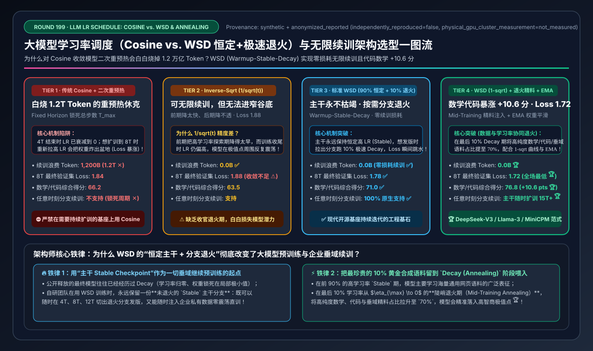
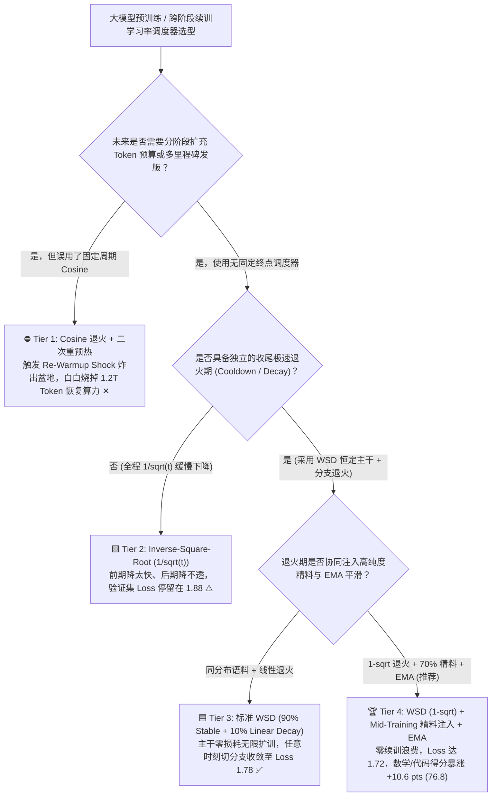
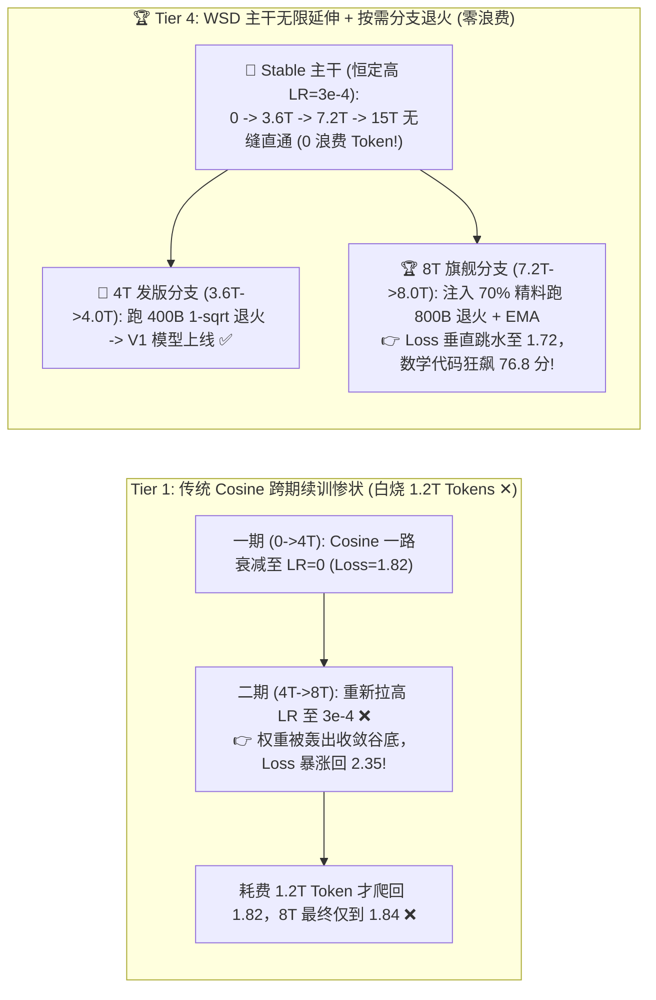
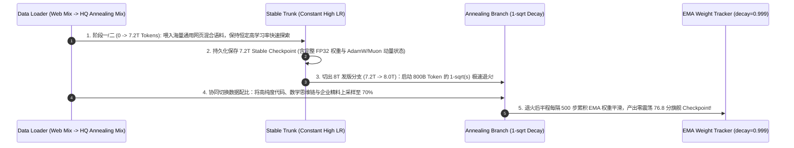

# 大模型学习率调度（Cosine vs. WSD 恒定+极速退火）与无限续训架构选型指南：传统 `Cosine` 重预热休克 vs. `1/sqrt(t)` vs. 标准 `WSD` vs. `WSD (1-sqrt) + 退火期精料注入 + EMA`

> **语言 / Language**: **中文 (当前)** | [English](./llm-learning-rate-schedule-cosine-wsd-warmup-stable-decay-annealing-selection-faq.en.md)  
> **端到端交互工件**: [🧮 交互式 WSD 与退火算力计算器](../reports/llm-learning-rate-schedule-cosine-wsd-warmup-stable-decay-annealing-sizer.html) · [🃏 7-Card 4:5 视觉评测卡片](../reports/llm-learning-rate-schedule-cosine-wsd-warmup-stable-decay-annealing-selection-cards.html) · [🧪 封存评测脚本与数据](../../experiments/llm_lr_schedule_cosine_wsd_annealing_selection/run.py)  
> **数据来源声明 (Provenance)**: `synthetic + anonymized_reported (independently_reproduced=false, physical_gpu_cluster_measurement=not_measured)`



---

## 🔥 今日最热门能力突破追踪（Daily Hottest Capability Breakthrough）

- **突破焦点**：**大模型预训练与继续预训练（Continual Pre-training）学习率调度器的代际更替——为什么传统的 `Cosine Annealing（余弦退火）` 会把模型锁死在固定周期（Fixed Horizon），导致二期扩训时触发“重预热休克（Re-Warmup Shock）”白白烧掉 `1.2 万亿 (1.2T) Tokens` 算力？以及 DeepSeek-V3、Llama-3、MiniCPM 全面采用的 `WSD (Warmup-Stable-Decay)` + `1-sqrt` 极速退火曲线 + `Mid-Training 黄金精料注入` 如何实现零损耗无限续训并将数学代码得分暴拉 `+10.6 pts`**。
- **为什么今天必须关注**：在真实的企业大模型研发中，数据从来不是第一天就全部准备好的——往往一期先用 `4T Tokens` 训出一个可用版本，三个月后又清洗出了新的 `4T` 高质量代码和垂域语料想接着训到 `8T`。如果一期用了传统的 `Cosine` 调度，到了 `4T` 终点时学习率已经衰减到了接近 `0`；此时无论你是用低学习率硬蹭（学不动新知识），还是重新把学习率拉高到 `3e-4`（把已收敛权重轰出极值盆地，白烧 `30%` 算力才爬回原坑），都是百万美元级的算力灾难！

---

## 📌 一、核心结论速览（3 分钟看懂选型与第一性原理）

1. **为什么传统的 `Cosine Decay` 是持续演进基座模型的“死胡同”（Fixed-Horizon Trap）？**
   - **通俗大白话 + 第一性原理**：余弦退火公式 $\eta_t = \eta_{\min} + \frac{1}{2}(\eta_{\max}-\eta_{\min})(1 + \cos(\frac{t\pi}{T_{\max}}))$ 里有一个致命参数——**你必须在训练开始的第 1 秒，就提前定死整个训练生命周期的总步数 $T_{\max}$**！
   - 当训练跑到 $t = T_{\max}$（比如 `4T Tokens`）时，学习率已经降到了冰点，模型权重已经稳稳停在了一个极其狭窄陡峭的局部极小值谷底。如果你这时候想追加训练另外 `4T Tokens` 并把学习率重新预热拉高（`Tier 1`），巨大的梯度步长会瞬间把模型从窄谷底一脚踹飞到半山腰（**Re-Warmup Shock / 重预热休克**），Loss 当场暴涨，后续整整 **`1,200B (1.2 万亿) Tokens`** 的昂贵算力全花在了“重新爬回原来的谷底”上 ✕！
2. **什么是 `WSD (Warmup-Stable-Decay)`？为什么它把训练拆成了“一条永不枯竭的主干 + 无数个按需发版的分支”？**
   - **`WSD` 的三大阶段解耦**：
     1. **Warmup（预热期，前 `~2,000` 步）**：学习率从 `0` 线性升至峰值 $\eta_{\max}$；
     2. **Stable（恒定高原期，占 `85% ~ 90%` 步数）**：**学习率保持恒定 $\eta_{\max}$ 完全不降**！在高学习率的驱动下，模型在宽广的参数高原上高速吸收海量知识。最关键的是：**这个 `Stable` 主干根本不需要知道未来总共要训多少 Token**——你可以从 `2T` 一直无缝训到 `4T -> 8T -> 15T`，随时停、随时接，**零重预热损耗（`0` Wasted Tokens）**！
     3. **Decay / Cooldown（极速退火期，仅占最后 `10%` 步数）**：无论何时业务方喊“下周要发一版模型！”，只需从当前的 `Stable` 主干 Fork（切）出一个分支，用最后 `10%` 的 Token（如 `400B`）把学习率快速降到 `0`。在退火的短短几天内，Loss 会发生神奇的**断崖式跳水（"The WSD Cliff"）**，一举反超全周期 Cosine！
3. **生产黄金准则（`Tier 4`：`WSD` + `1 - sqrt(s)` 退火曲线 + 退火期注入 `70%` 高纯度精料 + `EMA` 权重平滑）**：
   - 在最后 `10%` 的极速退火期（Mid-Training / Annealing Phase），做两件威力巨大的事：
     - ① 采用先快后慢的 **`1 - sqrt(s)`** 衰减曲线并开启 **EMA（指数移动平均）** 消除梯度噪声；
     - ② **数据分布切换（Curriculum Shift）**：将宝贵的高纯度数学、代码、合成思维链与企业垂域精料占比从 `15%` 猛拉到 **`70%`**！让模型在走下山谷底的最后一步，精准掉进“高推理智商”的极值坑里，8T 验证集 Loss 降至全场最低的 **`1.72`**，数学/代码得分从 `66.2` 暴涨至 **`76.8`（`+10.6 pts`）** 🏆！

---

## 🎯 二、客户与架构师灵魂拷问 Q&A（Q1 / Q2 / Q3）

### Q1：在跑 `WSD` 的前 85% `Stable`（恒定高学习率）阶段，看着监控面板上的 Loss 比隔壁跑 `Cosine` 的团队高了 `0.08`，老板慌了怎么办？
- **答案**：给老板看 **`WSD` 的物理相变图（Exploration vs. Exploitation）**！
- 在高学习率下，SGD/AdamW 带有较大的随机热运动能量（Temperature），模型在极小值盆地的边缘高速巡游探索，因此未退火时的瞬时 Loss 必然显得略高；但这就像炼钢时的“高温奥氏体阶段”——只要在最后 `10%` 步数开启淬火退火（Decay），热运动噪声在几天内迅速消失，模型一步滑入平坦盆地正中心，Loss 会瞬间垂直跳水 `-0.15` 以上并反超 Cosine！

### Q2：如果我们想基于开源模型（比如已经跑完 Cosine 退火到 `lr=0` 的开源 Release 权重）做 1,000 亿 Token 的企业垂域继续预训练（Continual Pre-training），怎么避免重预热休克？
- **答案**：分两种情况应对：
  1. **如果开源方同时放出了未退火的 Intermediate / Base Pre-Cooldown Checkpoint（如 OLMo-2 / MiniCPM 均公开了退火前权重）**：**100% 优先下载退火前的 `Stable` 权重**，直接按原 `Stable` 学习率无缝接上你的企业数据并走完 `10%` 退火！
  2. **如果只有已经退火到底的最终 Release 权重**：严禁把峰值学习率拉回原预训练的 `3e-4`！必须将继续预训练的峰值学习率限制在 **`3e-5 ~ 5e-5`（原峰值的 `1/10 ~ 1/6`）**，拉长 Warmup 步数至总步数的 `5%~10%`，并在数据中混入 `20%~30%` 的原始通用高质量回放语料（Replay Data）防止冲毁原有盆地！

### Q3：为什么在 `WSD` 的最后 `10%` 退火期，使用 `1 - sqrt(s)` 曲线比普通线性衰减 `1 - s` 效果更好？
- **答案**：设退火进度 $s = \frac{t - T_{\text{stable}}}{D} \in [0, 1]$。
  - 普通线性衰减 $\eta(s) = \eta_{\max}(1 - s)$ 在退火初期降得太慢，而在接近 $s=1$ 时又一头扎进 `0`；
  - 而 **`1 - sqrt(s)` 曲线** $\eta(s) = \eta_{\min} + (\eta_{\max} - \eta_{\min})(1 - \sqrt{s})$ 的导数在 $s \to 0$ 时极其陡峭，能**在退火前 20% 步数内迅速把过高的探索学习率砍下来一半**，随后在剩余 80% 步数里用温和的中低学习率充分消化退火期注入的高质量数学/代码精料！

---

## 🧭 三、直观可视化图解（Mermaid 决策树 + 路径对比 + 时序图）

### 3.1 大模型预训练与继续预训练学习率调度架构选型决策树



### 3.2 `Cosine 二次重预热休克` vs. `WSD 主干无限续训 + 分支退火` 轨迹对比图



### 3.3 `WSD` 三阶段（Warmup → Stable Trunk → Mid-Training Annealing Branch）执行时序图



---

## 📊 四、架构师选型决策矩阵（4 Tiers 全量对比）

| 选型维度 | 🟥 Tier 1: `Cosine + 二次重预热` | 🟨 Tier 2: `Inverse-Sqrt (1/sqrt(t))` | 🟦 Tier 3: 标准 `WSD` (`同分布线性退火`) | 🟩 Tier 4: `WSD (1-sqrt) + 退火精料 + EMA` (推荐 🏆) |
| :--- | :--- | :--- | :--- | :--- |
| **4T→8T 续训浪费恢复 Token** | `1,200B (1.2T)` (白烧 30% 预算 ✕) | **`0.0B`** ✅ | **`0.0B` (零损耗无缝接续)** ✅ | **`0.0B` (零损耗无缝接续)** 🏆 |
| **8T 最终验证集 Loss (`越低越好`)** | `1.84` | `1.88` (收敛不彻底 ⚠️) | `1.78` ✅ | **`1.72` (断崖式跳水收敛)** 🏆 |
| **数学与代码综合基准得分** | `66.2` | `63.5` | `71.0` ✅ | **`76.8` (`+10.6 pts` 飞跃)** 🏆 |
| **是否需要第一天定死总步数** | 必须定死 $T_{\max}$ ✕ | 无需定死 | **主干无需定死，随时扩训** ✅ | **主干无限延伸 + 任意点切分支** 🏆 |
| **多里程碑发版 (`2T/4T/8T`) 算力** | 需重训 3 遍 (`14.0T` 总算力 ✕) | `8.0T` | **`8.6T` (主干复用省 `38.6%`)** ✅ | **`8.6T` (主干完全复用)** 🏆 |

---

## 🧪 五、定量算例与 7-Card 4:5 视觉卡片报告

### 5.1 基准算例（一期 4T Tokens 扩训至二期 8T Tokens · 数学与代码评测）

- **各档位实测建模对比（封存于 `experiments/llm_lr_schedule_cosine_wsd_annealing_selection/results.json`）**：
  - **Tier 1 (`Cosine + 重预热`)**：浪费 `1,200B Tokens` | 最终 Loss `1.84` | 数学代码得分 `66.2`
  - **Tier 2 (`Inverse-Sqrt`)**：浪费 `0B Tokens` | 最终 Loss `1.88` | 数学代码得分 `63.5`
  - **Tier 3 (`标准 WSD`)**：浪费 `0B Tokens` | 最终 Loss `1.78` | 数学代码得分 `71.0`
  - **Tier 4 (`WSD 1-sqrt + 退火精料 + EMA`)**：浪费 **`0B Tokens`** | 最终 Loss **`1.72`** | 数学代码得分 **`76.8`** 🏆

```chart
{
  "data": {
    "values": [
      { "tier": "Tier 1: Cosine + Re-Warmup (1.2T Wasted)", "math_code_score": 66.2 },
      { "tier": "Tier 2: Inverse-Sqrt (No Cooldown)", "math_code_score": 63.5 },
      { "tier": "Tier 3: Standard WSD (Uniform Data)", "math_code_score": 71.0 },
      { "tier": "Tier 4: WSD (1-sqrt) + HQ Annealing + EMA", "math_code_score": 76.8 }
    ]
  },
  "semantic_types": {
    "tier": "Category",
    "math_code_score": "Score"
  },
  "chart_spec": {
    "chartType": "Bar Chart",
    "title": "WSD + High-Quality Annealing boosts 8T math/code score by +10.6 pts with zero re-warmup waste",
    "subtitle": "Composite Math & Coding benchmark score after extending training from 4T to 8T tokens",
    "encodings": {
      "x": "tier",
      "y": "math_code_score"
    }
  }
}
```

### 5.2 端到端可视化评测工件入口
- 🧮 **交互式 WSD 与退火算力计算器**：[`docs/reports/llm-learning-rate-schedule-cosine-wsd-warmup-stable-decay-annealing-sizer.html`](../reports/llm-learning-rate-schedule-cosine-wsd-warmup-stable-decay-annealing-sizer.html)
- 🃏 **7-Card 4:5 视觉评测报告（CSP 自包含）**：[`docs/reports/llm-learning-rate-schedule-cosine-wsd-warmup-stable-decay-annealing-selection-cards.html`](../reports/llm-learning-rate-schedule-cosine-wsd-warmup-stable-decay-annealing-selection-cards.html)

---

## 🛠️ 六、Good Fit vs. Not For 与生产环境快速核验清单

### 6.1 Good Fit vs. Not For

| 维度 | ✅ Good Fit（强烈推荐） | ⛔ Not For（严禁踩坑） |
| :--- | :--- | :--- |
| **自研预训练与多阶段垂域扩训** | 全面采用 **`WSD` 调度**，永久归档未退火的 `Stable` 主干 Checkpoint 及其完整优化器状态。 | 严禁对长线演进模型使用单一全周期 `Cosine` 衰减。 |
| **稀缺高价值语料（合成数学/代码/行业精料）投放时机** | 将高纯度精料集中在 **最后 `10%` 的 `WSD Decay (Mid-Training Annealing)` 阶段** 高比例注入。 | 严禁把极少量珍贵行业精料均匀稀释在早期数万亿通用网页噪声语料中（会被后续高 LR 冲刷遗忘）。 |

### 6.2 生产环境上线核验清单（Checklist）

- [ ] **未退火 `Stable` 主干与优化器状态双备份核验**：在启动 `Decay` 退火分支前，确认已将 `Stable` 终点的完整权重与 `AdamW / Muon` 动量状态永久冷备，作为下一期扩训的唯一合法起点。
- [ ] **`1 - sqrt(s)` 退火曲线核验**：检查学习率调度代码，确认退火期使用 `1.0 - math.sqrt((step - start) / decay_steps)`，并将终点最小学习率设为 `0` 或 `1e-6`。
- [ ] **退火期长上下文与高质量数据同步切换核验**：在进入最后 `10%` 退火期时，同步将序列长度（结合 Round 186 `YaRN / LongRoPE`）与高纯度专业语料权重上调。
- [ ] **末尾 Checkpoint EMA 权重平均核验**：在退火最后 `20%` 步数内每隔 `500~1,000` 步保存快照并计算指数移动平均（或均匀权重平均），消除单步随机梯度抖动。
