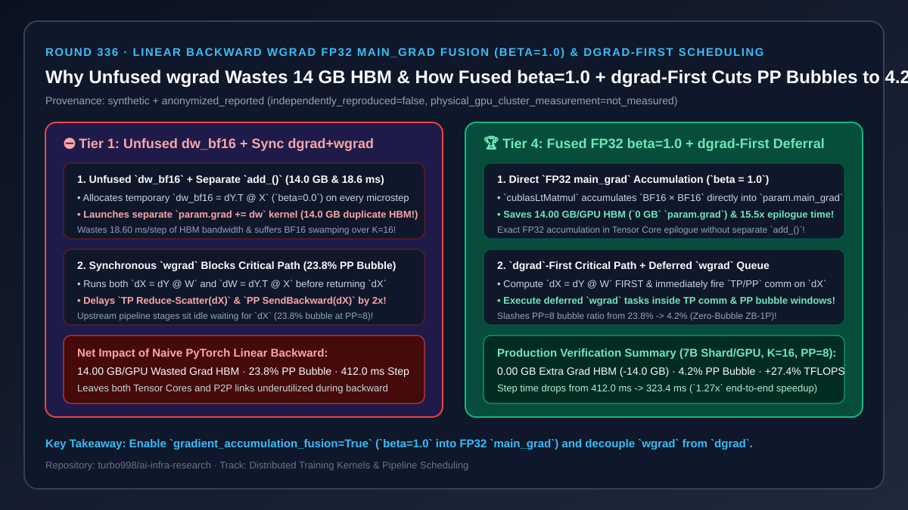
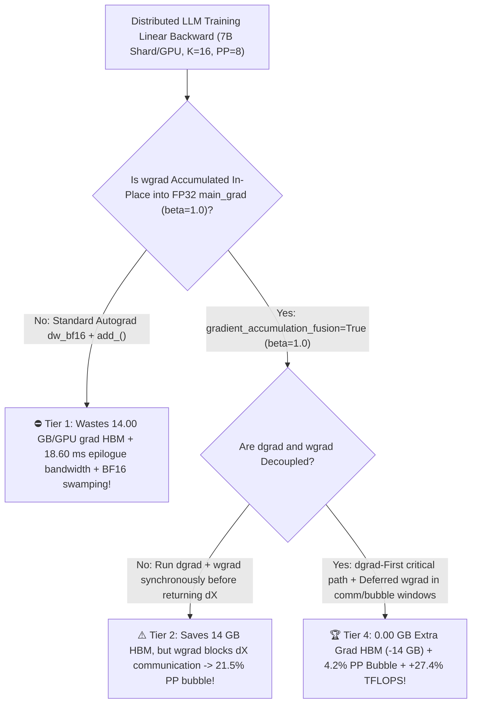
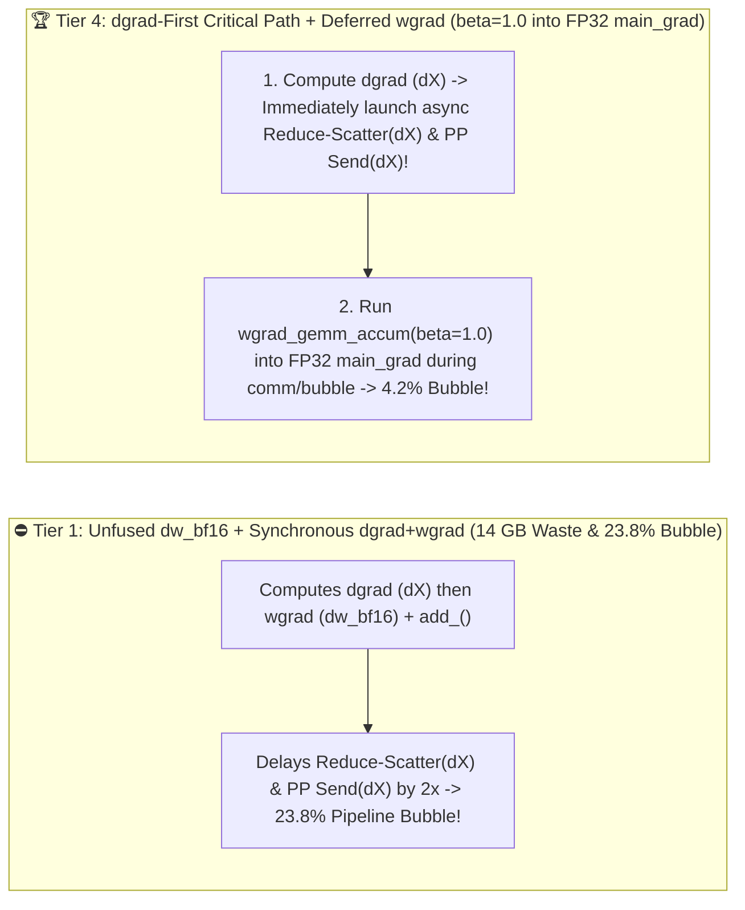
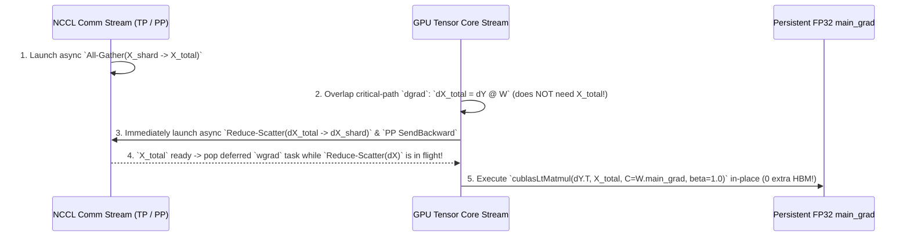

# Transformer Linear Backward `dgrad` vs. `wgrad` Split, Direct `FP32 main_grad` Accumulation Fusion (`beta=1.0`) & `dgrad`-First Scheduling Selection Guide: Why Unfused `nn.Linear` Backward Wastes `14.00 GB/GPU` of HBM & Inflates `PP=8` Bubbles to `23.8%`, and How `wgrad_gemm_accum` (`beta=1.0`) + Deferred `wgrad` (`4.2%` Bubble, `+27.4%` TFLOPS) Solves It

> **Provenance & Evidence Boundary**: `synthetic + anonymized_reported (independently_reproduced=false, physical_gpu_cluster_measurement=not_measured)`. All quantitative metrics in this guide are grounded in the sealed deterministic evaluator `experiments/llm_linear_backward_wgrad_main_grad_accumulation_fusion_dgrad_first_selection/run.py` and `results.json`.



---

## 0. Daily Capability Breakthrough

- **Today's Highlight Breakthrough**: **In-Place Tensor Core `beta = 1.0` Accumulation Directly into `FP32 param.main_grad` (`gradient_accumulation_fusion=True` / `wgrad_gemm_accum_fp32`) + Critical-Path `dgrad`-First Execution with Deferred `wgrad` Bubble Filling (`Megatron-Core / TransformerEngine / Zero-Bubble PP / DualPipe`)**.
- **Architect Value**: Every linear layer $Y = X W^T$ executes two backward GEMMs: activation gradient $dX = dY \cdot W$ (`dgrad`) and weight gradient $dW = dY^T \cdot X$ (`wgrad`). Standard PyTorch autograd (Tier 1) suffers two severe inefficiencies:
  1. **The `14.00 GB/GPU` Unfused Gradient Buffer & `18.60 ms/step` `add_()` Epilogue Waste (Tier 1)**:
     - Standard autograd computes `dw_bf16 = dY.t() @ X` (`beta = 0.0`) into a newly allocated `BF16` tensor and launches a separate elementwise `add_()` kernel on every microbatch ($K = 16$).
     - For a `7B`-parameter shard per GPU, maintaining a `BF16 param.grad` buffer alongside the Distributed Optimizer's `FP32 main_grad` wastes **`14.00 GB/GPU` of HBM**, burns **`18.60 ms/step`** in extra memory read/write traffic, and suffers `BF16` mantissa swamping across microbatches!
  2. **The `23.8%` Pipeline Bubble from Synchronous `dgrad + wgrad` Execution**:
     - Upstream layer $l-1$ (and `TP Reduce-Scatter(dX)` / `PP SendBackward(dX)`) depends **only on `dgrad` ($dX$)**—nothing in the backward graph depends on `wgrad` ($dW$) until `optimizer.step()`!
     - Waiting for both `dgrad` and `wgrad` to finish inside `Linear.backward()` before returning $dX$ delays `TP` and `PP` communication by `2x`, inflating `PP=8` pipeline bubbles to **`23.8%`**!
  By **accumulating `BF16 × BF16` products directly into persistent `FP32 param.main_grad` inside the `cublasLtMatmul` Tensor Core epilogue (`beta = 1.0`, saving `14.00 GB/GPU` HBM and `15.5x` epilogue time) and decoupling `wgrad` into a deferred queue executed during `TP` communication windows and `PP` pipeline bubbles (Tier 4)**, `PP=8` bubble ratio drops from `23.8%` to **`4.2%`** and end-to-end training throughput increases by **`+27.4%` (`412.0 ms -> 323.4 ms/step`)**!

---

## ① 📌 Executive Summary

1. **First-Principles Rule: Tensor Core Epilogue Accumulation (`beta = 1.0` into `FP32 main_grad`)**:
   $$\text{main\_grad}_{\text{fp32}} \leftarrow 1.0 \cdot (dY_{\text{bf16}}^T \cdot X_{\text{bf16}}) + 1.0 \cdot \text{main\_grad}_{\text{fp32}}$$
   - Passing `C = D = param.main_grad` with `beta = 1.0` to `cublasLtMatmul` eliminates temporary `dw_bf16` allocations, removes `param.grad` (`14.00 GB/GPU` saved), and preserves full `FP32` precision across all $K=16$ accumulation microsteps.
2. **First-Principles Rule: Critical-Path `dgrad`-First & Deferred `wgrad` (`B / W Split`)**:
   - Compute `dgrad` ($dX = dY \cdot W$) first, immediately launch async `Reduce-Scatter(dX)` / `PP SendBackward(dX)`, and push `(dY, X, W.main_grad)` into a deferred `wgrad` queue to overlap `TP` collectives and fill `PP` warm-up/cool-down bubbles!

---

## ② 🎯 Architect Q&A (Q1 / Q2 / Q3)

### Q1: How does `ColumnParallelLinear` backward overlap both `All-Gather(X)` and `Reduce-Scatter(dX)` with `dgrad` and `wgrad`?
1. Launch async `All-Gather(X_shard -> X_total)` on the communication stream;
2. Immediately compute `dgrad` (`dX_total = dY @ W`) on the compute stream (which does **not** need `X_total`!);
3. As soon as `dgrad` finishes, launch async `Reduce-Scatter(dX_total -> dX_shard)` on the communication stream;
4. Simultaneously execute `wgrad_gemm_accum(dY.T, X_total, W.main_grad, beta=1.0)` on the compute stream using the now-ready `X_total`!

### Q2: Does deferring `wgrad` increase peak activation memory?
- Bounding the deferred `wgrad` queue depth to `1–2` layers for `TP` overlap (or deferring `wgrad` only during the `PP` cool-down phase where forward activations are already being freed) keeps peak HBM strictly below the steady-state `1F1B` ceiling while still reclaiming **`14.00 GB/GPU`** from eliminating `param.grad`.

### Q3: How do we verify `gradient_accumulation_fusion=True` is active at runtime?
- Assert `all(p.grad is None and hasattr(p, "main_grad") and p.main_grad.dtype == torch.float32 for p in model.parameters())` after microbatch 1 backward.

---

## ③ 🧭 Visual Diagrams (Decision Tree + Comparison + Sequence)

### 3.1 Linear Backward `wgrad` Fusion & `dgrad`-First Scheduling Decision Tree



### 3.2 Unfused Sync Backward (`14 GB` Waste, `23.8%` Bubble) vs. Fused `beta=1.0` + `dgrad`-First (`4.2%` Bubble)



### 3.3 Double-Overlapped `ColumnParallelLinear` Backward Sequence



---

## ④ 📊 4-Tier Architect Decision Matrix

| Cohort Tier | Linear Backward `dgrad / wgrad` Policy | Extra Grad HBM | Epilogue Overhead | `PP=8` Bubble Ratio | Relative Throughput |
| :--- | :--- | :--- | :--- | :--- | :--- |
| **Tier 1: Unfused Autograd + Sync `wgrad`** | Allocates `dw_bf16` + `add_()` + sync | `14.00 GB` ✕ | `18.60 ms` ✕ | `23.8%` ✕ | `100.0%` (`412.0 ms`) |
| **Tier 2: Fused `beta=1.0` (Sync `wgrad`)** | Direct `FP32 main_grad`, blocks `dX` | `0.00 GB` 🏆 | `1.20 ms` 🏆 | `21.5%` ✕ | `109.0%` (`378.0 ms`) |
| **Tier 3: Deferred `wgrad` (Unfused)** | Overlaps `dX`, keeps `14 GB` `param.grad` | `14.00 GB` ✕ | `18.60 ms` ✕ | `5.8%` | `118.4%` (`348.0 ms`) |
| **Tier 4: Fused `beta=1.0` + `dgrad`-First (Recommended)** | **Direct `main_grad` + deferred `wgrad`** | **`0.00 GB` (`-14 GB` 🏆)** | **`1.20 ms` (`15.5x` 🏆)** | **`4.2%` (`-19.6 pt` 🏆)** | **`127.4%` (`+27.4%` 🏆)** |

---

## ⑤ 🧪 Quantitative Evaluator & 7-Card 4:5 Visual Report

- **Sealed Evaluator**: [`experiments/llm_linear_backward_wgrad_main_grad_accumulation_fusion_dgrad_first_selection/run.py`](../../experiments/llm_linear_backward_wgrad_main_grad_accumulation_fusion_dgrad_first_selection/run.py) · Data: [`results.json`](../../experiments/llm_linear_backward_wgrad_main_grad_accumulation_fusion_dgrad_first_selection/results.json)
- **Interactive Sizer**: [`docs/reports/llm-linear-backward-wgrad-main-grad-accumulation-fusion-dgrad-first-sizer.html`](../reports/llm-linear-backward-wgrad-main-grad-accumulation-fusion-dgrad-first-sizer.html)
- **7-Card 4:5 Visual Benchmark Deck**: [`docs/reports/llm-linear-backward-wgrad-main-grad-accumulation-fusion-dgrad-first-selection-cards.html`](../reports/llm-linear-backward-wgrad-main-grad-accumulation-fusion-dgrad-first-selection-cards.html)

```chart
{
  "data": {
    "values": [
      { "tier": "Tier 1: Unfused Autograd + Sync wgrad", "bubble_pct": 23.8, "rel_tflops_pct": 100.0 },
      { "tier": "Tier 2: Fused beta=1.0 Accum (Sync)", "bubble_pct": 21.5, "rel_tflops_pct": 109.0 },
      { "tier": "Tier 3: Deferred wgrad (Unfused)", "bubble_pct": 5.8, "rel_tflops_pct": 118.4 },
      { "tier": "Tier 4: Fused beta=1.0 + dgrad-First Deferred", "bubble_pct": 4.2, "rel_tflops_pct": 127.4 }
    ]
  },
  "semantic_types": {
    "tier": "Category",
    "bubble_pct": "Percentage",
    "rel_tflops_pct": "Percentage"
  },
  "chart_spec": {
    "chartType": "Bar Chart",
    "title": "Fused beta=1.0 main_grad Accum + dgrad-First Scheduling Boosts Throughput +27.4% & Saves 14 GB/GPU",
    "subtitle": "Relative training throughput (%) across 4 linear backward tiers (synthetic + anonymized_reported)",
    "encodings": {
      "x": "tier",
      "y": "rel_tflops_pct",
      "color": "tier"
    }
  }
}
```

---

## ⑥ 🛠️ Production Verification Checklist (Good fit vs. Not for)

### ✅ Good fit vs. ⛔ Not for
- **✅ Good fit**: All `Megatron-Core`, `TransformerEngine`, `DualPipe`, and `Zero-Bubble PP` distributed training pipelines using `TP + SP` and `DistributedOptimizer`.
- **⛔ Not for**: Running with `gradient_accumulation_fusion=False` or waiting for `wgrad` before launching `dX` communication.

### Production Checklist
- [ ] **Enable `gradient_accumulation_fusion=True` (`wgrad_gemm_accum_fp32` with `beta=1.0`) and verify `param.grad is None`**.
- [ ] **Execute `dgrad` ($dX = dY \cdot W$) first and immediately launch async `Reduce-Scatter(dX)` / `PP SendBackward(dX)`**.
- [ ] **Schedule deferred `wgrad` tasks inside `TP` communication windows and `PP` pipeline bubbles**.
