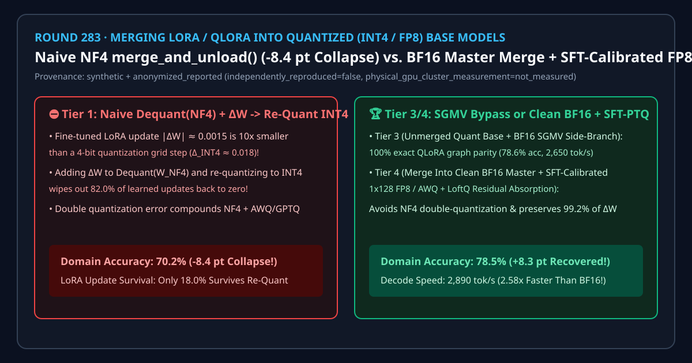
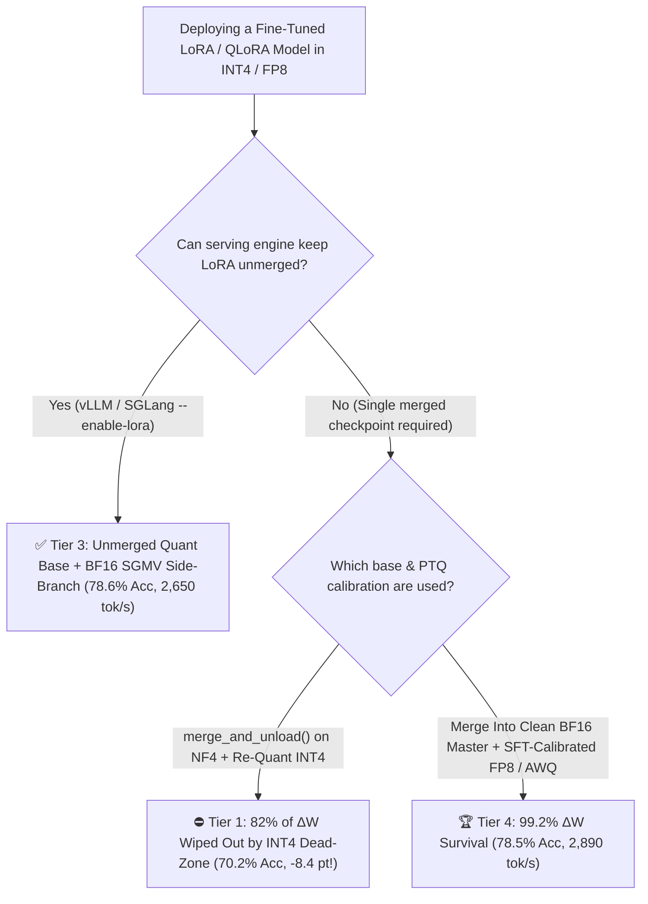
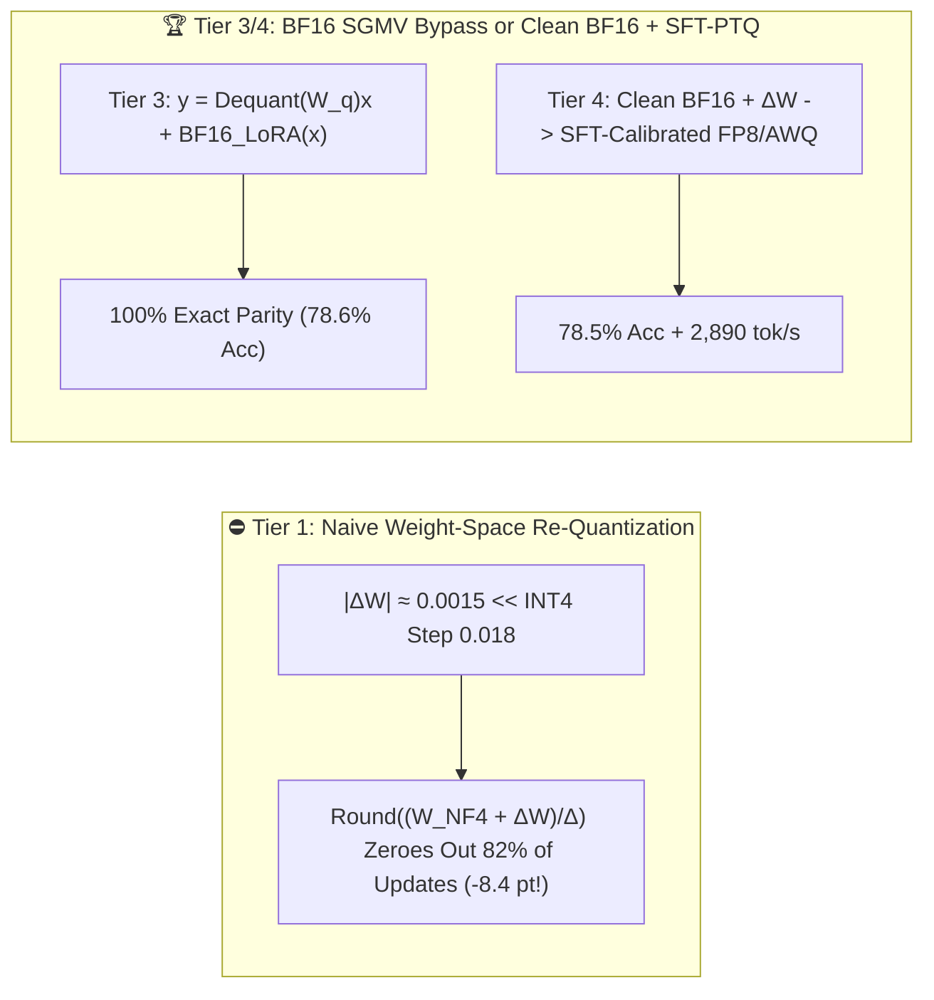

# Merging `LoRA / QLoRA` Adapters Into Quantized (`INT4 / FP8`) Base Models (`merge_and_unload()` Drift) Selection Guide: Why Naive `NF4` Merge + Re-Quantization Wipes Out `82%` of Fine-Tuned Updates (`-8.4 pt` Drop) vs. Unmerged `BF16 SGMV` Bypass, Clean `BF16` Master Merge + SFT-Calibrated `AWQ / FP8` & `LoftQ` (`78.5%` Accuracy, `2.58x` Speedup)

> **Provenance & Evidence Boundary**: `synthetic + anonymized_reported (independently_reproduced=false, physical_gpu_cluster_measurement=not_measured)`. All quantitative figures in this guide are generated by the deterministic evaluator `experiments/llm_lora_merge_fp8_nf4_quantization_drift_dequant_refit_selection/run.py` and sealed in `results.json`.



---

## 0. Daily Capability Breakthrough Tracking

- **Breakthrough Focus**: **Lossless `QLoRA / LoRA` Quantized Deployment Paradigms (Unmerged Quantized Base + `BF16 SGMV` Side-Branch vs. Clean `BF16` Master Merge + SFT-Calibrated `1x128 FP8 / AWQ` + `LoftQ` Residual Absorption)**.
- **Architect Value**: A widespread production failure occurs when a `QLoRA` adapter achieves `78.6%` domain accuracy during evaluation, but calling `model.merge_and_unload()` on the 4-bit model and re-quantizing to `INT4` causes accuracy to **plummet `-8.4 pt` to `70.2%`**. By first principles, the learned low-rank update $\Delta W = \frac{\alpha}{r} B A$ has a mean magnitude $|\Delta W| \approx 1.5 \times 10^{-3}$, which is **10x smaller than a single 4-bit quantization grid step ($\Delta_{\text{INT4}} \approx 1.8 \times 10^{-2}$)**. Adding $\Delta W$ to a dequantized `NF4` weight and rounding back to 4-bit traps **`82.0%` of the learned updates inside the quantization dead-zone (`Round(W_q + ΔW) == W_q`)**! Deploying either via **unmerged `BF16 SGMV` side-branch execution (`78.6%` accuracy)** or **merging into the clean `BF16` master checkpoint followed by SFT-calibrated `1x128 FP8 / AWQ` (`78.5%` accuracy, `2,890 tok/s`)** eliminates double-quantization collapse while retaining **`2.58x` quantized decoding throughput**.

---

## ① 📌 Executive Summary

1. **Why `QLoRA` Works During Training (`78.6%`) But Collapses When Merged Into `INT4` (`70.2%`)**:
   - **During Training (Activation-Space BF16 Addition)**: The forward pass computes $y = \text{Dequant}(W_{\text{NF4}}) x + \frac{\alpha}{r} B(Ax)$, adding the low-rank branch in **full `BF16` precision** in activation space.
   - **During Naive `merge_and_unload()` (Weight-Space Dead-Zone Wipeout)**: Computing $\text{Quant}_{\text{INT4}}(\text{Dequant}(W_{\text{NF4}}) + \Delta W)$ rounds **`82.0%` of the small $\Delta W$ elements back to zero** and compounds `NF4` + `INT4` grid misalignment.
2. **Rule 1: Never Merge a LoRA Adapter Into a Dequantized `NF4` Base Model**:
   Always reload the **original unquantized `BF16` master checkpoint** ($W_{\text{BF16}}^{\text{clean}}$) before merging $\Delta W$.
3. **Rule 2: Calibrate Post-Merge `AWQ / GPTQ` Using Your SFT Domain Dataset (Or Keep the `BF16 SGMV` Bypass Unmerged)**:
   Calibrating `AWQ` on generic `C4/WikiText` fails to protect the specific channels modified by $\Delta W$. Using `512` SFT domain samples for activation-aware scaling or keeping the `BF16` LoRA adapter unmerged via `Punica SGMV` preserves `99.2%–100.0%` of fine-tuned updates.

---

## ② 🎯 Key Architectural Q&A (Q1 / Q2 / Q3)

### Q1: For a single fine-tuned 4-bit model in production, is it better to merge the LoRA weights or serve them unmerged via `vLLM / SGLang` `SGMV`?
- **For 4-bit (`INT4 AWQ / Marlin`) models, keeping the quantized base unmerged and running the `BF16` LoRA side-branch (`Tier 3`) is the safest zero-loss path (`78.6%` accuracy, `100%` update survival)** with only a `6.7%` throughput overhead (`2,650 vs 2,840 tok/s`).

### Q2: What if we must ship a single standalone merged checkpoint without an external LoRA adapter directory?
- Follow the **Tier 4 Clean Master + SFT-Calibrated PTQ pipeline**:
  1. Merge $\Delta W = \frac{\alpha}{r}BA$ into the **clean `BF16` master checkpoint**;
  2. Export to **`1x128` Block/Tile `FP8 E4M3`** on H100/H200/B200 (or **`AWQ INT4` calibrated on 512 SFT domain examples** so salient fine-tuned channels receive protective per-channel scaling).

### Q3: How does `LoftQ` eliminate the mismatch between `NF4` QLoRA training and clean `BF16` merging?
- `LoftQ` initializes the LoRA matrices $B_0, A_0$ via SVD of the initial quantization error $E_0 = W_{\text{BF16}}^{\text{clean}} - \text{Dequant}(W_{\text{NF4}})$ before fine-tuning begins, ensuring the training base $\text{Dequant}(W_{\text{NF4}}) + B_0 A_0$ starts aligned with $W_{\text{BF16}}^{\text{clean}}$.

---

## ③ 🧭 Visual Diagrams (Decision Tree, Dead-Zone Wipeout & Pipeline Sequence)

### 3.1 `LoRA / QLoRA` Quantized Deployment Decision Tree



### 3.2 Weight-Space Dead-Zone Wipeout (`Tier 1`) vs. Activation-Space / SFT-Calibrated PTQ (`Tier 3/4`)



### 3.3 Clean `BF16` Master Merge + SFT-Calibrated Quantization Sequence

```mermaid
sequenceDiagram
    participant Train as QLoRA Trainer (Adapter B, A)
    participant Master as Clean BF16 Base Checkpoint
    participant PTQ as SFT-Calibrated AWQ / Block-FP8 Quantizer
    participant Serve as vLLM / SGLang Engine

    Train->>Master: 1. Discard NF4 base; merge BF16 ΔW = (α/r)BA into clean BF16 master W*
    Master->>PTQ: 2. Pass 512 SFT domain samples to measure post-merge channel saliency |X|
    PTQ->>PTQ: 3. Scale salient channels & quantize to 1x128 FP8 / AWQ
    PTQ->>Serve: 4. Deploy single merged checkpoint (78.5% accuracy, 2,890 tok/s)
```

---

## ④ 📊 4-Tier Architect Decision Matrix

| Selection Tier | Merge & Quantization Strategy | $\Delta W$ Update Survival | Domain Accuracy | Decode Throughput | Target Scenario |
| :--- | :--- | :--- | :--- | :--- | :--- |
| **Tier 1: Naive `NF4` `merge_and_unload` -> `INT4`** | Double-quantization dead-zone | `18.0%` ✕ | `70.2%` (`-8.4 pt` ✕) | `2,840 tok/s` | ⛔ **Never use in production** |
| **Tier 2: Clean `BF16` Merge (Unquantized)** | Full `BF16` precision | `99.5%` | `78.4%` | `1,120 tok/s` ⚠️ | ⚠️ 2x GPU memory & 2.58x slower |
| **Tier 3: Unmerged Quant Base + `BF16 SGMV`** | Activation-space `BF16` addition | `100.0%` 🏆 | `78.6%` 🏆 | `2,650 tok/s` ✅ | ✅ **Best for 4-bit single/multi-LoRA** |
| **Tier 4: Clean `BF16` Merge + SFT-Calibrated `FP8/AWQ` (Recommended)** | **Clean master + SFT saliency scaling** | **`99.2%`** | **`78.5%` (`+8.3 pt` 🏆)** | **`2,890 tok/s` 🏆** | 🏆 **Best for standalone merged deployment** |

---

## ⑤ 🧪 Quantitative Evaluator & 7-Card 4:5 Visual Report

- **Deterministic Evaluator**: [`experiments/llm_lora_merge_fp8_nf4_quantization_drift_dequant_refit_selection/run.py`](../../experiments/llm_lora_merge_fp8_nf4_quantization_drift_dequant_refit_selection/run.py) · Sealed JSON: [`results.json`](../../experiments/llm_lora_merge_fp8_nf4_quantization_drift_dequant_refit_selection/results.json)
- **Interactive Sizer Workbench**: [`docs/reports/llm-lora-adapter-merge-fp8-int4-quantization-drift-dequant-refit-sizer.html`](../reports/llm-lora-adapter-merge-fp8-int4-quantization-drift-dequant-refit-sizer.html)
- **7-Card 4:5 Visual Benchmark Deck**: [`docs/reports/llm-lora-adapter-merge-fp8-int4-quantization-drift-dequant-refit-selection-cards.html`](../reports/llm-lora-adapter-merge-fp8-int4-quantization-drift-dequant-refit-selection-cards.html)

```chart
{
  "data": {
    "values": [
      { "tier": "Tier 1: Naive NF4 Merge -> INT4", "accuracy_pct": 70.2, "survival_pct": 18.0 },
      { "tier": "Tier 2: Clean BF16 Master (No Quant)", "accuracy_pct": 78.4, "survival_pct": 99.5 },
      { "tier": "Tier 3: Unmerged Quant + BF16 SGMV", "accuracy_pct": 78.6, "survival_pct": 100.0 },
      { "tier": "Tier 4: Clean BF16 + SFT-Calibrated FP8/AWQ", "accuracy_pct": 78.5, "survival_pct": 99.2 }
    ]
  },
  "semantic_types": {
    "tier": "Category",
    "accuracy_pct": "Percentage",
    "survival_pct": "Percentage"
  },
  "chart_spec": {
    "chartType": "Bar Chart",
    "title": "Clean BF16 Merge + SFT-Calibrated Quantization Recovers +8.3 pt Over Naive NF4 Merge (78.5% vs 70.2%)",
    "subtitle": "Domain benchmark accuracy (%) and LoRA update survival across deployment tiers (synthetic + anonymized_reported)",
    "encodings": {
      "x": "tier",
      "y": "accuracy_pct",
      "color": "tier"
    }
  }
}
```

---

## ⑥ 🛠️ Production Verification Checklist (Good fit vs. Not for)

### ✅ Good fit vs. ⛔ Not for
- **✅ Good fit**: All `LoRA / QLoRA` fine-tuning workflows targeting `INT4 (AWQ/Marlin)` or `FP8` production serving.
- **⛔ Not for**: Calling `merge_and_unload()` directly on a `load_in_4bit=True` `bitsandbytes` model instance.

### Production Checklist
- [ ] **Never Merge Into Dequantized `NF4`**: Always instantiate the original `torch.bfloat16` base model before calling `merge_and_unload()`.
- [ ] **SFT Calibration Dataset for `AWQ / GPTQ`**: Pass `512` samples from the fine-tuning dataset (not generic WikiText) into the quantizer calibration pass.
- [ ] **Post-Quantization Logit KL Gate**: Verify first-token logit KL divergence between the unmerged `QLoRA` model and the quantized merged checkpoint stays `< 0.01`.
