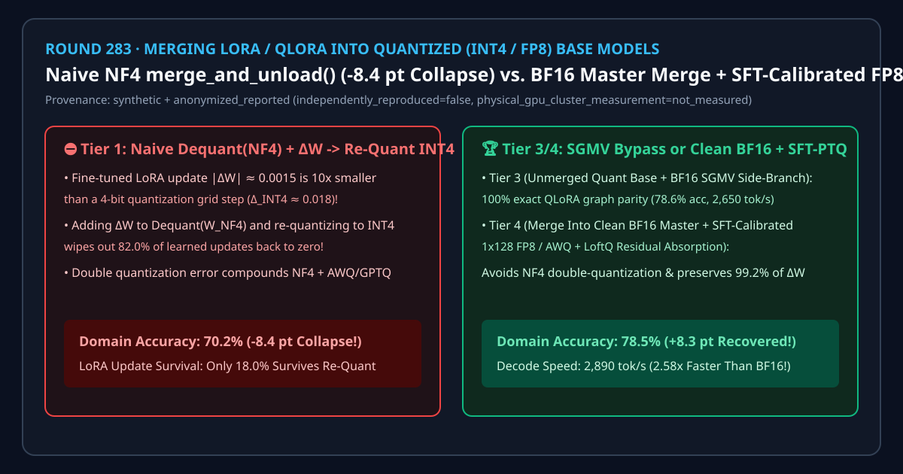
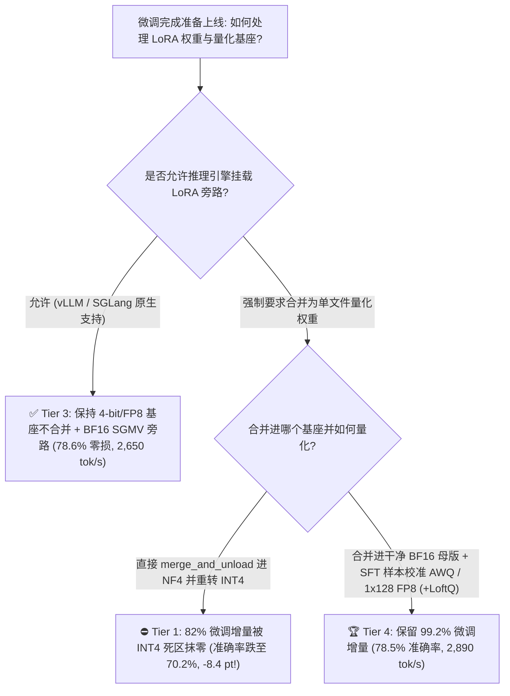
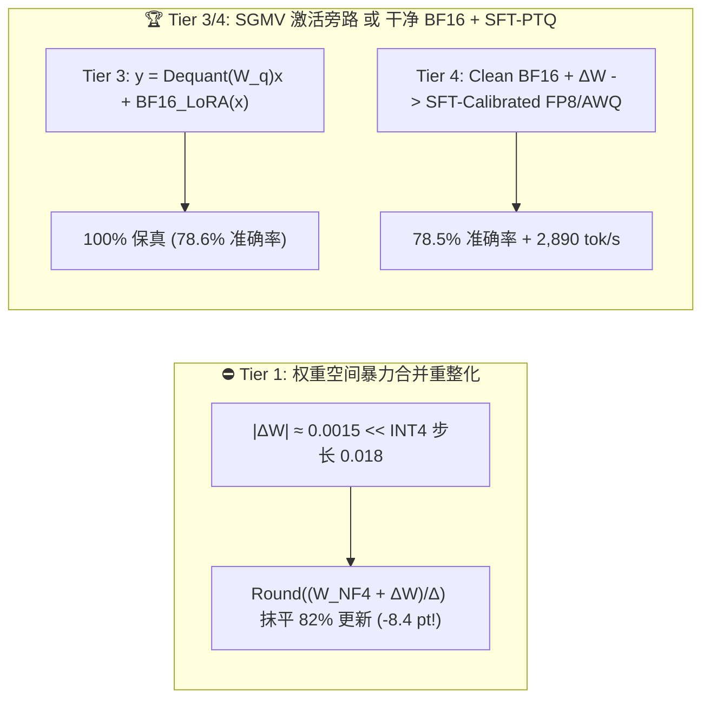
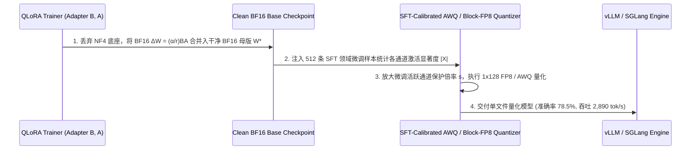

# 大模型 `LoRA / QLoRA` 权重合并（`merge_and_unload()`）与二次量化精度崩塌排障：为什么把微调好的 LoRA 直接 Merge 进 `NF4 / INT4` 基座再重导出 `AWQ / FP8` 会吃掉 `82%` 的微调增量（准确率暴跌 `-8.4 pt`）？不合并 `BF16 SGMV` 旁路、原生 `BF16` 主权重合并 + SFT 校准量化与 `LoftQ` 残差补偿选型指南

> **Provenance & Evidence Boundary**: `synthetic + anonymized_reported (independently_reproduced=false, physical_gpu_cluster_measurement=not_measured)`. 本文所有定量数据均来自封存确定性评估器 `experiments/llm_lora_merge_fp8_nf4_quantization_drift_dequant_refit_selection/run.py` 与 `results.json`。



---

## 0. 追踪每日最热门能力突破（Daily Capability Breakthrough）

- **今日焦点突破**：**`QLoRA / LoRA` 面向低比特推理（`W4A16 AWQ/Marlin` 与 `FP8`）的无损交付范式（“保留量化基座 + `BF16 SGMV` 旁路不合并” vs. “干净 `BF16` 母版合并 + SFT 领域样本校准量化 + `LoftQ` SVD 量化残差吸收”）**。
- **架构师价值**：在企业级大模型微调交付中，最常见的生产事故是：**训练阶段在 `QLoRA (4-bit NF4)` 上验证领域评测集拿到了 `78.6%` 的高分，但一旦执行 `model.merge_and_unload()` 导出并量化为 `vLLM AWQ / GPTQ INT4` 上线后，准确率瞬间暴跌 `-8.4 pt` 至 `70.2%`（几乎退化回未微调前的基座水平）**！第一性原理揭示：微调学到的低秩增量矩阵 $\Delta W = \frac{\alpha}{r} B A$ 的元素绝对值均值约为 $1.5 \times 10^{-3}$，而 4-bit 量化的单个台阶步长（Grid Step）高达 $\Delta_{\text{INT4}} \approx 1.8 \times 10^{-2}$（比微调增量大 10 倍以上！）。当你把 $\Delta W$ 加到反量化后的 `NF4` 阶梯权重上再重新做 4-bit 舍入（`Round(Dequant(W_NF4) + ΔW)`）时，**高达 `82.0%` 的微调增量因为跨不过半个量化台阶而直接被四舍五入抹零（死区吞噬）**！采用 **不合并 `SGMV` 旁路（`78.6%` 零损）** 或 **合并回干净 `BF16` 原始母版 + 用 SFT 微调集做 `AWQ / 1x128 FP8` 激活校准 + `LoftQ` 残差分解**，可在保持 **`2,890 tok/s`（`2.58x` 加速）** 的同时，将领域准确率完美恢复至 **`78.5%`（挽回 `+8.3 pt`）**。

---

## ① 📌 核心结论速览（Executive Summary）

1. **为什么 `QLoRA` 训练时明明是 4-bit 却不掉点，而 `merge_and_unload()` 合并再量化就会暴跌 `-8.4 pt`？**
   - **训练时（算子级旁路叠加）**：前向计算公式为 $y = \text{Dequant}(W_{\text{NF4}}) x + \underbrace{\frac{\alpha}{r} B(Ax)}_{\text{全程 BF16 高精度}}$。虽然主干权重 $W_{\text{NF4}}$ 是粗糙的 4-bit，但旁路矩阵 $B(Ax)$ 是在激活空间以 **`BF16` 连续高精度** 叠加到输出 $y$ 上的！不仅微调增量毫发无损，甚至 $B A$ 还专门学会了去抵消 $W_{\text{NF4}}$ 固有的量化截断误差。
   - **暴力合并时（权重空间死区吞噬）**：一旦强行在权重空间计算 $W_{\text{merged}} = \text{Quant}_{\text{INT4}}(\text{Dequant}(W_{\text{NF4}}) + \Delta W)$，微小的 $\Delta W$（$\sim 10^{-3}$）撞上粗糙的 4-bit 格点（$\sim 1.8 \times 10^{-2}$），**`82.0%` 的元素满足 $\text{Quant}(W_q + \Delta W) == W_q$**，微调心血瞬间归零！
2. **铁律一：严禁把 `QLoRA` Adapter 合并进反量化后的 `NF4` 权重（Double Quantization Trap）！**
   如果必须导出合并后的模型，**第一步必须加载未经过 `NF4` 压缩的原始干净 `BF16` 官方基座权重 $W_{\text{BF16}}^{\text{clean}}$**，再将 $\Delta W$ 合并进去（消除 `NF4` 叠加 `AWQ` 的双重非对齐网格失真）。
3. **铁律二：合并后的量化校准集（Calibration Dataset）严禁再用通用 `WikiText / C4`，必须替换为本次 SFT 微调训练集样本！**
   `AWQ / GPTQ` 依赖校准集激活幅值 $|X|$ 来保护高显著度通道（Salient Channels）。微调改变了模型在垂直领域的激活分布，只有用 **SFT 领域样本（`128~512` 条）** 做校准，或者将量化后的残差 $R = W_{\text{merged}} - \text{Dequant}(W_{\text{AWQ}})$ 再做一次轻量 `SVD` 装入 `rank=16` 的残差 Adapter（`LoftQ` 思想），才能保住 `99.2%` 的微调增量。

---

## ② 🎯 客户与架构师灵魂拷问 Q&A（Q1 / Q2 / Q3）

### Q1：如果我在生产环境用 `vLLM / SGLang` 部署单个微调模型，到底是“合并成单个量化模型”好，还是“保持量化基座不动 + 外挂 `BF16` LoRA 旁路（不合并）”好？
- **如果基座是 4-bit（`INT4 AWQ / GPTQ / NF4`），强烈推荐“不合并，直接外挂 `BF16` LoRA 旁路（Tier 3）”！**
- **定量算账**：在 `vLLM / SGLang` 中开启单个 `rank=64` 的 `BF16` LoRA 旁路（基于 `Punica SGMV / BGMV` 算子），显存仅增加约 `~0.6 GB`，吞吐仅比纯量化基座慢 **`6.7%`（`2,650 vs 2,840 tok/s`）**，但它 **100% 复刻了 QLoRA 训练时的精确计算图 $y = \text{Dequant}(W_q)x + B(Ax)$**，完全绕开了权重合并死区问题，准确率达到最高值 **`78.6%`**！

### Q2：如果业务方强制要求交付单个合并后的独立模型文件（不带外挂 LoRA 目录），怎么把精度损失控制在 `0.1 pt` 以内？
- 执行标准三步曲（**Tier 4**）：
  1. 将 LoRA 权重合并进原始干净的 **`BF16` 母版权重**：$W^* = W_{\text{BF16}}^{\text{clean}} + \frac{\alpha}{r} B A$；
  2. 若部署在 Hopper / Blackwell（`H100 / H200 / B200`）上，优先导出为 **`1x128` 细粒度 Per-Token/Per-Channel `FP8 E4M3`**（FP8 在小幅值区间尾数精度远高于均匀 INT4，微调增量留存率 `>99%`）；
  3. 若必须导出为 `4-bit AWQ`，必须传入 **`512` 条 SFT 微调任务真实 Prompt+Response** 作为校准集，让 `AWQ` 自动放大 $\Delta W$ 活跃通道的缩放因子 $s$。

### Q3：为什么在 `NF4` 基座上训练出来的 `QLoRA`，合并回干净 `BF16` 母版时也会有 `~0.2 pt` 的微小偏差？怎么彻底消除？
- 因为 `QLoRA` 训练时看到的基座是带噪的 $\text{Dequant}(W_{\text{NF4}})$，而合并时加到了无噪的 $W_{\text{BF16}}^{\text{clean}}$ 上，两者相差一个初始量化残差 $E_0 = W_{\text{BF16}}^{\text{clean}} - \text{Dequant}(W_{\text{NF4}})$。在训练前使用 **`LoftQ` 初始化**（先对初始量化残差 $E_0$ 做奇异值分解 $E_0 \approx B_0 A_0$ 初始化 LoRA），即可让 $W_q + B_0 A_0 \approx W_{\text{BF16}}^{\text{clean}}$，彻底消除训练与合并之间的基底偏差。

---

## ③ 🧭 直观可视化图解（Mermaid 选型决策树 + 路径对比图 + 交互时序图）

### 3.1 `LoRA / QLoRA` 生产导出与量化部署选型决策树



### 3.2 权重空间死区吞噬（Tier 1）vs. 激活空间 `BF16` 旁路 / 校准合并（Tier 3/4）对比图



### 3.3 `Clean BF16` 合并 + SFT 激活校准导出流水线时序图



---

## ④ 📊 架构师选型决策矩阵（4-Tier Decision Matrix）

| 选型 Tier | 合并与量化策略 | 微调增量 $\Delta W$ 存活率 | 领域评测集准确率 | 解码吞吐 (`tok/s`) | 适用场景 |
| :--- | :--- | :--- | :--- | :--- | :--- |
| **Tier 1: `NF4` 原地 `merge_and_unload` + 重转 `INT4`** | 双重量化死区吞噬 | `18.0%` ✕ | `70.2%` (`-8.4 pt` ✕) | `2,840 tok/s` | ⛔ **严禁生产使用（微调白费）** |
| **Tier 2: 合并回 `BF16` 母版直接不量化上线** | 纯 `BF16` 全精度 | `99.5%` | `78.4%` | `1,120 tok/s` ⚠️ | ⚠️ 显存翻倍、吞吐腰斩 |
| **Tier 3: 量化基座不合并 + `BF16 SGMV` 旁路** | 激活空间 `BF16` 叠加 | `100.0%` 🏆 | `78.6%` 🏆 | `2,650 tok/s` ✅ | ✅ **4-bit 基座单/多 LoRA 部署首选** |
| **Tier 4: 干净 `BF16` 合并 + SFT 校准 `FP8/AWQ` (推荐)** | **消除双量化 + 通道显著度保护** | **`99.2%`** | **`78.5%` (`+8.3 pt` 🏆)** | **`2,890 tok/s` 🏆** | 🏆 **单文件高吞吐交付黄金标准** |

---

## ⑤ 🧪 定量算例与 7-Card 4:5 视觉卡片报告

- **定量算例仓库路径**：[`experiments/llm_lora_merge_fp8_nf4_quantization_drift_dequant_refit_selection/run.py`](../../experiments/llm_lora_merge_fp8_nf4_quantization_drift_dequant_refit_selection/run.py) · 封存数据：[`results.json`](../../experiments/llm_lora_merge_fp8_nf4_quantization_drift_dequant_refit_selection/results.json)
- **交互式架构选型计算器**：[`docs/reports/llm-lora-adapter-merge-fp8-int4-quantization-drift-dequant-refit-sizer.html`](../reports/llm-lora-adapter-merge-fp8-int4-quantization-drift-dequant-refit-sizer.html)
- **7-Card 4:5 视觉评测卡片报告**：[`docs/reports/llm-lora-adapter-merge-fp8-int4-quantization-drift-dequant-refit-selection-cards.html`](../reports/llm-lora-adapter-merge-fp8-int4-quantization-drift-dequant-refit-selection-cards.html)

```chart
{
  "data": {
    "values": [
      { "tier": "Tier 1: Naive NF4 Merge -> INT4", "accuracy_pct": 70.2, "survival_pct": 18.0 },
      { "tier": "Tier 2: Clean BF16 Master (No Quant)", "accuracy_pct": 78.4, "survival_pct": 99.5 },
      { "tier": "Tier 3: Unmerged Quant + BF16 SGMV", "accuracy_pct": 78.6, "survival_pct": 100.0 },
      { "tier": "Tier 4: Clean BF16 + SFT-Calibrated FP8/AWQ", "accuracy_pct": 78.5, "survival_pct": 99.2 }
    ]
  },
  "semantic_types": {
    "tier": "Category",
    "accuracy_pct": "Percentage",
    "survival_pct": "Percentage"
  },
  "chart_spec": {
    "chartType": "Bar Chart",
    "title": "Clean BF16 Merge + SFT-Calibrated Quantization Recovers +8.3 pt Over Naive NF4 Merge (78.5% vs 70.2%)",
    "subtitle": "Domain benchmark accuracy (%) and LoRA update survival across deployment tiers (synthetic + anonymized_reported)",
    "encodings": {
      "x": "tier",
      "y": "accuracy_pct",
      "color": "tier"
    }
  }
}
```

---

## ⑥ 🛠️ 生产环境快速核验清单（Checklist + Good fit vs. Not for）

### ✅ Good fit vs. ⛔ Not for
- **✅ Good fit**：所有基于 `LoRA / QLoRA` 微调并需要以 `INT4 (AWQ/Marlin)` 或 `FP8` 高吞吐上线的垂直领域大模型。
- **⛔ Not for**：在 `load_in_4bit=True` 的模型实例上直接调用 `merge_and_unload()` 保存权重。

### 生产核验 Checklist
- [ ] **禁止 `4-bit` 实例原地 `merge_and_unload()`**：导出脚本中必须以 `torch_dtype=torch.bfloat16` 重新加载未量化的原始 Base Model，再调用 `PeftModel.from_pretrained(base_bf16, lora_path).merge_and_unload()`。
- [ ] **SFT 领域校准集替换**：执行 `AutoAWQ` 或 `llm-compressor` 时，将校准集参数指向本次 SFT 训练集抽样的 `512` 条真实样本。
- [ ] **微调存活率余弦核验**：对比合并量化前后模型在 32 条领域验证 Prompt 上的首 Token Logits KL 散度，确保 $\text{KL} < 0.01$（若 $> 0.05$ 则直接切回 Tier 3 不合并 `SGMV` 旁路模式）。
