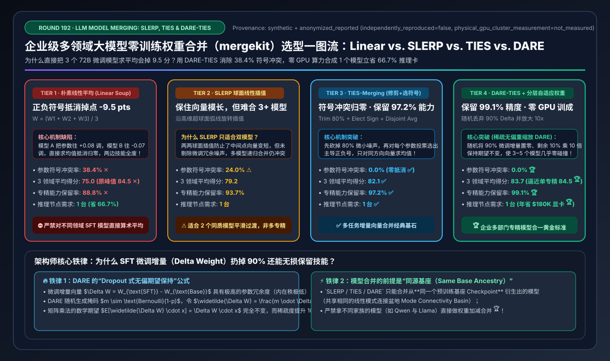
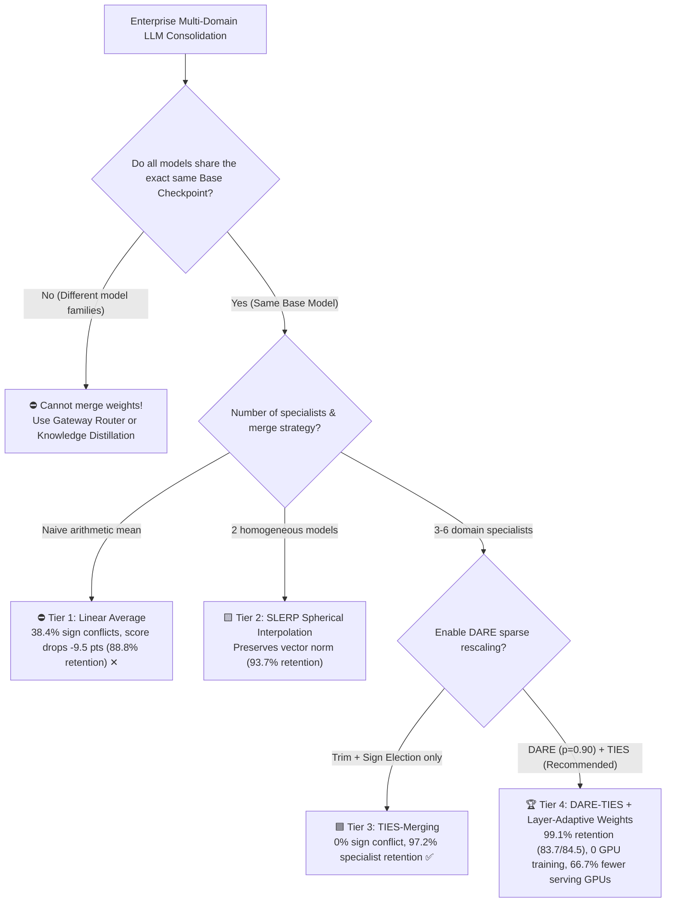

# Enterprise Multi-Domain LLM Weight Merging (`mergekit`) Selection Guide: Linear Soup vs. `SLERP` vs. `TIES-Merging` vs. `DARE-TIES`

> **Language / 语言**: [中文](./llm-model-merging-task-arithmetic-slerp-ties-dare-mergekit-selection-faq.md) | **English (Current)**  
> **End-to-End Interactive Artifacts**: [🧮 Interactive Model Merging Sizer](../reports/llm-model-merging-task-arithmetic-slerp-ties-dare-mergekit-sizer.html) · [🃏 7-Card 4:5 Visual Report](../reports/llm-model-merging-task-arithmetic-slerp-ties-dare-mergekit-selection-cards.html) · [🧪 Sealed Evaluator & Data](../../experiments/llm_model_merging_slerp_ties_dare_mergekit_selection/run.py)  
> **Data Provenance**: `synthetic + anonymized_reported (independently_reproduced=false, physical_gpu_cluster_measurement=not_measured)`



---

## 🔥 Daily Hottest Capability Breakthrough

- **Breakthrough Focus**: **Zero-Training, Data-Free Weight-Space LLM Merging (`mergekit`)—From Naive Linear Averaging (`Model Soup`) and Spherical Interpolation (`SLERP`) to `TIES-Merging` (Trim + Elect Sign) and `DARE-TIES` (Randomly Dropping `90%` of Delta Weights and Rescaling by `10x`), Consolidating Three `72B` Domain Specialists into One Unified `72B` Model in 4 Minutes on CPU while Retaining `99.1%` Peak Accuracy and Cutting Inference GPU Costs by `66.7%`**.
- **Why It Matters Today**: Enterprise teams often fine-tune separate domain specialists (e.g., `Qwen2.5-72B-SQL`, `Qwen2.5-72B-Legal`, `Qwen2.5-72B-MathCode`) from the same base checkpoint. Serving 3 separate 72B models requires **3× GPU nodes (`$270K/year`)**, whereas sequential fine-tuning triggers **Catastrophic Forgetting (`-14.2 pts` drop)**. **`DARE-TIES`** fuses them into a single 72B deployment with zero GPU training hours.

---

## 📌 1. Executive Summary (3-Minute Architect Takeaways)

1. **Why Naive Linear Averaging (`Tier 1`: $W = \frac{1}{3}\sum W_k$) Loses `-9.5 pts` (`88.8%` Retention)**:
   - In task vectors $\tau_k = W_k - W_{\text{base}}$, **`~90%` of parameter deltas are tiny redundant noise**, and **`38.4%` of coordinates suffer opposing signs (`+` vs. `-`)** across specialists. Naive averaging cancels out opposing directions and dilutes task signals by $1/K$, dropping average accuracy from `84.5` to **`75.0`** ✕.
2. **Why `SLERP` (`Tier 2`) Excels for 2 Models (`93.7%` Retention) but Struggles with `3+` Specialists**:
   - `SLERP` interpolates along a hyperspherical arc to preserve vector norm, preventing midpoint magnitude shrinkage on 2-model merges, but does not eliminate redundant delta noise or multi-way sign conflicts (`24.0%`).
3. **Production Gold Standard (`Tier 4`: `DARE-TIES` Drop-and-Rescale + Sign Election)**:
   - **`DARE` (Drop And REscale)**: Randomly drops $p = 90\%$ of delta weights to zero and rescales the remaining $10\%$ by $1 / (1 - p) = 10\times$ ($\tilde{\tau}_k = \frac{m \odot \tau_k}{1 - p}$). This preserves the exact mathematical expectation $E[\tilde{\tau}_k x] = \tau_k x$ while making task vectors `10x` sparser so 3–5 specialists rarely collide!
   - **`TIES` Sign Election**: Resolves any remaining overlapping coordinates via aggregate sign voting (`0.0%` sign conflict), achieving **`83.7 / 84.5` (`99.1%` retention)** and cutting serving hardware by **`66.7%`** 🏆!

---

## 🎯 2. Architect & Customer Deep-Dive Q&A (Q1 / Q2 / Q3)

### Q1: Can `DARE-TIES` merge models from different base families (e.g., `Qwen2.5` + `Llama-3`)?
- **Answer**: **No.** Weight-space merging strictly requires **Shared Base Ancestry** (all specialists fine-tuned from the same pretrained base checkpoint so their neuron permutations and feature spaces align).

### Q2: How do we merge `LoRA` adapters alongside full-parameter SFT models?
- **Answer**: Expand each LoRA adapter into its task vector $\Delta W = \frac{\alpha}{r} B A$ and apply `DARE-TIES` directly against $W_{\text{base}}$.

### Q3: What if two specialists underwent heavy continual pretraining (`>100B` tokens) and drifted out of the linear mode connectivity basin?
- **Answer**: Use **`mergekit-moe` (FrankenMoE Upcycling)** to share the Attention layers while placing each specialist's FFN layers side-by-side as routed MoE experts.

---

## 🧭 3. Visual Architecture Diagrams (Mermaid)



---

## 📊 4. Architect Decision Matrix (4 Tiers Compared)

| Dimension | 🟥 Tier 1: `Linear Average` | 🟨 Tier 2: `SLERP` | 🟦 Tier 3: `TIES-Merging` | 🟩 Tier 4: `DARE-TIES` (Recommended 🏆) |
| :--- | :--- | :--- | :--- | :--- |
| **Parameter Sign Conflict Rate** | `38.4%` ✕ | `24.0%` ⚠️ | **`0.0%`** ✅ | **`0.0%`** 🏆 |
| **Composite Score (Peak `84.5`)** | `75.0` ✕ | `79.2` | `82.1` ✅ | **`83.7`** 🏆 |
| **Specialist Accuracy Retention** | `88.8%` ✕ | `93.7%` | **`97.2%`** ✅ | **`99.1%`** 🏆 |
| **GPU Training Compute Needed** | `0 GPU Hours` | `0 GPU Hours` | `0 GPU Hours` | **`0 GPU Hours` (4 min on CPU)** 🏆 |
| **Serving Nodes Required (vs. 3)** | `1 Node` | `1 Node` | `1 Node` | **`1 Node (-66.7% GPUs)`** 🏆 |

---

## 🧪 5. Quantitative Case Study & 7-Card 4:5 Benchmark Report

```chart
{
  "data": {
    "values": [
      { "tier": "Tier 1: Naive Linear Average", "retention_pct": 88.8, "composite_score": 75.0 },
      { "tier": "Tier 2: SLERP Spherical", "retention_pct": 93.7, "composite_score": 79.2 },
      { "tier": "Tier 3: TIES-Merging", "retention_pct": 97.2, "composite_score": 82.1 },
      { "tier": "Tier 4: DARE-TIES (p=0.90)", "retention_pct": 99.1, "composite_score": 83.7 }
    ]
  },
  "semantic_types": {
    "tier": "Category",
    "retention_pct": "Percentage",
    "composite_score": "Score"
  },
  "chart_spec": {
    "chartType": "Bar Chart",
    "title": "DARE-TIES retains 99.1% specialist accuracy when merging three 72B models into one",
    "subtitle": "Specialist capability retention (%) across 4 weight-merging algorithms (higher is better)",
    "encodings": {
      "x": "tier",
      "y": "retention_pct"
    }
  }
}
```

- 🧮 **Interactive Model Merging Sizer**: [`docs/reports/llm-model-merging-task-arithmetic-slerp-ties-dare-mergekit-sizer.html`](../reports/llm-model-merging-task-arithmetic-slerp-ties-dare-mergekit-sizer.html)
- 🃏 **7-Card 4:5 Visual Benchmark Report**: [`docs/reports/llm-model-merging-task-arithmetic-slerp-ties-dare-mergekit-selection-cards.html`](../reports/llm-model-merging-task-arithmetic-slerp-ties-dare-mergekit-selection-cards.html)

---

## 🛠️ 6. Production Verification Checklist

- [ ] **Verify Identical Base Ancestry**: Confirm all specialist models descend from the exact same pretrained base checkpoint.
- [ ] **Keep DARE `density` in `0.10–0.25` Range**: Avoid setting `density < 0.05` (`p > 0.95`) to prevent variance amplification spikes.
- [ ] **Merge in `BF16 / FP32` Before Post-Training Quantization**: Always merge full-precision `safetensors` weights first, then apply `FP8` or `AWQ` quantization to the merged checkpoint.
- [ ] **Per-Domain Regression Gate (`>= 98.0%`)**: Validate the merged checkpoint against every individual domain evaluation suite before retiring separate deployments.
