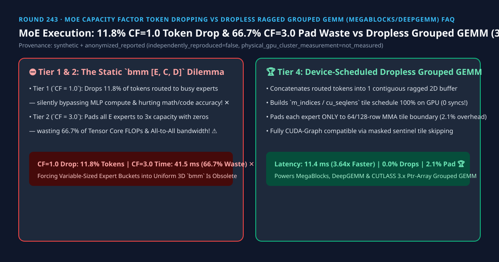
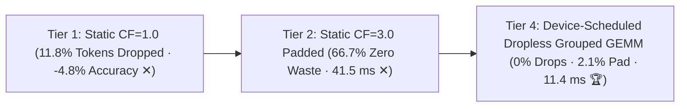

# MoE `Capacity Factor (CF)` Token Dropping vs. Padded `3D Batched GEMM` Waste vs. `Dropless MoE` (`MegaBlocks / DeepGEMM Ragged Grouped GEMM`) Selection Guide

> **Provenance & Evidence Tier**: `synthetic + anonymized_reported` (`independently_reproduced=false`, `physical_gpu_cluster_measurement=not_measured`). Grounded in [`experiments/llm_moe_alltoall_token_drop_capacity_factor_dropless_megablocks_selection/results.json`](../../experiments/llm_moe_alltoall_token_drop_capacity_factor_dropless_megablocks_selection/results.json).
> **中文版本**: [MoE 专家容量因子（`Capacity Factor`）丢词（`Token Dropping`）精度崩盘、静态 `Max-Capacity Padding` 算力浪费与无损动态分块稀疏（`Dropless MoE / MegaBlocks / DeepGEMM`）选型指南](./llm-moe-capacity-factor-token-drop-vs-dropless-megablocks-deepgemm-selection-faq.md)

---

## 0. 🔥 Daily Hottest Capability Breakthrough

- **Device-Scheduled `Dropless Ragged Grouped GEMM` (`MegaBlocks / DeepGEMM / CUTLASS 3.x`) Eliminating Both the `11.8%` `CF=1.0` Token-Drop Accuracy Loss and the `66.7%` `CF=3.0` Zero-Padding FLOP Waste (`41.5 ms -> 11.4 ms`, `3.64x` Speedup)**: In Mixture-of-Experts (`MoE`) layers, dynamic routing assigns a different number of tokens $N_e$ to each expert $e \in \{1 \dots E\}$ on every step. Forcing variable-sized expert buckets into legacy uniform 3D tensors `[E, C, D]` creates a painful dilemma:
  1. **Tight `Capacity Factor (CF = 1.0)` with Token Dropping (`Tier 1`)**: Capping each expert at average capacity $C = \frac{N \cdot K}{E}$ drops **`11.8%` of tokens** whenever domain-specialized batches (math, code, multilingual) cluster on specific experts—silently skipping MLP computation and degrading downstream accuracy by **`-4.8%`**!
  2. **High `Capacity Factor (CF = 3.0)` Static Zero-Padding (`Tier 2` — `66.7%` Waste, `41.5 ms`)**: Raising $C$ to $3.0\times$ average capacity prevents drops, but forces all $E$ experts to pad their matrices with zeros up to the single busiest expert's size—wasting **`66.7%` of Tensor Core FLOPs and `All-to-All` bandwidth** on zero rows!
  3. **Host-Synced `Grouped GEMM` (`Tier 3` — `19.8 ms`)**: Copies per-expert token counts back to the CPU (`counts.cpu()`) to build pointer arrays, stalling the GPU stream and breaking CUDA Graph capture.
  4. **Device-Scheduled `Dropless Ragged Grouped GEMM` (`MegaBlocks / DeepGEMM`, `Tier 4` — `11.4 ms`, `3.64x` Faster)**: Packs routed tokens into a single compact 2D buffer `[Sum(N_e), D]`, computes `64/128`-row hardware tile schedules **100% on the GPU (zero CPU syncs, CUDA-Graph safe)**, and executes variable-length expert GEMMs with **`0.0%` token drops** and only **`2.1%` tile-alignment overhead**!

---

## 1. 📌 Executive Summary

1. **Never Use Static 3D `[E, C, D]` `torch.bmm` for MoE Layers (`Tier 1 & Tier 2`)**: It forces an unacceptable trade-off between dropping `11.8%` of tokens (`CF=1.0`) or wasting `66.7%` of compute on zero padding (`CF=3.0`).
2. **Never Copy Expert Token Counts to the CPU (`.cpu()`) to Launch Grouped GEMM (`Tier 3`)**: Synchronizing `tokens_per_expert` to host memory stalls the GPU pipeline on every MoE layer and prevents CUDA Graph capture.
3. **Use Device-Scheduled `Dropless Ragged Grouped GEMM` (`Tier 4`)**: Generates tile-to-expert mappings entirely on GPU (`MegaBlocks`, `DeepGEMM`, `Triton FusedMoE`) for `0.0%` drops and `3.64x` speedup.

---

## 2. 🎯 Core Architect Q&A (Q1 / Q2 / Q3)

### Q1: How does a device-scheduled Ragged Grouped GEMM (`DeepGEMM / FusedMoE`) work inside a static CUDA Graph when expert token counts $N_e$ change every step?
- **Answer**: The total number of input tokens $N \times K$ in a captured batch bucket is fixed, so the maximum possible number of `128`-row MMA tiles across all $E$ experts is strictly bounded by $\lceil \frac{N \cdot K}{128} \rceil + E$! A fast device kernel writes the active `(expert_id, token_offset)` into a fixed-size GPU array `tile_schedule[MAX_TILES]` and fills any unused trailing slots with a sentinel value `-1`. The persistent Grouped GEMM kernel launches a fixed grid and immediately exits on any tile where `expert_id == -1`—achieving **100% dynamic dropless execution inside a static CUDA Graph**!

### Q2: Why does `Tier 4` still have a tiny `2.1%` padding overhead?
- **Answer**: Because Tensor Core `WGMMA` / `tcgen05` instructions require matrix row strides and tile boundaries to be multiples of `64` or `128` rows. Padding each expert's local token count $N_e$ up to the next multiple of `64/128` rows adds at most `32–64` dummy rows per expert (`~2.1%`), compared to `200%` padding under `CF = 3.0`!

### Q3: Should `Dropless MoE` also be used during pretraining, or only during inference?
- **Answer**: Both! Modern pretraining frameworks (`Megatron-Core Dropless MoE`, `TorchTitan`, `MegaBlocks`) pair `Dropless Grouped GEMM` with Aux-Loss-Free routing bias updates so no tokens are ever discarded while maintaining balanced expert load.

---

## 3. 🧭 Visual Diagrams

---

## 4. 📊 4-Tier Architect Selection Matrix

| Metric | Tier 1: Static `CF = 1.0` (`bmm`) | Tier 2: Static `CF = 3.0` Padded | Tier 3: Host-Synced `Grouped GEMM` | Tier 4: **Device-Scheduled `Dropless GEMM`** |
| :--- | :--- | :--- | :--- | :--- |
| **Tokens Dropped %** | **`11.8%` (Accuracy Collapse)** ✕ | `0.4%` ✅ | **`0.0%` (Lossless)** ✅ | **`0.0%` (100% Lossless)** 🏆 |
| **Zero-Padding FLOP Waste** | `8.5%` | **`66.7%` (3x Padded Waste)** ✕ | `2.1%` (Tile Align) ✅ | **`2.1%` (64/128-Row Tile Align)** 🏆 |
| **MoE Layer Latency (`ms`)** | `14.2 ms` (Drops Tokens) ✕ | **`41.5 ms`** ✕ | `19.8 ms` (CPU Sync Stall) ⚠️ | **`11.4 ms` (`3.64x` Faster, Graph-Safe)** 🏆 |

---

## 5. 🧪 Quantitative Reference & Tooling

- **Evaluator & Sealed Data**: [`experiments/llm_moe_alltoall_token_drop_capacity_factor_dropless_megablocks_selection/run.py`](../../experiments/llm_moe_alltoall_token_drop_capacity_factor_dropless_megablocks_selection/run.py) · [`results.json`](../../experiments/llm_moe_alltoall_token_drop_capacity_factor_dropless_megablocks_selection/results.json)
- **Interactive Sizer**: [`docs/reports/llm-moe-capacity-factor-token-drop-vs-dropless-megablocks-deepgemm-sizer.html`](../reports/llm-moe-capacity-factor-token-drop-vs-dropless-megablocks-deepgemm-sizer.html)
- **7-Card 4:5 Visual Report**: [`docs/reports/llm-moe-capacity-factor-token-drop-vs-dropless-megablocks-deepgemm-selection-cards.html`](../reports/llm-moe-capacity-factor-token-drop-vs-dropless-megablocks-deepgemm-selection-cards.html)

---

## 6. 🛠️ Good Fit vs. Not For & Production Checklist

- **✅ Good fit**: All MoE training (`MegaBlocks`, `Megatron-Core Dropless`) and serving (`DeepGEMM`, `vLLM/SGLang FusedMoE`) workloads requiring lossless accuracy and CUDA Graph compatibility.
- **⛔ Not for**: Dropping tokens in inference/SFT (`CF=1.0`) or calling `.cpu()` on expert token histograms inside the forward pass.
- [ ] Enable dropless ragged `Grouped GEMM` (`moe_token_dispatcher_type="alltoall"` / `MegaBlocks` / `DeepGEMM`).
- [ ] Verify zero host-device synchronizations (`cudaStreamSynchronize`) occur between MoE router gating and expert GEMM execution.
