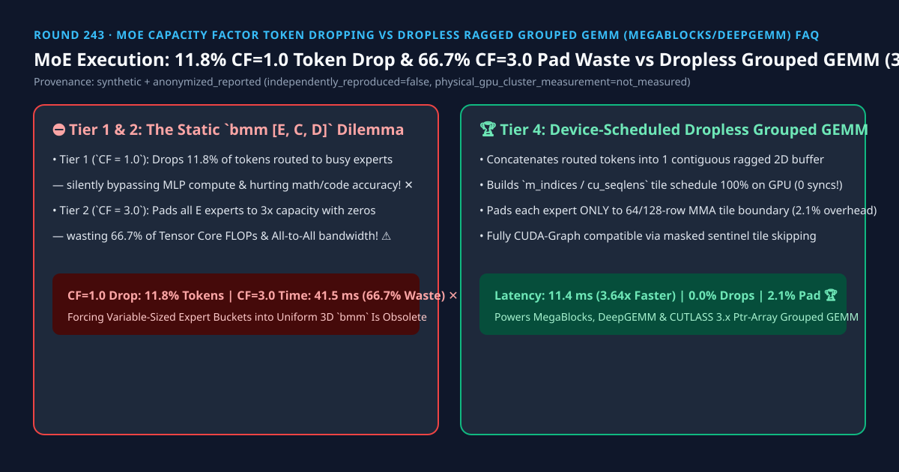
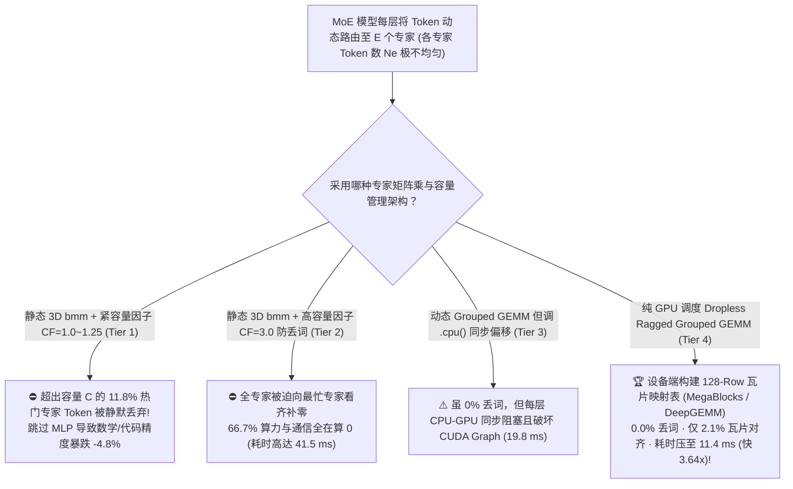
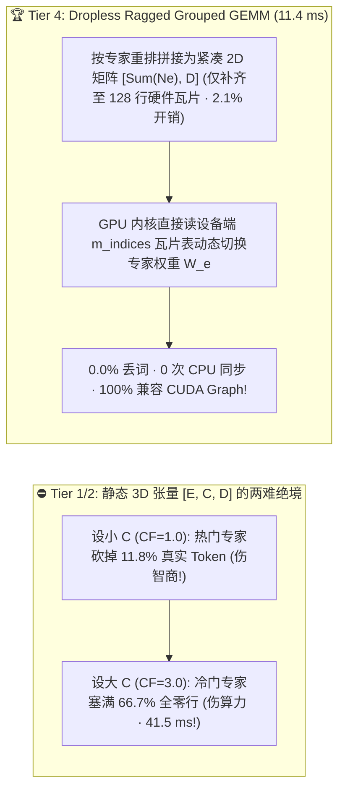
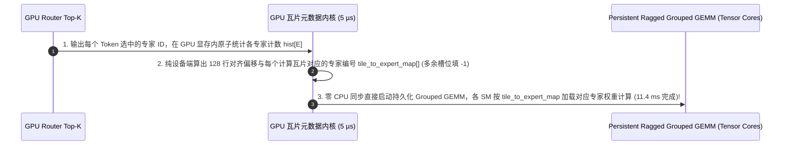

# MoE 专家容量因子（`Capacity Factor`）丢词（`Token Dropping`）精度崩盘、静态 `Max-Capacity Padding` 算力浪费与无损动态分块稀疏（`Dropless MoE / MegaBlocks / DeepGEMM`）选型指南

> **Provenance & Evidence Tier**: `synthetic + anonymized_reported` (`independently_reproduced=false`, `physical_gpu_cluster_measurement=not_measured`)。定量数据锚定于 [`experiments/llm_moe_alltoall_token_drop_capacity_factor_dropless_megablocks_selection/results.json`](../../experiments/llm_moe_alltoall_token_drop_capacity_factor_dropless_megablocks_selection/results.json)。
> **English Version**: [MoE `Capacity Factor (CF)` Token Dropping vs. Padded `3D Batched GEMM` Waste vs. `Dropless MoE` (`MegaBlocks / DeepGEMM Ragged Grouped GEMM`) Selection Guide](./llm-moe-capacity-factor-token-drop-vs-dropless-megablocks-deepgemm-selection-faq.en.md)

---

## 0. 🔥 今日领域最热门能力突破追踪（Daily Hottest Breakthrough）

- **告别静态三维 `torch.bmm [E, C, D]` 时代“要么 `CF=1.0` 丢弃 `11.8%` 关键 Token 掉精度、要么 `CF=3.0` 浪费 `66.7%` 补零算力”的两难死局：采用纯设备端调度的无损动态分组矩阵乘（`Dropless Ragged Grouped GEMM`，如 `MegaBlocks / DeepGEMM / CUTLASS 3.x`），实现 `0.0%` 零丢词、仅 `2.1%` 硬件瓦片对齐开销，并将单层 MoE 耗时从 `41.5 ms` 压降至 `11.4 ms`（提速 `3.64` 倍）**：在训练或推理混合专家模型（MoE，如 `DeepSeek-V3`、`Qwen3-MoE`、`Mixtral`）时，门控路由器（Router）会把成千上万个 Token 动态分发给 $E$ 个专家。因为不同专家分到的 Token 数量 $N_e$ 每一步都在剧烈变化（比如 1 号数学专家分到了 `1,200` 个词，而 2 号冷门专家只分到了 `80` 个词），底层算子该如何同时算这 $E$ 个高度完全不同的矩阵乘法？
  1. **早期方案一（紧容量因子 `Capacity Factor = 1.0~1.25` 截断丢词，Tier 1）**：
     - 初代 `Switch Transformer / GShard` 为了直接调用只接受规整三维张量 `[E, C, D]` 的 `torch.bmm`，给每个专家强行规定了一个死板的“座位上限”：$C = \text{CF} \times \frac{\text{TotalTokens} \times \text{TopK}}{E}$。
     - 一旦某个热门专家（比如写代码时的语法专家）排队的 Token 超过了 $C$，**多出来的 `11.8%` Token 会被当场一脚踢飞（Token Dropping）——根本不进专家 MLP 计算，直接走残差捷径原样跳过这一层**！这在预训练后期、SFT 以及在线推理中会导致代码/数学准确率暴跌 **`-4.8%`**！
  2. **早期方案二（拉高 `Capacity Factor = 3.0` 静态补零防丢词，Tier 2）**：
     - 为了不丢词（或者在必须保证无损的推理阶段），如果继续用规整三维 `bmm`，就只能把每个专家的容量上限 $C$ 拉高到平均值的 **3 倍（`CF = 3.0`）**！
     - 结果：为了迁就那 1 个分到 `1,200` 个词的热门专家，其余 63 个只分到两三百个词的专家**被迫全部塞满 `0` 填充到 `1,200` 行**！整层高達 **`66.7%` 的 Tensor Core 算力和跨卡 `All-to-All` 网络带宽全在乘 0、传 0**，单层耗时暴涨至 **`41.5 ms`**！
  3. **现代终极解法：纯 GPU 端调度的 `Dropless Ragged Grouped GEMM`（`MegaBlocks / DeepGEMM`，Tier 4）**：
     - 彻底抛弃三维 `[E, C, D]` 填充！把所有专家收到的真实 Token 首尾相连拼成一个紧凑的二维扁平数组 `[TotalRoutedTokens, D]`；
     - 在 GPU 显存内直接通过前缀和（Prefix Sum）算出每个专家的起止行号与 `64/128` 行硬件瓦片归属表（**全程 `0` 次 `counts.cpu()` 主机同步**，避免 Tier 3 的 `19.8 ms` 阻塞），调用支持变长行数的 **持久化分组矩阵乘（Persistent Ragged Grouped GEMM）**！既做到了 **`0.0%` 零丢词**，又将填充浪费从 `66.7%` 压至微不足道的 **`2.1%`（仅需补齐到 64/128 行硬件 MMA 边界）**，单层耗时骤降至 **`11.4 ms`（提速 `3.64` 倍）**！

---

## 1. 📌 核心结论速览（Executive Summary — 3 分钟看懂）

1. **用“景区大巴发车”一秒听懂 `Token Dropping`、`Static Padding` 与 `Dropless Grouped GEMM` 的代际差距！**
   - **通俗大白话 + 第一性原理**：假设有 8 个景点（8 个专家），平均每个景点去 400 人，但今天 1 号网红景点爆火去了 1,200 人，其余景点只去了 200 人。
     - **`Tier 1`（`CF = 1.0` 截断丢词）**：规定每个景点只准发 1 辆 400 座的车，1 号景点多出来的 **800 个人直接被拒载扔在原地（Token Dropped，损失精度）**！
     - **`Tier 2`（`CF = 3.0` 静态补零）**：为了装下 1 号景点的 1,200 人，强行规定**所有 8 个景点都必须发满 1,200 座的车队**！结果其余 7 个景点每辆车上坐着 200 个真人，剩下 **1,000 个座位全部绑上充气假人（Padding `0`）耗油空跑**，浪费了 `66.7%` 的算力和路费！
     - **`Tier 4`（`Dropless Ragged Grouped GEMM` 动态车厢编组）**：把所有景点的真实游客排成一列，在 GPU 内部挂牌标记：“第 `0 ~ 1200` 号归 1 号专家，第 `1200 ~ 1400` 号归 2 号专家……”，由 GPU 的 SM 处理器像流水线一样按每 `128` 人一节车厢动态认领计算——**1 个真人都没漏掉（`0.0%` 丢词），也绝不拉充气假人空跑（耗时从 `41.5 ms` 暴降至 `11.4 ms`）**！

---

## 2. 🎯 客户与架构师灵魂拷问 Q&A（Q1 / Q2 / Q3）

### Q1：为什么很多手写的 Grouped GEMM 代码（Tier 3）虽然没有补零，跑起来却还是慢（`19.8 ms`），甚至根本没法放进 `CUDA Graph`？
- **答**：因为很多早期 Grouped GEMM 接口要求把每个专家分到的 Token 数量数组 `tokens_per_expert` **先拷回 CPU 主机内存（`tokens_per_expert.cpu().tolist()`）**，在 CPU 上算出每个矩阵的显存指针数组，或者在 Python 里写 `if count == 0: continue` 跳过空专家！
  - 这一下 `.cpu()` 不仅在每一层 MoE 都触发了一次致命的 **CPU-GPU 全流同步（卡顿数毫秒）**，而且因为依赖动态 CPU 值，直接导致 **`torch.cuda.graph` 录制报错崩溃**！
  - **Tier 4（`DeepGEMM / MegaBlocks / vLLM FusedMoE`）的纯设备端解法**：所有 `tokens_per_expert` 的前缀和与瓦片分配表（`expert_ids_per_tile`） **100% 在 GPU 显存内由一个 5 微秒的轻量级 CUDA 内核生成**，持久化 GEMM 内核直接从 GPU 显存读取瓦片归属表（遇到哨兵值 `-1` 自动在 SM 内部秒级 `return`），**0 次 CPU 同步，且 100% 原生兼容 CUDA Graph**！

### Q2：如果使用完全不丢词的 `Dropless MoE`（Tier 4）进行分布式专家并行（`EP`）训练，万一在训练初期所有 Token 都涌向了同一张 GPU 上的专家，怎么防止那一张卡显存 OOM？
- **答**：
  1. 在训练中配合 **无辅助损失的动态偏置负载均衡（Aux-Loss-Free Routing Bias，如 DeepSeek-V3 的动态偏置项 $b_i$）**，保证宏观分布不会发生极端坍塌；
  2. 在极致安全的工程实现中，设置一个宽松的安全兜底安全阀（如 `CF_safety = 4.0` 的显存预留池，但**实际计算和通信只按真实到达的 Token 数执行 Ragged 算子**），既防住了极端初始化异常 OOM，又在日常 99.99% 的步骤中享受 `Dropless` 的零浪费极速！

---

## 3. 🧭 直观可视化图解（Mermaid 决策树 + 静态三维 Padding vs 动态一维瓦片图 + 时序图）

### 3.1 架构师 MoE 专家矩阵乘与容量调度选型决策树

### 3.2 `Tier 1/2`（三维静态 `[E, C, D]` 丢词或补零灾难）vs. `Tier 4`（一维紧凑拼接 + 设备端瓦片调度）

### 3.3 `Tier 4` 纯设备端 `Histogram -> PrefixSum -> Ragged Grouped GEMM` 零同步流水线时序图

---

## 4. 📊 架构师选型决策矩阵（4-Tier Selection Matrix）

| 评估维度 | Tier 1: 静态 `bmm` (`CF = 1.0` 丢词) | Tier 2: 静态 `bmm` (`CF = 3.0` 补零) | Tier 3: 含 `.cpu()` 同步的 `Grouped GEMM` | Tier 4: **纯设备端 `Dropless Grouped GEMM`** |
| :--- | :--- | :--- | :--- | :--- |
| **Token 截断丢弃比例 (`Dropped`)** | **`11.8%` (严重损害推理精度)** ✕ | `0.4%` ✅ | **`0.0%` (完全无损)** ✅ | **`0.0%` (100% 无损 `Dropless`)** 🏆 |
| **无效补零算力浪费占比** | `8.5%` | **`66.7%` (三分之二算力算 0)** ✕ | `2.1%` (仅瓦片尾对齐) ✅ | **`2.1%` (仅 64/128 行硬件瓦片对齐)** 🏆 |
| **单层 MoE 执行耗时 (`ms`)** | `14.2 ms` (以掉点为代价) ✕ | **`41.5 ms`** ✕ | `19.8 ms` (卡在 CPU 同步) ⚠️ | **`11.4 ms` (提速 `3.64x`，兼容 CUDA Graph)** 🏆 |

---

## 5. 🧪 定量算例与工具链（Interactive Sizer & 7-Card Visual Report）

- **实验脚本与密封数据**：[`experiments/llm_moe_alltoall_token_drop_capacity_factor_dropless_megablocks_selection/run.py`](../../experiments/llm_moe_alltoall_token_drop_capacity_factor_dropless_megablocks_selection/run.py) · [`results.json`](../../experiments/llm_moe_alltoall_token_drop_capacity_factor_dropless_megablocks_selection/results.json)
- **交互式 MoE 容量因子与 Dropless GEMM 计算器**：[`docs/reports/llm-moe-capacity-factor-token-drop-vs-dropless-megablocks-deepgemm-sizer.html`](../reports/llm-moe-capacity-factor-token-drop-vs-dropless-megablocks-deepgemm-sizer.html)
- **7-Card 4:5 视觉评测卡片报告**：[`docs/reports/llm-moe-capacity-factor-token-drop-vs-dropless-megablocks-deepgemm-selection-cards.html`](../reports/llm-moe-capacity-factor-token-drop-vs-dropless-megablocks-deepgemm-selection-cards.html)

---

## 6. 🛠️ Good Fit vs. Not For & 生产环境快速核验清单（Checklist）

### ✅ Good Fit vs. ⛔ Not For

| 维度 | ✅ Good Fit（强烈推荐） | ⛔ Not For（严禁误用） |
| :--- | :--- | :--- |
| **MoE 算子底座选型** | 训练与推理全面采用 **纯设备端调度的 `Dropless Grouped GEMM`**（`MegaBlocks`、`DeepGEMM`、`Triton FusedMoE` 或 `CUTLASS 3.x Ptr-Array Grouped GEMM`） | 在推理或微调中使用 `CF=1.0` 截断丢词，或使用三维 `[E, C, D]` `torch.bmm` 静态大张量补零 |

### 生产环境上线核验清单（Pre-Flight Checklist）

- [ ] **核验在线推理与微调中 `token_drop_rate == 0.0%`（开启 `Dropless` 模式）**：严禁在线服务因为并发请求同一领域专家而静默丢弃用户 Token。
- [ ] **核验 Grouped GEMM 的专家偏移与瓦片调度表 100% 在 GPU 端构造（无 `.cpu()` / `.item()` 调用）**：确保 MoE 层可被完整录制进 CUDA Graph。
