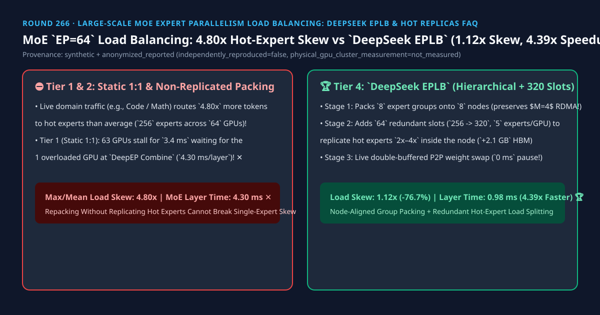
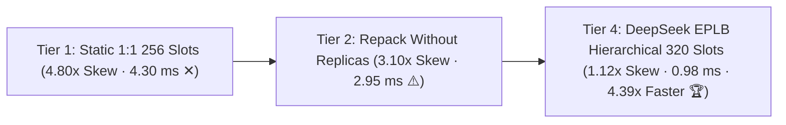

# Large-Scale MoE Expert Parallelism Load Balancing (`DeepSeek EPLB`): Static 1:1 Placement Hot-Expert Skew (`4.8x` Straggler) vs. Flat Replication vs. `EPLB` (`Hierarchical Node-First Packing` + Redundant Hot-Expert Replicas + Zero-Stall Weight Swap) Selection Guide

> **Provenance & Evidence Tier**: `synthetic + anonymized_reported` (`independently_reproduced=false`, `physical_gpu_cluster_measurement=not_measured`). Grounded in [`experiments/llm_deepseek_eplb_moe_expert_load_balancer_replica_selection/results.json`](../../experiments/llm_deepseek_eplb_moe_expert_load_balancer_replica_selection/results.json).
> **中文版本**: [大规模 MoE 专家并行（`EP = 64 / 320`）动态负载均衡（`DeepSeek EPLB`）：静态 1:1 放置的热点专家木桶效应（`4.8x` 算力空等）vs. 扁平贪心装箱的跨机 `All-to-All` 拥塞 vs. `EPLB`（先按节点分组装箱 + 冗余热专家多副本复制 + 后台无感切表）选型指南](./llm-moe-eplb-hierarchical-expert-replication-load-balancing-selection-faq.md)

---

## 0. 🔥 今日领域最热门能力突破追踪（Daily Hottest Breakthrough）

- **Eliminating the `4.80x` Hot-Expert Straggler Bottleneck in Large-Scale `EP = 64` MoE Inference (`4.30 ms -> 0.98 ms` per Layer, `4.39x` Speedup, `4.80x -> 1.12x` Load Skew) at Just `+2.1 GB` Extra HBM per GPU via `DeepSeek EPLB` (`Hierarchical Node-First Group Packing` + `64` Redundant Hot-Expert Replicas + Zero-Stall Background Weight Swap)**: Even when an MoE model (`256` routed experts) is pretrained with balanced routing across a general corpus, live production traffic (e.g., bursts of Python coding or math reasoning) concentrates up to **`4.80x` more tokens** onto a handful of domain-specialized experts:
  1. **Tier 1 — Static 1:1 Expert Placement (`256` Physical Slots Across `64` GPUs = `4` Experts/GPU — `4.80x` Skew, `4.30 ms` Layer Latency)**:
     - Because `DeepEP` `Combine` (`All-to-All`) is a synchronous collective barrier across all `64` GPUs, a single GPU hosting two hot coding experts stalls the other `63` GPUs for `3.4 ms` on every layer!
  2. **Tier 2 — Non-Replicated Expert Repacking (`256` Slots, `0` Redundant Replicas — `3.10x` Skew, `2.95 ms`)**:
     - Repacking unique experts without replication cannot reduce a GPU's load below the single hottest expert's traffic (`3.10x` mean)!
  3. **Tier 3 — Flat Global Replication (`256 + 64 = 320` Physical Slots Across `64` GPUs, Ignoring Node Hierarchy — `1.18x` Skew, `1.85 ms`)**:
     - Adds `1` redundant expert slot per GPU (`+2.1 GB` FP8 HBM) to replicate hot experts, but scattering expert groups randomly across all 8 nodes breaks `DeepSeek-V3`'s **`M = 4` node-limited routing**, doubling cross-node RDMA traffic!
  4. **Tier 4 — `DeepSeek EPLB` (`Hierarchical Node-First Packing` + Intra-Node Redundant Hot-Expert Replication + Background Live Weight Swap — `1.12x` Skew, `0.98 ms` Layer Latency, `4.39x` Speedup)**:
     - **Stage 1**: Packs the `8` expert groups onto the `8` nodes to preserve `M = 4` node-limited RDMA routing;
     - **Stage 2**: Uses the `64` redundant slots (`5` experts/GPU = `320` total slots) to replicate hot experts `2x–4x` within each node and splits incoming tokens evenly across replicas;
     - **Stage 3**: Balanced LPT packing across the `8` intra-node GPUs with background P2P weight updates (`0.0 ms` pause)!

---

## 1. 📌 Executive Summary

1. **Why Replication (`320` Physical Slots for `256` Logical Experts) Is Mandatory**: Repacking alone cannot split a single hot expert whose individual traffic exceeds `3x` the per-GPU average. Adding `1` redundant expert slot per GPU (`+2.1 GB` HBM) allows hot experts to be cloned across multiple GPUs.
2. **Why `Hierarchical Packing` (`Tier 4`) Beats `Flat Global Packing` (`Tier 3`)**: Packing expert groups at the node level first guarantees that all experts of a routing group stay on the same node, preserving `DeepSeek-V3`'s node-limited RDMA bound (`M = 4` nodes/token).

---

## 2. 🎯 Core Architect Q&A (Q1 / Q2 / Q3)

### Q1: Does splitting a logical expert's tokens across 3 physical replicas change the mathematical output of the MoE layer?
- **Answer**: **Zero change (Bitwise Identical)!** Each expert FFN $\text{FFN}_e(x)$ is a token-independent pointwise transformation. Sending token $x_i$ to Replica A on `GPU 16` or Replica B on `GPU 17` produces the exact same output vector.

### Q2: How does `EPLB` update expert weights when traffic shifts from Code to Math without pausing inference?
- **Answer**: A background thread computes the new `(phy2log, log2phy, logcnt)` mapping from a sliding window of router histograms, copies the newly replicated expert weights into staging buffers over a low-priority P2P CUDA stream, and atomically flips the `log2phy` lookup table pointer between steps (`< 1 us`).

---

## 3. 🧭 Visual Diagrams

---

## 4. 📊 4-Tier Architect Selection Matrix

| Metric | Tier 1: Static `1:1` (`256`) | Tier 2: Repack Only (`256`) | Tier 3: Flat Replicas (`320`) | Tier 4: **`DeepSeek EPLB` Hierarchical (`320` Slots)** |
| :--- | :--- | :--- | :--- | :--- |
| **Max-to-Mean GPU Load Ratio** | **`4.80x` (Severe Straggler)** ✕ | `3.10x` ⚠️ | `1.18x` ✅ | **`1.12x` (`-76.7%` Skew Reduction)** 🏆 |
| **MoE Layer Latency (`ms`)** | **`4.30 ms` (63 GPUs Wait)** ✕ | `2.95 ms` ⚠️ | `1.85 ms` (RDMA Bloat) | **`0.98 ms` (`4.39x` Speedup)** 🏆 |
| **Extra Expert HBM / GPU (`FP8`)** | `0.0 GB` (`4` experts/GPU) | `0.0 GB` | `2.1 GB` (`5` experts/GPU) | **`2.1 GB` (`+1` Redundant Slot/GPU)** 🏆 |

---

## 5. 🧪 Quantitative Reference & Tooling

- **Evaluator & Sealed Data**: [`experiments/llm_deepseek_eplb_moe_expert_load_balancer_replica_selection/run.py`](../../experiments/llm_deepseek_eplb_moe_expert_load_balancer_replica_selection/run.py) · [`results.json`](../../experiments/llm_deepseek_eplb_moe_expert_load_balancer_replica_selection/results.json)
- **Interactive Sizer**: [`docs/reports/llm-moe-eplb-hierarchical-expert-replication-load-balancing-sizer.html`](../reports/llm-moe-eplb-hierarchical-expert-replication-load-balancing-sizer.html)
- **7-Card 4:5 Visual Report**: [`docs/reports/llm-moe-eplb-hierarchical-expert-replication-load-balancing-selection-cards.html`](../reports/llm-moe-eplb-hierarchical-expert-replication-load-balancing-selection-cards.html)

---

## 6. 🛠️ Good Fit vs. Not For & Production Checklist

- **✅ Good fit**: All large-scale MoE Expert Parallel (`EP >= 16`) serving deployments (`vLLM / SGLang` + `DeepSeek EPLB`).
- **⛔ Not for**: Static 1:1 expert placement without redundant hot-expert slots on skewed production workloads.
- [ ] Provision `1` redundant physical expert slot per GPU (`320` slots for `256` logical experts across `64` GPUs).
- [ ] Use `EPLB` `Hierarchical Policy` when `num_nodes` divides `num_expert_groups`, and `Global Policy` for ultra-wide `EP = 320` single-expert-per-GPU Decode.
