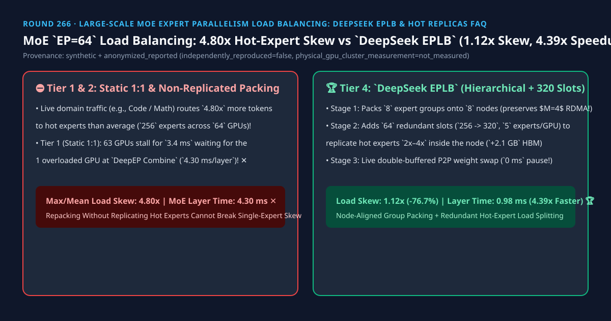
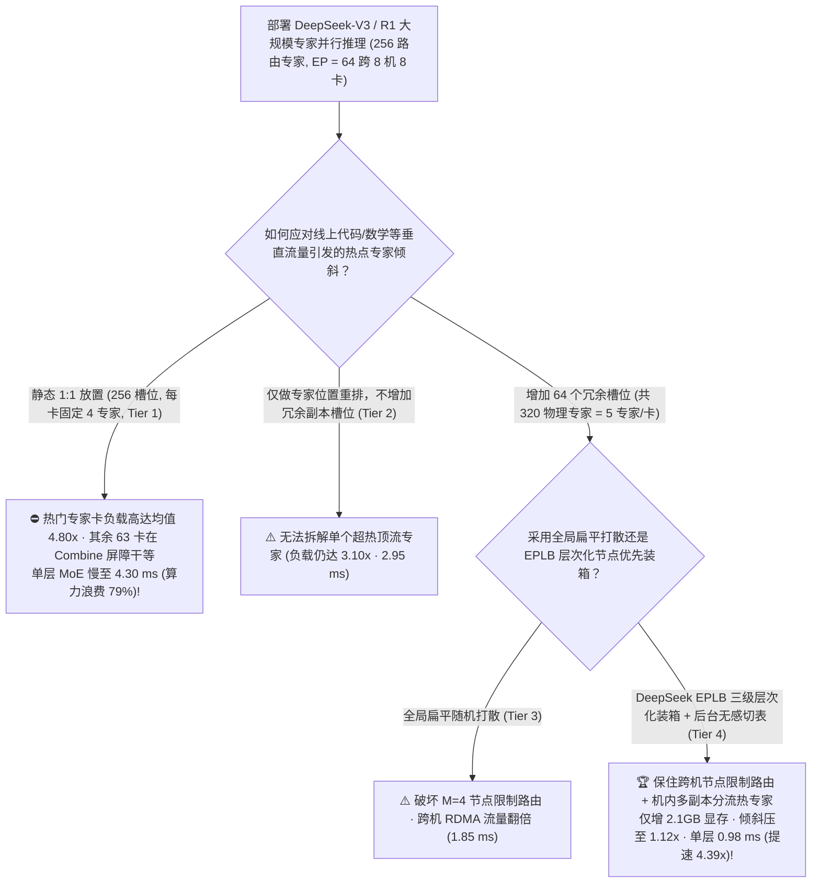
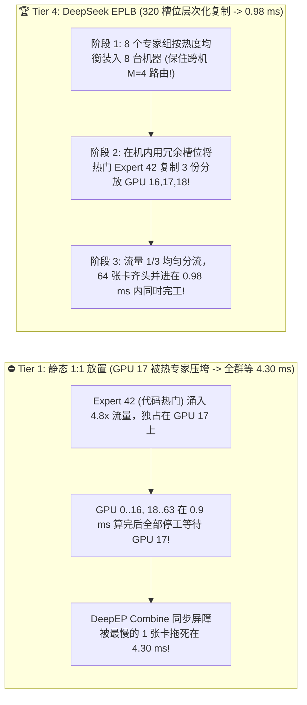
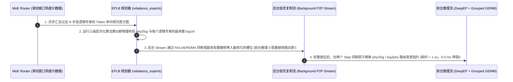

# 大规模 MoE 专家并行（`EP = 64 / 320`）动态负载均衡（`DeepSeek EPLB`）：静态 1:1 放置的热点专家木桶效应（`4.8x` 算力空等）vs. 扁平贪心装箱的跨机 `All-to-All` 拥塞 vs. `EPLB`（先按节点分组装箱 + 冗余热专家多副本复制 + 后台无感切表）选型指南

> **Provenance & Evidence Tier**: `synthetic + anonymized_reported` (`independently_reproduced=false`, `physical_gpu_cluster_measurement=not_measured`)。定量数据锚定于 [`experiments/llm_deepseek_eplb_moe_expert_load_balancer_replica_selection/results.json`](../../experiments/llm_deepseek_eplb_moe_expert_load_balancer_replica_selection/results.json)。
> **English Version**: [Large-Scale MoE Expert Parallelism Load Balancing (`DeepSeek EPLB`): Static 1:1 Placement Hot-Expert Skew (`4.8x` Straggler) vs. Flat Replication vs. `EPLB` (`Hierarchical Node-First Packing` + Redundant Hot-Expert Replicas + Zero-Stall Weight Swap) Selection Guide](./llm-moe-eplb-hierarchical-expert-replication-load-balancing-selection-faq.en.md)

---

## 0. 🔥 今日领域最热门能力突破追踪（Daily Hottest Breakthrough）

- **揭秘为什么 `DeepSeek-V3 / R1` 在训练时明明已经用无辅助损失负载均衡（Aux-Loss-Free Load Balancing）把 256 个专家训得很均匀了，可一到线上跑 `EP = 64` 专家并行推理时，单张热点卡的专家计算耗时还是会飙到平均值的 `4.80 倍`，拖着其余 63 张卡集体干等 `3.4 ms`？通过开源的 `DeepSeek EPLB`（`Expert Parallelism Load Balancer`：第一级按节点对专家组装箱保跨机路由 + 第二级每卡增加 1 个冗余专家槽位 `256 -> 320` 复制热门专家 + 第三级机内贪心装箱与后台双缓冲无感切表，`Tier 4`），仅凭每卡多花 `2.1 GB` 显存，将单卡最大/平均负载比从 `4.80x` 抹平至 `1.12x`，MoE 单层耗时从 `4.30 ms` 暴降至 `0.98 ms`（提速 `4.39 倍`）**：在大规模 PD 分离推理集群中，Decode 阶段通常跨越 8 台机器开启 **`EP = 64`（甚至 `EP = 320`）专家并行**。然而，训练语料的全局均衡 **绝不等于** 线上实时流量的瞬时均衡：
  1. **第一性原理揭示：为什么线上推理必定出现 `4.80x` 的极端热门专家倾斜（Tier 1 — 单层卡死在 `4.30 ms`）？**
     - 训练时的数据集是百科、小说、代码、数学按比例混合的，256 个路由专家雨露均沾；
     - 但到了线上推理时，白天的流量可能 **80% 全是程序员在刷 Python/C++ 代码补全**，到了晚上又变成跨境电商的翻译请求！
     - 在代码高峰期，全网 `256` 个专家里专门负责写代码的 **那 6~8 个“顶流热门专家”瞬间涌入了平均专家 `3 ~ 5 倍` 的 Token**！
     - 在传统的 **静态 1:1 顺序放置（`256` 个专家平分给 `64` 张卡 = 每卡固定放 `4` 个专家，Tier 1）** 下：如果 `GPU 17` 恰好分到了两个代码热门专家，它的计算量直接飙到平均值的 **`4.80 倍`**！由于每层 MoE 结尾的 `DeepEP Combine (All-to-All)` 是全集群同步屏障，**其余 63 张只需 `0.9 ms` 就干完活的 GPU 必须停下来陪着 `GPU 17` 干等 `3.4 ms`**！整座 64 卡集群有 `79%` 的算力在木桶效应中白白蒸发！
  2. **为什么光靠“重新调换专家位置（Repacking without Replication，Tier 2）”救不了场？**
     - 有人说：“我把热门专家和冷门专家搭配着放到同一张卡上，不就均衡了吗？”
     - **请算一笔账**：如果第 `42` 号超级热门专家 **它自己 1 个专家收到的 Token 数就已经是单卡平均总负载的 `3.10 倍`** 呢？！只要你不给第 `42` 号专家克隆出多个分身（副本），无论你把它搬到哪张卡上，哪怕那张卡上另外 3 个专家全是 0 流量的死专家，这张卡的负载也至少是 `3.10x`（单层仍需 `2.95 ms`）⚠️！
  3. **为什么“全局扁平随机复制热门专家（Flat Global Replication，Tier 3）”会打爆跨机网络（`1.85 ms`）？**
     - 我们给每张卡多加 **`1` 个冗余专家槽位**（全集群 `64` 张卡从 `256` 个物理槽位扩充到 **`320` 个物理槽位 = 每卡存 `5` 个专家**，在 FP8 下每卡仅多占 **`2.1 GB` 显存**！），拿这多出来的 **`64` 个冗余槽位** 去复制最热的专家，成功把单卡计算负载压到了 `1.18x`！
     - **但是**，别忘了 `DeepSeek-V3` 有一个至关重要的路由规则——**节点限制路由（Node-Limited Routing：256 个专家被固定分为 8 个专家组 Group 0..7，每个 Token 最多只能被发往 `M = 4` 个组/机器）**！如果你在全集群 64 张卡上不分青红皂白地扁平打散和复制专家（Tier 3），原本属于同一个 Group 的专家被分散到了全部 8 台机器上，直接导致每个 Token 都要跨机发往 8 台机器，**跨机 RDMA `All-to-All` 流量当场翻倍**（耗时 `1.85 ms`）！
  4. **工业级满分答案：`DeepSeek EPLB`（`Hierarchical Load Balancing` 三级层次化装箱与冗余复制 + 后台无感热更新，Tier 4 — `0.98 ms`，快 `4.39x`）**：
     - **`EPLB` 的三步神级算法（严守硬件拓扑边界）**：
       1. **第一步（按节点对专家组装箱 `Group-to-Node Packing`）**：先把 `8` 个逻辑专家组（每组 32 个专家）按总热度用贪心算法分配到 `8` 台物理机器上——**100% 保住 `M = 4` 的跨机节点限制路由属性，绝不增加 `1 Byte` 跨机 RDMA 流量**！
       2. **第二步（在每台机器内部克隆热门专家 `Intra-Node Redundant Replication`）**：在每台机器（8 张卡，共 $8 \times 5 = 40$ 个物理槽位）内部，为本机器负责的 `32` 个逻辑专家分配这 **`8` 个多出来的冗余副本名额**：哪个专家当前最热，就给它克隆 2~4 个物理副本，并把发往该逻辑专家的 Token **均匀轮询（Round-Robin / Hash）分流到它的多个物理副本上**！
       3. **第三步（机内副本到 GPU 贪心装箱 `Replica-to-GPU Packing` + 后台双缓冲切表）**：在单机 8 卡内部把这 `40` 个带权重的物理副本均匀装箱到 8 张卡上，将全网最大/平均负载比压到惊人的 **`1.12x`**，单层 MoE 耗时从 `4.30 ms` 骤降至 **`0.98 ms`（提速 `4.39x`）** 🏆！

---

## 1. 📌 核心结论速览（Executive Summary — 3 分钟看懂）

1. **为什么每张卡多花 `2.1 GB` 显存（从存 4 个专家变成存 5 个专家，`256 -> 320` 槽位），就能换来整群吞吐暴涨 `4.39 倍`？**
   - 在 Decode 阶段，单卡通常留有数 GB 的富余显存，但受困于热门专家导致的 `All-to-All Combine` 同步等待木桶效应。多拿出 `64` 个冗余物理槽位把前 `20%` 的热门专家复制 `2 ~ 4` 份，相当于给拥堵的高速收费站多开了 3 个并排窗口，瞬间削平了木桶最长的那块板！
2. **线上流量分布每隔 10 分钟变一次，重新搬移专家权重（Re-Sharding）会不会导致线上推理卡顿几秒钟？**
   - **完全 `0.0 ms` 零停顿！** 因为：
     1. 现有请求继续查 **旧的路由映射表 `logical_to_physical_map_old`** 正常跑推理；
     2. 在低优先级的后台通信流（Background P2P / RDMA Stream）上，利用空闲带宽在几秒内把新选出的热门专家权重悄悄拷贝到备用冗余槽位；
     3. 拷贝完成后，在两个 Decode Step 之间只花 **`1 微秒` 原子切换指针指向 `logical_to_physical_map_new`** 即可！

---

## 2. 🎯 客户与架构师灵魂拷问 Q&A（Q1 / Q2 / Q3）

### Q1：什么情况下应该用 `EPLB` 的“层次化策略（Hierarchical Policy）”，什么情况下用“全局策略（Global Policy）”？
- **答**：这是 `DeepSeek EPLB` 官方文档明确给出的分界线：
  - **当节点数等于或整除专家组数（如 Prefill 或常规 Decode `EP = 64 = 8 台机器`，对应 `n_groups = 8`）时**：必须使用 **`Hierarchical Policy`（先按机器分专家组，再在机内复制与装箱，Tier 4）**！这样可以完美利用机内 `900 GB/s` NVLink 做副本分流，同时严格控制跨机 RDMA 跳数；
  - **当超大规模 Decode 采用 `EP = 320`（每张卡只放 `1` 个专家，全走跨机 IBGDA 点对点直发）时**：由于此时所有专家通信本来就是跨机一跳直达，直接启用 `EPLB` 的 **`Global Policy`（例如用 `256` 逻辑专家 + `64` 冗余卡组成 `320` 卡池全局复制分流）**！

### Q2：把同一个逻辑专家（比如 `Expert 42`）复制成 3 个物理副本（放在 `GPU 0, GPU 3, GPU 5`）并把 Token 拆成 3 份送过去，计算出来的数学结果与原来只有 1 个专家时完全一样吗？
- **答**：**100% 逐比特完全恒等（Bitwise Identical）！** 因为 MoE 的专家前馈网络 $\text{FFN}_e(x)$ 是对每个 Token $x$ **逐 Token 独立计算（Pointwise per Token，不同 Token 之间没有任何交叉项！）**。无论 Token $x_i$ 是去 `GPU 0` 上的副本算，还是去 `GPU 3` 上的副本算，只要权重相同，算出来的 $\text{FFN}_{42}(x_i)$ 分毫不差！

---

## 3. 🧭 直观可视化图解（Mermaid 决策树 + 静态木桶倾斜 vs `EPLB` 三级层次化复制图 + 时序图）

### 3.1 架构师大规模 MoE 专家并行（`EP = 64 / 320`）动态负载均衡选型决策树

### 3.2 `Tier 1`（静态 `1:1` 热点卡木桶短板）vs. `Tier 4`（`DeepSeek EPLB` 层次化多副本分流）对比图

### 3.3 `Tier 4` `EPLB` 在线滑动窗口热度统计与后台零停顿权重热迁移（Zero-Stall Swap）时序图

---

## 4. 📊 架构师选型决策矩阵（4-Tier Selection Matrix）

| 评估维度 | Tier 1: 静态 `1:1` 放置 (`256` 槽) | Tier 2: 无副本重排 (`256` 槽) | Tier 3: 扁平全局复制 (`320` 槽) | Tier 4: **`DeepSeek EPLB` 层次化复制 (`320` 槽)** |
| :--- | :--- | :--- | :--- | :--- |
| **最忙 GPU / 平均 GPU 负载倾斜比** | **`4.80x` (严重木桶短板!)** ✕ | `3.10x` (受限于单热专家) ⚠️ | `1.18x` ✅ | **`1.12x` (削减 `-76.7%` 倾斜，近乎完美均衡)** 🏆 |
| **单层 MoE (`Dispatch+GEMM+Combine`) 耗时** | **`4.30 ms` (63 卡空等)** ✕ | `2.95 ms` ⚠️ | `1.85 ms` (跨机通信膨胀) | **`0.98 ms` (比静态放置快 `4.39x`!)** 🏆 |
| **每卡额外冗余专家显存开销 (`FP8`)** | `0.0 GB` (4 专家/卡) | `0.0 GB` (4 专家/卡) | `2.1 GB` (5 专家/卡) | **`2.1 GB` (每卡多存 1 个专家换来 `4.39x` 提速)** 🏆 |

---

## 5. 🧪 定量算例与工具链（Interactive Sizer & 7-Card Visual Report）

- **实验脚本与密封数据**：[`experiments/llm_deepseek_eplb_moe_expert_load_balancer_replica_selection/run.py`](../../experiments/llm_deepseek_eplb_moe_expert_load_balancer_replica_selection/run.py) · [`results.json`](../../experiments/llm_deepseek_eplb_moe_expert_load_balancer_replica_selection/results.json)
- **交互式 MoE EPLB 层次化负载均衡与冗余副本计算器**：[`docs/reports/llm-moe-eplb-hierarchical-expert-replication-load-balancing-sizer.html`](../reports/llm-moe-eplb-hierarchical-expert-replication-load-balancing-sizer.html)
- **7-Card 4:5 视觉评测卡片报告**：[`docs/reports/llm-moe-eplb-hierarchical-expert-replication-load-balancing-selection-cards.html`](../reports/llm-moe-eplb-hierarchical-expert-replication-load-balancing-selection-cards.html)

---

## 6. 🛠️ Good Fit vs. Not For & 生产环境快速核验清单（Checklist）

### ✅ Good Fit vs. ⛔ Not For

| 维度 | ✅ Good Fit（强烈推荐） | ⛔ Not For（严禁误用） |
| :--- | :--- | :--- |
| **大规模 MoE 专家并行推理 (`EP >= 16`)** | 预留 **`15% ~ 25%` 冗余物理专家槽位**（如 `256 -> 320`），启用 **`DeepSeek EPLB` 层次化负载均衡与后台双缓冲权重热迁移** | 在生产多租户/垂直领域流量下使用静态无副本的 1:1 专家放置，或在每次重平衡时暂停前台推理等待权重搬移 |

### 生产环境上线核验清单（Pre-Flight Checklist）

- [ ] **为每个 EP Rank 预留至少 `1` 个冗余物理专家槽位（例如 `num_redundant_experts = 64` for `EP = 64`）**。
- [ ] **在多节点 `EP` 且模型采用分组路由（Group-Limited Routing）时，强制开启 `EPLB` 的 `Hierarchical Policy`**。
- [ ] **核验动态权重重平衡通过独立后台 CUDA Stream 双缓冲拷贝 + 原子映射表切换完成（前台 P99 零毛刺）**。
