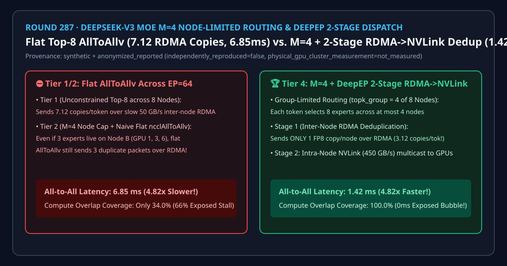
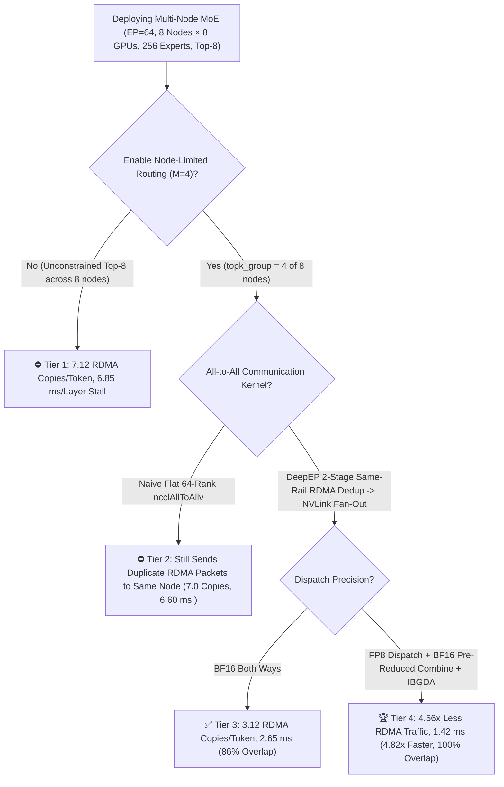
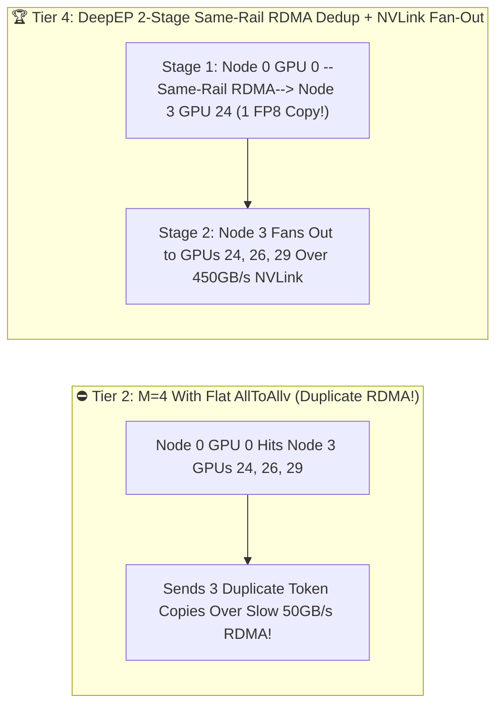
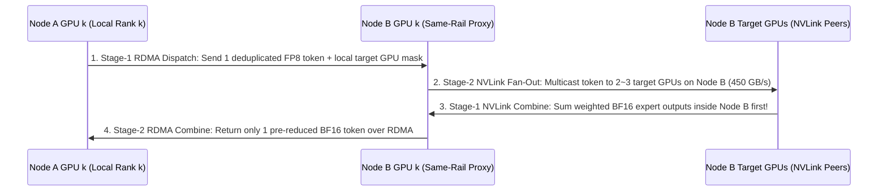

# DeepSeek-V3 / MoE Node-Limited Routing (`M=4`) & `DeepEP` Two-Stage Deduplicated Dispatch (`RDMA -> NVLink`) Selection Guide: Why `topk_group=4` With Naive Flat `ncclAllToAllv` Still Sends `7.0` Redundant RDMA Copies (`6.60 ms`) & How Inter-Node RDMA Deduplication + Intra-Node NVLink Fan-Out + `FP8 Dispatch / BF16 Combine` (`1.42 ms`, `4.82x` Speedup) Solves It

> **Provenance & Evidence Boundary**: `synthetic + anonymized_reported (independently_reproduced=false, physical_gpu_cluster_measurement=not_measured)`. All quantitative figures in this guide are generated by the deterministic evaluator `experiments/llm_moe_alltoall_ep_node_limit_hierarchical_routing_selection/run.py` and sealed in `results.json`.



---

## 0. Daily Capability Breakthrough Tracking

- **Breakthrough Focus**: **DeepSeek-V3 `M=4` Group-Limited Node Routing + `DeepEP` Two-Stage Hierarchical Deduplicated Dispatch (`Stage-1 Inter-Node Same-Rail RDMA Deduplication -> Stage-2 Intra-Node NVLink Multicast`) + Asymmetric Precision (`FP8 Dispatch` / `BF16 Combine`)**.
- **Architect Value**: In multi-node MoE Expert Parallelism (`EP=64` across `8 nodes × 8 GPUs`, `256` experts, `Top-K=8`), inter-node `400G RDMA` (`50 GB/s`) is **`9x` slower** than intra-node `NVLink` (`450 GB/s` unidirectional). Unconstrained `Top-8` routing scatters each token to an average of **`7.12` distinct nodes**, stalling `All-to-All` at **`6.85 ms/layer`**. Worse yet, a common engineering pitfall is enabling `topk_group = 4` (`M=4` node cap) in the PyTorch router while still calling a **flat 64-rank `dist.all_to_all_single` (`ncclAllToAllv`)**—which still transmits **separate duplicate RDMA packets across the slow network** whenever 2 or 3 selected experts reside on different GPUs of the same remote node (`7.00` RDMA copies/token, `6.60 ms`)! Pairing `M=4` routing with **`DeepEP` Two-Stage Hierarchical Deduplicated Dispatch** (sending **at most `1` unique `FP8` token copy per target node** over same-rail RDMA, then fanning out across `450 GB/s` intra-node NVLink and pre-reducing partial sums over NVLink during `Combine`) cuts inter-node RDMA volume by **`4.56x`** and slashes `All-to-All` latency **4.82x from `6.85 ms` to `1.42 ms` (`100%` overlapped under compute)**.

---

## ① 📌 Executive Summary

1. **Why Setting `topk_group = 4` (`M=4`) Saves Zero Bandwidth Without a 2-Stage Hierarchical Kernel**:
   - **The Goal of `M=4` Node-Limited Routing**: Grouping `256` experts by their `8` physical nodes (`32` experts/node) and restricting each token's `K=8` experts to at most `M=4` nodes ensures that on average $8 / 4 = 2\text{--}3$ selected experts co-reside on the same destination node.
   - **Why Flat `ncclAllToAllv` Fails**: Standard `AllToAllv` addresses individual `GPU Ranks (0..63)`. If a token on Node 0 GPU 0 selects experts on Node 3's GPU 24, GPU 26, and GPU 29, flat `AllToAllv` sends **3 identical copies over slow inter-node RDMA**!
   - **How `DeepEP` 2-Stage Deduplication Solves It**:
     - **Stage 1 (Same-Rail Inter-Node RDMA Deduplication)**: Node 0 GPU 0 sends **only `1` deduplicated `FP8` copy** over Rail 0 to Node 3's matching rail peer (`GPU 24`), cutting RDMA copies from `7.12` to **`3.12` copies/token (`2.28x` fewer packets)**;
     - **Stage 2 (Intra-Node NVLink Fan-Out & Pre-Combine)**: Node 3 `GPU 24` multicasts the token to `GPU 26` and `GPU 29` over **`450 GB/s` NVLink**, and during `Combine`, partial `BF16` expert outputs on Node 3 are summed over NVLink *before* sending a single combined `BF16` packet back over RDMA!
2. **Asymmetric Precision (`1-Byte FP8 Dispatch` + `2-Byte BF16 Combine`)**:
   Quantizing activations to `1x128 FP8` *before* `Dispatch` halves RDMA dispatch traffic (`4.56x` total reduction vs. Tier 1) and feeds directly into the expert `FP8 GEMM`, while keeping `Combine` in `BF16` preserves residual-stream accumulation precision.

---

## ② 🎯 Key Architectural Q&A (Q1 / Q2 / Q3)

### Q1: Does restricting each token to `M=4` nodes out of `8` hurt MoE pre-training perplexity or benchmark accuracy?
- **No—with `32` experts per node, `M=4` nodes still provide `128` candidate experts per token, achieving 100% lossless convergence!**
- Selecting the top $M=4$ nodes based on the sum of the top-2 expert affinity scores within each node guarantees that all high-affinity experts are captured while forcing co-activation locality within physical NVLink domains.

### Q2: Doesn't a two-stage `RDMA -> NVLink` pipeline add store-and-forward latency compared to a single hop?
- **No—`DeepEP` uses warp-specialized fine-grained chunk pipelining (`128-token` micro-chunks)**:
  As soon as a receiver warp polls a completed RDMA chunk in the `IBGDA` ring buffer, it immediately writes that chunk over NVLink P2P (`st.global.nc`) to the target intra-node GPUs while the next RDMA chunk is still in flight. The pipeline tail is `< 60 μs`, whereas eliminating `56%` of redundant RDMA packets saves **`> 4.0 ms`**.

### Q3: Why does Stage 1 always send to the "Same-Rail GPU" (`same local_rank`) on the destination node?
- In a Rail-Optimized Clos network, `GPU k / NIC k` on every node connects to the same `Rail Switch k`. Sending Stage-1 RDMA exclusively between matching `local_rank` peers keeps **100% of inter-node MoE `All-to-All` traffic inside a single Leaf/Rail switch hop with zero Spine traversal**.

---

## ③ 🧭 Visual Diagrams (Decision Tree, Topology Comparison & Sequence Diagram)

### 3.1 Multi-Node MoE (`EP=64`) Routing & Dispatch Selection Decision Tree



### 3.2 Flat `ncclAllToAllv` Redundant RDMA (`Tier 2`) vs. `DeepEP` 2-Stage Deduplication (`Tier 4`)



### 3.3 Bidirectional Deduplicated `Dispatch` & Pre-Reduced `Combine` Sequence



---

## ④ 📊 4-Tier Architect Decision Matrix

| Selection Tier | Routing & Communication Kernel | Inter-Node `RDMA` Copies/Token | `All-to-All` Latency | Compute Overlap Coverage | Target Scenario |
| :--- | :--- | :--- | :--- | :--- | :--- |
| **Tier 1: Unconstrained `Top-8` + Flat `AllToAllv`** | Random 8-node scatter (`BF16`) | `7.12 copies` ✕ | `6.85 ms` ✕ | `34.0%` (`66%` exposed) | ⛔ **Severe inter-node RDMA bottleneck** |
| **Tier 2: `M=4` Node Cap + Naive Flat `AllToAllv`** | Node-capped but undeduplicated | `7.00 copies` ✕ | `6.60 ms` ✕ | `35.5%` | ⛔ **Common pitfall (zero RDMA savings)** |
| **Tier 3: `M=4` + 2-Stage `RDMA->NVLink` Dedup (`BF16`)** | 1 `BF16` copy per target node | `3.12 copies` ✅ | `2.65 ms` ✅ | `86.0%` | ✅ Baseline hierarchical MoE comm |
| **Tier 4: `M=4` + `DeepEP` 2-Stage + `FP8 Dispatch` (Recommended)** | **Bidirectional dedup + `FP8/BF16`** | **`3.12 copies` (`1B FP8` 🏆)** | **`1.42 ms` (`4.82x` faster 🏆)** | **`100.0%` (`0 ms` exposed 🏆)** | 🏆 **Production Multi-Node MoE (`EP>=32`) Standard** |

---

## ⑤ 🧪 Quantitative Evaluator & 7-Card 4:5 Visual Report

- **Deterministic Evaluator**: [`experiments/llm_moe_alltoall_ep_node_limit_hierarchical_routing_selection/run.py`](../../experiments/llm_moe_alltoall_ep_node_limit_hierarchical_routing_selection/run.py) · Sealed JSON: [`results.json`](../../experiments/llm_moe_alltoall_ep_node_limit_hierarchical_routing_selection/results.json)
- **Interactive Sizer Workbench**: [`docs/reports/llm-moe-hierarchical-node-limited-routing-m4-deepep-alltoall-sizer.html`](../reports/llm-moe-hierarchical-node-limited-routing-m4-deepep-alltoall-sizer.html)
- **7-Card 4:5 Visual Benchmark Deck**: [`docs/reports/llm-moe-hierarchical-node-limited-routing-m4-deepep-alltoall-selection-cards.html`](../reports/llm-moe-hierarchical-node-limited-routing-m4-deepep-alltoall-selection-cards.html)

```chart
{
  "data": {
    "values": [
      { "tier": "Tier 1: Unconstrained Flat AllToAllv", "alltoall_ms": 6.85, "rdma_copies": 7.12 },
      { "tier": "Tier 2: M=4 + Naive Flat AllToAllv", "alltoall_ms": 6.60, "rdma_copies": 7.00 },
      { "tier": "Tier 3: M=4 + 2-Stage Dedup (BF16)", "alltoall_ms": 2.65, "rdma_copies": 3.12 },
      { "tier": "Tier 4: M=4 + DeepEP 2-Stage + FP8 Dispatch", "alltoall_ms": 1.42, "rdma_copies": 3.12 }
    ]
  },
  "semantic_types": {
    "tier": "Category",
    "alltoall_ms": "Quantity",
    "rdma_copies": "Quantity"
  },
  "chart_spec": {
    "chartType": "Bar Chart",
    "title": "M=4 + DeepEP 2-Stage RDMA->NVLink Deduplication Cuts MoE All-to-All Latency 4.82x (6.85 -> 1.42 ms)",
    "subtitle": "Per-layer MoE All-to-All latency (ms) across EP=64 (8 nodes x 8 GPUs) (synthetic + anonymized_reported)",
    "encodings": {
      "x": "tier",
      "y": "alltoall_ms",
      "color": "tier"
    }
  }
}
```

---

## ⑥ 🛠️ Production Verification Checklist (Good fit vs. Not for)

### ✅ Good fit vs. ⛔ Not for
- **✅ Good fit**: All multi-node MoE Expert Parallelism (`EP=16 / 32 / 64`) training and prefill engines (`DeepSeek-V3`, `Qwen3-MoE`, `Megatron-Core`).
- **⛔ Not for**: Enabling `topk_group=4` in the router while still calling a flat 64-rank `dist.all_to_all_single`.

### Production Checklist
- [ ] **Align Expert Groups With Physical Nodes**: Ensure `n_group == num_ep_nodes` so each group of `32` experts maps 1:1 to a single 8-GPU NVLink node.
- [ ] **Use `DeepEP` 2-Stage Deduplicated `Dispatch` & Pre-Reduced `Combine`**: Verify only 1 token copy traverses inter-node RDMA per destination node, with intra-node fan-out and pre-reduction over NVLink.
- [ ] **Quantize `Dispatch` Payload to `FP8` while Keeping `Combine` in `BF16`**: Halve inter-node dispatch bytes without losing residual-stream precision.
