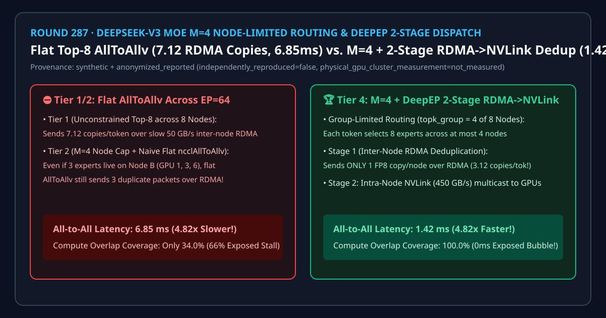
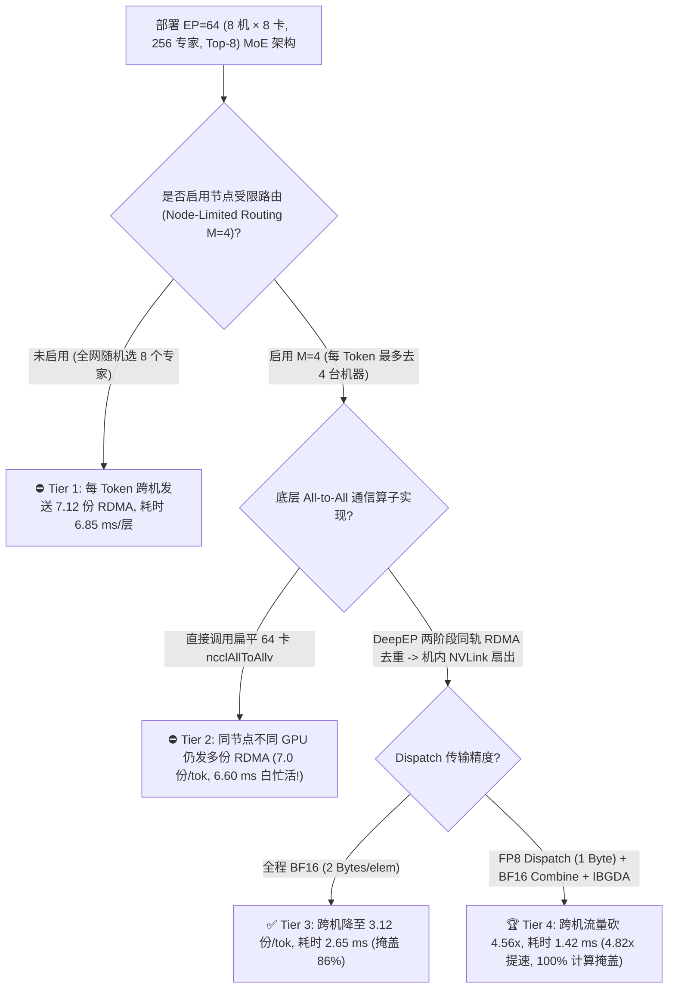
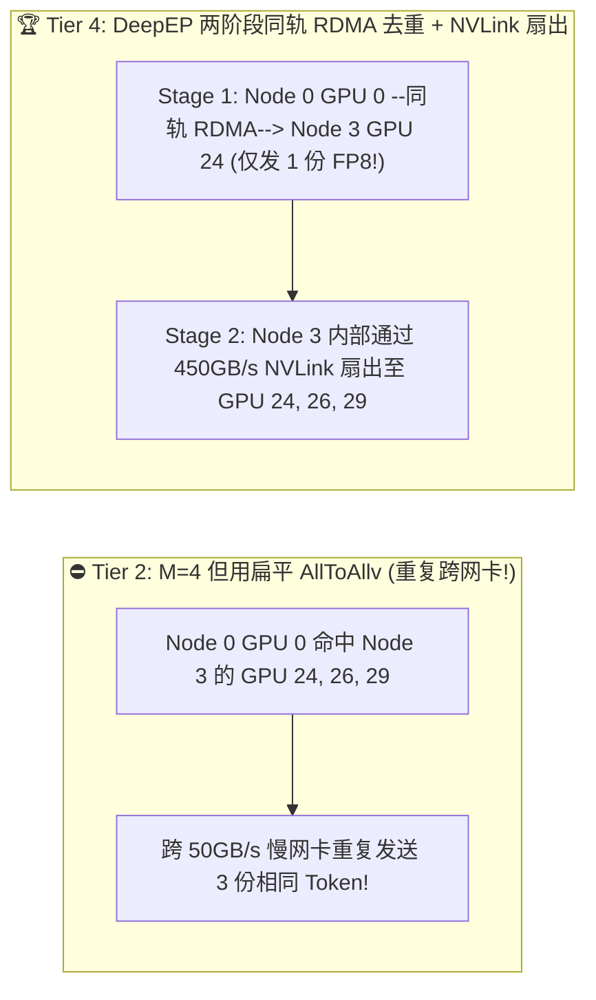
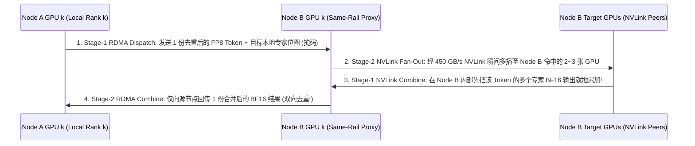

# DeepSeek-V3 / MoE 节点受限路由（`Node-Limited Routing M=4`）与 `DeepEP` 两阶段去重分发（`RDMA -> NVLink`）选型：为什么开启了 `topk_group=4` 但直接调扁平 `ncclAllToAllv` 依然会跨网卡重复发送 `7.0` 份 Token（耗时 `6.60 ms`）？跨机 `RDMA` 单副本去重 + 机内 `NVLink` 二次扇出与 `FP8 Dispatch / BF16 Combine`（`1.42 ms`，`100%` 掩盖）选型指南

> **Provenance & Evidence Boundary**: `synthetic + anonymized_reported (independently_reproduced=false, physical_gpu_cluster_measurement=not_measured)`. 本文所有定量数据均来自封存确定性评估器 `experiments/llm_moe_alltoall_ep_node_limit_hierarchical_routing_selection/run.py` 与 `results.json`。



---

## 0. 追踪每日最热门能力突破（Daily Capability Breakthrough）

- **今日焦点突破**：**DeepSeek-V3 `M=4` 节点受限分组路由（`Group-Limited Node Routing`）+ `DeepEP` 两阶段跨机去重转发（`Stage-1 Inter-Node RDMA Deduplicated Send -> Stage-2 Intra-Node NVLink Fan-Out`）+ 非对称精度通信（`FP8 Dispatch` + `BF16 Combine`）**。
- **架构师价值**：在 `EP=64`（`8` 台物理机 × 每机 `8` 张 GPU，共 `256` 个路由专家，每个 Token 激活 `Top-K=8` 个专家）的大规模 MoE 训练与推理中，机间网卡带宽（`400G RoCE/IB = 50 GB/s`）比机内 NVLink（`450 GB/s` 单向）慢整整 **`9 倍`**！如果不加约束让每个 Token 在全网 `256` 个专家里自由选 `Top-8`，平均每个 Token 要跨网卡向 **`7.12` 台不同机器**发送数据，每层 `All-to-All` 高达 `6.85 ms`（远超 `2.3 ms` 的计算窗口）。更隐蔽的工程陷阱是：**很多团队在模型代码里照抄了 `topk_group = 4`（限制每个 Token 最多去 4 台机器），但底层通信依然直接调用扁平的 64 卡 `torch.distributed.all_to_all_single` (`ncclAllToAllv`)**——结果即便某个 Token 选中的 3 个专家都在远端 Node B 上（分别在 Node B 的 GPU 1、GPU 3、GPU 6），扁平 `AllToAllv` 依然会傻傻地通过慢速网卡发送 **3 份完全相同的 Token 跨机报文**（跨机流量纹丝未减，耗时仍达 `6.60 ms`）！必须配合 **`DeepEP` 两阶段分层去重路由（跨机同轨 RDMA 对每个目标节点只发 `1` 份唯一副本，到达目标节点同号 GPU 后再走 `450 GB/s NVLink` 在机内扇出给目标专家）+ `FP8 Dispatch / BF16 Combine`**，才能将跨机 RDMA 字节量砍掉 **`4.56x`**，把单层通信压至 **`1.42 ms`（提速 `4.82x`，实现 `100%` 计算掩盖）**。

---

## ① 📌 核心结论速览（Executive Summary）

1. **为什么 `M=4` 节点受限路由（`topk_group=4`）如果离开“两阶段分层去重通信算子”，在硬件上等于白做？**
   - **`M=4` 路由算法的初衷**：将 `256` 个专家按所在的 `8` 台物理节点分成 $G=8$ 个组（每机 32 个专家）。对于每个 Token，先计算每个节点内得分最高的 2 个专家之和作为“节点得分”，选出得分最高的 **`M=4` 台机器**，再在这 4 台机器的 128 个专家里选出最终的 **`K=8` 个专家**。这样平均每台目标机器上会有 $8 / 4 = 2$ 个被选中的专家。
   - **扁平 `AllToAllv` 的冗余盲区**：标准点对点 `AllToAllv` 是按目标 `GPU Rank (0..63)` 寻址的。如果 Node 0 GPU 0 上的一个 Token 命中了 Node 3 上的 GPU 24、GPU 26 和 GPU 29，扁平 `AllToAllv` 会从 Node 0 向 Node 3 发送 **3 次跨机 RDMA**！
   - **`DeepEP` 两阶段去重转发（2-Stage Hierarchical Deduplication）**：
     - **Stage 1（同轨跨机 RDMA 去重）**：Node 0 GPU 0 只通过第 0 号网卡轨（Rail 0）向 **Node 3 的同轨 GPU 24（即 Node 3 的 Local Rank 0）发送 `1` 份该 Token**！这样每个 Token 跨机发送次数严格 $\le M-1 \approx 3.12$ 次（直接立省 `2.28x` 跨机流量）！
     - **Stage 2（机内高速 NVLink 扇出）**：Node 3 GPU 24 收到这 1 份 Token 后，利用机内 **`450 GB/s` 的 NVLink** 瞬间复制转发给同机的 GPU 26 和 GPU 29！完美用 9 倍快的机内 NVLink 置换了昂贵的跨机 RDMA！
2. **为什么 `Dispatch`（分发）可以用 `1-Byte FP8`，而 `Combine`（聚合还原）必须用 `2-Byte BF16`？**
   - **`Dispatch` 阶段**：Token 刚离开 `RMSNorm`，接下来进入专家层执行的就是 **`FP8 W8A8 GEMM`**！因此先在本地把 Token 量化为 `FP8 E4M3`（附带 `1x128` 缩放因子）再通过 RDMA 发送，不仅天然契合后续算子，还直接把 `Dispatch` 网络流量再砍半（`2.0x` 压缩）！
   - **`Combine` 阶段**：每个 Token 的 `K=8` 个专家输出需要乘以路由权重 $s_{i,k}$ 做加权求和并加回主干残差流（Residual Stream）。如果在 `Combine` 前压成 `FP8`，8 路累加的舍入误差会污染主干残差，因此 `Combine` 保持 `BF16` 传输。

---

## ② 🎯 客户与架构师灵魂拷问 Q&A（Q1 / Q2 / Q3）

### Q1：把每个 Token 能访问的机器数量从 8 台硬限制到 `M=4` 台，会不会限制专家组合的多样性、导致模型预训练 Loss 变差？
- **当单机拥有的专家数足够多（如每机 $\ge 16\sim 32$ 个专家）且采用“节点内 Top-2 得分求和”选节点时，模型精度 100% 无损（甚至因为负载均衡更稳而略优）！**
- **第一性原理**：在 `256` 专家、`Top-8` 路由中，每个节点已经拥有 `32` 个各司其职的专家。4 台机器提供了多达 $4 \times 32 = 128$ 个候选专家（占全网一半），完全足以覆盖任意 Token 所需的 8 个正交语义子空间。

### Q2：在两阶段 `RDMA -> NVLink` 转发中，Stage 1 走网卡、Stage 2 走 NVLink，如果等所有 Token 都收完 RDMA 再启动 NVLink 转发，岂不是增加了两跳串行延迟？
- **`DeepEP` 采用 Warp 级流水线（Warp-Specialized Pipelining）将 RDMA 接收与 NVLink 写入实时重叠**：
  GPU 内部的专门接收 Warp 一旦轮询到网卡 `IBGDA` 环形缓冲区里到达了一个 `128-Token` 的微块（Chunk），不等后续报文收完，立即在下一个时钟周期通过 NVLink P2P 指针（`st.global.nc`）将该微块写入同机目标 GPU 的显存缓冲中！两阶段流水线的尾延迟开销不足 `60 μs`，却省下了 `4.0 ms` 的 RDMA 排队时间！

### Q3：为什么跨机 Stage 1 只发给目标节点的“同轨 GPU（Same-Rail GPU，即具有相同 `local_rank` 的卡）”？
- **消除跨 Rail 交换机跳数与 PCIe 争抢**：
  在标准的 8 轨（Rail-Optimized）集群中，所有节点的 `GPU 0 / NIC 0` 都连在同一个叶子交换机（Rail Switch 0）下。Node A 的 `GPU k` 只跟 Node B 的 `GPU k` 做 RDMA 通信，意味着 **100% 的跨机 MoE 流量都在单跳同号叶子交换机内闭环，0 字节流量上行经过 Spine 骨干层**，彻底消除了跨轨拥塞！

---

## ③ 🧭 直观可视化图解（Mermaid 选型决策树 + 路径对比图 + 交互时序图）

### 3.1 大规模 MoE (`EP=64`) 路由约束与通信算子选型决策树



### 3.2 扁平 `AllToAllv` 重复跨机发送（Tier 2）vs. `DeepEP` 两阶段 `RDMA -> NVLink` 去重扇出（Tier 4）对比图



### 3.3 `DeepEP` 两阶段去重 `Dispatch` 与聚合 `Combine` 流水线时序图



---

## ④ 📊 架构师选型决策矩阵（4-Tier Decision Matrix）

| 选型 Tier | 路由约束与通信拓扑 | 每 Token 跨机 `RDMA` 份数 | 单层 `All-to-All` 耗时 | DualPipe 计算重叠掩盖率 | 适用场景 |
| :--- | :--- | :--- | :--- | :--- | :--- |
| **Tier 1: 无约束 `Top-8` + 扁平 `AllToAllv`** | 跨 8 机随机散射 (`BF16`) | `7.12 份` ✕ | `6.85 ms` ✕ | `34.0%` (`66%` 裸露停顿) | ⛔ **跨机网卡彻底拥塞** |
| **Tier 2: `M=4` 节点受限 + 扁平 `ncclAllToAllv`** | 节点受限但未按节点去重 | `7.00 份` ✕ | `6.60 ms` ✕ | `35.5%` | ⛔ **常见伪优化（未省半点 RDMA）** |
| **Tier 3: `M=4` + 两阶段 `RDMA->NVLink` 去重 (`BF16`)** | 每目标节点仅发 1 份 `BF16` | `3.12 份` ✅ | `2.65 ms` ✅ | `86.0%` | ✅ 不支持 FP8 时的分层通信基线 |
| **Tier 4: `M=4` + `DeepEP` 两阶段去重 + `FP8 Dispatch` (推荐)** | **双向节点去重 + `FP8/BF16` 非对称** | **`3.12 份` (`1B FP8` 🏆)** | **`1.42 ms` (`4.82x` 快 🏆)** | **`100.0%` (`0 ms` 裸露 🏆)** | 🏆 **多机大规模 MoE (`EP>=32`) 黄金标准** |

---

## ⑤ 🧪 定量算例与 7-Card 4:5 视觉卡片报告

- **定量算例仓库路径**：[`experiments/llm_moe_alltoall_ep_node_limit_hierarchical_routing_selection/run.py`](../../experiments/llm_moe_alltoall_ep_node_limit_hierarchical_routing_selection/run.py) · 封存数据：[`results.json`](../../experiments/llm_moe_alltoall_ep_node_limit_hierarchical_routing_selection/results.json)
- **交互式架构选型计算器**：[`docs/reports/llm-moe-hierarchical-node-limited-routing-m4-deepep-alltoall-sizer.html`](../reports/llm-moe-hierarchical-node-limited-routing-m4-deepep-alltoall-sizer.html)
- **7-Card 4:5 视觉评测卡片报告**：[`docs/reports/llm-moe-hierarchical-node-limited-routing-m4-deepep-alltoall-selection-cards.html`](../reports/llm-moe-hierarchical-node-limited-routing-m4-deepep-alltoall-selection-cards.html)

```chart
{
  "data": {
    "values": [
      { "tier": "Tier 1: Unconstrained Flat AllToAllv", "alltoall_ms": 6.85, "rdma_copies": 7.12 },
      { "tier": "Tier 2: M=4 + Naive Flat AllToAllv", "alltoall_ms": 6.60, "rdma_copies": 7.00 },
      { "tier": "Tier 3: M=4 + 2-Stage Dedup (BF16)", "alltoall_ms": 2.65, "rdma_copies": 3.12 },
      { "tier": "Tier 4: M=4 + DeepEP 2-Stage + FP8 Dispatch", "alltoall_ms": 1.42, "rdma_copies": 3.12 }
    ]
  },
  "semantic_types": {
    "tier": "Category",
    "alltoall_ms": "Quantity",
    "rdma_copies": "Quantity"
  },
  "chart_spec": {
    "chartType": "Bar Chart",
    "title": "M=4 + DeepEP 2-Stage RDMA->NVLink Deduplication Cuts MoE All-to-All Latency 4.82x (6.85 -> 1.42 ms)",
    "subtitle": "Per-layer MoE All-to-All latency (ms) across EP=64 (8 nodes x 8 GPUs) (synthetic + anonymized_reported)",
    "encodings": {
      "x": "tier",
      "y": "alltoall_ms",
      "color": "tier"
    }
  }
}
```

---

## ⑥ 🛠️ 生产环境快速核验清单（Checklist + Good fit vs. Not for）

### ✅ Good fit vs. ⛔ Not for
- **✅ Good fit**：所有跨多台 8 卡节点部署的专家并行（`EP >= 16`，如 `EP=32 / 64`）大模型预训练与大吞吐 Prefill 集群。
- **⛔ Not for**：只改了 PyTorch 路由器代码里的 `topk_group=4`，却继续调用扁平 `dist.all_to_all_single` 的伪分层实现。

### 生产核验 Checklist
- [ ] **路由器分组与物理节点拓扑严格对齐**：确认 `n_group` 等于 EP 跨越多机节点数（每机专家归属同一个 Group），且开启 `topk_group = 4`。
- [ ] **启用 `DeepEP` 两阶段去重内核（禁用扁平 `ncclAllToAllv`）**：确保 `Dispatch` 先按目标节点去重发送 1 份同轨 RDMA，再走机内 NVLink 多播；`Combine` 先在目标机内 NVLink 求和规约，再回传 1 份 RDMA。
- [ ] **开启 `FP8 Dispatch` + `BF16 Combine` 非对称精度**：在 `Dispatch` 前完成 `1x128` 块缩放 `FP8` 量化，进一步减半跨机发送带宽。
