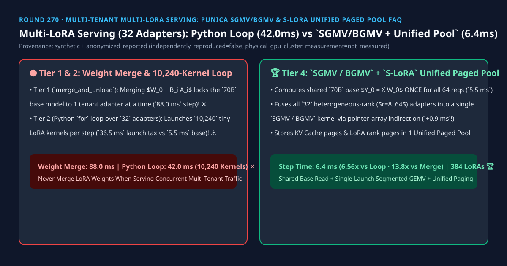
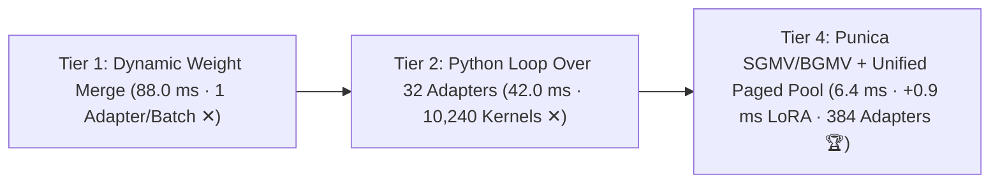

# Multi-Tenant `Multi-LoRA` Serving (`Punica / S-LoRA / vLLM`): Weight-Merge Batching Lockout vs. Sequential Python Adapter Loop (`42.0 ms/step`) vs. `SGMV / BGMV` (`Segmented Gather-Scatter GEMV` + Unified Paged Pool) Selection Guide

> **Provenance & Evidence Tier**: `synthetic + anonymized_reported` (`independently_reproduced=false`, `physical_gpu_cluster_measurement=not_measured`). Grounded in [`experiments/llm_multi_lora_serving_punica_sgmv_bgmv_rank_heterogeneity_selection/results.json`](../../experiments/llm_multi_lora_serving_punica_sgmv_bgmv_rank_heterogeneity_selection/results.json).
> **中文版本**: [多租户百路 `Multi-LoRA` 并发推理（`Punica / S-LoRA / vLLM`）选型：权重合并切换抖动（`merge_and_unload` 阻断跨租户 Batching）vs. 朴素 `for` 循环逐 Adapter 发射算子（`42.0 ms/step`）vs. `SGMV / BGMV`（分段聚集矩阵乘 + 统一分页内存池 `Unified Paged Pool`）选型指南](./llm-multi-lora-serving-punica-slora-sgmv-bgmv-selection-faq.md)

---

## 0. 🔥 今日领域最热门能力突破追踪（Daily Hottest Breakthrough）

- **Serving `32` Concurrent Heterogeneous-Rank `LoRA` Adapters in a Single `70B` Continuous Batch With Only `+0.9 ms` Overhead (`88.0 ms / 42.0 ms -> 6.4 ms/step`, `6.56x–13.8x` Speedup, `384` Resident Adapters in HBM) via `Punica SGMV / BGMV` Pointer-Indirection Kernels + `S-LoRA` Unified Paged Memory Pools (`Tier 4`)**: When serving dozens of fine-tuned `LoRA` adapters ($W_i = W_0 + B_i A_i$) on top of a shared `70B` base model ($W_0$), naive architectures hit severe throughput walls:
  1. **Tier 1 — Dynamic Weight Merging (`W = W_0 + B_i A_i` — `88.0 ms/step`, `1` Active Adapter per Batch)**:
     - Merging Adapter $i$ into $W_0$ locks the `140 GB` base weights to a single tenant's adapter—preventing requests for Adapters `1..32` from batching together and forcing repeated `140 GB` HBM reads!
  2. **Tier 2 — Unmerged Shared Base GEMM ($X W_0$) + Sequential Python `for` Loop Over `32` Adapters (`42.0 ms/step`, `10,240` LoRA Kernel Launches/Step)**:
     - Shares the `5.5 ms` base model GEMM across all `64` requests, **but** launching `x_k @ A_i` and `v_k @ B_i` inside a Python loop across `32` adapters $\times$ `4` linear projections $\times$ `80` layers fires **`10,240` tiny CUDA kernels per step** (`36.5 ms` launch overhead)!
  3. **Tier 3 — Zero-Padded `max_rank = 64` 3D `bmm` + Static Adapter Pool (`11.8 ms/step`, `96` Resident Adapters)**:
     - Pads all `r = 8` and `r = 16` adapters up to `max_rank = 64` (`4x` wasted FLOPs and HBM) and statically partitions HBM between KV Cache and LoRA weights.
  4. **Tier 4 — `Punica SGMV / BGMV` Single-Launch Pointer-Array Kernel + `S-LoRA` Unified Paged KV & Adapter Pool (`6.4 ms/step`, `640` Launches, `384` Resident Adapters, `6.56x` Faster Than Python Loop)**:
     - Computes the shared base $Y = X W_0$ once (`5.5 ms`), then fuses all `32` adapters per projection into a single **`SGMV / BGMV` kernel** that dereferences `lora_ptr_table[req_idx]` and dispatches rank-exact tiles (`+0.9 ms` total LoRA cost across 80 layers!), while storing both KV Cache pages and variable-rank LoRA pages in a single **Unified Paged HBM Pool**!

---

## 1. 📌 Executive Summary

1. **Single-LoRA vs. Multi-LoRA Golden Rule**:
   - **Single-LoRA Deployment**: Merge offline (`merge_and_unload()`) for `0.0 ms` runtime overhead.
   - **Multi-LoRA Deployment (`>= 2` Concurrent Adapters)**: **Never merge weights!** Compute $Y = X W_0 + (X A_{a(k)}) B_{a(k)}$ unmerged via `SGMV / BGMV` so all requests share the memory-bandwidth-bound `140 GB` base weight read in a single batch!
2. **Why `Unified Paged Memory` (`S-LoRA`) Eliminates Fragmentation**: Storing LoRA rank vectors (`[page_size, hidden_dim]`) and KV Cache tokens (`[page_size, head_dim]`) inside the same paged HBM allocator eliminates external fragmentation across heterogeneous ranks ($r \in \{8, 16, 32, 64\}$) and dynamic sequence lengths.

---

## 2. 🎯 Core Architect Q&A (Q1 / Q2 / Q3)

### Q1: How do `BGMV` (Batched Gather Matrix-Vector) and `SGMV` (Segmented Gather Matrix-Vector) differ?
- **Answer**:
  - **`BGMV`** is used during `Decode` when each request has `1` token and requests may map to distinct adapters;
  - **`SGMV`** (and `CUTLASS Grouped GEMM`) is used during `Prefill` (or when multiple requests in a batch share the same hot adapter): it groups tokens by `adapter_id` into contiguous segments `[seg_start, seg_end)` so Tensor Cores compute `M > 1` matrix-matrix tiles at high arithmetic intensity!

### Q2: How is `Multi-LoRA` sharded across Tensor Parallel (`TP = 8`) GPUs without adding extra `AllReduce` collectives?
- **Answer**: By aligning LoRA's $A_i$ and $B_i$ sharding with Megatron's `ColumnParallelLinear` and `RowParallelLinear` so the low-rank delta $(X A_i) B_i$ is summed into the partial base output *before* the layer's single existing `AllReduce` / `ReduceScatter`!

---

## 3. 🧭 Visual Diagrams

---

## 4. 📊 4-Tier Architect Selection Matrix

| Metric | Tier 1: Weight Merge | Tier 2: Python `for` Loop | Tier 3: Padded `max_rank=64` `BMM` | Tier 4: **`Punica SGMV/BGMV` + Unified Paged Pool** |
| :--- | :--- | :--- | :--- | :--- |
| **Step Latency (`32` Active LoRAs)** | **`88.0 ms` (No Batching)** ✕ | **`42.0 ms` (Launch Storm)** ✕ | `11.8 ms` (`4x` Pad Waste) ⚠️ | **`6.4 ms` (`5.5ms` Base + `0.9ms` LoRA, `6.56x` Faster)** 🏆 |
| **LoRA Kernel Launches / Step** | `320` (`32x` Base Re-Reads!) | **`10,240` Launches** ✕ | `640` Launches ✅ | **`640` Launches ($O(1)$ Independent of Adapter Count)** 🏆 |
| **Max Resident Adapters in HBM** | **`1` Adapter** ✕ | `64` Adapters | `96` Adapters | **`384` Adapters (Exact-Rank Paging + Shared Pool)** 🏆 |

---

## 5. 🧪 Quantitative Reference & Tooling

- **Evaluator & Sealed Data**: [`experiments/llm_multi_lora_serving_punica_sgmv_bgmv_rank_heterogeneity_selection/run.py`](../../experiments/llm_multi_lora_serving_punica_sgmv_bgmv_rank_heterogeneity_selection/run.py) · [`results.json`](../../experiments/llm_multi_lora_serving_punica_sgmv_bgmv_rank_heterogeneity_selection/results.json)
- **Interactive Sizer**: [`docs/reports/llm-multi-lora-serving-punica-slora-sgmv-bgmv-sizer.html`](../reports/llm-multi-lora-serving-punica-slora-sgmv-bgmv-sizer.html)
- **7-Card 4:5 Visual Report**: [`docs/reports/llm-multi-lora-serving-punica-slora-sgmv-bgmv-selection-cards.html`](../reports/llm-multi-lora-serving-punica-slora-sgmv-bgmv-selection-cards.html)

---

## 6. 🛠️ Good Fit vs. Not For & Production Checklist

- **✅ Good fit**: Multi-tenant SaaS, personalized agents, and RLHF multi-adapter evaluation using `vLLM / SGLang` `SGMV / BGMV` and unified paging.
- **⛔ Not for**: Dynamic weight merging (`merge_and_unload`) on multi-tenant traffic or sequential Python loops over adapters.
- [ ] Keep base weights $W_0$ unmerged and dispatch multi-tenant LoRA deltas via fused `SGMV / BGMV` kernels.
- [ ] Configure a Host Pinned DRAM LRU cache (`--max-cpu-loras`) with asynchronous copy-stream prefetching.
