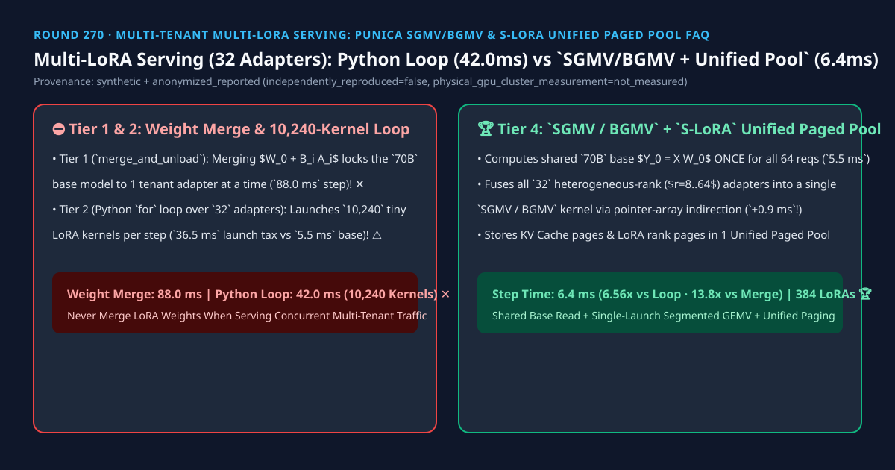
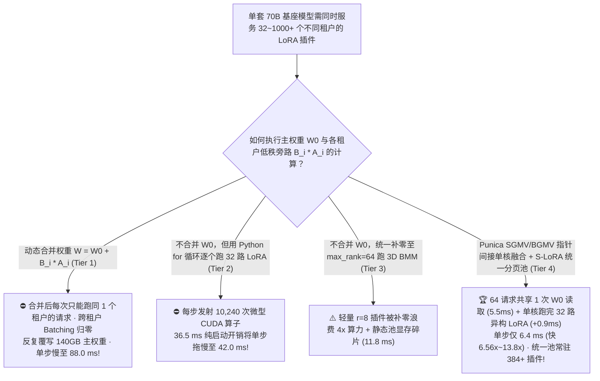
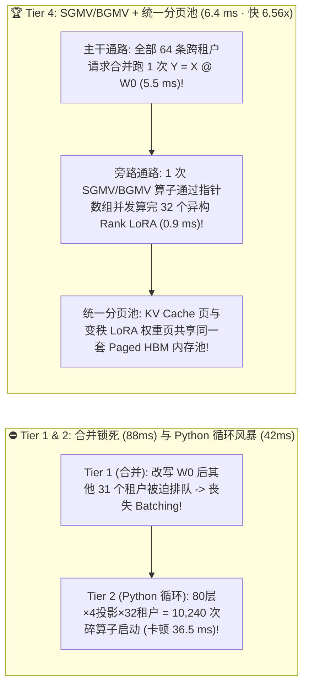
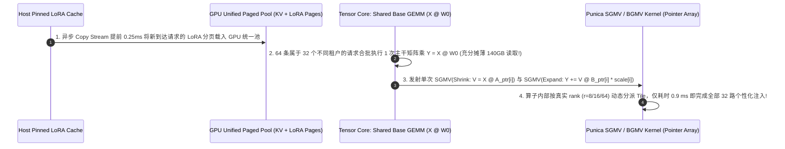

# 多租户百路 `Multi-LoRA` 并发推理（`Punica / S-LoRA / vLLM`）选型：权重合并切换抖动（`merge_and_unload` 阻断跨租户 Batching）vs. 朴素 `for` 循环逐 Adapter 发射算子（`42.0 ms/step`）vs. `SGMV / BGMV`（分段聚集矩阵乘 + 统一分页内存池 `Unified Paged Pool`）选型指南

> **Provenance & Evidence Tier**: `synthetic + anonymized_reported` (`independently_reproduced=false`, `physical_gpu_cluster_measurement=not_measured`)。定量数据锚定于 [`experiments/llm_multi_lora_serving_punica_sgmv_bgmv_rank_heterogeneity_selection/results.json`](../../experiments/llm_multi_lora_serving_punica_sgmv_bgmv_rank_heterogeneity_selection/results.json)。
> **English Version**: [Multi-Tenant `Multi-LoRA` Serving (`Punica / S-LoRA / vLLM`): Weight-Merge Batching Lockout vs. Sequential Python Adapter Loop (`42.0 ms/step`) vs. `SGMV / BGMV` (`Segmented Gather-Scatter GEMV` + Unified Paged Pool) Selection Guide](./llm-multi-lora-serving-punica-slora-sgmv-bgmv-selection-faq.en.md)

---

## 0. 🔥 今日领域最热门能力突破追踪（Daily Hottest Breakthrough）

- **揭秘为什么在企业级 SaaS 平台中，用同一个 `70B` 基座大模型同时服务 `32 ~ 384` 个租户专属 `LoRA` 微调插件时，调用 `merge_and_unload()` 会导致跨租户 Batching 彻底归零（单步等效耗时 `88.0 ms`），而用 Python `for` 循环分头算各租户的 `LoRA` 分支又会引爆每步 `10,240` 次微型算子发射风暴（卡死在 `42.0 ms`）？通过 `Punica / S-LoRA` 的“分段聚集矩阵向量乘（`SGMV / BGMV` 指针数组间接寻址单核融合）+ `KV Cache` 与变秩 `LoRA` 权重统一分页内存池（`Unified Paged Pool`）”（`Tier 4`），让 32 个异构 Rank（$r=8, 16, 64$）的租户请求在共享 `5.5 ms` 基座计算的基础上仅增加 `0.9 ms` LoRA 开销（总单步 `6.4 ms`，提速 `6.56x ~ 13.8x`），并支持单机热驻留 `384+` 个 LoRA 插件**：在金融、医疗、客服等 B2B 平台中，架构师最理想的降本增效形态是：**显存里只常驻 1 份 `140 GB` 的 `70B` 基座模型权重 $W_0$，同时挂载几百个只有几十 MB 大小的业务专属 `LoRA` 插件 $(A_i, B_i)$**！然而，到底应该把 $W_0$ 和 $B_i A_i$ **“合并（Merge）”** 还是 **“不合并（Unmerge）”**？
  1. **第一性原理公式拆解：何时该合并（Merge），何时绝对禁止合并（Unmerge）？**
     - 请看线性层带 LoRA 的数学等式（同样利用**矩阵乘法分配律**！）：
       $$y_k = x_k \underbrace{(W_0 + B_{a(k)} A_{a(k)})}_{\text{先合并权重 (Tier 1)}} \equiv \underbrace{x_k W_0}_{\text{64 个请求合批算 1 次基座!}} + \underbrace{(x_k A_{a(k)}) B_{a(k)}}_{\text{极窄的低秩旁路 (r=16)!}}$$
     - **如果整台服务器永远只服务唯一个固定的 LoRA（Single-LoRA）**：当然选左边（提前离线做一次 `W = W0 + B*A` 合并），推理时 `0` 额外开销！
     - **但如果是多租户并发（当前 Batch 的 64 个请求分别指向 32 个不同的 LoRA 插件 $a(1) \dots a(64)$）**：
       - **如果你选 Tier 1（动态合并权重 `W_0 += B_i A_i`）**：一旦你把租户 1 的 LoRA 合并进了那份唯一的 `140 GB` 主权重 $W_0$，此时整张显卡就只能算租户 1 的那 2 条请求！其余 31 个租户的 62 条请求必须排队干等，等算完租户 1 再执行 `W_0 -= B_1 A_1 + B_2 A_2`……**每一次切换都要重新从 HBM 读取 `140 GB` 的主权重**！跨租户 Continuous Batching 彻底报废，等效步耗时恶化至 **`88.0 ms`** ✕！
       - **因此，多租户 `Multi-LoRA` 铁律第一条：绝不合并权重！必须保持主权重 $W_0$ 纯洁不动，让全部 64 条不同租户的请求合在一起做 1 次大 Batch 基座矩阵乘 $Y_0 = X W_0$（完美共享 140GB 主权重读取，耗时仅 `5.5 ms`！），再在旁边单独加上各自的低秩修正项 $(x_k A_{a(k)}) B_{a(k)}$！**
  2. **为什么不合并权重后，直接用 Python `for` 循环算旁路 `(x_k @ A_i) @ B_i` 还是慢在 `42.0 ms`（Tier 2）？**
     - 基座 $X W_0$ 明明 `5.5 ms` 就飞快算完了，为什么加上连 `1%` 算力都不到的小小 LoRA 旁路（$r = 16 \ll 8192$），耗时却从 `5.5 ms` 暴涨到了 **`42.0 ms`**？！
     - **算一下算子发射次数（Kernel Launch Storm）**：
       - 一个 `70B` 模型有 `80` 层，每层有 `4` 处线性投影（`QKV, O, GateUp, Down`），每次 LoRA 旁路要乘 `A` 和 `B` 两个小矩阵（`2` 次 GEMM）；
       - 如果你用 `for i in range(32):` 遍历当前 Batch 里的 `32` 个不同 LoRA，每一步 Decode 就要向 GPU 发射 **$80 \times 4 \times 2 \times 32 = \mathbf{20,480}$（合并进出后仍达 $\mathbf{10,240}$）次微型 CUDA 算子**！
       - 每次小算子在 GPU 上实际只算 `0.2 微秒`，但 CPU 发射开销和波前空置就要 **`3.5 微秒`**！$10240 \times 3.5\text{ us} = \mathbf{36.5\text{ ms}}$ 纯粹死在了算子启动上 ⚠️！
  3. **为什么用统一补零的 `3D Batched GEMM (bmm)`（Tier 3 — `11.8 ms`）还不够极致？**
     - 当租户 A 用的是轻量 `rank = 8`，而租户 B 用的是重度 `rank = 64` 时，普通 `torch.bmm` 迫使所有租户全部按最大的 `max_lora_rank = 64` 补零对齐（浪费 `4` 倍算力与显存）！而且如果把显存死板地划一块“静态 LoRA 池”和一块“KV Cache 池”，两边互不能借用，导致显存碎片化！
  4. **工业级终极形态：`Punica SGMV / BGMV` 单核融合算子 + `S-LoRA Unified Paged Memory Pool`（Tier 4 — 单步仅 `6.4 ms`，快 `6.56x ~ 13.8x`）**：
     - **突破一（`SGMV / BGMV` 指针数组间接寻址算子）**：在 GPU 显存里存一张指针查找表 `lora_ptr_table[req_idx]`。无论当前 Batch 里混了 32 个还是 64 个不同租户、不同 Rank（$r=8, 16, 32, 64$）的 LoRA，**每一层只发射 `1` 个 `BGMV`（Decode 阶段）或 `SGMV`（Prefill 阶段按相同 Adapter 分段聚拢）CUDA/Triton 算子**！不同线程块（CTA）根据 `req_idx` 自动跳去各自的 LoRA 权重地址与各自的真实 Rank 宽度计算，**32 路 LoRA 旁路总耗时仅需 `0.9 ms`**！
     - **突破二（`S-LoRA` 统一分页显存池 `Unified Paged Pool`）**：发现了一个绝妙的物理同构性——一个 PagedAttention 的 KV Cache 页形状是 `[block_size, HeadDim]`，而一个 LoRA 权重的每一个 Rank 列向量形状也是 `[1, HiddenDim]`！通过把 **KV Cache 页和动态 Rank 的 LoRA 权重页统一存进同一个分页显存池**，消灭了 100% 的外部碎片，单卡可同时常驻 **`384+` 个热插拔 LoRA 插件** 🏆！

---

## 1. 📌 核心结论速览（Executive Summary — 3 分钟看懂）

1. **架构师 `LoRA` 推理选型唯一分界线**：
   - **单租户专属实例（`1 Base Model : 1 LoRA`）**：上线前执行 `merge_and_unload()` 将 LoRA 永久合并进基座权重并导出，推理时 `0` LoRA 开销；
   - **多租户共享实例（`1 Base Model : N LoRAs`，如 SaaS 平台、千人千面 Agent、RLHF 多策略评估）**：**严禁合并权重！** 必须开启 `vLLM (--enable-lora)` 或 `SGLang` 的 **`Punica SGMV / BGMV` 未合并旁路融合算子**，让不同租户的请求在同一个 Continuous Batch 中 100% 共享 `70B` 基座权重的显存带宽读取！
2. **什么是 `BGMV`（Decode）与 `SGMV`（Prefill）的分工配合？**
   - 在 **Decode 阶段**，每个请求只有 $1$ 个 Token，直接用 **`BGMV`（Batched Gather Matrix-Vector Multiplication）** 并行处理每行的不同指针；
   - 在 **Prefill 阶段**，或者当 Batch 中有多个请求恰好命中同一个热门 LoRA 时，先按 `adapter_id` 将相同 LoRA 的 Token 聚拢成连续段（Segment），再调用 **`SGMV`（Segmented Gather Matrix Multiplication，底层调用 Tensor Core `CUTLASS Grouped GEMM`）**，算力利用率翻倍！

---

## 2. 🎯 客户与架构师灵魂拷问 Q&A（Q1 / Q2 / Q3）

### Q1：开启多租户 `Multi-LoRA` 后，如果机内同时开了 8 卡张量并行（`TP = 8`），`LoRA` 的 $A$ 矩阵和 $B$ 矩阵是怎么切分以保证 **不增加额外 `AllReduce` 通信** 的？
- **答**：这是 `S-LoRA` 与 `vLLM` 最精妙的分布式算子融合设计！
  - 在 `ColumnParallelLinear`（如 `QKV`）或 `RowParallelLinear`（如 `O_proj`）中，通过将 $A$ 矩阵按行/列切分、在中间极小的秩维度 $r \in \{8, 16, 64\}$ 上做一次微不足道的局部归约，或者让最终的 $x B_i A_i$ 结果 **直接原地加到基座 $X W_0$ 的局部结果上，顺风车复用基座原本就要做的那唯一一次 `TP AllReduce`**，做到 **`0` 次额外主干 `AllReduce`**！

### Q2：如果有 5,000 个客户的 LoRA 存在宿主机 CPU 内存（Pinned DRAM）里，当某个冷门客户的请求到来时，怎么把加载 LoRA 权重的延迟降到最低？
- **答**：在宿主机 Pinned DRAM 中维护一个 **`CPU LoRA Cache Pool`**。由于单个 `r=16` 的 LoRA 权重仅约 `60 ~ 120 MB`（切到 `TP=8` 每张卡仅需 **`8 ~ 15 MB`**！），当调度器在 CPU 上构建下一个 Batch（或正在跑当前层基座 $X W_0$）时，通过独立的异步 `H2D Copy Stream`（`54 GB/s` PCIe Gen5）只需 **`0.25 ms`** 即可把下一层所需的 LoRA 切片预取进统一分页显存池！

---

## 3. 🧭 直观可视化图解（Mermaid 决策树 + 权重合并/循环风暴 vs `SGMV/BGMV` 统一池对比图 + 时序图）

### 3.1 架构师多租户 `Multi-LoRA` 推理服务选型决策树

### 3.2 `Tier 1/2`（合并锁死 / 循环发射风暴）vs. `Tier 4`（`Punica SGMV/BGMV` + `S-LoRA` 统一分页池）对比图

### 3.3 `Tier 4` 单层 `Shared Base GEMM` + `SGMV / BGMV` 低秩累加与后台冷插件预取时序图

---

## 4. 📊 架构师选型决策矩阵（4-Tier Selection Matrix）

| 评估维度 | Tier 1: 动态权重合并 (`Merge`) | Tier 2: Python `for` 循环逐路算 | Tier 3: 补零 `max_rank=64` `BMM` | Tier 4: **`Punica SGMV/BGMV` + `S-LoRA` 统一分页池** |
| :--- | :--- | :--- | :--- | :--- |
| **单步有效生成延迟 (`32` 路并发 LoRA)** | **`88.0 ms` (丧失跨租户合批)** ✕ | **`42.0 ms` (算子启动风暴)** ✕ | `11.8 ms` (补零浪费) ⚠️ | **`6.4 ms` (基座 `5.5ms` + LoRA `0.9ms`，快 `6.56x`)** 🏆 |
| **每步 `LoRA` 旁路算子发射次数** | `320` 次 (但基座需重跑 32 次!) | **`10,240` 次 (CPU 严重瓶颈)** ✕ | `640` 次 ✅ | **`640` 次 (`80层 × 4处 × 2`，与租户数无关!)** 🏆 |
| **单机显存可同时热驻留 `LoRA` 数量** | **`1` 个 (独占基座)** ✕ | `64` 个 | `96` 个 (受限于 `r=64` 补零) | **`384` 个 (按真实 Rank 分页 + 与 KV 动态共享)** 🏆 |

---

## 5. 🧪 定量算例与工具链（Interactive Sizer & 7-Card Visual Report）

- **实验脚本与密封数据**：[`experiments/llm_multi_lora_serving_punica_sgmv_bgmv_rank_heterogeneity_selection/run.py`](../../experiments/llm_multi_lora_serving_punica_sgmv_bgmv_rank_heterogeneity_selection/run.py) · [`results.json`](../../experiments/llm_multi_lora_serving_punica_sgmv_bgmv_rank_heterogeneity_selection/results.json)
- **交互式多租户 Multi-LoRA SGMV/BGMV 与统一池定容计算器**：[`docs/reports/llm-multi-lora-serving-punica-slora-sgmv-bgmv-sizer.html`](../reports/llm-multi-lora-serving-punica-slora-sgmv-bgmv-sizer.html)
- **7-Card 4:5 视觉评测卡片报告**：[`docs/reports/llm-multi-lora-serving-punica-slora-sgmv-bgmv-selection-cards.html`](../reports/llm-multi-lora-serving-punica-slora-sgmv-bgmv-selection-cards.html)

---

## 6. 🛠️ Good Fit vs. Not For & 生产环境快速核验清单（Checklist）

### ✅ Good Fit vs. ⛔ Not For

| 维度 | ✅ Good Fit（强烈推荐） | ⛔ Not For（严禁误用） |
| :--- | :--- | :--- |
| **多租户 SaaS / 千人千面 Agent `Multi-LoRA` 推理** | 开启 **`vLLM (--enable-lora)` / `SGLang` 的 `Punica SGMV / BGMV` 算子 + 按请求 `lora_request` 动态路由 + Host Pinned LRU 缓存** | 为每个租户单独部署一套完整的 `70B` 基座模型，或在多租户请求间动态调用 `merge_adapter() / unmerge_adapter()` |

### 生产环境上线核验清单（Pre-Flight Checklist）

- [ ] **确认多租户场景下绝不合并 LoRA 权重**：启用 `Punica / S-LoRA` `SGMV / BGMV` 算子实现 `O(1)` 算子发射次数。
- [ ] **合理设置 `--max-loras`（单 Batch 最大并发 LoRA 数）与 `--max-cpu-loras`（Host Pinned DRAM 缓存池大小）**。
- [ ] **在微调规范中推荐优先对 `QKV / O / GateUp / Down` 线性层做 LoRA，避免修改 `RMSNorm` 或扩充词表 `Embedding`（以便 100% 复用统一 `SGMV` 算子）**。
