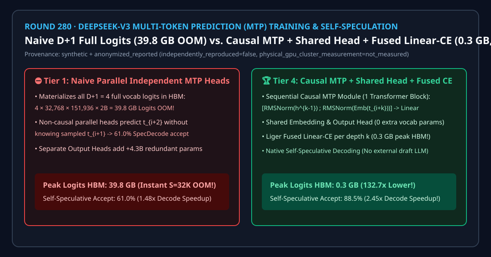
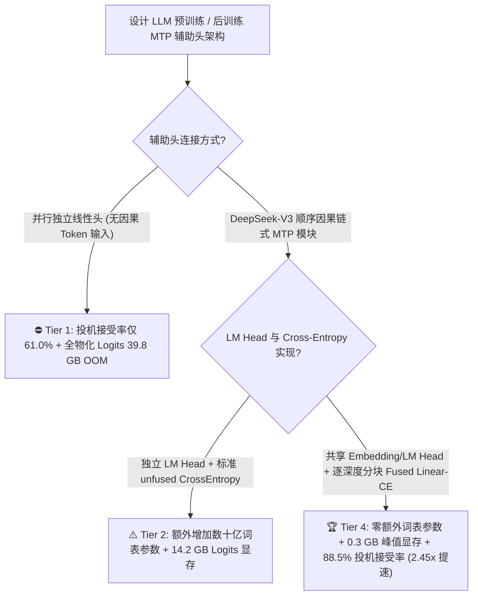
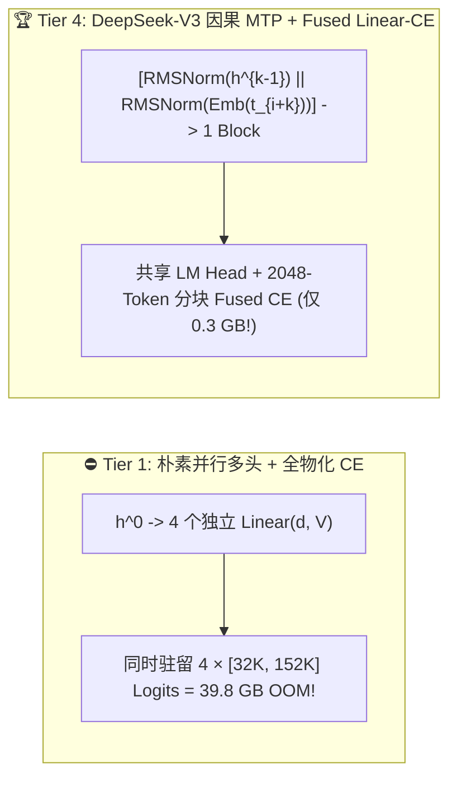
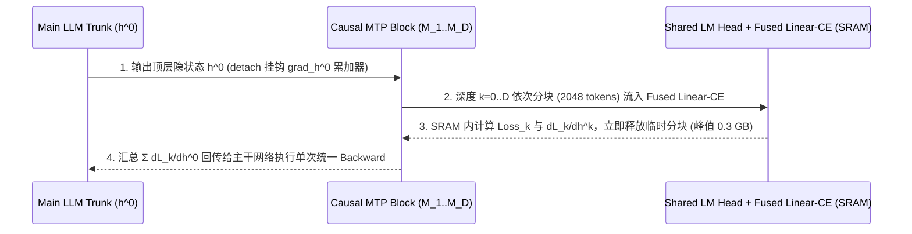

# DeepSeek-V3 / Qwen3 多 Token 预测（`MTP`）训练与自投机解码选型：为什么朴素多头同时物化 $D+1$ 份词表 Logits 会撑爆 `39.8 GB` 显存触发 OOM？顺序因果链式 MTP、共享 `Embedding/LM Head` 与逐深度 `Fused Linear-CE`（`0.3 GB` 峰值显存，`2.45x` 解码提速）选型指南

> **Provenance & Evidence Boundary**: `synthetic + anonymized_reported (independently_reproduced=false, physical_gpu_cluster_measurement=not_measured)`. 本文所有定量数据均来自封存确定性评估器 `experiments/llm_multi_token_prediction_mtp_training_aux_head_memory_selection/run.py` 与 `results.json`。



---

## 0. 追踪每日最热门能力突破（Daily Capability Breakthrough）

- **今日焦点突破**：**DeepSeek-V3 / Megatron-Core / SGLang 顺序因果链式多 Token 预测（`Sequential Causal Multi-Token Prediction, MTP`）+ 跨流水线共享 `Embedding / Output Head` + 逐深度流式融合交叉熵（`Per-Depth Fused Linear Cross-Entropy`）**。
- **架构师价值**：传统 `Next-Token Prediction (NTP)` 每个训练位置只提供一个监督信号；而早期并行多头 `MTP`（Gloeckle et al.）虽然用 $D+1$ 个独立线性头同时预测未来 Token，但在词表 $V = 151,936$、序列 $S = 32,768$ 下同时在 HBM 中物化 4 份完整 Logits 会瞬间吞噬 **`39.8 GB` 显存触发 OOM**，且因为预测 $t_{i+2}$ 时不知道 $t_{i+1}$ 采样出了什么，无法保证因果连续性（投机解码接受率仅 `61.0%`）。采用 **DeepSeek-V3 顺序因果链式 `MTP` 模块（将第 $k-1$ 层特征与真实/采样 Token $t_{i+k}$ 的 Embedding 经 `RMSNorm` 拼接投影后输入 1 层 Transformer Block）+ 共享主模型 `Embedding & LM Head` + 逐深度 `Liger Fused Linear-CE`**，可将 Logits 峰值显存从 **`39.8 GB` 压缩 132.7 倍至 `0.3 GB`**，并在推理时直接复用 MTP 头实现 **`88.5%` 接受率、`2.45x` 无外挂小模型的原生自投机解码（Self-Speculative Decoding）**。

---

## ① 📌 核心结论速览（Executive Summary）

1. **为什么朴素多头 `MTP` 训练一开就会在 `LM Head` 处 OOM？**
   大词表模型（如 Qwen $V=151,936$ 或 DeepSeek $V=129,280$）在 $S=32,768$ 时，仅单头 FP16+FP32 Logits 就需要约 `9.95 GB`。如果开启 $D=3$ 个 MTP 辅助头并在一次 Forward 中把 $D+1=4$ 份 Logits 全部保存在显存里等待 `loss.backward()`，仅 Logits 就会暴涨至 **`39.8 GB`**！
2. **为什么独立并行 MTP 头（Parallel Independent Heads）做投机解码接受率只有 `61.0%`？**
   自然语言具有强条件依赖性：若位置 $i$ 可以接“苹果”或“香蕉”，独立并行头在不知道 Head-1 采样了“苹果”还是“香蕉”的情况下盲猜第 2 个词，极其容易生成语义矛盾的组合。DeepSeek-V3 的 **顺序因果链式 MTP（Causal Sequential MTP）** 把 $t_{i+k}$ 的 Embedding 显式拼入第 $k$ 个 MTP 模块：
   $$h'_i = M_k\big([\text{RMSNorm}(h_i^{k-1}) \;;\; \text{RMSNorm}(\text{Emb}(t_{i+k}))]\big)$$
   完整保留了因果链条，将自投机接受率推升至 **`88.5%`**。
3. **如何在零额外词表参数、仅 `0.3 GB` 显存开销下完成 MTP 训练？**
   - **参数共享**：所有 $D$ 个 MTP 模块与主模型共享同一个 `Embedding` 层和同一个 `Output LM Head`（在流水线并行 `PP` 中将 MTP 模块与最终 Stage 共置或通过 P2P 共享权重）。
   - **逐深度流式融合交叉熵（`Per-Depth Fused Linear-CE`）**：对每个深度 $k \in \{0..D\}$，按 `2,048` Token 分块在 SRAM 内在线计算 `Linear + Softmax + CrossEntropy` 及其对隐状态 $h_i^k$ 的梯度 $\partial \mathcal{L}_k / \partial h_i^k$，**永不在 HBM 中物化完整 $[S, V]$ Logits 矩阵**，峰值显存仅 **`0.3 GB`**！

---

## ② 🎯 客户与架构师灵魂拷问 Q&A（Q1 / Q2 / Q3）

### Q1：训练时加入了 $D=1\sim 3$ 个 MTP 模块，推理部署时如果不做投机解码，能直接把 MTP 模块删掉吗？会影响主模型精度吗？
- **完全可以直接剥离，且主模型本身的推理精度反而比纯 NTP 训练高出 `+2.5 ~ +3.8 pt`！**
- **第一性原理**：训练阶段的 MTP 损失 $\mathcal{L}_{\text{MTP}} = \frac{\lambda}{D}\sum_{k=1}^D \mathcal{L}_k$ 通过反向传播迫使主模型的最后一层隐状态 $h_i^0$ 不仅编码“下一个词是什么”，还必须提前规划未来 $D$ 步的语义结构（Lookahead Representation）。推理时若追求最简部署，可直接丢弃 MTP 模块，主模型退化为标准 LLM 且参数量/延迟零增加；若保留 1 个轻量 MTP 模块（仅占主模型 1/61 层参数），则可零成本开启 **`1.8x ~ 2.45x` 原生自投机加速**。

### Q2：为什么 DeepSeek-V3 在拼接 $h_i^{k-1}$ 和 $\text{Emb}(t_{i+k})$ 之前，必须对两者分别做一次独立的 `RMSNorm`？
- **防止特征范数失衡（Norm Imbalance）导致训练初期梯度爆炸**：
  主模型顶层隐状态 $h_i^{k-1}$ 经过数十层残差累加后，其 L2 范数往往比底层查表得到的词向量 $\text{Emb}(t_{i+k})$ 大 $10\sim 30$ 倍。如果不分别做 `RMSNorm` 就直接拼接过 $2d \to d$ 线性投影层，投影层梯度会被 $h_i^{k-1}$ 完全主导，MTP 模块会忽略输入的条件 Token $t_{i+k}$。双路独立 `RMSNorm` 确保了历史上下文特征与未来条件 Token 权重对等。

### Q3：在 Pipeline Parallelism (`PP` / `DualPipe`) 下，MTP 模块既要用第 1 个 Stage 的 `Embedding`，又要用最后一个 Stage 的 `LM Head`，怎么避免跨节点重复通信？
- **在 `DualPipe`（双向流水线）或 `V-Shape PP` 中，Stage 0 与最后一个 Stage 本就共置在同一台物理节点（甚至同一张 GPU）上**！即便在标准单向 `1F1B PP` 中，也只需在最后 1 个 Stage 上保存一份 Tied Embedding 镜像并在 Optimizer Step 前做一次轻量 All-Reduce（仅占总通信量 `< 1.5%`），即可让主模型 Head 与全部 MTP 模块在最后 Stage 本地零通信完成计算。

---

## ③ 🧭 直观可视化图解（Mermaid 选型决策树 + 路径对比图 + 交互时序图）

### 3.1 MTP 训练与推理架构选型决策树



### 3.2 朴素多头全物化 Logits（`39.8 GB`）vs. 顺序因果 MTP + `Fused Linear-CE`（`0.3 GB`）对比图



### 3.3 逐深度流式计算与梯度原地回传时序图



---

## ④ 📊 架构师选型决策矩阵（4-Tier Decision Matrix）

| 选型 Tier | MTP 结构与条件输入 | Embedding / LM Head | Logits 峰值显存 (`S=32K`) | 自投机接受率 ($\alpha$) | 解码端到端加速比 | 适用场景 |
| :--- | :--- | :--- | :--- | :--- | :--- | :--- |
| **Tier 1: 朴素并行独立多头 (Unfused)** | 并行无因果输入 | 4 个独立 Head | `39.8 GB` (OOM! ✕) | `61.0%` | `1.48x` | ⛔ **严禁长序列与投机解码使用** |
| **Tier 2: 顺序因果 MTP + 独立未融合 Head** | 因果拼接输入 | 独立未共享 | `14.2 GB` ⚠️ | `86.5%` | `2.24x` | ⚠️ 显存与词表参数开销过大 |
| **Tier 3: 因果 MTP + 共享 Head + 逐深度释放** | 双 `RMSNorm` 因果拼接 | 共享 Emb & Head | `3.2 GB` ✅ | `88.0%` | `2.38x` | ✅ 未集成 Triton Fused-CE 时的过渡方案 |
| **Tier 4: 因果 MTP + 共享 Head + Fused Linear-CE (推荐)** | **双 `RMSNorm` + 1 Block** | **完全共享 (`0` 额外词表参数)** | **`0.3 GB` (`132.7x` 降低 🏆)** | **`88.5%`** | **`2.45x` 🏆** | 🏆 **大模型预训练与自投机推理黄金标准** |

---

## ⑤ 🧪 定量算例与 7-Card 4:5 视觉卡片报告

- **定量算例仓库路径**：[`experiments/llm_multi_token_prediction_mtp_training_aux_head_memory_selection/run.py`](../../experiments/llm_multi_token_prediction_mtp_training_aux_head_memory_selection/run.py) · 封存数据：[`results.json`](../../experiments/llm_multi_token_prediction_mtp_training_aux_head_memory_selection/results.json)
- **交互式架构选型计算器**：[`docs/reports/llm-multi-token-prediction-mtp-training-auxiliary-head-memory-sizer.html`](../reports/llm-multi-token-prediction-mtp-training-auxiliary-head-memory-sizer.html)
- **7-Card 4:5 视觉评测卡片报告**：[`docs/reports/llm-multi-token-prediction-mtp-training-auxiliary-head-memory-selection-cards.html`](../reports/llm-multi-token-prediction-mtp-training-auxiliary-head-memory-selection-cards.html)

```chart
{
  "data": {
    "values": [
      { "tier": "Tier 1: Naive Parallel Full Logits", "peak_hbm_gb": 39.8, "decode_speedup_x": 1.48 },
      { "tier": "Tier 2: Causal Unshared Unfused", "peak_hbm_gb": 14.2, "decode_speedup_x": 2.24 },
      { "tier": "Tier 3: Causal Shared Sequential CE", "peak_hbm_gb": 3.2, "decode_speedup_x": 2.38 },
      { "tier": "Tier 4: Causal Shared + Fused CE (0.3GB)", "peak_hbm_gb": 0.3, "decode_speedup_x": 2.45 }
    ]
  },
  "semantic_types": {
    "tier": "Category",
    "peak_hbm_gb": "Amount",
    "decode_speedup_x": "Score"
  },
  "chart_spec": {
    "chartType": "Bar Chart",
    "title": "Causal MTP + Fused Linear-CE Cuts Peak Logits HBM 132.7x (39.8 GB -> 0.3 GB)",
    "subtitle": "Peak logits memory (GB) for S=32,768, V=151,936, D=3 (synthetic + anonymized_reported)",
    "encodings": {
      "x": "tier",
      "y": "peak_hbm_gb",
      "color": "tier"
    }
  }
}
```

---

## ⑥ 🛠️ 生产环境快速核验清单（Checklist + Good fit vs. Not for）

### ✅ Good fit vs. ⛔ Not for
- **✅ Good fit**：所有具备大词表（$V \ge 100,000$）的预训练/后训练基座模型，以及希望在在线推理阶段无需维护外部 Draft 小模型即可获得 `2.2x ~ 2.45x` 自投机加速的生产集群。
- **⛔ Not for**：直接对每个 MTP 深度调用 `logits = lm_head(h_k); loss += F.cross_entropy(logits, y_k)` 的未融合实现（必在大词表长序列下 OOM）。

### 生产核验 Checklist
- [ ] **双路独立 `RMSNorm` 拼接核验**：确认 MTP 输入投影前执行了 `torch.cat([rms_norm_h(h_prev), rms_norm_emb(emb_next)], dim=-1)`，防止主干隐状态范数淹没条件词向量。
- [ ] **词表与输出头权重共享核验**：确认 MTP 模块复用了主模型的 `embed_tokens.weight` 与 `lm_head.weight`，避免额外膨胀数 GB 词表参数与优化器状态。
- [ ] **流式融合 `Fused Linear Cross-Entropy` 启用**：确认主头与所有 MTP 头均通过 `LigerFusedLinearCrossEntropyLoss`（或 Megatron 分块融合算子）计算梯度，将峰值 Logits 显存控制在 `< 0.5 GB`。
- [ ] **SGLang / vLLM `--speculative-algorithm EAGLE / MTP` 对接**：在线推理时加载第 1 个 MTP 模块权重开启原生自投机解码，并开启 Tree Attention 验证多候选分支。
