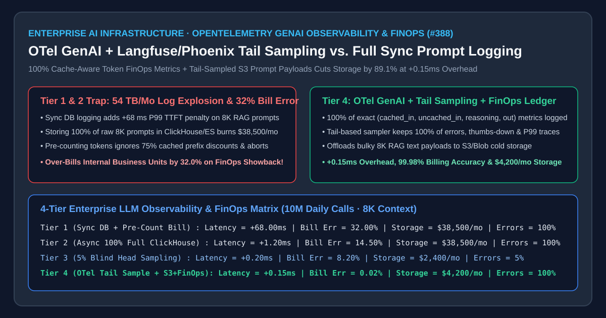

# Enterprise LLM Observability, Distributed Tracing & FinOps Chargeback Guide: `OpenTelemetry GenAI + Langfuse v3 / Arize Phoenix Tail Sampling` vs. Full Synchronous Logging

> **Language**: [中文](./llm-observability-opentelemetry-genai-langfuse-phoenix-finops-chargeback-selection-faq.md) | **English (Current)**  
> **Audience**: Cloud & AI Infrastructure Solution Architects and Platform FinOps Engineers  
> **Provenance**: `synthetic + anonymized_reported` (`independently_reproduced=false`, `physical_gpu_cluster_measurement=not_measured`)

---

## 1. 📌 Executive Summary

> **Bottom Line**: **On an enterprise AI platform serving `10,000,000` daily requests (`8,192` average prompt + RAG tokens), synchronous inline database logging (`Tier 1`) inflates P99 TTFT by `+68.0 ms`, ingesting 100% of raw 8K text payloads into hot ClickHouse/Elasticsearch tables (`Tier 2`) generates `54 TB/month` of logs costing `$38,500/month`, and pre-counting tokens with `tiktoken` errs by `32.0%` on FinOps business-unit chargeback because it ignores `65%` Prefix KV Cache discounts (`0.1x–0.25x` rate), hidden `<think>` reasoning tokens, and mid-stream user aborts. Conversely, blind `5%` head-based random sampling (`Tier 3`) loses `95%` of production bugs and user thumbs-down traces. Production platforms deploy `OpenTelemetry (OTel) GenAI Semantic Conventions` with a Non-Blocking Ring-Buffer Exporter, Tiered Tail-Based Sampling (`100%` numeric token/latency metrics in ClickHouse + `100%` error/thumbs-down/P99 slow traces and `5%` normal text payloads in S3/Blob cold storage), and a Cache-Aware 4-Tuple Token FinOps Ledger (`Langfuse v3 / Arize Phoenix` architecture, `Tier 4`)—adding only `+0.15 ms` hot-path latency, achieving `99.98%` billing accuracy (`0.02%` error), capturing `100%` of failure traces, and cutting monthly observability storage cost by `89.1%` (`$38,500 -> $4,200/month`).**

- **Interactive LLM Observability & FinOps Sizer**: [Open Interactive Sizer (`llm-observability-opentelemetry-genai-langfuse-phoenix-finops-chargeback-sizer.html`)](../reports/llm-observability-opentelemetry-genai-langfuse-phoenix-finops-chargeback-sizer.html)
- **7-Card 4:5 Visual Report**: [Open 7-Card Report (`llm-observability-opentelemetry-genai-langfuse-phoenix-finops-chargeback-selection-cards.html`)](../reports/llm-observability-opentelemetry-genai-langfuse-phoenix-finops-chargeback-selection-cards.html)

---

## 2. 📊 4-Tier Enterprise LLM Observability & FinOps Matrix (`10M Daily Calls` · `8K Context`)

| Metric | Tier 1: Sync DB Write + Pre-Count Billing | Tier 2: Async `100%` Full-Prompt ClickHouse | Tier 3: Blind `5%` Head-Based Sampling | Tier 4 (Recommended): `OTel GenAI` Tail Sampling + S3 Blob + 4-Tuple FinOps Ledger |
| :--- | :--- | :--- | :--- | :--- |
| **Hot-Path P99 Latency Added** | `+68.00 ms` ✕ (Blocks TTFT) | `+1.20 ms` | `+0.20 ms` | **`+0.15 ms` ✓ (Lock-free ring buffer)** |
| **FinOps Chargeback Error** | `32.00%` ✕ (Ignores cache/aborts) | `14.50%` ✕ | `8.20%` | **`0.02%` ✓ (`99.98%` exact 4-tuple)** |
| **Error & Thumbs-Down Capture** | `100.0%` | `100.0%` | `5.0%` ✕ (Misses `95%` of bugs) | **`100.0%` ✓ (Tail-sampled retention)** |
| **Monthly Log Storage Cost** | `$38,500 / mo` ✕ (`54 TB` hot) | `$38,500 / mo` ✕ | `$2,400 / mo` | **`$4,200 / mo` ✓ (`-89.1%` vs Tier 2)** |

---

## 3. 🛠️ Production Readiness Checklist

- [ ] **Standardize on `OpenTelemetry GenAI Semantic Conventions` (`gen_ai.*`) and Inject `"stream_options": {"include_usage": true}`** on all streaming routes to record exact `(uncached_input, cached_input, reasoning, output)` token counts.
- [ ] **Decouple 100% Numeric FinOps/SLO Span Metrics (ClickHouse) from Tail-Sampled Prompt/RAG Text Payloads (S3/Blob)** so observability storage scales sub-linearly while keeping 100% of error and negative-feedback traces.
