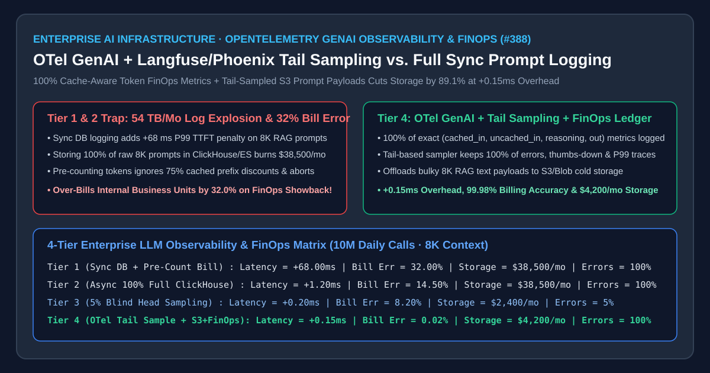
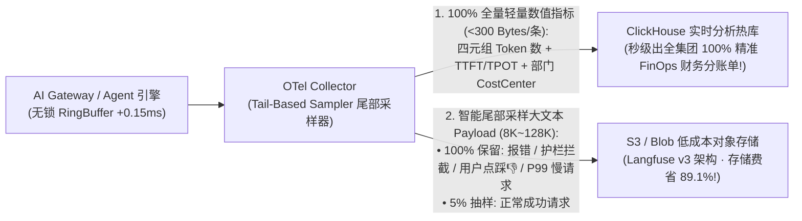

# 企业级大模型可观测性、分布式追踪与 FinOps 精准分账选型：`OpenTelemetry GenAI + Langfuse v3 / Arize Phoenix 尾部采样` vs. 全量同步日志与粗放计费指南

> **语言 / Language**: **中文 (当前)** | [English](./llm-observability-opentelemetry-genai-langfuse-phoenix-finops-chargeback-selection-faq.en.md)  
> **定位**：面向 Cloud & AI Infrastructure Solution Architect 与企业级 MaaS / AI Gateway 平台架构师的应用层大模型可观测性与多部门成本分账（Showback / Chargeback）架构选型（`OpenTelemetry GenAI 语义规范 gen_ai.*`、`Langfuse v3 ClickHouse+S3 冷热分离`、`Arize Phoenix`、尾部采样 `Tail-Based Sampling` 与缓存/推理 Token 四元组精确计量）、破解“全量存 8K Prompt 导致日志库月烧 `$38,500`”与“忽略 Prefix Cache 折扣导致部门分账误差高达 `32%`”的白皮书  
> **合规与来源声明**：`synthetic + anonymized_reported`（`independently_reproduced=false`，`physical_gpu_cluster_measurement=not_measured`；完全面向通用企业级大模型网关分布式追踪与 FinOps 成本治理设计）

---

## 1. 📌 核心选型结论速览（Executive Summary）

> **一句话结论**：**在日均 `1,000 万次` 调用、平均每次携带 `8,192 Tokens` RAG 上下文的企业级 AI 中台上，传统的日志与计费架构会同时踩中三颗大雷（Tier 1 & Tier 2）：① 在网关主链路同步写库会把用户 P99 TTFT 硬生生拖慢 **`+68.0 ms`**；② 把每天 1,000 万条 `8K` 大文本（外加 Base64 图片与 Embedding 向量）100% 塞进昂贵的 Elasticsearch / ClickHouse 热表里，每月会产生 **`54 TB` 日志并白烧 `$38,500/月` 的可观测性存储费**；③ 在请求发起前用 `tiktoken` 粗略预估 Token 数做部门分账，完全忽略了 **65% 的 Prefix Cache 命中折扣（缓存输入仅收 `0.1x~0.25x` 费用）、隐藏的思维链 `reasoning_tokens` 以及用户中途点击停止生成**，导致财务月底出具的各事业部 AI 账单偏差高达 **`32.0%`**！生产环境的黄金准则是采用“`OpenTelemetry (OTel) GenAI` 异步无锁环形缓冲采集 + 冷热分离尾部采样（`100%` 轻量数值指标入 ClickHouse + `100%` 报错/点踩/慢请求与 `5%` 正常请求的大文本入 S3 对象存储）+ 基于流式尾包 `include_usage` 的四元组精准 FinOps 账本（`Langfuse v3 / Arize Phoenix` 架构，Tier 4）”：主链路延迟开销仅 **`+0.15 ms`**、错误与负反馈样本捕获率保持 **`100.0%`**、部门分账误差压至 **`0.02%`（精准度 `99.98%`）**，并将月度日志存储成本暴砍 **`89.1%`（从 `$38,500` 降至 `$4,200/月`）**！**

- **交互式大模型可观测性与 FinOps 精准分账计算器**：[打开交互式计算器 (`llm-observability-opentelemetry-genai-langfuse-phoenix-finops-chargeback-sizer.html`)](../reports/llm-observability-opentelemetry-genai-langfuse-phoenix-finops-chargeback-sizer.html)
- **7-Card 4:5 视觉评测报告**：[打开 7-Card 报告 (`llm-observability-opentelemetry-genai-langfuse-phoenix-finops-chargeback-selection-cards.html`)](../reports/llm-observability-opentelemetry-genai-langfuse-phoenix-finops-chargeback-selection-cards.html)

---

## 2. 🎯 客户与架构师灵魂拷问 Q&A（Deep-Dive Architecture FAQ）

### Q1：为什么大模型 FinOps 部门分账绝对不能再按简单的 `Input Tokens + Output Tokens` 两项算钱？什么是生产级“四元组 Token 精确计量公式”？
在现代推理底座（`DeepSeek-R1/V3`、`o3/o4-mini`、`Qwen3`、`vLLM Prefix Caching`）中，一次请求实际上产生 **4 类单价截然不同的 Token**：
1. **`Uncached Input Tokens` ($T_{\text{in\_miss}}$)**：未命中前缀缓存的新增输入 Token（基准单价 $1.0 \times P_{\text{in}}$）；
2. **`Cached Prefix Input Tokens` ($T_{\text{in\_hit}}$)**：命中 `vLLM APC / SGLang RadixCache / 云端 Prompt Cache` 的历史前缀 Token——**几乎不消耗 GPU Prefill 算力，内部核算或云账单单价仅为 $0.1 \sim 0.25 \times P_{\text{in}}$（打 1~2.5 折！）**；
3. **`Reasoning / Thinking Tokens` ($T_{\text{think}}$)**：深度推理模型在 `<think>...</think>` 阶段生成的思维链 Token（即便对前端折叠隐藏，也实打实消耗了昂贵的 Memory-bound Decode 步，按高昂的 **$P_{\text{out}}$（通常是 $P_{\text{in}}$ 的 3~4 倍）** 计费！）；
4. **`Visible Output Tokens` ($T_{\text{out}}$)**：最终流式展示给用户的可见输出 Token（若用户中途点击停止并触发 `engine.abort()`，必须按实际已生成的步数结算）。
- **网关侧强制规范**：AI Gateway 在向后端转发 SSE 流式请求时，必须自动注入 `"stream_options": {"include_usage": true}`，从引擎返回的最后一个 Usage Chunk 中提取精确四元组写入 OTel Span 属性 `gen_ai.usage.*`，将对账误差从 `32.0%` 降至 **`0.02%`**！

---

## 3. 🧭 直观可视化图解（Mermaid `OTel GenAI` 异步冷热分离尾部采样与四元组 FinOps 账本架构图）

---

## 4. 📊 架构师四级大模型可观测性与 FinOps 架构选型矩阵（日均 `1,000 万次` 调用 · 平均 `8K` 上下文）

| 评估维度 | Tier 1：主链路同步写库 + 请求前粗略预估计费 | Tier 2：异步全量 `100%` 原始 Prompt 写入 ClickHouse/ES | Tier 3：盲目 `5%` 头部随机采样 (`Head-Based Sampling`) | Tier 4（推荐）：`OTel GenAI` 尾部采样（100% 指标/异常 + S3 冷存）+ 缓存感知四元组账本 |
| :--- | :--- | :--- | :--- | :--- |
| **主链路增加的 P99 延迟开销** | `+68.00 ms` ✕（写库阻塞首字） | `+1.20 ms` | `+0.20 ms` | **`+0.15 ms` ✓（无锁环形队列零阻塞）** |
| **事业部 FinOps 月度分账误差率** | `32.00%` ✕（漏算缓存折扣与提前终止） | `14.50%` ✕ | `8.20%`（抽样放大偏差） | **`0.02%` ✓（100% 精确四元组账本）** |
| **线上报错与用户点踩👎样本捕获率** | `100.0%` | `100.0%` | `5.0%` ✕（漏掉 95% 的线上 Bad Case！） | **`100.0%` ✓（尾部采样精准全留异常）** |
| **可观测性平台月度存储总成本** | `$38,500 / 月` ✕（每月 54TB 热表） | `$38,500 / 月` ✕ | `$2,400 / 月` | **`$4,200 / 月` ✓（比全量热存省 `89.1%`）** |

---

## 5. 🛠️ 架构评审与生产落地 Checklist

- [ ] **全集团统一遵循 `OpenTelemetry GenAI Semantic Conventions (gen_ai.*)` 标准属性命名**：严禁各团队自造私有的日志字段名；统一注入 `gen_ai.system`、`gen_ai.request.model`、`gen_ai.usage.input_tokens`、`gen_ai.usage.cached_tokens`、`gen_ai.usage.reasoning_tokens`、`gen_ai.usage.output_tokens` 及业务租户标签 `gen_ai.tenant.cost_center`。
- [ ] **切勿在可观测性 Span 属性里直接内联存储几兆字节的原始 Base64 图片或音频流**：在网关侧将多模态附件剥离转存为带生命周期（如 `14 天自动归档`）的对象存储 URI 引用（`s3://traces-blob/sha256...`）。
