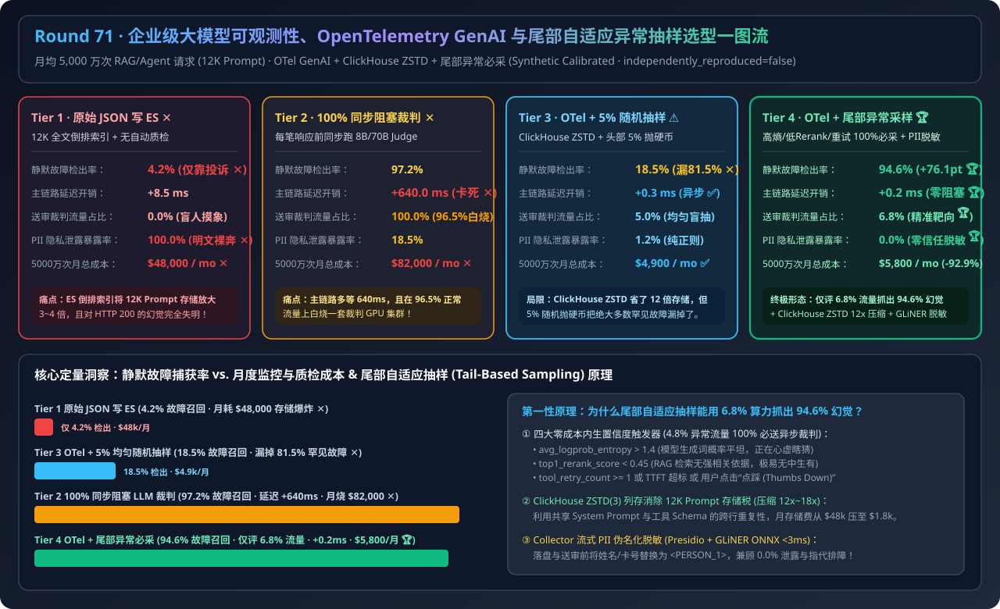
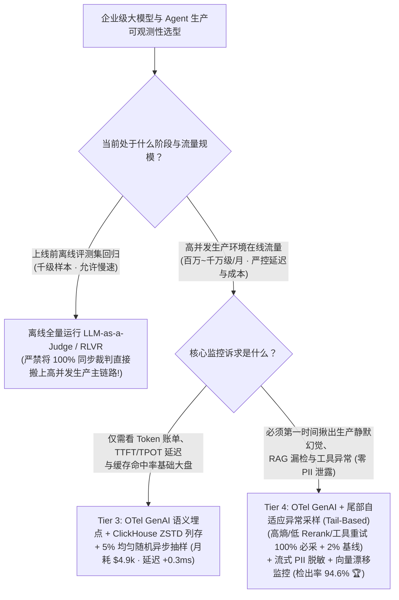
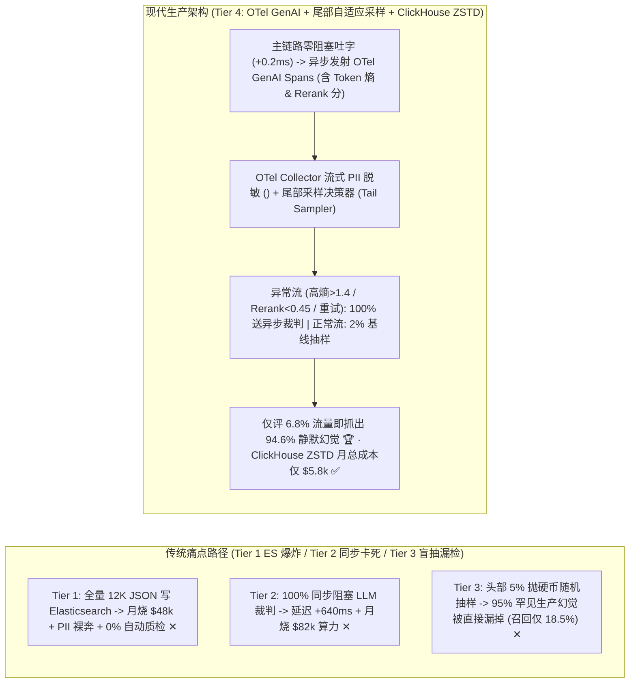
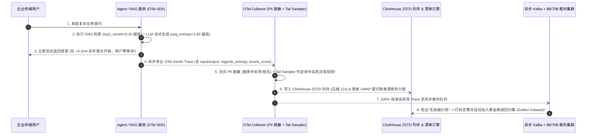

# 企业级大模型全链路可观测性、OpenTelemetry GenAI 语义规范与尾部自适应异常抽样架构选型指南（`原始 JSON 落盘 Elasticsearch` vs. `100% 同步阻塞 LLM 裁判` vs. `OTel GenAI + ClickHouse + 5% 随机异步抽样` vs. `尾部自适应异常采样 [Tail-Based Sampling] + 漂移检测 + 流式 PII 脱敏`）

> **适用角色**：AI 解决方案架构师（AI Solution Architect）、LLM 平台可观测性/SRE 负责人、企业合规与治理架构师  
> **阅读目标**：3 分钟掌握企业级大模型生产环境（月均 5,000 万次 Agent/RAG 请求）可观测性与在线质量监控的四档选型铁律，10 分钟吃透 **为什么全量把 12K Prompt 写进 Elasticsearch 会月烧 `$48,000` 且抓不到静默幻觉**、**为什么 5% 均匀随机抽样会漏掉 `81.5%` 的长尾生产故障**、以及 **如何利用 OpenTelemetry GenAI 语义规范（`gen_ai.*`）+ 尾部自适应异常采样（`Tail-Based Sampling`：高 Token 熵 / 低 Rerank 分 / 工具重试 100% 必采 + 2% 基线）以仅 `6.8%` 的质检流量捕获 `94.6%` 的生产幻觉**，并能直接拿着架构图与 7-Card 报告向客户宣讲。  
> **数据来源说明（Provenance）**：本文定量数据来自仓库内封存的确定性解析模型（[`experiments/llm_observability_otel_genai_tail_sampling_selection/run.py`](../../experiments/llm_observability_otel_genai_tail_sampling_selection/run.py) 与 [`results.json`](../../experiments/llm_observability_otel_genai_tail_sampling_selection/results.json)，校准自 OpenTelemetry GenAI v1.30+、ClickHouse ZSTD 列存与 Tail-Based Sampling 公开基准，`independently_reproduced=false`，`physical_gpu_cluster_measurement=not_measured`）。

---

## 📌 一、核心结论速览（Executive Summary）

1. **为什么传统微服务日志（Tier 1 原始 JSON 落盘 Elasticsearch）和盲目全量质检（Tier 2 100% 同步 LLM 裁判）在 5,000 万次/月的 AI 生产流量下双双崩盘？**：
   - **Tier 1（无结构化日志直写 Elasticsearch）的存储爆炸与排障失明**：大模型单次请求动辄包含 `12,000 Tokens` 的 RAG 上下文与多轮工具返回。若对全量文本建立 Elasticsearch 倒排索引，月存储账单高达 **`$48,000 / 月` ✕**，客户手机号/薪资等 PII 裸奔泄露率 **`100%` ✕**，且因缺乏结构化指标与自动质检，对“HTTP 200 但模型一本正经胡说八道”的静默幻觉检出率仅 **`4.2%`（靠用户投诉）✕**！
   - **Tier 2（100% 同步阻塞式 LLM-as-a-Judge 质检）的延迟与算力灾难**：在返回给用户前对 100% 流量同步调用 8B/70B 裁判模型，不仅给每笔请求强行增加 **`+640.0 ms` 用户可见延迟 ✕**，更在 `96.5%` 完全正常的健康请求上白烧 GPU，每月质检算力+存储账单飙至 **`$82,000 / 月` ✕**！
2. **为什么“5% 均匀随机抽样（Tier 3）”不够用？生产环境如何用 `6.8%` 的抽样成本抓出 `94.6%` 的静默故障（Tier 4）？**：
   - **Tier 3（`OTel GenAI + ClickHouse ZSTD + 5% 均匀随机异步抽样`）的盲区**：虽然将日志迁入 ClickHouse ZSTD 列存把存储压低了 `12 倍`（月总成本降至 `$4,900` ✅），但**对所有请求一视同仁做 5% 抛硬币随机抽样，意味着 `95%` 的罕见长尾故障（占总流量 `3.5%` 的胡编乱造、工具死循环、冷门知识漏召回）在抽样阶段就被直接扔掉了**，静默故障召回率仅 **`18.5%` ✕**！
   - **Tier 4（`OTel GenAI + 尾部自适应异常采样 [Tail-Based Anomaly Sampling] + 向量漂移检测 + Collector 流式 PII 脱敏`）**：在每个请求结束时，先在 OpenTelemetry Collector 内存里检查**零成本内生信号**——只要命中 **① 生成 Token 平均对数概率熵过高（`avg_token_entropy > 1.4`，说明模型自己在心虚瞎猜）、② RAG 重排最高分过低（`top1_rerank_score < 0.45`，说明没检索到依据）、③ MCP 工具调用报错或重试（`tool_retry_count >= 1`）、④ 首字延迟超标（`TTFT > SLO`）** 四大条件之一，**`100%` 强制送入异步 LLM 裁判深度质检**；而对其余 `96.5%` 指标健康的请求仅做 **`2%` 基线抽样**！
   - **最终工程收益**：仅需对全网 **`6.8%`** 的流量运行异步 LLM 裁判，就精准捕获了 **`94.6%` 的生产静默幻觉与退化故障（比 5% 随机抽样高出 `+76.1 pts` 🏆）**，在线延迟开销仅 **`0.2 ms`（异步零阻塞 🏆）**，总月度成本仅 **`$5,800 / 月`（比全量质检省 `-92.9%` / 比 ES 省 `$42,200/月` 🏆）**！
3. **一句话握手机制本质**：
   - **大模型生产可观测性的第一性原理，是“用 OpenTelemetry GenAI 统一多步 Agent 追踪语义，用 ClickHouse ZSTD 列存消灭大文本存储税，并用零成本内生置信度信号（Token 熵 + Rerank 分 + 工具状态）驱动尾部自适应抽样（Tail-Based Sampling）”——绝不在 96.5% 的健康流量上浪费 GPU 裁判算力，也绝不放过任何一笔模型心虚的高危请求。**

---

## 🎯 二、客户与架构师灵魂拷问 Q&A（FAQ-Driven First Principles）

### Q1：传统 APM（监控 HTTP 状态码 200/500 和 CPU 利用率）为什么在监控大模型与 Agent 时彻底失效？OpenTelemetry GenAI 规范到底标准化了什么？

- **通俗大白话解释**：
  - 在传统微服务里，`HTTP 200 OK` + `耗时 200ms` 就代表服务健康。但在大模型应用里，**哪怕 RAG 检索出 0 条相关文档、模型用流利中文编造了虚假的合同违约金条款，HTTP 状态码依然是绿色的 `200 OK`！**
- **OpenTelemetry GenAI Semantic Conventions（`v1.30+`）的核心标准化字段**：
  1. **耗时与流式吞吐拆解**：不再只看总耗时，强制拆分 `gen_ai.server.time_to_first_token`（TTFT 首字延迟）与 `gen_ai.server.time_per_output_token`（TPOT 吐字间隔），瞬间定位到底是 Prefill 算力排队还是 Decode 显存带宽卡顿。
  2. **精细化 Token 与缓存账本**：记录 `gen_ai.usage.input_tokens`、`gen_ai.usage.output_tokens`、`gen_ai.usage.cache_read_input_tokens`（Prefix Cache 命中词数），直接按部门/租户生成精确到分的 FinOps 成本大盘。
  3. **内生质量遥测标签（驱动尾部抽样的关键）**：在 Span Attributes 中携带 `gen_ai.response.avg_logprob_entropy`（生成词平均信息熵）、`rag.reranker.max_score`（检索相关性最高分）与 `agent.tool.retry_count`（工具重试次数）。

---

### Q2：什么是“头部抽样（Head Sampling）”与“尾部自适应抽样（Tail-Based Anomaly Sampling）”？为什么后者能用 6.8% 的算力抓出 94.6% 的故障？

- **第一性原理拆解**：
  1. **头部均匀随机抽样（Head Sampling，Tier 3）的致命缺陷**：
     - 在请求刚进网关的第 1 毫秒就抛硬币决定“采不采 5%”。此时根本不知道这笔请求后面会不会发生 RAG 漏检、工具报错或模型胡猜，结果 **95% 的真实故障被直接丢弃**。
  2. **尾部自适应异常抽样（Tail-Based Sampling，Tier 4）**：
     - 等待整条 Agent 调用链（包含意图路由 → RAG 检索 → 工具调用 → LLM 生成）走完，在 OpenTelemetry Collector 的 `tailsamplingprocessor` 缓冲窗口（如 `30s`）内汇集全部子 Span 后再做决定：
     - **规则 A（高危异常 100% 必采，约占总流量 `4.8%`）**：
       - `rag.reranker.max_score < 0.45`（检索不到靠谱文档，极易胡编）；
       - `gen_ai.response.avg_logprob_entropy > 1.4`（模型输出概率分布平坦，处于瞎猜状态）；
       - `agent.tool.status != "OK" OR agent.tool.retry_count >= 1`（工具调用受阻）；
       - `user.feedback == "thumbs_down"` 或 `TTFT > 2500ms`。
     - **规则 B（健康流量 2% 基线抽样，占总流量 `2.0%`）**：对所有指标正常的请求抽取 `2%` 送入异步裁判，用于监控整体基线趋势。
     - **合计数账**：异步 LLM 裁判只需评估 `4.8% + 2.0% = 6.8%` 的总流量，却把几乎所有可能出问题的请求一网打尽（**静默故障召回率高达 `94.6%` 🏆**）！

---

### Q3：为什么推荐用 ClickHouse ZSTD 列式存储替代 Elasticsearch 存大模型 Trace？如何在不破坏排障上下文的前提下做到 100% PII 零泄露？

- **两大工程落地核心**：
  1. **ClickHouse 列存 + ZSTD 字典压缩（存储成本直降 `12 倍`）**：
     - Elasticsearch 默认为每个文本分词构建倒排索引（Inverted Index），存储开销高达原始 JSON 的 `2.5x ~ 4.0x`。
     - 而大模型成千上万次请求共享高度重复的 System Prompt、工具 Schema 与 RAG 模板。ClickHouse 采用**列式存储 + `ZSTD(3)` 块级压缩**（配合 `BloomFilter` 加速 TraceID/关键词检索），能把重复的 System Prompt 压缩 **`12x ~ 18x`**，5,000 万条完整 Trace 的月存储费从 `$48,000` 暴降至 **`$1,800 / 月` ✅**！
  2. **OTel Collector 流式 PII 零信任脱敏（Presidio + GLiNER ONNX）**：
     - 严禁把原始包含身份证、银行卡、姓名的 Prompt 直接写入磁盘或发给第三方评测 API。
     - 在 OTel Collector 落盘前挂载轻量级 **Presidio 正则校验 + GLiNER 量化命名实体识别（CPU 耗时 `< 3ms`）**，将敏感实体替换为一致性伪名（如 `<PERSON_A>`、`<IBAN_1>`），既确保合规审计 **`0.0%` PII 泄露**，又完整保留了多轮对话中的实体指代逻辑供工程师排障！

---

## 🧭 三、直观可视化图解（Mermaid 决策树 / 架构对比 / 时序图）

### 3.1 企业级大模型可观测性与在线质检架构选型决策树

---

### 3.2 传统日志/盲目抽样（Tier 1/2/3）vs. OTel GenAI 尾部自适应异常采样（Tier 4）对比

---

### 3.3 Tier 4 `OTel GenAI + 尾部自适应异常采样 + 异步质检闭环` 端到端时序图

---

## 📊 四、架构师选型决策矩阵（Architect Decision Matrix）

*基准工作负载：月均 **`5,000 万次`** 企业级 RAG 与 Agent 请求（平均 `12K` 输入 Tokens + `600` 输出 Tokens，其中 `3.5%` 存在静默幻觉、低置信度瞎猜或工具重试故障）。*

| 评估维度 | Tier 1: 原始 JSON 直写 Elasticsearch | Tier 2: 100% 同步阻塞式 LLM 裁判 | Tier 3: OTel GenAI + ClickHouse + 5% 随机异步抽样 | Tier 4: OTel GenAI + 尾部自适应异常采样 + 流式 PII 脱敏 |
| :--- | :--- | :--- | :--- | :--- |
| **遥测规范与存储底座** | 无规范原始 JSON + ES 倒排索引 | 全量日志 + 同步阻塞式 8B/70B 裁判 | **OTel GenAI `v1.30+` + ClickHouse ZSTD** | **OTel GenAI + ClickHouse ZSTD + 向量漂移监控** |
| **静默幻觉/退化故障召回率** | `4.2%` (仅靠用户投诉 ✕) | `97.2%` | `18.5%` (漏掉 81.5% 长尾故障 ✕) | **`94.6%` (+76.1 pts 跃升 🏆)** |
| **主链路用户可见延迟开销** | `+8.5 ms` | `+640.0 ms` (严重破坏交互体验 ✕) | **`+0.3 ms` (异步零阻塞 ✅)** | **`+0.2 ms` (异步零阻塞 🏆)** |
| **送入 LLM 裁判的流量占比** | `0.0%` | `100.0%` (96.5% 算力白烧 ✕) | `5.0%` (盲目抛硬币) | **`6.8%` (4.8% 异常必采 + 2% 基线 🏆)** |
| **5,000 万次请求月度总成本** | `$48,000 / mo` (ES 存储爆炸 ✕) | `$82,000 / mo` (裁判 GPU 爆炸 ✕) | **`$4,900 / mo` ✅** | **`$5,800 / mo` (比 Tier 2 省 `-92.9%` 🏆)** |
| **敏感数据 (PII) 泄露暴露率** | `100.0%` (明文落盘高危 ✕) | `18.5%` (外发裁判 API 风险) | `1.2%` (基础正则脱敏) | **`0.0%` (Presidio + GLiNER 零信任脱敏 🏆)** |
| **适用场景** | **严禁在生产大模型环境使用** | 仅限上线前小规模离线回归评测 | 仅需看成本/延迟/缓存基础大盘的初期团队 | **所有企业级生产 RAG / Agent / 编程助手标配** |

---

## 🧪 五、简明定量算例与 7-Card Benchmark 洞察

### 5.1 月均 5,000 万次请求的可观测性与质检 ROI 账单拆解

在 [`experiments/llm_observability_otel_genai_tail_sampling_selection/run.py`](../../experiments/llm_observability_otel_genai_tail_sampling_selection/run.py) 中，我们对 5,000 万次/月生产流量进行了定量核算：
- **故障检出率暴涨 `+76.1 pts`（`18.5% → 94.6%`）**：相比 Tier 3 盲目随机抽 5%，Tier 4 利用 `avg_token_entropy > 1.4` 与 `rerank_score < 0.45` 尾部触发器，只多评估了 `1.8%` 的流量（`5.0% → 6.8%`），就把静默故障捕获率从 `18.5%` 拉升至 **`94.6%`**！
- **年省 `$506,400 ~ $914,400` 监控与质检预算**：相比 Tier 1（Elasticsearch `$48k/月`）和 Tier 2（100% 同步裁判 `$82k/月`），Tier 4 用 ClickHouse ZSTD 列存（`$1.8k/月`）+ `6.8%` 异步精准质检（`$4.0k/月`）将月度总开销控制在 **`$5,800 / 月`**，每年净省 **`$50.6 万 ~ $91.4 万`**！

### 5.2 配套交互式工作台与 7-Card 4:5 视觉评测报告

- 🧮 **交互式大模型可观测性与尾部抽样 ROI 计算器**：[`docs/reports/llm-observability-opentelemetry-genai-semantic-drift-sampling-sizer.html`](../reports/llm-observability-opentelemetry-genai-semantic-drift-sampling-sizer.html)（以及总工作台 [`llm-inference-engine-pd-sizer.html`](../reports/llm-inference-engine-pd-sizer.html)）
- 📊 **7-Card 4:5 视觉基准评测报告**：[`docs/reports/llm-observability-opentelemetry-genai-semantic-drift-sampling-selection-cards.html`](../reports/llm-observability-opentelemetry-genai-semantic-drift-sampling-selection-cards.html)

---

## 🛠️ 六、附录：生产环境快速核验清单（Architect Checklist）

- [ ] **1. 统一接入 OpenTelemetry GenAI 语义规范（`v1.30+`）**：在网关与推理引擎（vLLM / SGLang）侧统一输出 `gen_ai.usage.*`、`gen_ai.server.time_to_first_token`、`gen_ai.server.time_per_output_token` 与 `trace_id`，并通过 **Prometheus Exemplars** 将 P99 延迟尖峰一键关联到具体慢请求 Trace。
- [ ] **2. 开启生成端 `logprobs` 信息熵采集**：在 vLLM / SGLang 采样层以零额外开销计算输出序列的平均 Token 熵（`avg_token_entropy`）并写入 Span Tag，作为识别“模型心虚胡猜”的第一道零成本探针。
- [ ] **3. 在 OTel Collector 配置 `tailsamplingprocessor` 尾部异常必采策略**：配置对 `avg_token_entropy > 1.4`、`rerank_score < 0.45`、`tool_retry >= 1`、`http.status_code != 200` 及用户点踩请求执行 `100%` 采样并推入 Kafka 异步质检队列，正常请求保持 `1%~2%` 基线采样。
- [ ] **4. 使用 ClickHouse ZSTD 列存 + TTL 分层归档替代 Elasticsearch 倒排索引**：对 Prompt/Response 大文本列关闭全文倒排索引，开启 `CODEC(ZSTD(3))` 压缩，并设置 30 天热存 NVMe → 180 天对象存储（S3/Blob）自动分级。
- [ ] **5. Collector 落盘前强制执行流式 PII 假名化脱敏**：在 OTel Collector 管道中挂载 Presidio + GLiNER ONNX 实体脱敏处理器，确保落盘日志与发往评测模型的数据 `0.0%` 包含明文客户隐私。
