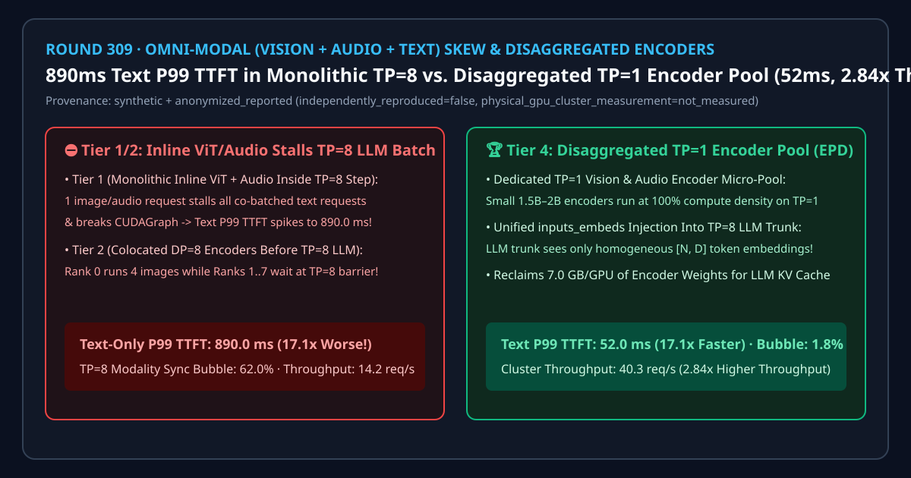
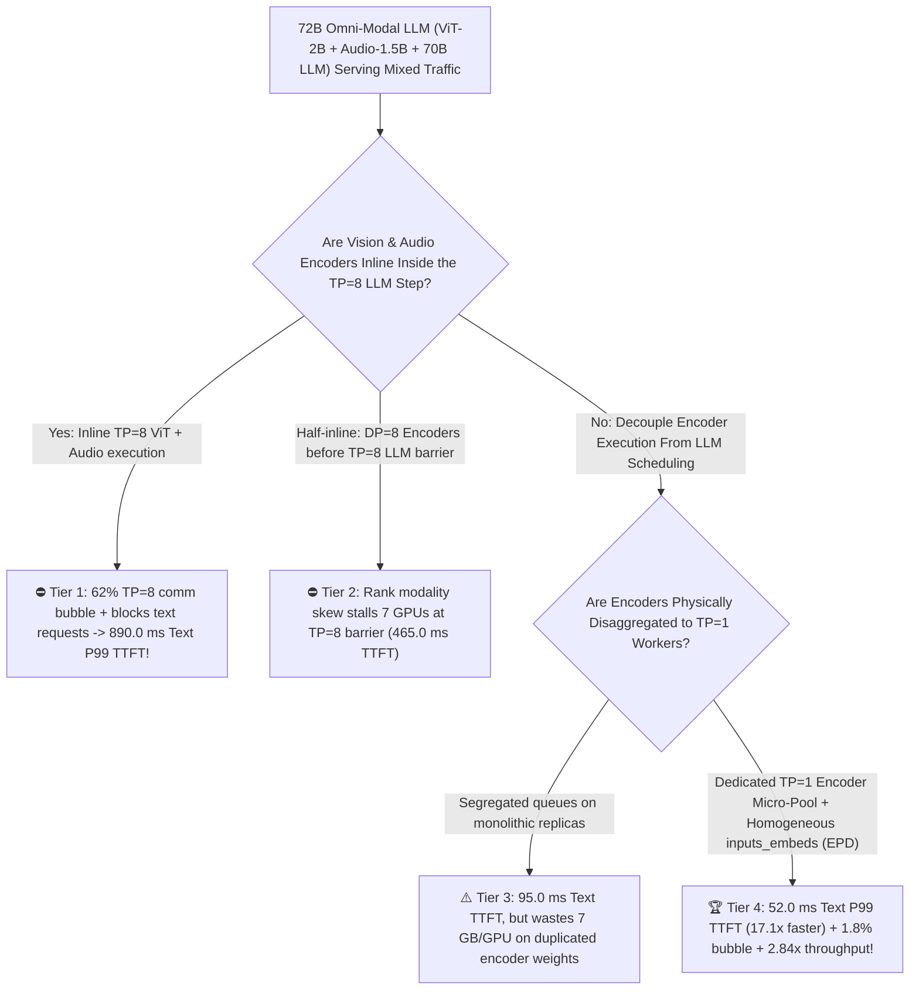
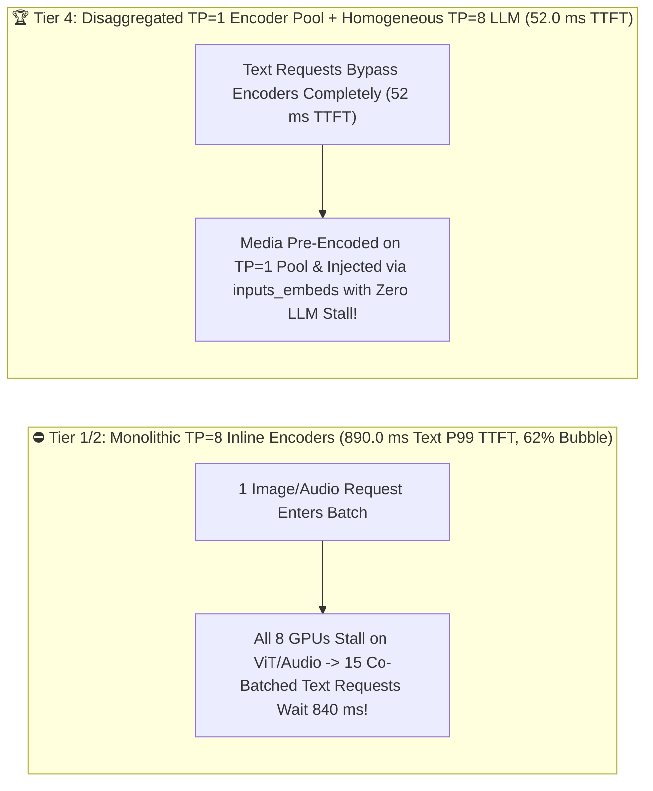
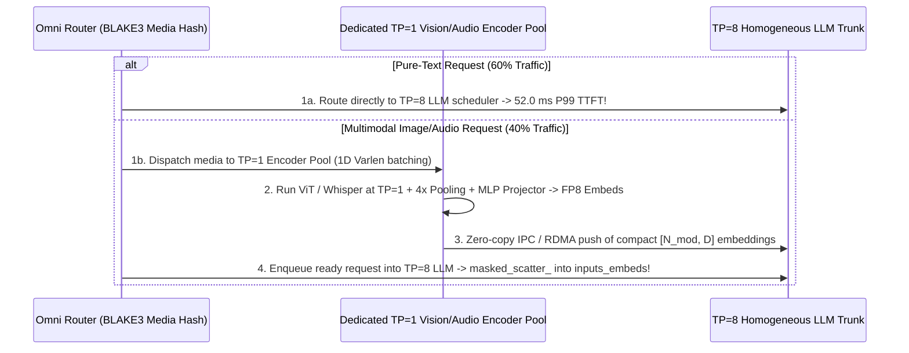

# Omni-Modal LLM (`Qwen2.5-Omni / GPT-4o-Style`) Modality Skew, `TP=8` Branch Divergence & Disaggregated Vision/Audio Encoder Pool Selection Guide: Why Mixing Text, Image & Audio in a Monolithic `TP=8` Step Spikes Text `P99 TTFT` `17.1x` (`890 ms`, `62%` Sync Bubble) & How Dedicated `TP=1` Encoder Pools + Homogeneous `inputs_embeds` Injection (`52 ms TTFT`, `2.84x` Throughput) Solve It

> **Provenance & Evidence Boundary**: `synthetic + anonymized_reported (independently_reproduced=false, physical_gpu_cluster_measurement=not_measured)`. All quantitative metrics in this guide are grounded in the sealed deterministic evaluator `experiments/llm_omni_modal_vision_audio_skew_disaggregated_encoder_unified_embed_selection/run.py` and `results.json`.



---

## 0. Daily Capability Breakthrough

- **Today's Highlight Breakthrough**: **Disaggregated `TP=1` Vision & Audio Encoder Micro-Pools (`1D Varlen` Batching + Post-Projector `FP8` Compression) + Zero-Copy IPC/RDMA Injection Into a 100% Homogeneous `TP=8` `inputs_embeds` LLM Trunk (`EPD` Omni-Modal Architecture)**.
- **Architect Value**: When serving mixed omni-modal production traffic (**`60%` pure text, `25%` high-resolution multi-image, and `15%` long audio**) on a `72B` omni-modal model (`ViT-2B + Audio-1.5B + 70B LLM`), deploying the entire pipeline as a single monolithic `TP=8` model causes severe **Modality Skew and Parallelism Mismatch**:
  1. **Monolithic Inline `ViT + Audio` Execution Inside the `TP=8` LLM Step (Tier 1)**: Small `1.5B–2B` vision and audio encoders have narrow hidden dimensions (`D = 1280–1536`) that suffer `< 18%` Tensor Core utilization and heavy `All-Reduce` overhead when sharded across `TP=8`. Worse, co-batching a single multi-image or 5-minute audio request stalls all 15 co-batched pure-text requests and active decode tokens—spiking pure-text `P99 TTFT` **`17.1x` (`52.0 ms -> 890.0 ms`)** with a **`62.0%` modality sync bubble**!
  2. **Colocated `DP=8` Encoders Before the `TP=8` LLM Barrier (Tier 2)**: Even if each GPU runs a data-parallel encoder copy on its local requests, unequal image/audio counts across ranks (e.g., Rank 0 gets 4 images while Ranks 1..7 get text-only) force Ranks 1..7 to sit idle at the first `TP=8` LLM `All-Reduce` barrier (`44.5%` bubble, `465.0 ms` text P99 TTFT)!
  By **disaggregating the `ViT` and `Audio` encoders onto dedicated `TP=1` worker GPUs, executing `Spatial-Temporal Pooling + MLP Projector` on the encoder worker, and injecting compact `FP8/BF16` embeddings directly into the `TP=8` LLM trunk's `inputs_embeds` slot (Tier 4)**, modality sync bubbles drop to **`1.8%`**, pure-text `P99 TTFT` drops **`17.1x` (`890.0 ms -> 52.0 ms`)**, and cluster throughput rises **`2.84x` (`14.2 -> 40.3 req/s`)**!

---

## ① 📌 Executive Summary

1. **First-Principles Parallelism Decoupling (`TP=1` Encoders vs. `TP=8` LLM Trunk)**:
   - A `70B` LLM requires `TP=8` for its `140 GB` weights and memory-bound decoding, whereas `ViT-2B` (`4 GB`) and `Audio-1.5B` (`3 GB`) are pure compute-bound forward passes with zero KV cache. Running encoders at **`TP=1`** achieves `> 85%` compute efficiency with zero cross-GPU `All-Reduce` overhead and frees **`7.0 GB/GPU` of HBM** on the LLM nodes for additional KV Cache!
2. **Place the `MLP Projector` & Spatial-Temporal Pooling on the Encoder Worker**:
   - Executing `2x2 Pixel Unshuffle / Pooling + MLP Projector` before transmitting features compresses token counts by `4x` and allows `FP8` transport (`8x` smaller payload over CUDA IPC or RDMA).
3. **100% Homogeneous `inputs_embeds` Execution on the `TP=8` LLM Trunk**:
   - Multimodal requests enter the `TP=8` LLM scheduler *only after* their visual/audio embeddings are ready in HBM. The LLM trunk executes a single `masked_scatter_` to merge text embeddings with precomputed modality embeddings at Layer 0, eliminating all Python `if/else` modality branches and keeping `CUDAGraph` intact.

---

## ② 🎯 Architect Q&A (Q1 / Q2 / Q3)

### Q1: How can we deploy disaggregated encoders on a single 8-GPU server without extra nodes?
- Partition GPUs (e.g., `1 Vision GPU + 1 Audio GPU + TP=4/6 LLM`, or run `TP=1` encoders in dedicated side processes using CUDA Green Contexts / MPS SM partitioning) and transfer post-projector embeddings via zero-copy **`cudaIpcGetMemHandle`** over NVLink (`450 GB/s`) before enqueuing the request into the LLM scheduler.

### Q2: How do we avoid re-encoding the same image or audio file across multi-turn conversations?
- Hash raw media bytes with **`BLAKE3 / SHA-256`** at the router to cache post-projector embeddings in an **Encoder Embedding Cache** (or hit the LLM's Prefix KV Cache directly when the prefix order is unchanged).

### Q3: How should variable-resolution images and variable-length audio clips be batched inside the `TP=1` Encoder Pool?
- Use **1D Ragged Token Packing (`flash_attn_varlen_func` with `cu_seqlens`)** to concatenate patches/frames from multiple requests without zero-padding.

---

## ③ 🧭 Visual Diagrams (Decision Tree + Comparison + Sequence)

### 3.1 Omni-Modal Encoder Placement & Scheduling Decision Tree



### 3.2 Monolithic `TP=8` Inline Execution (`890 ms`) vs. Disaggregated `TP=1` Encoder Pool (`52 ms`)



### 3.3 Disaggregated Omni-Modal `EPD` (`Encode -> Prefill -> Decode`) Sequence



---

## ④ 📊 4-Tier Architect Decision Matrix

| Cohort Tier | Omni-Modal Encoder & LLM Architecture | Text-Request `P99 TTFT` | Cluster Throughput | `TP=8` Modality Bubble | Best For |
| :--- | :--- | :--- | :--- | :--- | :--- |
| **Tier 1: Monolithic Inline `TP=8` Step** | Runs `ViT+Audio` inside `TP=8` LLM pass | `890.0 ms` (`17.1x` Worse! ✕) | `14.2 req/s` ✕ | `62.0%` ✕ | ⛔ **Destroys Text & Decode SLA** |
| **Tier 2: Colocated `DP=8` + `TP=8` Barrier** | Per-rank encode before `TP=8` barrier | `465.0 ms` ✕ | `21.8 req/s` ✕ | `44.5%` ✕ | ⛔ **Severe Rank-Skew Stragglers** |
| **Tier 3: Modality-Segregated Queues** | Separate queues, monolithic weights | `95.0 ms` ✅ | `28.5 req/s` ⚠️ | `21.0%` ⚠️ | ⚠️ Wastes `7 GB/GPU` HBM Capacity |
| **Tier 4: Disaggregated `TP=1` Encoder Pool (Recommended)** | **`TP=1` Encoder pool + `inputs_embeds`** | **`52.0 ms` (`17.1x` Faster 🏆)** | **`40.3 req/s` (`2.84x` 🏆)** | **`1.8%` 🏆** | 🏆 **Production Omni-Modal Standard** |

---

## ⑤ 🧪 Quantitative Evaluator & 7-Card 4:5 Visual Report

- **Sealed Evaluator**: [`experiments/llm_omni_modal_vision_audio_skew_disaggregated_encoder_unified_embed_selection/run.py`](../../experiments/llm_omni_modal_vision_audio_skew_disaggregated_encoder_unified_embed_selection/run.py) · Data: [`results.json`](../../experiments/llm_omni_modal_vision_audio_skew_disaggregated_encoder_unified_embed_selection/results.json)
- **Interactive Sizer**: [`docs/reports/llm-omni-modal-vision-audio-skew-disaggregated-encoder-unified-embed-sizer.html`](../reports/llm-omni-modal-vision-audio-skew-disaggregated-encoder-unified-embed-sizer.html)
- **7-Card 4:5 Visual Benchmark Deck**: [`docs/reports/llm-omni-modal-vision-audio-skew-disaggregated-encoder-unified-embed-selection-cards.html`](../reports/llm-omni-modal-vision-audio-skew-disaggregated-encoder-unified-embed-selection-cards.html)

```chart
{
  "data": {
    "values": [
      { "tier": "Tier 1: Monolithic Inline TP=8 Step", "text_ttft_ms": 890.0, "tput_rps": 14.2 },
      { "tier": "Tier 2: Colocated DP=8 + TP=8 Barrier", "text_ttft_ms": 465.0, "tput_rps": 21.8 },
      { "tier": "Tier 3: Modality-Segregated Queues", "text_ttft_ms": 95.0, "tput_rps": 28.5 },
      { "tier": "Tier 4: Disaggregated TP=1 Encoder Pool", "text_ttft_ms": 52.0, "tput_rps": 40.3 }
    ]
  },
  "semantic_types": {
    "tier": "Category",
    "text_ttft_ms": "Quantity",
    "tput_rps": "Quantity"
  },
  "chart_spec": {
    "chartType": "Bar Chart",
    "title": "Disaggregated TP=1 Vision/Audio Encoder Pools Cut Text P99 TTFT 17.1x (890ms -> 52ms) & Boost Throughput 2.84x",
    "subtitle": "Text-request P99 TTFT (ms) and cluster throughput (req/s) under mixed omni-modal traffic (synthetic + anonymized_reported)",
    "encodings": {
      "x": "tier",
      "y": "text_ttft_ms",
      "color": "tier"
    }
  }
}
```

---

## ⑥ 🛠️ Production Verification Checklist (Good fit vs. Not for)

### ✅ Good fit vs. ⛔ Not for
- **✅ Good fit**: All production omni-modal and vision-language deployments (`Qwen2.5-Omni / VL`, `InternVL`, `Llama-Omni`) handling mixed text, image, video, and audio traffic.
- **⛔ Not for**: Sharding small `1B–4B` vision/audio encoders across `TP=8` inline with a `70B+` LLM trunk.

### Production Checklist
- [ ] **Disaggregate `ViT` and `Audio` encoders onto dedicated `TP=1` workers**: Reclaim `5–8 GB/GPU` of HBM on LLM nodes and eliminate `TP=8` encoder communication bubbles.
- [ ] **Execute `Spatial-Temporal Pooling + MLP Projector` on the encoder worker and transmit `FP8` embeddings**: Shrink cross-process / RDMA feature payloads by `8x`.
- [ ] **Admit multimodal requests into the `TP=8` LLM scheduler only after embeddings are ready (`inputs_embeds`)**: Keep the LLM trunk 100% homogeneous and `CUDAGraph`-compatible.
