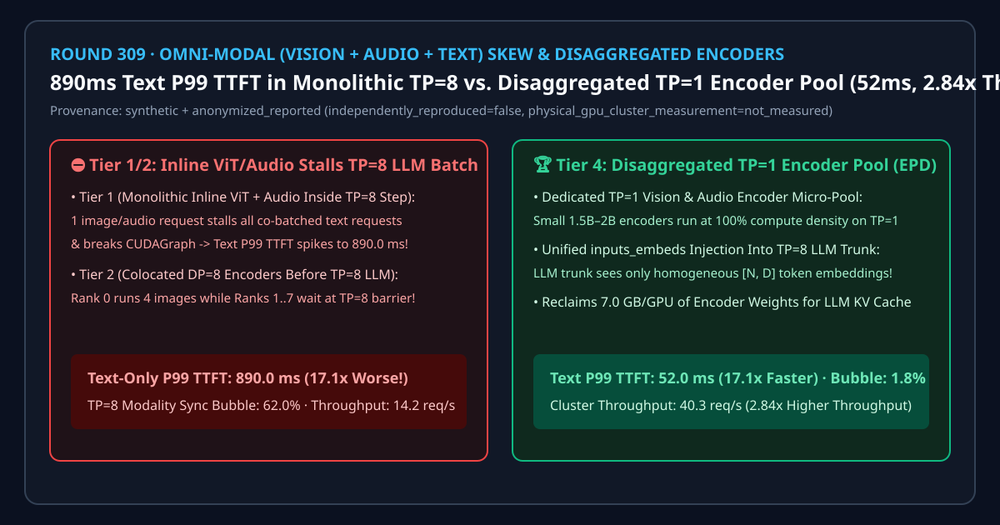
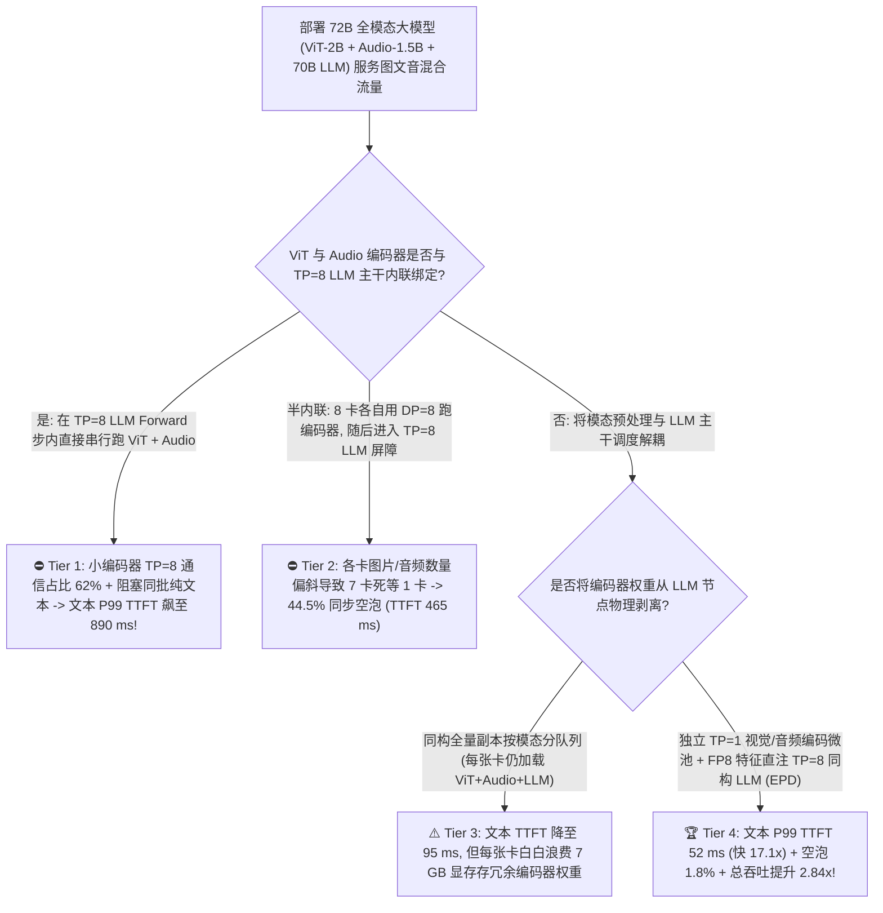
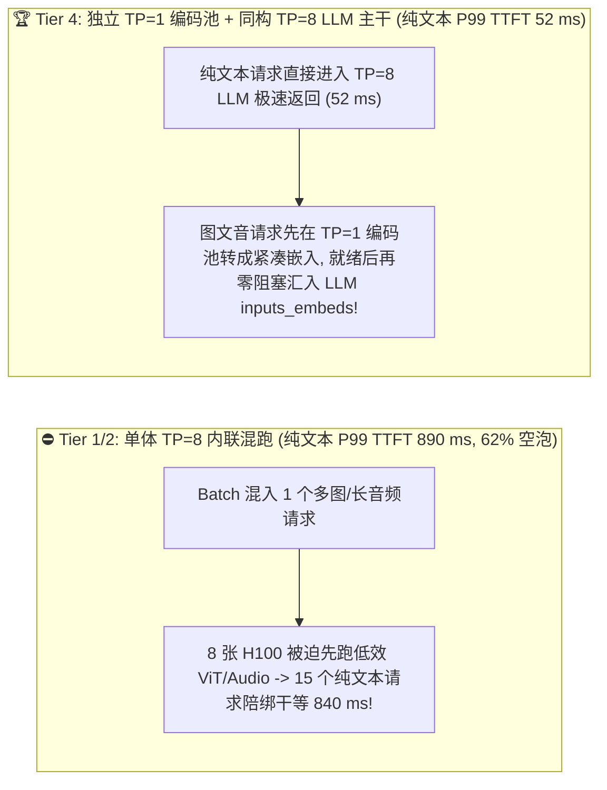
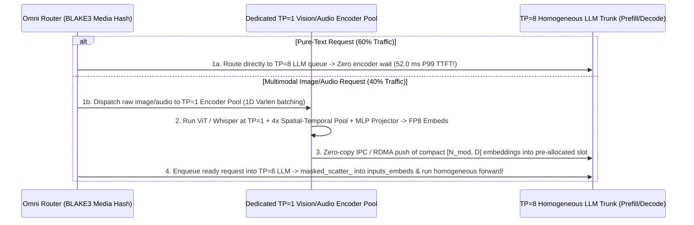

# 全模态大模型（`Omni-Modal：Qwen2.5-Omni / GPT-4o-Style`）混合请求模态偏斜（`Modality Skew`）、`TP=8` 分支发散与异构预编码池分离（`Disaggregated Encoder Pool`）选型：为什么在 `TP=8` 单体引擎里混跑图文音请求会让纯文本 `P99 TTFT` 暴涨 `17.1x` 至 `890 ms`（产生 `62%` 跨卡同步空泡）？基于独立 `TP=1` 视觉/音频编码微池 + 统一 `inputs_embeds` 特征槽注入（文本 `P99 TTFT` 恢复 `52 ms`，吞吐提升 `2.84x`）选型指南

> **Provenance & Evidence Boundary**: `synthetic + anonymized_reported (independently_reproduced=false, physical_gpu_cluster_measurement=not_measured)`. 本文所有定量数据均来自封存确定性评估器 `experiments/llm_omni_modal_vision_audio_skew_disaggregated_encoder_unified_embed_selection/run.py` 与 `results.json`。



---

## 0. 追踪每日最热门能力突破（Daily Capability Breakthrough）

- **今日焦点突破**：**面向全模态大模型（`Qwen2.5-Omni / Llama-Omni / InternVL`：`ViT-2B` 视觉塔 + `Whisper/Audio-1.5B` 音频塔 + `70B` LLM 主干）生产部署的“独立 `TP=1` 模态专属预编码池（`Disaggregated Vision/Audio Encoder Micro-Pools`）+ 投影后 `FP8` 统一嵌入张量通过 CUDA IPC / RDMA 直注 `TP=8` 同构 LLM 主干（`Homogeneous inputs_embeds Trunk`）”架构**。
- **架构师价值**：当业务流量同时包含 **`60%` 纯文本请求、`25%` 4K 多图理解请求与 `15%` 长语音请求** 时，如果将完整的 `72B` 全模态模型（`ViT + Audio + LLM`）作为一个单体模型（Monolithic Model）直接加载在 `8×H100 (TP=8)` 节点上混合组批推理，会遭遇严重的**“模态偏斜（Modality Skew）”与“并行度错配”**：
  1. **痛点一：在 `TP=8` LLM Step 内联执行 `ViT` 与 `Audio Encoder`（Tier 1）**：一方面，`ViT-2B` 和 `Audio-1.5B` 本身隐藏层很窄（如 `D=1280 ~ 1536`），强行按 `TP=8` 切分后每张卡分到的矩阵极小，Tensor Core 算力利用率不足 `18%` 且每层都被 `NVLink All-Reduce` 延迟主导；另一方面，只要当前 Batch 里混入了 1 个包含 8 张高清大图或 5 分钟音频的请求，同 Batch 里另外 **15 个纯文本请求以及所有正在流式生成的 Decode 请求都必须停下来，干等 `ViT` 和 `Audio` 编码器跑完**，导致纯文本请求的 `P99 TTFT` 从 `52.0 ms` 暴涨 **`17.1 倍`至 `890.0 ms`**，跨卡同步空泡高达 **`62.0%`**！
  2. **痛点二：在 8 张卡上用数据并行 `DP=8` 跑编码器、再汇入 `TP=8` 跑 LLM（Tier 2）**：由于每个请求携带的图片张数和音频时长高度随机（例如 `Rank 0` 分到了 4 张 4K 图耗时 `380 ms`，而 `Rank 1..7` 分到的是纯文本耗时 `0 ms`），当进入 LLM 第 1 层 `TP=8` 同步屏障时，**`Rank 1..7` 的 7 张 H100 被迫停机空转 `380 ms` 死等 `Rank 0`**（产生 `44.5%` 同步空泡，纯文本 `P99 TTFT` 仍高达 `465.0 ms`）！
  采用 **将 `ViT` 与 `Audio Encoder` 从 `TP=8` LLM 进程中彻底剥离，部署在独立的 `TP=1` 编码器微池上，并将经过 `MLP Projector` 降维对齐后的紧凑 `FP8/BF16` 模态嵌入向量通过共享内存/RDMA 直接注入 `TP=8` LLM 的 `inputs_embeds` 槽位（Tier 4）**，可让 `TP=8` LLM 主干永远只看到 **100% 同构的二维 `[num_tokens, hidden_dim]` 嵌入矩阵**，将模态同步空泡压至 **`1.8%`**，纯文本 `P99 TTFT` 恢复至 **`52.0 ms`（提速 `17.1x`）**，集群总吞吐从 `14.2 req/s` 跃升至 **`40.3 req/s`（提升 `2.84x`）**！

---

## ① 📌 核心结论速览（Executive Summary）

1. **第一性原理：为什么 `ViT / Audio Encoder` 绝不应该和 `70B LLM` 共享同一个 `TP=8` 并行度？**
   - **`70B LLM` 主干**：参数量高达 `140 GB`，隐藏层维度 $D = 8,192$，解码阶段受限于 HBM 显存带宽，**必须使用 `TP=8`（甚至 `TP=8 + EP`）** 才能装下权重并跑进 `< 20 ms TPOT`；
   - **`ViT-2B / Whisper-1.5B` 编码器**：参数量仅 `3 ~ 4 GB`，且 100% 是计算密集型的双向/卷积前向计算（没有自回归 Decode，也没有庞大的 KV Cache！）。在单张 GPU（**`TP=1`**）上就能轻松放下一整份编码器权重并跑出 **`> 85%` 的峰值算力利用率**；而一旦切成 `TP=8`，不仅每层白白增加两次跨卡 `All-Reduce`，而且在单节点 8 张卡上冗余驻留或者占用 LLM 宝贵的显存空间（剥离后每张 LLM 显卡还能多腾出 **`7.0 GB` 显存给 KV Cache**）！
2. **为什么剥离编码器后，应该传输“过完 `Projector` 并池化压缩后的特征向量”，而不是原始编码器输出？**
   - 在 `Qwen2.5-VL / Omni` 或 `InternVL` 中，`ViT` 原始输出的 Patch 序列极长，但紧接着会经过一个 **`2x2 Pixel Shuffle / Spatial-Temporal Pooling + MLP Projector`**，将视觉 Token 数量直接压缩 **`4 倍`** 并对齐到 LLM 词嵌入空间（而且支持无损转为 `FP8` 传输，体积再减半，总传输量缩小 **`8x`**）！
   - 因此，必须把 `MLP Projector` 放在 **`TP=1` 编码器池的最后一棒**执行：编码器算完直接压缩成紧凑的 `[N_compressed, D_llm]` `FP8` 张量，再通过 NVLink IPC 或 RDMA 零拷贝写入 LLM Prefill 节点的预分配槽位！
3. **让 `TP=8` LLM 主干实现“全模态零分支（Zero-Branch Homogeneous Execution）”**：
   - 在传统单体实现中，模型 `forward()` 里到处是 `if pixel_values is not None: ...`、`if input_audio is not None: ...` 的 Python 动态控制流，导致整段前向无法被编译进同一个静态图，且打断 Chunked Prefill 步长预算。
   - 而在解耦架构下，多模态请求只有当其图片/音频已经在 `TP=1` 编码池转化成了现成的嵌入向量后，才正式进入 `TP=8` LLM 的调度队列！此时对 `TP=8` LLM 而言，1 个图文音请求与 1 个纯文本请求在算子层面 **100% 完全同构**——只需在第 0 层词表 `Embedding` 查表后执行一次极速的 `masked_scatter_` 将预编码特征填入 `<|vision_pad|>` 与 `<|audio_pad|>` 占位符，后续 80 层 Transformer 完全没有任何模态分支！

---

## ② 🎯 客户与架构师灵魂拷问 Q&A（Q1 / Q2 / Q3）

### Q1：如果客户只有单台 8 卡 H100 服务器，怎么在单机内部实现 `Encoder` 与 `LLM` 的解耦？
- **两种单机最佳拓扑**：
  1. **方案 A（`1E + 1A + 6L` 或 `2E + 6L / TP=4` 卡级物理切分）**：用 `CUDA_VISIBLE_DEVICES=0` 跑独立的 `TP=1` 视觉编码器实例、`CUDA_VISIBLE_DEVICES=1` 跑音频编码器实例（或双实例混部在 GPU 0~1），其余卡跑 LLM 主干，通过 **CUDA IPC 共享显存句柄（`cudaIpcGetMemHandle`）** 在机内 NVLink 上以 `450 GB/s` 零拷贝传递特征；
  2. **方案 B（双进程 + CUDA Green Contexts / MPS SM 分区 + 独立流调度）**：当 LLM 必须占满 `TP=8` 时，将 `ViT / Audio` 作为独立的 `DP=8` 旁路工作进程运行在限定了 `15%` SM 配额的高优先级非阻塞流上，**等预编码彻底完成后再把请求句柄提交给 `TP=8` LLM 调度器**，绝不在 LLM 的 `TP=8` 同步步内阻塞等待编码器！

### Q2：在多轮对话中，用户针对同一张 4K 架构图或同一段 5 分钟会议录音连续追问 10 个问题，需要每次都调 `TP=1` 编码器池吗？
- **需要配合两级缓存（Encoder Output Cache + LLM Prefix KV Cache）**：
  1. 若第 2 轮提问的前缀完全未变，直接命中 LLM 节点的 **Prefix KV Cache**（连特征注入都省了，`0 ms` 复用）；
  2. 若图片/音频出现在非前缀位置（如用户调换了多张图的对比顺序），则通过对原始图片/音频字节流计算 **`BLAKE3 / SHA-256` 哈希指纹**，直接从 **编码器特征缓存池（Encoder Embedding Cache）** 取出算好的 `[N_vis, D]` 特征向量，100% 免除重复运行 `ViT / Audio Encoder`！

### Q3：音频编码器（如 `Whisper` 固定 `30s` 窗）和动态分辨率 `ViT`（`NaViT`）在 `TP=1` 编码池里怎么高效组批？
- 在独立的 `TP=1` 编码器池内部，开启 **一维去填充变长拼包（`1D Varlen FlashAttention cu_seqlens`）**：将不同请求的 4K 图切片（例如请求 A 的 `1,024` 个 Patch 与请求 B 的 `256` 个 Patch）无填充首尾拼接成一个紧凑的一维 Token 流 `[1280, D]` 一次性跑完 `ViT`，消灭不同图片分辨率与音频时长带来的 Padding 浪费！

---

## ③ 🧭 直观可视化图解（Mermaid 选型决策树 + 路径对比图 + 交互时序图）

### 3.1 全模态大模型（视觉 + 音频 + 文本）推理架构选型决策树



### 3.2 单体 `TP=8` 内联混跑阻塞（`890 ms`）vs. 独立 `TP=1` 编码池 + 同构 `inputs_embeds` 主干（`52 ms`）对比图



### 3.3 全模态 `EPD`（`Encoder - Prefill - Decode`）分离推理与特征注入交互时序图



---

## ④ 📊 架构师选型决策矩阵（4-Tier Decision Matrix）

| 选型 Tier | 全模态编码器与 LLM 主干部署架构 | 纯文本请求 `P99 TTFT` | 集群总吞吐 (`req/s`) | `TP=8` 模态同步空泡 | 适用场景 |
| :--- | :--- | :--- | :--- | :--- | :--- |
| **Tier 1: 单体 `TP=8` 步内串行跑 `ViT+Audio`** | 所有模态耦合在同一 `TP=8` Forward | `890.0 ms` (`17.1x` 慢! ✕) | `14.2 req/s` ✕ | `62.0%` ✕ | ⛔ **多模态请求直接拖死全集群纯文本 SLA** |
| **Tier 2: 同卡 `DP=8` 编码器 + `TP=8` 屏障** | 各 Rank 独立编码后在 LLM 入口同步 | `465.0 ms` ✕ | `21.8 req/s` ✕ | `44.5%` ✕ | ⛔ **木桶效应导致 7 张卡等最慢的 1 张卡** |
| **Tier 3: 单体副本按模态物理分队列** | 隔离队列，但每卡冗余加载全部编码器 | `95.0 ms` ✅ | `28.5 req/s` ⚠️ | `21.0%` ⚠️ | ⚠️ 浪费 `7 GB/GPU` 显存且突发流量利用率低 |
| **Tier 4: 独立 `TP=1` 编码池 + 统一特征注入 (推荐)** | **编码池 `TP=1` 解耦 + 主干 `inputs_embeds` 同构** | **`52.0 ms` (`17.1x` 快 🏆)** | **`40.3 req/s` (`2.84x` 🏆)** | **`1.8%` 🏆** | 🏆 **生产级全模态（Omni）推理黄金标准** |

---

## ⑤ 🧪 定量算例与 7-Card 4:5 视觉卡片报告

- **定量算例仓库路径**：[`experiments/llm_omni_modal_vision_audio_skew_disaggregated_encoder_unified_embed_selection/run.py`](../../experiments/llm_omni_modal_vision_audio_skew_disaggregated_encoder_unified_embed_selection/run.py) · 封存数据：[`results.json`](../../experiments/llm_omni_modal_vision_audio_skew_disaggregated_encoder_unified_embed_selection/results.json)
- **交互式架构选型计算器**：[`docs/reports/llm-omni-modal-vision-audio-skew-disaggregated-encoder-unified-embed-sizer.html`](../reports/llm-omni-modal-vision-audio-skew-disaggregated-encoder-unified-embed-sizer.html)
- **7-Card 4:5 视觉评测卡片报告**：[`docs/reports/llm-omni-modal-vision-audio-skew-disaggregated-encoder-unified-embed-selection-cards.html`](../reports/llm-omni-modal-vision-audio-skew-disaggregated-encoder-unified-embed-selection-cards.html)

```chart
{
  "data": {
    "values": [
      { "tier": "Tier 1: Monolithic Inline TP=8 Step", "text_ttft_ms": 890.0, "tput_rps": 14.2 },
      { "tier": "Tier 2: Colocated DP=8 + TP=8 Barrier", "text_ttft_ms": 465.0, "tput_rps": 21.8 },
      { "tier": "Tier 3: Modality-Segregated Queues", "text_ttft_ms": 95.0, "tput_rps": 28.5 },
      { "tier": "Tier 4: Disaggregated TP=1 Encoder Pool", "text_ttft_ms": 52.0, "tput_rps": 40.3 }
    ]
  },
  "semantic_types": {
    "tier": "Category",
    "text_ttft_ms": "Quantity",
    "tput_rps": "Quantity"
  },
  "chart_spec": {
    "chartType": "Bar Chart",
    "title": "Disaggregated TP=1 Vision/Audio Encoder Pools Cut Text P99 TTFT 17.1x (890ms -> 52ms) & Boost Throughput 2.84x",
    "subtitle": "Text-request P99 TTFT (ms) and cluster throughput (req/s) under mixed omni-modal traffic (synthetic + anonymized_reported)",
    "encodings": {
      "x": "tier",
      "y": "text_ttft_ms",
      "color": "tier"
    }
  }
}
```

---

## ⑥ 🛠️ 生产环境快速核验清单（Checklist + Good fit vs. Not for）

### ✅ Good fit vs. ⛔ Not for
- **✅ Good fit**：所有同时服务文本、图片、视频、音频混合流量的全模态大模型（`Qwen2.5-Omni / VL`、`InternVL`、`Llama-Omni`）生产集群。
- **⛔ Not for**：把参数量仅 `1B~4B` 的视觉/音频编码器强行切成 `TP=8` 并塞进 `70B+` LLM 的同步推理循环中。

### 生产核验 Checklist
- [ ] **物理剥离 `ViT` 与 `Audio Encoder` 至独立的 `TP=1` 编码微池**：释放 LLM 节点上 `5~8 GB/GPU` 的冗余权重显存，避免小算子 `TP=8` 通信开销。
- [ ] **将 `Spatial-Temporal Pooling + MLP Projector` 放在编码池末尾执行并输出 `FP8/BF16` 压缩特征**：将跨进程/跨机特征传输体积压缩 `4x ~ 8x`。
- [ ] **确保多模态请求仅在特征就绪后才进入 `TP=8` LLM 调度队列（`inputs_embeds` 同构注入）**：彻底消除纯文本请求被图文音编码阻塞的队头等待。
