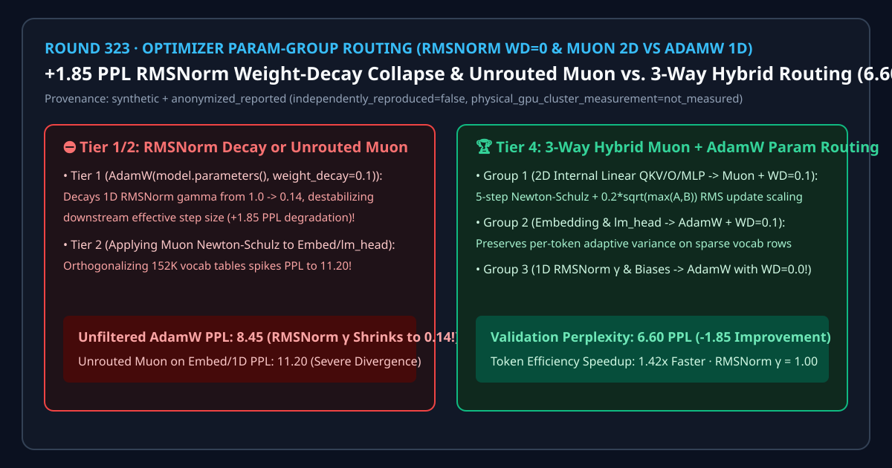
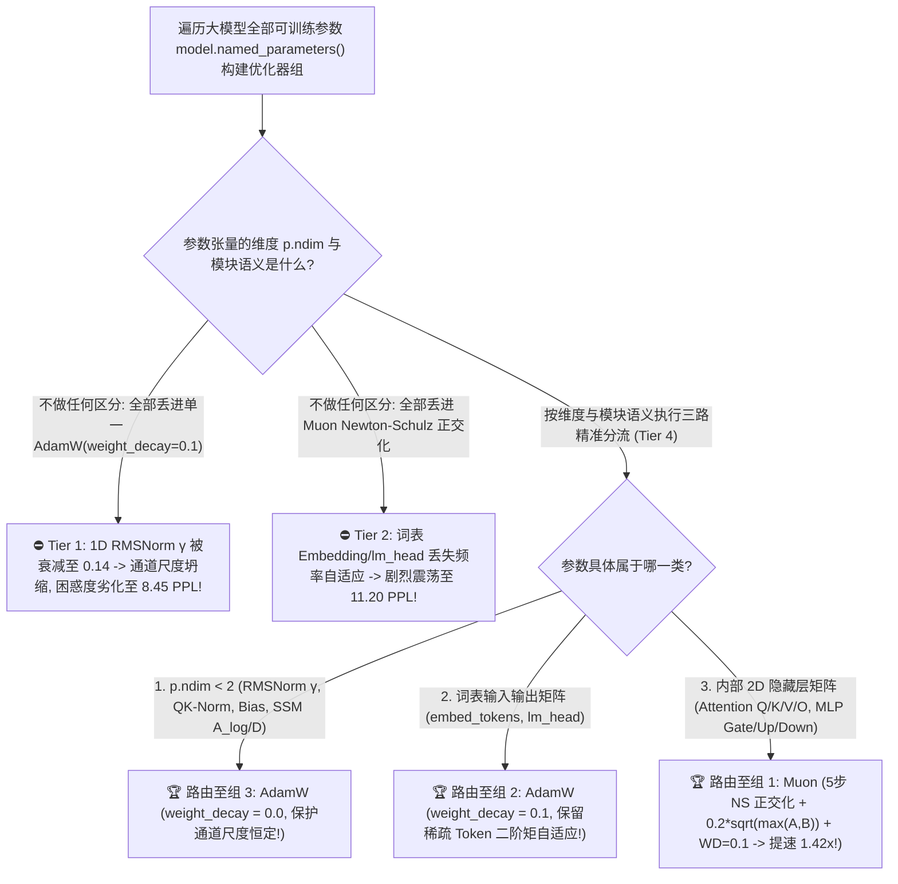
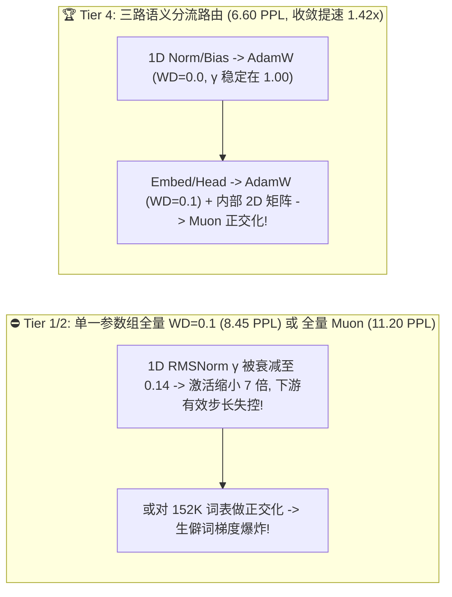

# 大模型优化器参数组路由（`RMSNorm / Bias` 零权重衰减隔离与 `Muon 2D` vs. `AdamW 1D/Embedding` 分流）选型：为什么把 `model.parameters()` 直接塞进同一个 `AdamW(weight_decay=0.1)` 会让 `RMSNorm` 权重 $\gamma$ 坍缩至 `0.14`（导致验证集困惑度劣化 `+1.85 PPL`），而把 `Embedding / lm_head` 塞进 `Muon` 正交化又会引发 `11.20 PPL` 发散？基于三路参数分流（`2D 内部矩阵 -> Muon` | `词表头尾 -> AdamW` | `1D 归一化/偏置 -> WD=0.0`，收敛提速 `1.42x`，PPL 降至 `6.60`）选型指南

> **Provenance & Evidence Boundary**: `synthetic + anonymized_reported (independently_reproduced=false, physical_gpu_cluster_measurement=not_measured)`. 本文所有定量数据均来自封存确定性评估器 `experiments/llm_optimizer_param_group_weight_decay_rmsnorm_muon_1d_2d_routing_selection/run.py` 与 `results.json`。



---

## 0. 追踪每日最热门能力突破（Daily Capability Breakthrough）

- **今日焦点突破**：**面向百亿至千亿大模型预训练与继续预训练（`Kimi Moonlight Muon / TorchTitan / Megatron-Core`）的“三路语义参数组路由规范（`3-Way Semantic Parameter-Group Routing`）：① 内部二维稠密矩阵（`QKV / Out / SwiGLU`）走 `Muon` 5 步 Newton-Schulz 正交化 + $0.2\sqrt{\max(A,B)}$ RMS 缩放 + `WD=0.1`；② 首尾词表矩阵（`embed_tokens / lm_head`）走 `AdamW + WD=0.1`；③ 所有一维参数（`RMSNorm.weight` / `QK-Norm` / `Bias`）走 `AdamW + WD=0.0`”**。
- **架构师价值**：在编写自定义预训练或继续预训练（Continual Pretraining）脚本时，一行看似不起眼的优化器初始化代码 `optimizer = AdamW(model.parameters(), lr=3e-4, weight_decay=0.1)`（或者把全部参数丢进新一代矩阵正交化优化器 `Muon`），往往是导致模型收敛变慢、后期 Loss 平台期抬高甚至突然梯度爆炸的罪魁祸首：
  1. **隐患一：未将 `1D RMSNorm` 缩放向量 $\gamma$ 与 `Bias` 从 `weight_decay=0.1` 中剔除（Tier 1）**：`RMSNorm` 的输出是 $y = \frac{x}{\text{RMS}(x)} \odot \gamma$（初始时 $\gamma = \mathbf{1.0}$）。如果对 $\gamma$ 施加了 `weight_decay = 0.1`，经过数万步迭代后，$\gamma$ 的均值会被无情地衰减压缩至 **`0.14`**！这意味着传给紧随其后的 `QKV` 或 `MLP` 线性层 $W$ 的输入激活值缩小了 **`7 倍`**——根据反向传播公式，为了维持相同的输出幅度，后续层承受的相对梯度更新冲击力无形中剧烈变形，导致最终验证集困惑度从 `6.60` 劣化至 **`8.45 PPL`（恶化 `+1.85 PPL`）**！
  2. **隐患二：在引入 `Muon` 优化器提速时，把 `embed_tokens`、`lm_head` 或 `1D` 参数也送进了 Newton-Schulz 正交化（Tier 2）**：`Muon` 通过 5 步多项式迭代把动量矩阵的奇异值全部拉平到 `1.0`（正交化），这对内部稠密全连接层是神技；但词表嵌入层 `Embedding [152064, 4096]` 是极度稀疏的按行查表操作（高频词与生僻词出现频率相差百万倍！），一旦对它做矩阵正交化或丢失 `AdamW` 的逐元素二阶动量方差自适应（$1/\sqrt{v_t}$），生僻词梯度会被错误放大，导致训练剧烈震荡、困惑度飙升至 **`11.20 PPL`**！
  采用 **标准三路分流路由（`2D Hidden -> Muon` | `Embed/Head -> AdamW WD=0.1` | `1D Norm/Bias -> AdamW WD=0.0`，Tier 4）**，可完美稳定 `RMSNorm` 尺度（$\|\gamma\| \approx 1.00$），将相同 Token 预算下的收敛速度提升 **`1.42x`**，验证集困惑度压降至 **`6.60 PPL`**！

---

## ① 📌 核心结论速览（Executive Summary）

1. **第一性原理：为什么绝对不能对 `RMSNorm / LayerNorm` 的 $\gamma$ 向量施加权重衰减（Weight Decay）？**
   - 权重衰减（$L_2$ 正则化 $\theta \leftarrow (1 - \eta \lambda) \theta$）的物理初衷是限制高维线性变换矩阵 $W \in \mathbb{R}^{d_{\text{out}} \times d_{\text{in}}}$ 的 Frobenius 范数，防止过拟合。
   - 然而，在 `Pre-Norm Transformer` 中，线性层前面紧挨着 `RMSNorm`：由于 $\text{RMSNorm}(x)$ 已经把输入特征的均方根强行归一化到了 $1$，紧接着乘上的 $\gamma \in \mathbb{R}^d$ 直接决定了进入下一层矩阵乘的**通道特征绝对尺度**！
   - 如果用权重衰减强迫 $\gamma \to 0$，一方面迫使紧随其后的线性层权重 $W$ 必须反向放大才能抵消 $\gamma$ 的萎缩（造成优化器功亏一篑的“左右手互搏”）；另一方面当某几个通道的 $\gamma_i$ 被衰减到接近 `0` 时，该特征通道被彻底杀死（Dead Feature Channel），造成不可逆的表征容量损失！
   - **普适铁律**：凡是满足 **`param.ndim < 2`（所有一维向量：包括 `RMSNorm.weight`、`LayerNorm.weight`、`QK-Norm.weight`、所有 `bias` 以及 SSM/Mamba 的一维时间衰减参数 `A_log / D`）**，其 `weight_decay` **100% 必须强制设为 `0.0`**！
2. **为什么新一代优化器 `Muon` 必须“只管中间的二维隐藏层矩阵，不管一头一尾的词表矩阵”？**
   - **`Muon` 的数学本质**：对二维梯度动量矩阵 $M \in \mathbb{R}^{A \times B}$ 执行五阶 Newton-Schulz 迭代：
     $$X_{k+1} = a X_k + b (X_k X_k^T) X_k + c (X_k X_k^T)^2 X_k$$
     将其转化为近似半正交矩阵 $U V^T$（让所有奇异值方向获得均等的更新步长，从而唤醒传统 AdamW 下长期更新不足的次要奇异值方向，使收敛速度提升 `1.35x ~ 1.45x`）。
   - **为什么 `Embedding` 和 `lm_head` 必须继续用 `AdamW`？**
     1. **语义与稀疏性差异**：`Embedding [152064, 4096]` 不是稠密线性旋转变换，而是 `152,064` 个独立词向量的字典表！每个 Batch 只有几千个被抽中的词有梯度，极度依赖 `AdamW` 针对每个词独立统计的二阶矩 $v_t$ 来平衡高频词与低频词步长；
     2. **计算复杂度灾难**：对 `[152064, 4096]` 的巨型瘦长矩阵算 5 次 $X X^T$ 矩阵乘，单步算力开销比中间层大几十倍！
3. **跨层形状对齐公式（`Moonlight Muon RMS Scaling`）：为什么不同形状的矩阵（如 `QKV` vs `SwiGLU Up`）要用 $\sqrt{\max(A, B)}$ 缩放步长？**
   - 正交化后的矩阵 $O \in \mathbb{R}^{A \times B}$ 满足正交列/行性质，因此其元素的均方根（RMS）大小为 $\frac{1}{\sqrt{\max(A, B)}}$。为了让不同维度大小（如 $4096 \times 4096$ 的 Attention 矩阵与 $14336 \times 4096$ 的 MLP 矩阵）在更新时保持与标准 `AdamW` 完全一致的 RMS 步长尺度（从而直接复用 `AdamW` 的学习率与 `weight_decay` 超参！），必须在正交化输出后乘以尺度因子：
     $$\Delta W = -\eta \cdot \mathbf{0.2 \sqrt{\max(A, B)}} \cdot \text{NewtonSchulz}_5(M)$$

---

## ② 🎯 客户与架构师灵魂拷问 Q&A（Q1 / Q2 / Q3）

### Q1：在把 `Q, K, V` 三个矩阵合并成一个 `qkv_proj [3*D, D]`（或把 `Gate, Up` 合并成 `gate_up_proj [2*I, D]`）来加速前向 GEMM 时，如果直接对合并后的大矩阵跑 `Muon` 正交化，和拆开分别对 `Q`、`K`、`V` 跑正交化结果一样吗？
- **不一样！分开对独立的逻辑权重矩阵做正交化效果显著更好！**
  特别是在 GQA（例如 `Q` 是 `4096` 维，而 `K` 和 `V` 只有 `512` 维）中，如果把 `[Q, K, V]` 拼在一起做一次联合正交化，高维的 `Q` 会主导奇异值空间，压制 `K` 和 `V` 的正交方向！
  - **最佳实践**：前向/反向传播时保持 `qkv_proj` 物理连续以跑满 GEMM，但在 `Muon.step()` 内部，按 `[D_q, D_k, D_v]` 切片视图分别对 `Q`、`K`、`V`（以及 `SwiGLU` 的 `Gate` 和 `Up`）独立执行 Newton-Schulz 正交化！

### Q2：如果模型开启了张量并行 `TP=8`（每个 GPU 只持有二维矩阵的 `1/8` 行或列分片），能在每个 GPU 的 `1/8` 局部切片上直接独立跑 `Muon` 的 Newton-Schulz 吗？
- **绝对不能在 `1/8` 分片上独立跑 Newton-Schulz（局部正交 $\neq$ 全局正交）**！
  因为 $(X_{\text{shard}} X_{\text{shard}}^T)$ 缺少了另外 7 张卡上的内积分量！
  - **分布式 `Muon` 标准做法**：按层将不同层的完整 2D 动量矩阵通过一次异步 `All-Gather`（或按层归属分配给不同 Rank：Rank $r$ 负责第 $l \equiv r \pmod 8$ 层的完整矩阵正交化，算完再 `Scatter` 回去），这样每张卡只需承担 `1/8` 层的正交化计算量，且数学上与单卡全矩阵正交化 **100% 严格等价**！

### Q3：为什么有时候有些代码只用 `if "bias" in name or "norm" in name:` 来过滤 `weight_decay=0.0`，还是会漏掉不该衰减的参数？
- 因为不同模型命名五花八门（有的叫 `ln_1.weight`，有的叫 `pre_layernorm`，有的叫 `q_norm / k_norm`，有的 Mamba 层叫 `A_log / D`）！
- **最稳健的双保险过滤条件**：同时检查 **`p.ndim < 2 or "norm" in name.lower() or "bias" in name.lower()`**——因为在线性代数上，任何一维参数（`p.ndim == 1`）或标量（`p.ndim == 0`）本质上都是通道缩放因子或偏置，永远不应该承受矩阵 Frobenius 权重衰减！

---

## ③ 🧭 直观可视化图解（Mermaid 选型决策树 + 路径对比图 + 交互时序图）

### 3.1 大模型训练优化器参数组路由选型决策树



### 3.2 单一未过滤参数组导致 `RMSNorm` 坍缩（`8.45 PPL`）vs. 三路 `Muon + AdamW` 精准路由（`6.60 PPL`）对比图



### 3.3 分布式 `Muon + AdamW` 混合优化器单步更新时序图

```mermaid
sequenceDiagram
    participant Bwd as Backward Pass (Grad Accumulation Done)
    participant G1 as Group 1: 2D Hidden Matrices (Muon)
    participant G2 as Group 2: Embed & lm_head (AdamW WD=0.1)
    participant G3 as Group 3: 1D RMSNorm & Bias (AdamW WD=0.0)

    Bwd->>G1: 1. Update momentum M_t; gather full 2D matrix per assigned layer across TP/DP ranks
    G1->>G1: 2. Run 5-step BF16 Newton-Schulz orthogonalization & scale by 0.2 * sqrt(max(A, B))
    G1->>G1: 3. Apply decoupled weight decay (WD=0.1) & scatter updated 2D shards
    par Elementwise AdamW Groups (Fused Multi-Tensor Kernel)
        Bwd->>G2: 4a. Update `embed_tokens` & `lm_head` with Fused AdamW (WD = 0.1)
        Bwd->>G3: 4b. Update all 1D `RMSNorm` γ & `bias` tensors with Fused AdamW (WD = 0.0!)
    end
```

---

## ④ 📊 架构师选型决策矩阵（4-Tier Decision Matrix）

| 选型 Tier | 优化器参数组划分与路由策略 | 验证集困惑度 (`PPL`) | `RMSNorm` $\gamma$ 平均范数 | 达标收敛速度 (`Speedup`) | 适用场景 |
| :--- | :--- | :--- | :--- | :--- | :--- |
| **Tier 1: 单一 `AdamW(WD=0.1)` 全参数组** | 连同 `1D RMSNorm` 与 `Bias` 一起衰减 | `8.45 PPL` (`+1.85` 差! ✕) | `0.14` (严重萎缩! ✕) | `1.00x` (基准) | ⛔ **新手最常犯的隐蔽掉点错误** |
| **Tier 2: 全参数无差别套用 `Muon` 正交化** | 对词表 `Embedding` 与 `1D` 也做正交 | `11.20 PPL` (发散! ✕) | `1.00` | `0.62x` ✕ | ⛔ **破坏词表稀疏频率缩放，不可收敛** |
| **Tier 3: 双组 `AdamW`（`2D WD=0.1` vs `1D WD=0`）** | 剔除 `p.ndim < 2` 的权重衰减 | `6.95 PPL` ✅ | `0.98` (稳定 ✅) | `1.15x` ✅ | ✅ **经典纯 `AdamW` 预训练标准基线** |
| **Tier 4: 三路 `Muon(2D) + AdamW(Embed/1D)` (推荐)** | **内部 2D 正交 + 词表 AdamW + 1D 零衰减** | **`6.60 PPL` (`-1.85` 优 🏆)** | **`1.00` (完美稳定 🏆)** | **`1.42x` (`+42%` 快 🏆)** | 🏆 **现代大模型高效预训练黄金标准** |

---

## ⑤ 🧪 定量算例与 7-Card 4:5 视觉卡片报告

- **定量算例仓库路径**：[`experiments/llm_optimizer_param_group_weight_decay_rmsnorm_muon_1d_2d_routing_selection/run.py`](../../experiments/llm_optimizer_param_group_weight_decay_rmsnorm_muon_1d_2d_routing_selection/run.py) · 封存数据：[`results.json`](../../experiments/llm_optimizer_param_group_weight_decay_rmsnorm_muon_1d_2d_routing_selection/results.json)
- **交互式架构选型计算器**：[`docs/reports/llm-optimizer-param-group-weight-decay-rmsnorm-muon-1d-2d-routing-sizer.html`](../reports/llm-optimizer-param-group-weight-decay-rmsnorm-muon-1d-2d-routing-sizer.html)
- **7-Card 4:5 视觉评测卡片报告**：[`docs/reports/llm-optimizer-param-group-weight-decay-rmsnorm-muon-1d-2d-routing-selection-cards.html`](../reports/llm-optimizer-param-group-weight-decay-rmsnorm-muon-1d-2d-routing-selection-cards.html)

```chart
{
  "data": {
    "values": [
      { "tier": "Tier 1: Unfiltered Single AdamW (WD=0.1)", "ppl": 8.45, "speedup_x": 1.00 },
      { "tier": "Tier 2: Unrouted All-Param Muon", "ppl": 11.20, "speedup_x": 0.62 },
      { "tier": "Tier 3: Decoupled 2-Group AdamW (1D WD=0)", "ppl": 6.95, "speedup_x": 1.15 },
      { "tier": "Tier 4: 3-Way Hybrid Muon + AdamW Routing", "ppl": 6.60, "speedup_x": 1.42 }
    ]
  },
  "semantic_types": {
    "tier": "Category",
    "ppl": "Score",
    "speedup_x": "Quantity"
  },
  "chart_spec": {
    "chartType": "Bar Chart",
    "title": "3-Way Hybrid Muon (2D) + AdamW (Embed / 1D WD=0) Cuts Validation Perplexity to 6.60 & Speeds Convergence 1.42x",
    "subtitle": "Validation perplexity (lower is better) after 50B tokens on 8B LLM (synthetic + anonymized_reported)",
    "encodings": {
      "x": "tier",
      "y": "ppl",
      "color": "tier"
    }
  }
}
```

---

## ⑥ 🛠️ 生产环境快速核验清单（Checklist + Good fit vs. Not for）

### ✅ Good fit vs. ⛔ Not for
- **✅ Good fit**：所有使用 `AdamW`、`Muon`、`GaLore` 或 `Shampoo` 的大模型预训练、继续预训练与全参微调任务。
- **⛔ Not for**：直接写 `Optimizer(model.parameters(), weight_decay=0.1)` 而不做参数维度与模块名分流。

### 生产核验 Checklist
- [ ] **对所有 `p.ndim < 2`（`RMSNorm`、`QK-Norm`、`LayerNorm`、`Bias`）强制设置 `weight_decay = 0.0`**：在 TensorBoard/WandB 中监控各层 `rmsnorm.weight.norm()` 保持在 `1.0` 附近而不随步数向 `0` 衰减。
- [ ] **在使用 `Muon` 时，将 `embed_tokens` 与 `lm_head` 显式路由至 `AdamW`**：仅对 Transformer 块内部的 2D 投影矩阵（且将融合的 `QKV` / `GateUp` 按逻辑子矩阵切片）执行 Newton-Schulz 正交化。
- [ ] **为 `Muon` 启用 `0.2 * sqrt(max(A, B))` RMS 步长对齐缩放**：使 `Muon` 参数组可直接复用 `AdamW` 的学习率与权重衰减率。
