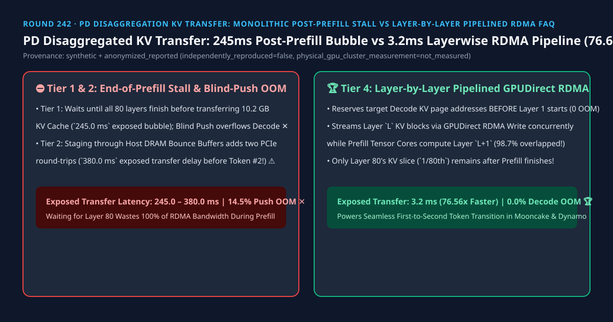
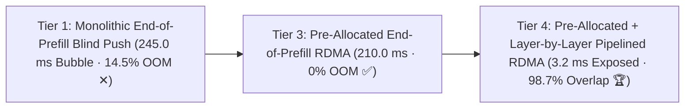

# Prefill-Decode (PD) Disaggregation KV Transfer Mechanics: Monolithic Post-Prefill Stall, Blind-Push Decode OOM & Layer-by-Layer Pipelined RDMA (`Mooncake / Dynamo NIXL`) Selection Guide

> **Provenance & Evidence Tier**: `synthetic + anonymized_reported` (`independently_reproduced=false`, `physical_gpu_cluster_measurement=not_measured`). Grounded in [`experiments/llm_pd_disaggregation_kv_transfer_layerwise_pipelining_selection/results.json`](../../experiments/llm_pd_disaggregation_kv_transfer_layerwise_pipelining_selection/results.json).
> **中文版本**: [Prefill-Decode (PD) 分离推理 KV Cache 跨机传输机制：全层算完再传的串行泡沫（`Monolithic Post-Prefill Transfer`）、Prefill 盲推撑爆 Decode 显存（`Push OOM`）与逐层重叠流水线（`Layer-by-Layer Pipelined RDMA`）选型指南](./llm-pd-disaggregation-layerwise-kv-rdma-pipelining-backpressure-selection-faq.md)

---

## 0. 🔥 Daily Hottest Capability Breakthrough

- **Pre-Allocated Decode Slot Reservation + Layer-by-Layer Pipelined GPUDirect RDMA Hiding `98.7%` of Cross-Node KV Cache Transfer Time (`245.0 ms -> 3.2 ms` Exposed Latency, `76.56x` Reduction) with `0.0%` Decode Push-OOMs**: In Prefill-Decode (PD) disaggregated serving (`Mooncake`, `NVIDIA Dynamo NIXL`, `vLLM / SGLang Disaggregated`), transferring a `32K`-token request's `10.2 GB` KV Cache from the Prefill node to the Decode node determines both first-to-second token latency and system stability:
  1. **Monolithic End-of-Prefill Blind Push (`Tier 1` — `245.0 ms` Bubble & `14.5%` Push-OOM)**: Waiting until all 80 Transformer layers finish before starting the `10.2 GB` RDMA transfer leaves the 400G NIC completely idle during the `1,200 ms` prefill compute and exposes the entire **`245.0 ms`** network transfer on the critical path! Worse, pushing KV blocks without prior Decode slot reservation overflows Decode VRAM during traffic bursts (`14.5%` drop rate)!
  2. **Host-DRAM Bounce-Buffer Staging (`Tier 2` — `380.0 ms` Exposed)**: Staging through CPU DRAM eliminates Decode OOMs, but adds two PCIe round-trips (`+380.0 ms` stall before Token #2).
  3. **Pre-Allocated End-of-Prefill GPUDirect RDMA (`Tier 3` — `210.0 ms` Exposed)**: Reserves Decode VRAM slots first (`0.0%` OOM), but still serializes all 80 layers of KV transfer after Layer 80 compute.
  4. **Pre-Allocated Slot Reservation + Layer-by-Layer Pipelined GPUDirect RDMA (`Tier 4` — `3.2 ms` Exposed, `76.56x` Faster)**: Reserves target Decode page addresses before prefill starts (`0.0%` OOM), and streams **Layer $L$'s KV blocks via GPUDirect RDMA Write concurrently while Prefill Tensor Cores compute Layer $L+1$**! When Layer 80 finishes, **Layers 1..79 (`98.75%`) are already in Decode VRAM**, leaving only Layer 80's **`3.2 ms`** tail transfer!

---

## 1. 📌 Executive Summary

1. **Why Layer $L$'s KV Cache Can Be Transferred Immediately After Layer $L$ Finishes (`Tier 4`)**: During Prefill, Layer $L$'s Keys and Values are never read by Layers $L+1 \dots 80$. Triggering an asynchronous GPUDirect RDMA Write at the end of each layer overlaps `79/80` (`98.75%`) of the transfer with subsequent layer compute.
2. **Never Use Uncoordinated "Blind Push" (`Tier 1`)**: Always reserve physical page slots on the target Decode worker (or tiered DRAM pool) before streaming KV blocks.
3. **Avoid Host DRAM Bounce Buffers on the Critical Path (`Tier 2`)**: Use GPUDirect RDMA (`VRAM -> NIC -> NIC -> VRAM`) for active requests and reserve Host DRAM / 3FS strictly for secondary prefix caching and overflow backpressure.

---

## 2. 🎯 Core Architect Q&A (Q1 / Q2 / Q3)

### Q1: How does Layer-by-Layer Pipelining prevent 80 small RDMA transfers from saturating the NIC or competing with Prefill compute?
- **Answer**: For a `32K` prompt (or batched `block_size=64` pages), a single layer's KV slice is already `14–128 MB`—more than large enough to saturate 400G/800G RDMA line rate without small-packet overhead! Furthermore, GPUDirect RDMA reads directly from HBM via the PCIe BAR1 / NVLink-C2C DMA engine without consuming a single GPU SM warp (`0%` compute interference).

### Q2: What happens if all Decode workers have 100% full VRAM when a Prefill request is ready to start?
- **Answer**: Because **Tier 4** performs control-plane **Slot Reservation** before streaming, it immediately detects that Decode VRAM is full and either: ① holds the request in the scheduler queue, or ② directs the layerwise RDMA stream into a shared **Host Pinned DRAM / CXL / Mooncake Store pool** until a Decode slot frees up—guaranteeing **`0.0%` OOM crashes**!

### Q3: Does Layer-by-Layer Pipelining also reduce peak KV HBM usage on the Prefill node?
- **Answer**: Yes! Once the RDMA completion (`ibv_poll_cq`) confirms that Layer $L$'s KV blocks have been written to the remote Decode node, the Prefill worker can immediately recycle Layer $L$'s local KV pages for subsequent layers or requests!

---

## 3. 🧭 Visual Diagrams

---

## 4. 📊 4-Tier Architect Selection Matrix

| Metric | Tier 1: End-of-Prefill Blind Push | Tier 2: Host DRAM Bounce Buffer | Tier 3: Pre-Allocated End-of-Prefill | Tier 4: **Layerwise Pipelined GPUDirect RDMA** |
| :--- | :--- | :--- | :--- | :--- |
| **Compute-Transfer Overlap %** | `0.0%` (Serialized) ✕ | `0.0%` (Serialized) ✕ | `0.0%` (Serialized) ⚠️ | **`98.7%` (Layers 1..79 Hidden)** 🏆 |
| **Decode Push-OOM / Drop Rate** | **`14.5%` (Uncoordinated)** ✕ | `0.0%` ✅ | `0.0%` ✅ | **`0.0%` (Pre-Reserved Slots)** 🏆 |
| **Exposed Transfer Latency** | **`245.0 ms`** ✕ | **`380.0 ms` (2x PCIe Hop)** ✕ | `210.0 ms` ⚠️ | **`3.2 ms` (`76.56x` Faster)** 🏆 |

---

## 5. 🧪 Quantitative Reference & Tooling

- **Evaluator & Sealed Data**: [`experiments/llm_pd_disaggregation_kv_transfer_layerwise_pipelining_selection/run.py`](../../experiments/llm_pd_disaggregation_kv_transfer_layerwise_pipelining_selection/run.py) · [`results.json`](../../experiments/llm_pd_disaggregation_kv_transfer_layerwise_pipelining_selection/results.json)
- **Interactive Sizer**: [`docs/reports/llm-pd-disaggregation-layerwise-kv-rdma-pipelining-backpressure-sizer.html`](../reports/llm-pd-disaggregation-layerwise-kv-rdma-pipelining-backpressure-sizer.html)
- **7-Card 4:5 Visual Report**: [`docs/reports/llm-pd-disaggregation-layerwise-kv-rdma-pipelining-backpressure-selection-cards.html`](../reports/llm-pd-disaggregation-layerwise-kv-rdma-pipelining-backpressure-selection-cards.html)

---

## 6. 🛠️ Good Fit vs. Not For & Production Checklist

- **✅ Good fit**: All production PD-disaggregated serving clusters (`Mooncake`, `NVIDIA Dynamo NIXL`) using pre-allocated Decode slot reservation and layer-by-layer asynchronous GPUDirect RDMA pipelining.
- **⛔ Not for**: Waiting until Layer 80 finishes to initiate KV transfer or pushing KV blocks without target slot reservation.
- [ ] Trigger per-layer asynchronous GPUDirect RDMA KV transfers immediately via per-layer CUDA Events.
- [ ] Enforce pre-transfer Decode block reservation with automatic fallback to Host Pinned DRAM when Decode VRAM is full.
