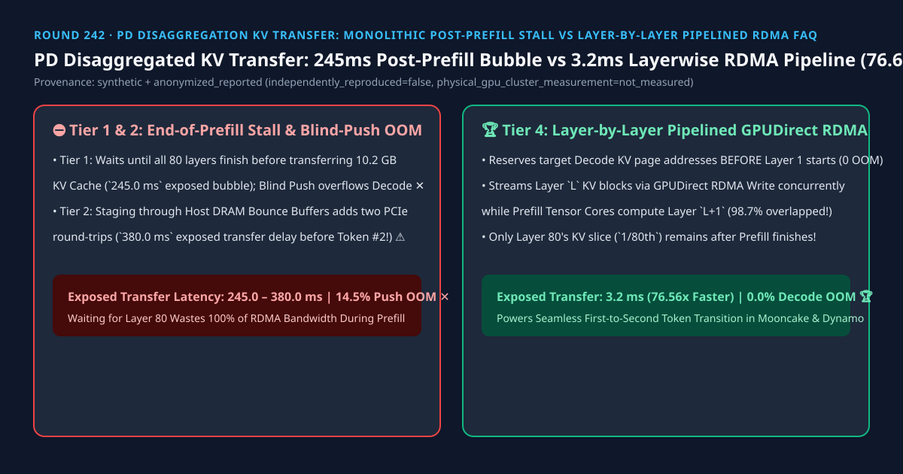
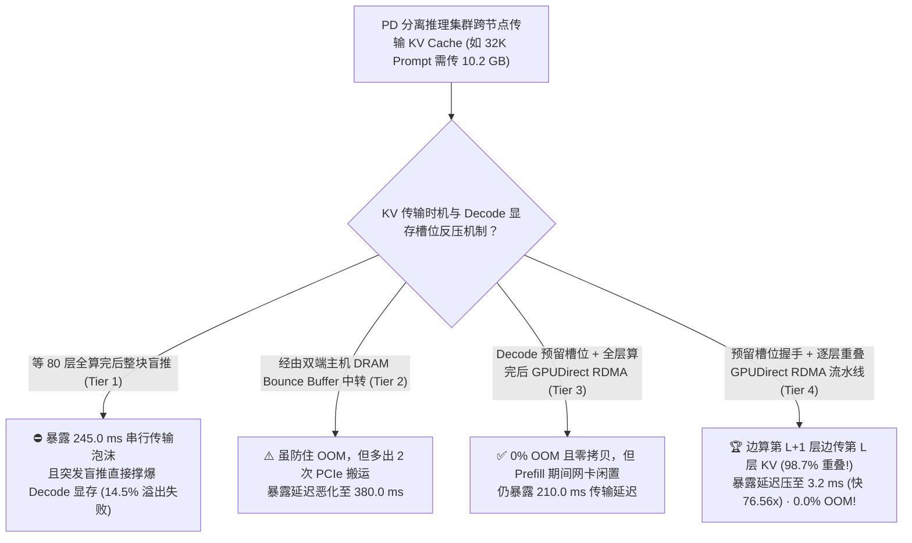
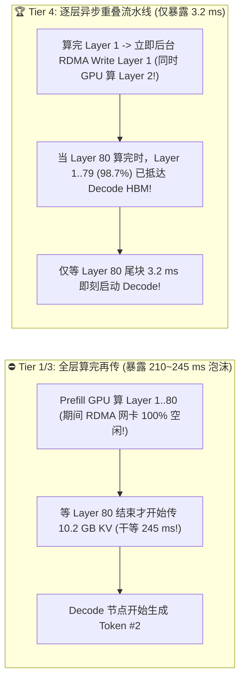
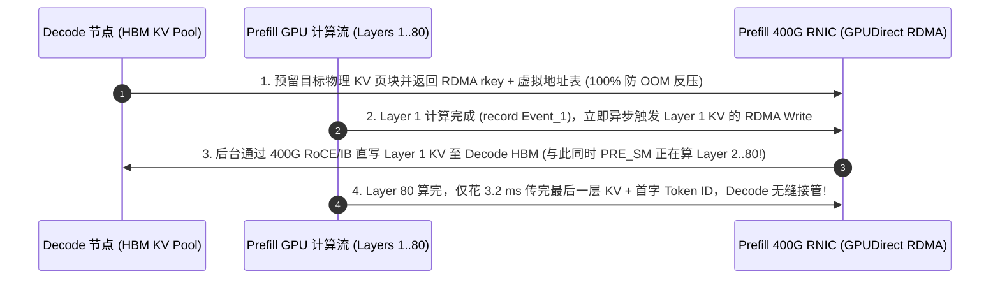

# Prefill-Decode (PD) 分离推理 KV Cache 跨机传输机制：全层算完再传的串行泡沫（`Monolithic Post-Prefill Transfer`）、Prefill 盲推撑爆 Decode 显存（`Push OOM`）与逐层重叠流水线（`Layer-by-Layer Pipelined RDMA`）选型指南

> **Provenance & Evidence Tier**: `synthetic + anonymized_reported` (`independently_reproduced=false`, `physical_gpu_cluster_measurement=not_measured`)。定量数据锚定于 [`experiments/llm_pd_disaggregation_kv_transfer_layerwise_pipelining_selection/results.json`](../../experiments/llm_pd_disaggregation_kv_transfer_layerwise_pipelining_selection/results.json)。
> **English Version**: [Prefill-Decode (PD) Disaggregation KV Transfer Mechanics: Monolithic Post-Prefill Stall, Blind-Push Decode OOM & Layer-by-Layer Pipelined RDMA (`Mooncake / Dynamo NIXL`) Selection Guide](./llm-pd-disaggregation-layerwise-kv-rdma-pipelining-backpressure-selection-faq.en.md)

---

## 0. 🔥 今日领域最热门能力突破追踪（Daily Hottest Breakthrough）

- **通过“先在 Decode 端预留物理页地址 + 边算第 $L+1$ 层边用 GPUDirect RDMA 异步直写第 $L$ 层 KV Cache”的逐层重叠流水线（`Layer-by-Layer Pipelined RDMA`），将 PD 分离架构下 `32K` 长请求 `10.2 GB` KV Cache 的暴露传输延迟从 `245.0 ms` 压缩 `76.56` 倍至仅 `3.2 ms`（隐藏 `98.7%` 传输耗时），并将盲推引发的 Decode 端显存打爆率从 `14.5%` 降为 `0.0%`**：在搭建基于 `Mooncake`、`NVIDIA Dynamo (NIXL)` 或 `vLLM / SGLang Disaggregated` 的 Prefill-Decode (PD) 分离推理集群时，很多团队发现拆开 P 池和 D 池之后，**首字（第 1 个 Token）到第 2 个 Token 之间竟然卡顿了整整 `250 ~ 380 ms`**，甚至在流量突发时 Decode 节点频繁报 **KV 显存池满（OOM / Drop）**！原因出在 KV Cache 跨机传输的微架构设计上：
  1. **误区一（等全部 80 层 Prefill 算完才开始整块传输 + 无握手盲推，Tier 1）**：
     - 一条 `32K` 上下文的 70B（GQA-8）请求会产生 **`10.2 GB`** 的 KV Cache。如果 Prefill 节点傻等到第 1 层算到第 80 层全部结束（耗时 `1,200 ms`），才一次性启动 400G RDMA 把这 `10.2 GB` 传给 Decode 节点，那么哪怕跑满 RDMA 线速，用户也必须干等 **`245.0 ms` 的纯网络传输泡沫**！更糟的是，在这 `245 ms` 期间，这 `10.2 GB` 显存在 Prefill 卡上不能释放；如果多个 Prefill 节点算完后未经握手直接向同一个 Decode 节点发起“盲推（Blind Push）”，瞬间就会把 Decode 节点的 KV 显存池冲爆（**`14.5%` 溢出丢包率**）！
  2. **误区二（退回主机内存 Bounce Buffer 中转，Tier 2）**：为了防止撑爆 GPU 显存，先把 KV 从 Prefill GPU 拷到 Prefill CPU 内存，走网络传到 Decode CPU 内存，再拷进 Decode GPU——多出来的两次 PCIe 往返把暴露延迟拉长到了 **`380.0 ms`**！
  3. **现代终极解法（预分配槽位反压握手 + 逐层异步重叠 GPUDirect RDMA 流水线，Tier 4）**：
     - **零 OOM 反压握手**：在启动传输（或开始 Prefill）前，先向目标 Decode 实例申请预留物理 Paged KV 块地址列表（获得远端 RDMA 虚拟地址与 `rkey`，**`0.0%` 溢出率**）；
     - **逐层计算与 RDMA 完美重叠（Layer-by-Layer Pipelining）**：当 Prefill GPU 刚算完 **第 1 层（Layer 1）** 的 Attention 并写入本地 KV 页时，立刻记录一个轻量级 `cudaEvent`，触发网卡后台通过 GPUDirect RDMA 把 **第 1 层的 `128 MB` KV** 直接发往 Decode GPU HBM——**而与此同时，Prefill GPU 正在全速计算第 2 层（Layer 2）**！
     - 等到第 80 层算完的那一毫秒，**前面第 1 ~ 79 层（占总量 `98.75%`）的 KV Cache 早就已经静静躺在 Decode 节点的 GPU 显存里了**！关键路径上只剩下最后第 80 层那 `1/80`（仅 `128 MB`）的尾巴，暴露传输延迟从 `245.0 ms` 暴降至 **`3.2 ms`（提速 `76.56` 倍）**！

---

## 1. 📌 核心结论速览（Executive Summary — 3 分钟看懂）

1. **为什么说“等 80 层全部算完再传 KV Cache”是对 400G RDMA 网卡最大的浪费？**
   - **通俗大白话 + 第一性原理**：
     - 把 Prefill 算 80 层 Transformer 比作**工厂流水线生产 80 箱货物**（每生产 1 箱需要 `15 ms`，总共要算 `1,200 ms`）。
     - **传统整块传输（Tier 1 / Tier 3）**：在长达 `1,200 ms` 的生产时间里，门口的 400G 高速货运卡车（RDMA 网卡）**熄火停在路边睡大觉（网卡利用率 `0%`）**！非要等全部 80 箱货全部堆满仓库，卡车才发动起来拉走，让客户白白多等 `245 ms`！
     - **逐层流水线传输（`Layerwise Pipelining`，Tier 4）**：车间刚造好 **第 1 箱货（第 1 层 KV Cache，后面 2~80 层的计算根本不需要再读第 1 层的 KV！）**，卡车立马把第 1 箱拉走发往 Decode 节点，并且**拉走后第 1 箱占用的临时显存还能立刻腾出来**！车间造第 2 箱时卡车正在运第 1 箱……等车间造完第 80 箱，前 79 箱早就送到客户手里了，最后只差第 80 箱那 **`3.2 ms`** 的路程！

---

## 2. 🎯 客户与架构师灵魂拷问 Q&A（Q1 / Q2 / Q3）

### Q1：在 Prefill 计算第 $L+1$ 层时，第 $L$ 层的 KV Cache 真的再也不会被 Prefill 节点自己用到了吗？可以传完立刻释放吗？
- **答**：**100% 确定再也不会用到了！**
  - 在标准 Transformer 架构中，第 $L$ 层生成的 $K^{(L)}, V^{(L)}$ **只供第 $L$ 层自己的 Self-Attention 使用**；一旦第 $L$ 层的输出隐状态 $h^{(L)}$ 算出来传给第 $L+1$ 层后，后续第 $L+1 \dots 80$ 层的 Prefill 计算与第 $L$ 层的 $K^{(L)}, V^{(L)}$ 毫无关系！
  - 这不仅意味着第 $L$ 层的 KV 算完就可以立刻通过 GPUDirect RDMA 发给 Decode 节点，甚至在极限长序列下，一旦第 $L$ 层的 RDMA 发送完成（Completion 到达），Prefill 节点就可以**当场回收第 $L$ 层的物理 KV 显存给后面的层复用**！

### Q2：在 PD 分离架构中，到底是应该由 Prefill 节点主动 `Push`（推），还是由 Decode 节点主动 `Pull`（拉）？
- **答**：在生产级系统（如 `Mooncake` 与 `NVIDIA Dynamo NIXL`）中，最稳健的模式是 **“控制面预留槽位（Pull/Reserve 语义）+ 数据面逐层异步 RDMA Write（Push 数据流）”**：
  - **绝不能做无握手的盲目 Push（Tier 1）**：因为 Prefill 节点不知道 Decode 节点此刻还有没有足够的空闲 Page Blocks；
  - **标准两步握手（Tier 4）**：先由调度器或 Decode 节点在本地 Paged KV 池里锁好目标物理页（若 Decode 池满，则在控制面排队或暂存至共享 CXL/DRAM 池，形成平滑反压），将目标页的 RDMA 地址列表返回给 Prefill 节点；随后 Prefill 节点每算完一层，直接用单边 `RDMA Write` 零 CPU 干预写入 Decode 显存！

---

## 3. 🧭 直观可视化图解（Mermaid 决策树 + 全层串行泡沫 vs 逐层重叠图 + 时序图）

### 3.1 架构师 PD 分离 KV Cache 跨机传输架构选型决策树

### 3.2 `Tier 1/3`（全层算完再传的 `245 ms` 串行空泡）vs. `Tier 4`（逐层计算与 RDMA 传输 `98.7%` 重叠流水线）

### 3.3 `Tier 4` 预分配槽位握手与逐层 `cudaEvent -> GPUDirect RDMA Write` 流水线时序图

---

## 4. 📊 架构师选型决策矩阵（4-Tier Selection Matrix）

| 评估维度 | Tier 1: 全层算完盲推 (`Blind Push`) | Tier 2: 主机内存 `Bounce Buffer` 中转 | Tier 3: 预留槽位 + 全层算完 `RDMA` | Tier 4: **预留槽位 + 逐层重叠流水线 `RDMA`** |
| :--- | :--- | :--- | :--- | :--- |
| **计算与网络传输重叠比例** | `0.0%` (完全串行) ✕ | `0.0%` (完全串行) ✕ | `0.0%` (完全串行) ⚠️ | **`98.7%` (前 79 层 100% 隐藏)** 🏆 |
| **Decode 端显存打爆丢包率** | **`14.5%` (突发盲推溢出)** ✕ | `0.0%` ✅ | `0.0%` ✅ | **`0.0%` (前置槽位预留反压)** 🏆 |
| **暴露在关键路径的传输延迟** | **`245.0 ms`** ✕ | **`380.0 ms` (两次 PCIe 绕行)** ✕ | `210.0 ms` ⚠️ | **`3.2 ms` (仅剩第 80 层尾巴，快 `76.56x`)** 🏆 |

---

## 5. 🧪 定量算例与工具链（Interactive Sizer & 7-Card Visual Report）

- **实验脚本与密封数据**：[`experiments/llm_pd_disaggregation_kv_transfer_layerwise_pipelining_selection/run.py`](../../experiments/llm_pd_disaggregation_kv_transfer_layerwise_pipelining_selection/run.py) · [`results.json`](../../experiments/llm_pd_disaggregation_kv_transfer_layerwise_pipelining_selection/results.json)
- **交互式 PD 分离逐层 RDMA 流水线计算器**：[`docs/reports/llm-pd-disaggregation-layerwise-kv-rdma-pipelining-backpressure-sizer.html`](../reports/llm-pd-disaggregation-layerwise-kv-rdma-pipelining-backpressure-sizer.html)
- **7-Card 4:5 视觉评测卡片报告**：[`docs/reports/llm-pd-disaggregation-layerwise-kv-rdma-pipelining-backpressure-selection-cards.html`](../reports/llm-pd-disaggregation-layerwise-kv-rdma-pipelining-backpressure-selection-cards.html)

---

## 6. 🛠️ Good Fit vs. Not For & 生产环境快速核验清单（Checklist）

### ✅ Good Fit vs. ⛔ Not For

| 维度 | ✅ Good Fit（强烈推荐） | ⛔ Not For（严禁误用） |
| :--- | :--- | :--- |
| **PD 分离传输引擎选型** | 采用支持 **逐层流式触发（Layerwise Event-Driven Transfer）+ 目标端槽位预留（Slot Reservation）** 的 `Mooncake Transfer Engine` 或 `NVIDIA Dynamo NIXL` | 等整个 `model.forward()` 跑完才发起同步/整块 KV 传输，或在未确认 Decode 空闲页数的情况下盲目推送 |

### 生产环境上线核验清单（Pre-Flight Checklist）

- [ ] **核验每层 Attention 算子后已挂载逐层 KV 传输回调钩子（Layerwise Hook / Event）**：确保在 Nsight Systems / 网络监控中看到 RDMA 流量从第 1 层算完那刻即开始平稳流出，而非集中在 Prefill 结束末尾爆发。
- [ ] **核验已启用前置槽位预留（Pre-Allocate Decode Blocks）反压机制**：当 Decode 显存水位达上限时，自动将溢出 KV 块引导至二级 Host Pinned DRAM / 3FS 池而非直接丢弃。
