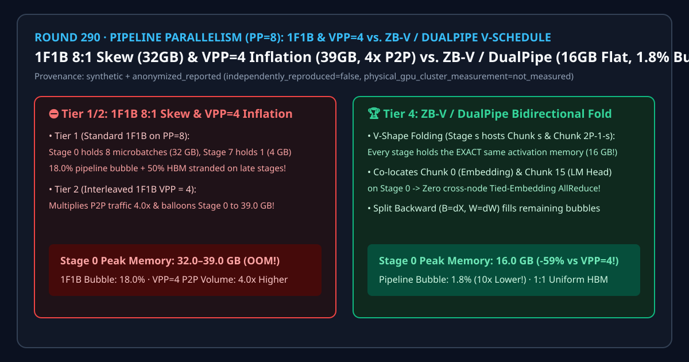
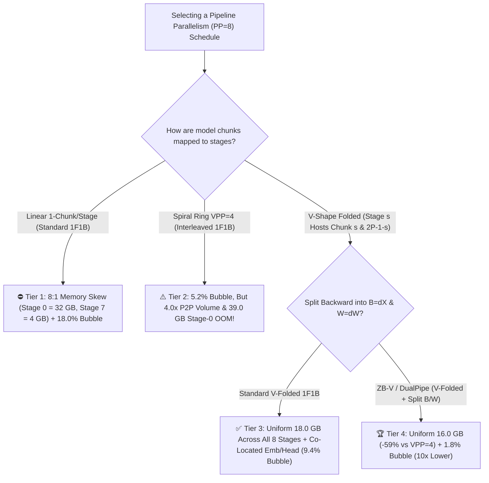
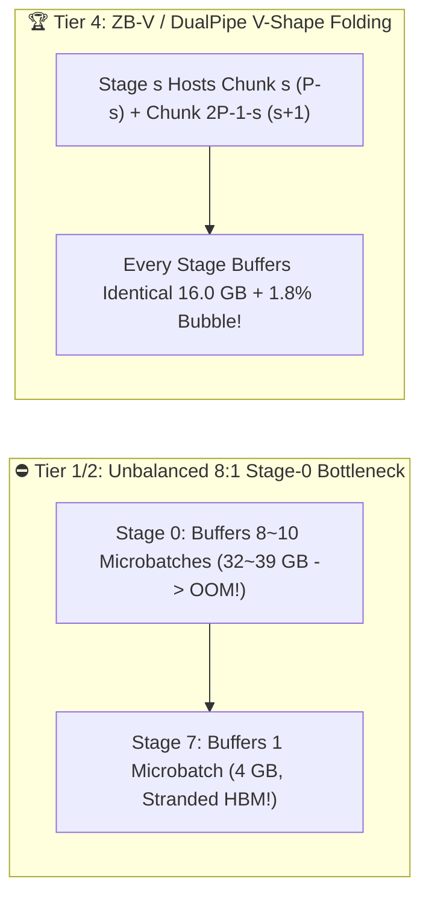
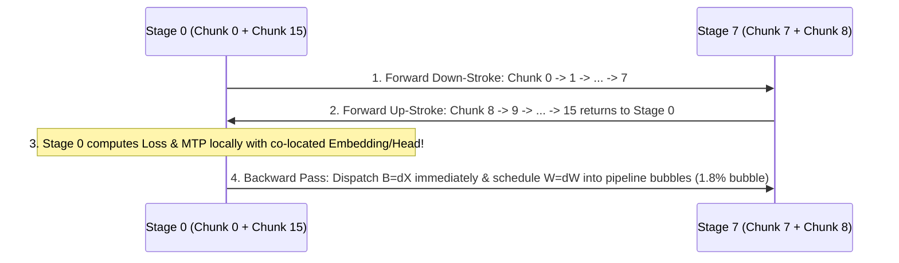

# Pipeline Parallelism (`PP=8`) Schedule & Memory Skew Selection Guide: Why Standard `1F1B` Suffers an `8:1` Stage-0 Memory Imbalance (`32 GB` OOM) and `Interleaved 1F1B (VPP=4)` Inflates P2P Traffic `4x` (`39 GB`) vs. `ZB-V / DualPipe` V-Shape Folding (`16.0 GB` Uniform HBM, `1.8%` Bubble)

> **Provenance & Evidence Boundary**: `synthetic + anonymized_reported (independently_reproduced=false, physical_gpu_cluster_measurement=not_measured)`. All quantitative figures in this guide are generated by the deterministic evaluator `experiments/llm_megatron_pp_virtual_pipeline_interleaved_1f1b_v_schedule_selection/run.py` and sealed in `results.json`.



---

## 0. Daily Capability Breakthrough Tracking

- **Breakthrough Focus**: **`Zero-Bubble V-Schedule (ZB-V)` / DeepSeek `DualPipe` V-Shape Folded Pipeline Parallelism (Co-Locating Forward Chunk $s$ and Returning Chunk $2P-1-s$ on Physical Stage $s$ + Split Backward $B=dX / W=dW$)**.
- **Architect Value**: In `PP=8` multi-node LLM training, standard **`1F1B`** forces **Stage 0 to buffer $P=8$ in-flight microbatches of activations (`32.0 GB`) while Stage 7 holds only `1` microbatch (`4.0 GB`)**—stranding half of total cluster activation HBM on later stages while Stage 0 crashes with `OOM` (`18.0%` pipeline bubble). Turning on Megatron-LM **`Interleaved 1F1B` (`VPP = 4` virtual stages)** shrinks the bubble to `5.2%`, but **multiplies cross-stage P2P communication volume by `4.0x` and inflates Stage-0 peak activation memory to `39.0 GB` (`+21.9%` higher than `1F1B`)**! Switching to **`ZB-V / DualPipe` V-Shape Folding** equalizes in-flight activation memory to a **perfect `1:1` uniform `16.0 GB` across all 8 stages (`-59.0%` vs. `VPP=4`)**, co-locates `Embedding` (`Chunk 0`) and `LM Head / MTP` (`Chunk 15`) on Stage 0 with zero cross-node weight sync, keeps P2P volume at `2.0x` (using only adjacent full-duplex links), and slashes pipeline bubbles to **`1.8%` (`10x` lower than `1F1B`)**.

---

## ① 📌 Executive Summary

1. **Why Standard `1F1B` Suffers an `8:1` Activation Memory Imbalance**:
   During the `PP=8` warmup phase, Stage $s$ must execute and stash $P - s$ forward microbatches before its first backward microbatch arrives from Stage $s+1$. Thus Stage 0 stores **`8` microbatches (`32.0 GB`)** while Stage 7 stores **`1` microbatch (`4.0 GB`)**. Because batch size is bottlenecked by the highest-memory rank (Stage 0), `112 GB` of activation capacity across Stages 1–7 is stranded!
2. **Why `Interleaved 1F1B (VPP=4)` Inflates Both P2P Traffic (`4.0x`) and Stage-0 Memory (`39.0 GB`)**:
   Splitting each stage into $v=4$ interleaved chunks routes every microbatch around the 8-stage ring **4 times** (`4.0x` P2P volume, including long-distance wrap-around hops from `Stage 7 -> Stage 0`) and requires Stage 0 to hold $4P + (P-1) = 39$ quarter-chunks (**`39.0 GB`**) in flight!
3. **How `ZB-V / DualPipe` V-Shape Folding Achieves `16.0 GB` Uniform HBM & `1.8%` Bubble**:
   Partitioning the model into $2P = 16$ half-chunks and folding them in a **V-shape** so physical Stage $s$ hosts `Chunk` $s$ (which buffers $P-s$ half-chunks) and `Chunk` $2P-1-s$ (which buffers $s+1$ half-chunks) means **every stage $s \in \{0..7\}$ holds the exact same $(P-s) + (s+1) = P+1$ half-chunks (`16.0 GB` with $B/W$ lifespan scheduling)**!

---

## ② 🎯 Key Architectural Q&A (Q1 / Q2 / Q3)

### Q1: Why does V-Shape folding eliminate cross-node `Tied-Embedding` and `MTP` weight synchronization overhead?
- Because `Chunk 0` (the first model chunk containing `Embedding`) and `Chunk 2P-1` (the final model chunk containing the `Output LM Head` and DeepSeek `MTP` modules) are both placed on **physical Stage 0**! They share tensors directly in local HBM with zero inter-node All-Reduce.

### Q2: Why is V-Shape folding (`0 -> 1 -> ... -> 7 -> 6 -> ... -> 0`) much friendlier to Clos/Fat-Tree networks than `Interleaved 1F1B` (`0 -> ... -> 7 -> 0`)?
- `Interleaved 1F1B` requires a wrap-around hop from `Stage 7 -> Stage 0` on every virtual pass, which typically traverses the Spine switches between the first and last racks. In a **V-Shape schedule**, every forward and backward transition occurs strictly between **adjacent stages ($s \leftrightarrow s+1$)**, utilizing symmetric full-duplex bidirectional links with zero wrap-around hops!

### Q3: If we cannot switch schedulers immediately, how can we mitigate Stage-0 OOM in standard `1F1B`?
- Apply **Stage-Aware Selective Activation Checkpointing**: enable activation recomputation on Stages `0..2` (which hold `6–8` in-flight microbatches) while disabling recomputation on Stages `5..7` (which hold only `1–3` microbatches and have ample free HBM).

---

## ③ 🧭 Visual Diagrams (Decision Tree, Memory Profile & Sequence Diagram)

### 3.1 `PP=8` Pipeline Parallelism Schedule Selection Decision Tree



### 3.2 `1F1B / VPP=4` Stage-0 Skew (`32–39 GB`) vs. `ZB-V / DualPipe` Uniform HBM (`16.0 GB`)



### 3.3 `ZB-V` Down-Stroke, Up-Stroke & Split-Backward Execution Sequence



---

## ④ 📊 4-Tier Architect Decision Matrix

| Selection Tier | Schedule & Chunk Mapping | Stage-0 Peak Activation HBM | Cross-Stage Memory Skew | Pipeline Bubble | P2P Comm Volume | Target Scenario |
| :--- | :--- | :--- | :--- | :--- | :--- | :--- |
| **Tier 1: Standard `1F1B` (`VPP=1`)** | Linear 1 chunk/stage | `32.0 GB` ✕ | `8 : 1` skew ✕ | `18.0%` ✕ | `1.0x` | ⛔ **Severe Stage-0 OOM & high bubble** |
| **Tier 2: `Interleaved 1F1B` (`VPP=4`)** | 4-pass spiral ring | `39.0 GB` (OOM! ✕) | `8 : 1` skew | `5.2%` ✅ | `4.0x` ✕ | ⚠️ High P2P & Stage-0 memory bloat |
| **Tier 3: V-Shape Folded `1F1B`** | `Chunk s` & `2P-1-s` on Stage $s$ | `18.0 GB` ✅ | **`1 : 1` uniform ✅** | `9.4%` | `2.0x` | ✅ Eliminates Stage-0 skew & tied-emb sync |
| **Tier 4: `ZB-V / DualPipe` + Split `B/W` (Recommended)** | **V-Fold + `B=dX / W=dW` split** | **`16.0 GB` (`-59%` 🏆)** | **`1 : 1` uniform 🏆** | **`1.8%` (`10x` lower 🏆)** | **`2.0x` (Full-Duplex 🏆)** | 🏆 **Production `PP>=4` Training Standard** |

---

## ⑤ 🧪 Quantitative Evaluator & 7-Card 4:5 Visual Report

- **Deterministic Evaluator**: [`experiments/llm_megatron_pp_virtual_pipeline_interleaved_1f1b_v_schedule_selection/run.py`](../../experiments/llm_megatron_pp_virtual_pipeline_interleaved_1f1b_v_schedule_selection/run.py) · Sealed JSON: [`results.json`](../../experiments/llm_megatron_pp_virtual_pipeline_interleaved_1f1b_v_schedule_selection/results.json)
- **Interactive Sizer Workbench**: [`docs/reports/llm-pipeline-parallel-interleaved-1f1b-vs-dualpipe-v-schedule-memory-sizer.html`](../reports/llm-pipeline-parallel-interleaved-1f1b-vs-dualpipe-v-schedule-memory-sizer.html)
- **7-Card 4:5 Visual Benchmark Deck**: [`docs/reports/llm-pipeline-parallel-interleaved-1f1b-vs-dualpipe-v-schedule-memory-selection-cards.html`](../reports/llm-pipeline-parallel-interleaved-1f1b-vs-dualpipe-v-schedule-memory-selection-cards.html)

```chart
{
  "data": {
    "values": [
      { "tier": "Tier 1: Standard 1F1B (8:1 Skew)", "stage0_mem_gb": 32.0, "bubble_pct": 18.0 },
      { "tier": "Tier 2: Interleaved 1F1B (VPP=4)", "stage0_mem_gb": 39.0, "bubble_pct": 5.2 },
      { "tier": "Tier 3: V-Shape Folded 1F1B", "stage0_mem_gb": 18.0, "bubble_pct": 9.4 },
      { "tier": "Tier 4: ZB-V / DualPipe Split-BW", "stage0_mem_gb": 16.0, "bubble_pct": 1.8 }
    ]
  },
  "semantic_types": {
    "tier": "Category",
    "stage0_mem_gb": "Amount",
    "bubble_pct": "Percentage"
  },
  "chart_spec": {
    "chartType": "Bar Chart",
    "title": "ZB-V / DualPipe V-Folding Cuts Stage-0 Activation Memory to 16.0 GB (-59% vs VPP=4) & Bubble to 1.8%",
    "subtitle": "Stage-0 peak activation memory (GB) and pipeline bubble (%) on PP=8 (synthetic + anonymized_reported)",
    "encodings": {
      "x": "tier",
      "y": "stage0_mem_gb",
      "color": "tier"
    }
  }
}
```

---

## ⑥ 🛠️ Production Verification Checklist (Good fit vs. Not for)

### ✅ Good fit vs. ⛔ Not for
- **✅ Good fit**: Multi-node LLM pre-training (`PP = 4 / 8 / 16`) where Stage-0 activation memory or cross-node P2P bandwidth is a bottleneck.
- **⛔ Not for**: Blindly setting `virtual_pipeline_model_parallel_size >= 4` when Stage 0 is already close to its HBM limit.

### Production Checklist
- [ ] **V-Shape Chunk Placement (`Chunk s` and `Chunk 2P-1-s`)**: Verify uniform activation memory across all $P$ pipeline ranks (`1:1` ratio).
- [ ] **Co-Located `Embedding` & `LM Head / MTP` on Stage 0**: Eliminate cross-pipeline `All-Reduce` for tied embeddings and auxiliary MTP heads.
- [ ] **Split Backward ($B=dX$, Deferred $W=dW$)**: Decouple weight-gradient GEMMs to fill warmup/cooldown pipeline bubbles (`< 2.0%` bubble).
