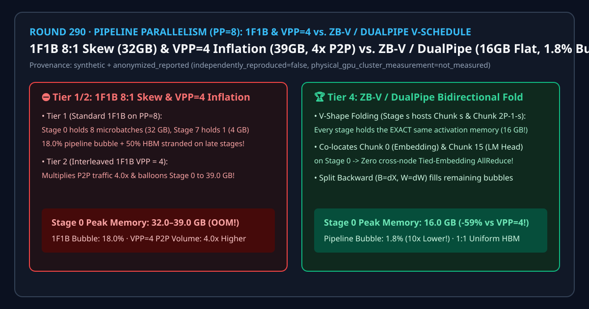
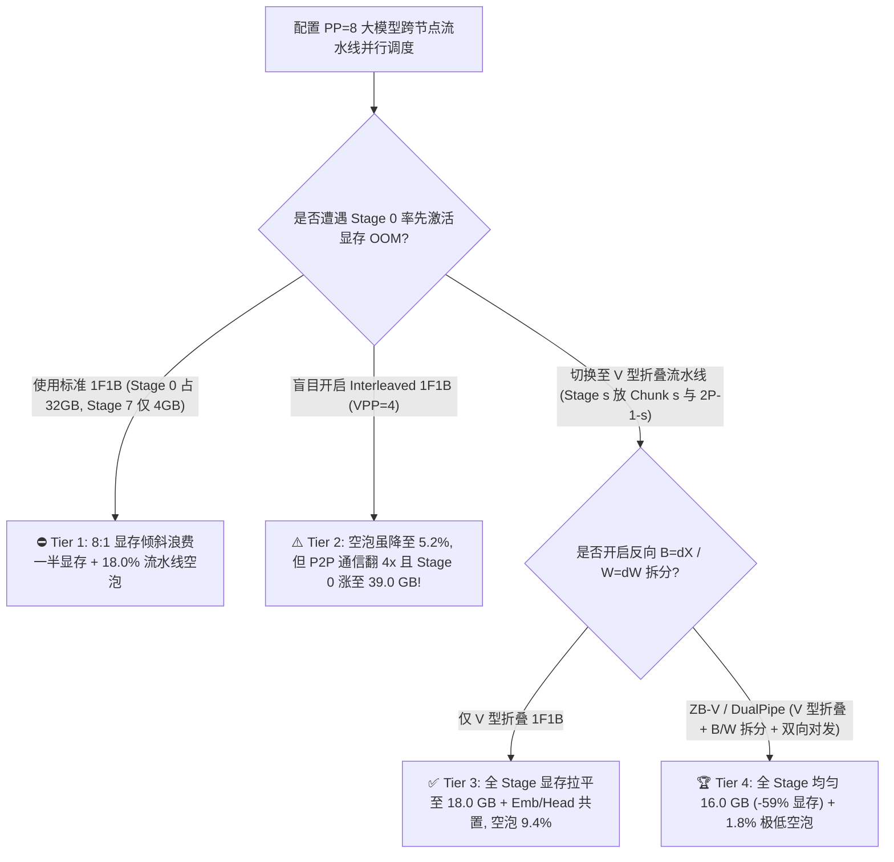
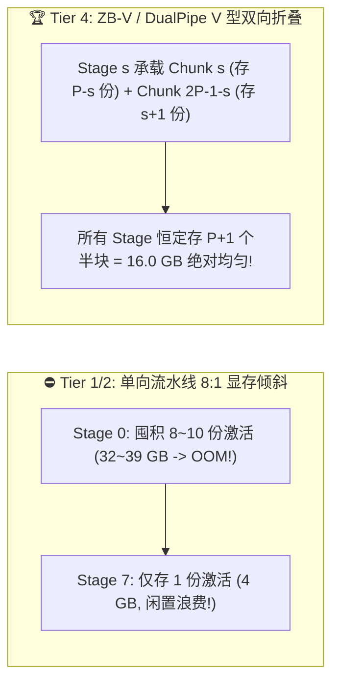
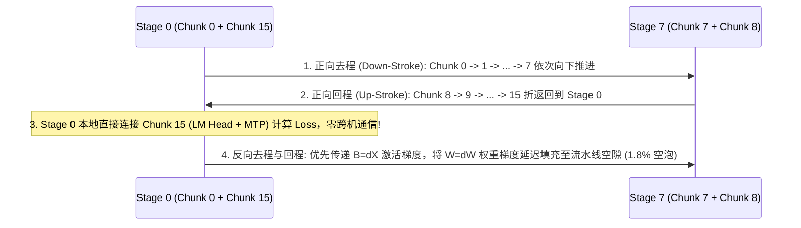

# 流水线并行（`PP=8`）调度与显存倾斜深水区：为什么标准 `1F1B` 存在 `8:1` 首尾显存不均（Stage 0 占 `32 GB` 率先 OOM），而 `Interleaved 1F1B (VPP=4)` 又会让通信翻 `4x`、显存涨到 `39 GB`？`ZB-V / DualPipe` V 型双向折叠（全 Stage 均匀 `16.0 GB` 显存，`1.8%` 极低空泡）选型指南

> **Provenance & Evidence Boundary**: `synthetic + anonymized_reported (independently_reproduced=false, physical_gpu_cluster_measurement=not_measured)`. 本文所有定量数据均来自封存确定性评估器 `experiments/llm_megatron_pp_virtual_pipeline_interleaved_1f1b_v_schedule_selection/run.py` 与 `results.json`。



---

## 0. 追踪每日最热门能力突破（Daily Capability Breakthrough）

- **今日焦点突破**：**`Zero-Bubble V-Schedule (ZB-V)` / DeepSeek `DualPipe` V 型双向折叠流水线并行（将模型切分为 $2P$ 个虚拟块，使物理 Stage $s$ 同时承载正向递增的 `Chunk` $s$ 与反向折返的 `Chunk` $2P-1-s$，配合 $B=dX / W=dW$ 反向拆解）**。
- **架构师价值**：在 `PP=8` 的跨节点大模型训练中，架构师长期受困于两大痛点：第一，在标准 **`1F1B`** 调度下，为了喂饱流水线，**Stage 0 必须同时驻留 $P=8$ 个微批次（Microbatches）的激活值（`32.0 GB`），而最后一个 Stage 7 只需要驻留 `1` 个微批次（`4.0 GB`）**——导致 Stage 1..7 上一半以上的宝贵显存白白闲置，而 Stage 0 率先 `OOM`；第二，当开启 Megatron-LM 的 **`Interleaved 1F1B`（虚拟流水线 `VPP = 4`）** 试图把流水线空泡缩小 4 倍（`18.0% -> 5.2%`）时，不仅**跨机 P2P 通信量暴增 `4.0x`**，而且 Stage 0 的在途微批次进一步膨胀至 $P + \frac{P-1}{v}$ 折算峰值 **`39.0 GB`（比 1F1B 还多占 `+21.9%` 显存！）**。通过切换至 **`ZB-V` / `DualPipe` V 型折叠流水线**，每个物理 Stage 的在途半块数恒定相等（全集群 8 个 Stage 激活显存完美拉平在 **`16.0 GB`，比 `VPP=4` 省 `-59.0%` 峰值显存**），P2P 通信仅 `2.0x`（且支持双向全双工隐藏），同时顺手将首层 `Embedding` 与末层 `LM Head / MTP` 共置在 Stage 0 上，把流水线空泡压至 **`1.8%`（提速 10 倍降泡）**！

---

## ① 📌 核心结论速览（Executive Summary）

1. **为什么标准 `1F1B` 会有 `8:1` 的极端显存倾斜（Memory Imbalance）？**
   在 `PP=8` 的启动阶段（Warmup Phase），Stage 0 必须一口气连续做完 **8 个微批次的 Forward**（把激活值全部压入显存栈保存），第 1 个微批次才能跑完 Stage 0..7 的正向并一路从 Stage 7..0 传回梯度启动 Stage 0 的第 1 次 Backward！同理，Stage $s$ 需要驻留 $P - s$ 个微批次的激活值（Stage 0 存 `8` 份 = `32 GB`，Stage 7 存 `1` 份 = `4 GB`）。由于整条流水线的最大微批次大小取决于最先 OOM 的 **Stage 0**，后面 7 个 Stage 上总计 `112 GB` 的显存空间被徹底浪费！
2. **为什么 `Interleaved 1F1B (VPP=4)` 救了空泡，却引爆了 Stage 0 显存（`39.0 GB`）和 `4x` P2P 通信？**
   `Interleaved 1F1B` 把每个 Stage 的层拆成 $v=4$ 个不相邻的小块（例如 Stage 0 负责 Chunk 0, 8, 16, 24），数据像螺旋线一样在 Stage 0..7 之间绕 **4 圈**！
   - 虽然每个小块的计算时间变成了 $\frac{1}{4}$（使启动空泡缩小为 $\frac{P-1}{vM} = 5.2\%$），但每个微批次必须跨越节点边界 $4(P-1)$ 次（**P2P 通信量翻 `4.0x`**）；
   - 更致命的是，在严格保持优化器更新语义的 Interleaved 调度下，Stage 0 在进入稳态前需要累积的在途小块数多达 $4P + (P-1) = 39$ 个四分之一块（折合 **`39.0 GB`，比 1F1B 的 `32.0 GB` 还要高出 `7.0 GB`**）！
3. **V 型双向折叠（`V-Shape Folding`：`ZB-V` / `DualPipe`）的三大神级收益**：
   把模型拆成 $2P = 16$ 个半块（Chunk $0 \dots 15$），按 **V 字折返** 放置：
   - **Stage 0** 放 `Chunk 0`（第 1 块）和 `Chunk 15`（最后 1 块）；
   - **Stage $s$** 放 `Chunk` $s$ 和 `Chunk` $2P - 1 - s$；
   - **Stage 7** 放 `Chunk 7` 和 `Chunk 8`。
   **收益 ①（激活显存 100% 绝对拉平）**：Stage $s$ 的第一个块需要存 $(P - s)$ 份激活，第二个块需要存 $(s + 1)$ 份激活，两者相加恒等于 $(P - s) + (s + 1) = P + 1$ 个半块！**无论 $s$ 是多少，所有 8 个 Stage 的峰值激活显存一模一样（统统只有 `16.0 GB`，比 `1F1B` Stage 0 减半）**！
   **收益 ②（`Embedding` 与 `LM Head / MTP` 天然共置在 Stage 0）**：`Chunk 0`（含词表 Embedding）和 `Chunk 15`（含输出 LM Head 与 DeepSeek MTP 模块）刚好在同一张 GPU（Stage 0）上！**共享词表权重零跨机通信**！
   **收益 ③（配合 $B/W$ 拆分实现 `1.8%` 零空泡）**：只需 `2.0x` 的相邻节点双向对发通信，即可把空泡压到 **`1.8%`**。

---

## ② 🎯 客户与架构师灵魂拷问 Q&A（Q1 / Q2 / Q3）

### Q1：如果我们目前还在用标准的 Megatron `1F1B`，在不改调度器为 `ZB-V` 的前提下，有什么快速办法缓解 Stage 0 的显存爆炸？
- 可以采用 **非均匀层切分（Asymmetric Layer Partitioning）或分阶段选择性重计算（Stage-Aware Selective Activation Checkpointing）**：
  1. **给 Stage 0 少分 1~2 层 Transformer Layer**（把省下的层挪给显存极其宽裕的最后几个 Stage）；
  2. **按 Stage 梯度开启重计算**：只对 Stage 0..2 开启 `Full / Selective Activation Checkpointing`（因为它们要存 6~8 个微批次），而对 Stage 5..7 **完全关闭重计算**（因为它们只存 1~3 个微批次，显存根本用不完）！这样能白捡回约 `15%` 的反向计算耗时。但最彻底的根治方案依然是升级为 **V 型折叠调度（Tier 3/4）**。

### Q2：为什么 `V-Shape` 折叠流水线比环状螺旋的 `Interleaved 1F1B (VPP=2)` 在网络拓扑上友好得多？
- 在 `Interleaved 1F1B` 中，数据流是单向环绕的：`Stage 0 -> 1 -> ... -> 7 -> 0 -> 1 ...`。注意 **`Stage 7 -> Stage 0` 这一跳往往跨越了距离最远的两个机柜（Cross-Spine）**！
- 而在 **V 型折叠（`0 -> 1 -> ... -> 7 -> 7 -> 6 -> ... -> 0`）** 中，正向走 `s -> s+1`，折返走 `s+1 -> s`，**100% 的 P2P 通信永远只发生在相邻的两个 Stage（$s \leftrightarrow s+1$）之间**！不仅彻底消灭了首尾跨机柜长跳（Wrap-Around Link），还能完美利用 RoCE / IB 双向全双工链路同时对发（如 `DualPipe`）！

### Q3：`DualPipe` 和 `ZB-V` 都用了双向 V 型折叠，它们俩有什么区别？该如何选？
- **`ZB-V`（Zero-Bubble V-Schedule）**：只需存 **1 份模型权重**，正向沿着 V 字下去再折返上来，反向再原路走回去，适合单向通信或常规 Dense/MoE 模型；
- **`DualPipe`（DeepSeek-V3 采用）**：在首尾两端同时注入两股相向而行的微批次流，让 `Forward` 和 `Backward` 块在同一个时刻把 `All-to-All` 通信与 `GEMM` 计算 100% 严丝合缝地拼在一起，但需要在首尾镜像维护参数副本（在开启大规模 `EP=64` 专家并行、单卡专家权重占比很小时，这点参数镜像开销微不足道，换取了 MoE 跨机 `All-to-All` 的 100% 隐藏）。

---

## ③ 🧭 直观可视化图解（Mermaid 选型决策树 + 路径对比图 + 交互时序图）

### 3.1 `PP=8` 流水线并行调度架构选型决策树



### 3.2 `1F1B` 显存倾斜（`32 GB vs 4 GB`）vs. `ZB-V / DualPipe` V 型均匀折叠（全卡 `16 GB`）对比图



### 3.3 `ZB-V` 正向 V 型折返与反向 `B / W` 拆解填泡时序图



---

## ④ 📊 架构师选型决策矩阵（4-Tier Decision Matrix）

| 选型 Tier | 流水线调度与块放置策略 | Stage 0 峰值激活显存 | 各 Stage 显存均衡度 | 流水线空泡率 | 跨机 P2P 通信倍率 | 适用场景 |
| :--- | :--- | :--- | :--- | :--- | :--- | :--- |
| **Tier 1: 标准 `1F1B` (`VPP=1`)** | 单向线性放置 | `32.0 GB` ✕ | `8 : 1` 极度失衡 ✕ | `18.0%` ✕ | `1.0x` | ⛔ **Stage 0 极易 OOM 且空泡大** |
| **Tier 2: `Interleaved 1F1B` (`VPP=4`)** | 4 圈单向螺旋环绕 | `39.0 GB` (OOM! ✕) | `8 : 1` 失衡 | `5.2%` ✅ | `4.0x` ✕ | ⚠️ 仅适合 NVLink 机内 PP 且显存充裕时 |
| **Tier 3: V 型折叠 `1F1B` (`V-Folded`)** | `Chunk s` 与 `2P-1-s` 共置 | `18.0 GB` ✅ | **`1 : 1` 完美均衡 ✅** | `9.4%` | `2.0x` | ✅ 快速消除 Stage 0 OOM 与词表同步 |
| **Tier 4: `ZB-V / DualPipe` + `B/W` 拆分 (推荐)** | **V 型折叠 + 反向拆解重叠** | **`16.0 GB` (`-59%` 🏆)** | **`1 : 1` 完美均衡 🏆** | **`1.8%` (`10x` 降泡 🏆)** | **`2.0x` (双向全双工 🏆)** | 🏆 **跨节点 `PP>=4` 大模型训练黄金标准** |

---

## ⑤ 🧪 定量算例与 7-Card 4:5 视觉卡片报告

- **定量算例仓库路径**：[`experiments/llm_megatron_pp_virtual_pipeline_interleaved_1f1b_v_schedule_selection/run.py`](../../experiments/llm_megatron_pp_virtual_pipeline_interleaved_1f1b_v_schedule_selection/run.py) · 封存数据：[`results.json`](../../experiments/llm_megatron_pp_virtual_pipeline_interleaved_1f1b_v_schedule_selection/results.json)
- **交互式架构选型计算器**：[`docs/reports/llm-pipeline-parallel-interleaved-1f1b-vs-dualpipe-v-schedule-memory-sizer.html`](../reports/llm-pipeline-parallel-interleaved-1f1b-vs-dualpipe-v-schedule-memory-sizer.html)
- **7-Card 4:5 视觉评测卡片报告**：[`docs/reports/llm-pipeline-parallel-interleaved-1f1b-vs-dualpipe-v-schedule-memory-selection-cards.html`](../reports/llm-pipeline-parallel-interleaved-1f1b-vs-dualpipe-v-schedule-memory-selection-cards.html)

```chart
{
  "data": {
    "values": [
      { "tier": "Tier 1: Standard 1F1B (8:1 Skew)", "stage0_mem_gb": 32.0, "bubble_pct": 18.0 },
      { "tier": "Tier 2: Interleaved 1F1B (VPP=4)", "stage0_mem_gb": 39.0, "bubble_pct": 5.2 },
      { "tier": "Tier 3: V-Shape Folded 1F1B", "stage0_mem_gb": 18.0, "bubble_pct": 9.4 },
      { "tier": "Tier 4: ZB-V / DualPipe Split-BW", "stage0_mem_gb": 16.0, "bubble_pct": 1.8 }
    ]
  },
  "semantic_types": {
    "tier": "Category",
    "stage0_mem_gb": "Amount",
    "bubble_pct": "Percentage"
  },
  "chart_spec": {
    "chartType": "Bar Chart",
    "title": "ZB-V / DualPipe V-Folding Cuts Stage-0 Activation Memory to 16.0 GB (-59% vs VPP=4) & Bubble to 1.8%",
    "subtitle": "Stage-0 peak activation memory (GB) and pipeline bubble (%) on PP=8 (synthetic + anonymized_reported)",
    "encodings": {
      "x": "tier",
      "y": "stage0_mem_gb",
      "color": "tier"
    }
  }
}
```

---

## ⑥ 🛠️ 生产环境快速核验清单（Checklist + Good fit vs. Not for）

### ✅ Good fit vs. ⛔ Not for
- **✅ Good fit**：所有开启流水线并行（`PP = 4 / 8 / 16`）的大模型预训练与长上下文微调集群。
- **⛔ Not for**：在跨机慢速网络或 Stage 0 显存吃紧时盲目调大 `virtual_pipeline_model_parallel_size >= 4`。

### 生产核验 Checklist
- [ ] **V 型块映射（`Chunk s` & `Chunk 2P-1-s`）开启**：确认每个 Stage 的峰值在途激活内存方差为 `0`，彻底消除 Stage 0 单点 OOM。
- [ ] **首尾 `Embedding` 与 `LM Head / MTP` 本地零通信绑定**：利用 V 型折叠使 `Chunk 0` 与 `Chunk 2P-1` 共置在 Stage 0，省去跨节点 Tied-Embedding 规约。
- [ ] **反向计算 $B=dX$ 与 $W=dW$ 拆解使能**：在 Linear 层将激活梯度与权重梯度解耦，把流水线空泡压入 `< 2.0%`。
